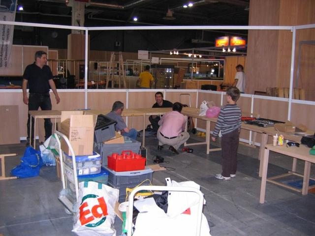
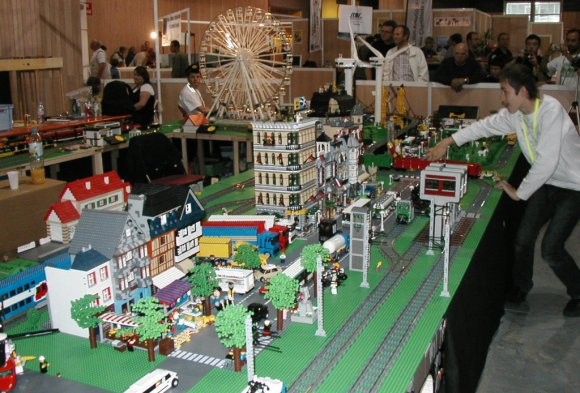
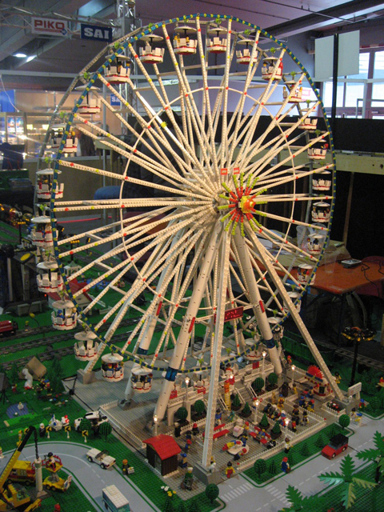
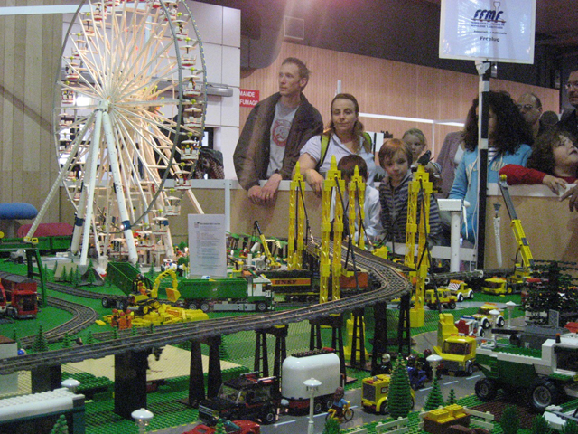
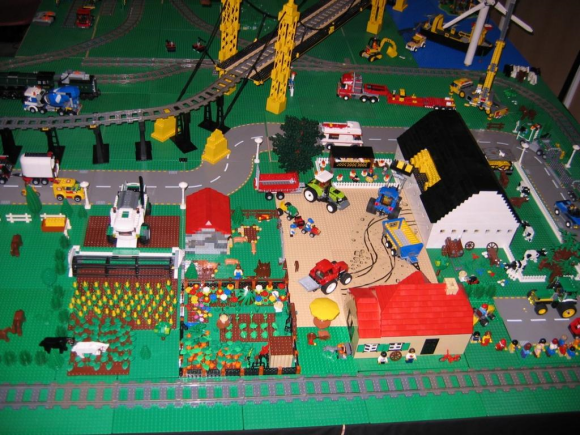
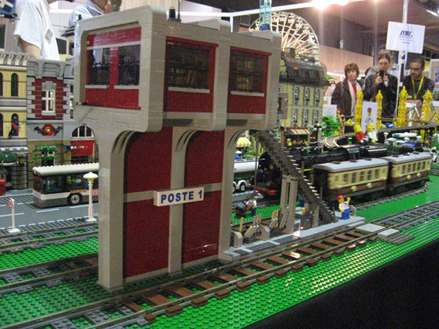
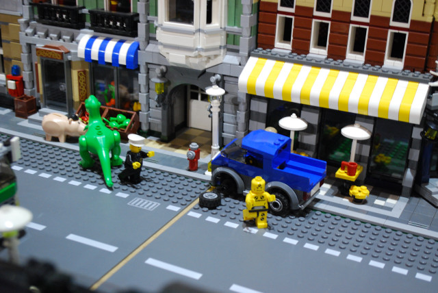
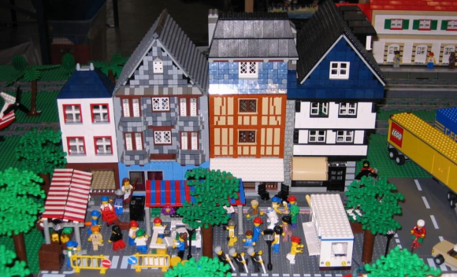
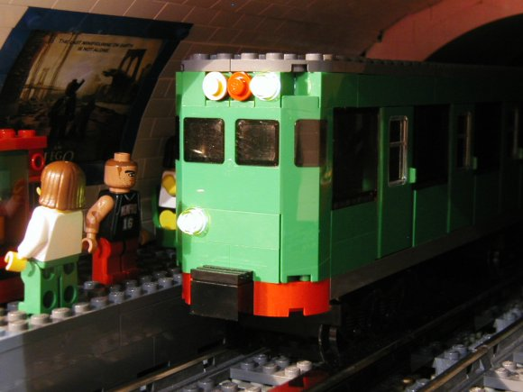
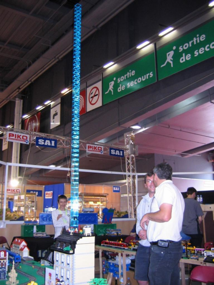

C’était la trentième édition pour ce Mondial qui revenait cette année à la Porte de Versailles de Paris.

Nous étions invités cette année, comme pour nos précédentes participations, par la FFMF - Fédération Française de Modélisme Ferroviaire.

Comme toute exposition, cela a commencé par le montage, instant rarement photographié... Nous nous sommes mis à construire les tables. Puis au fur et à mesure de l’arrivée des participants, le réseau a pris forme et nos réalisations sont venues agrémenter l’ensemble.

**Montage - mercredi 16 juin**

22H30, il était temps de quitter le Hall. Rendez-vous le lendemain matin pour le premier jour d’exposition.

Les quelques "anciens" présents dans cette exposition ont été heureux de pouvoir se reposer sur Christophe et Richard qui ont assuré comme des "pros" l’organisation de notre stand. C’était d’autant plus appréciable car cette nouvelle édition a été prise en charge, coté "Commissariat Général" du salon, par une nouvelle organisation, qui est à l’origine du retour du "Mondial du Modélisme" sur la Porte de Versailles.

Nous avons été heureux d’apprendre qu’un contrat de 3 ans avait été passé entre l’organisateur et les gestionnaires du parc de la Porte de Versailles afin que les 2 autres prochaines éditions se tiennent également au même endroit.

Il a été important de constater lors de cette reprise avec cette nouvelle organisation, que nos amis de la FFMF ne nous avaient pas oubliés et qu’une nouvelle fois notre diorama se trouvait au coeur de leur espace d’exposition.

Parlons justement de ce diorama.

Il était principalement constitué de modules présentés par les adhérents suivants.

## Denis (Grande roue)

**Grande Roue**

## Christophe (Pont suspendu)

**Pont suspendu**

## Daniela (Ferme)

4 jours d’exposition avec un réseau de train qui n’est pas mon point fort. Très peu d’exposants pour gérer le stand les jeudi et vendredi, donc forcement, j’appréhendais le déroulement. Heureusement nous avons eu de l’aide de dernière minute avec Julie (merci beaucoup) et le jeune Nicolas, un "pro" du train d’un stand voisin.

Les nombreuses visites aussi bien Freelugien (Virginie) mais aussi de gens que j’avais rencontrés à Cholet et à Saint-Martin-les-Champs m’ont fait plaisir. Un public très intéressé et curieux m’a fait oublier, que dans une semaine il y aura Fana’briques et que mes vignettes de jeux n’étaient pas encore terminées. Mon projet d’une grande ferme avance doucement et a été apprécié du public pour ses nombreux détails. En bonus j’avais le privilège de monter le set 10211 (Le grand magasin) de Thaaz, qui en avait besoin pour Fana’briques. Merci à la FFMF pour son accueil et particulièrement à Véronique.

## Richard (Poste d’aiguillage)

Étant venu en train de Lille pour être récupéré ensuite par Christophe et Daniela à la sortie de la Gare du Nord dans une voiture déjà bien chargée, mon apport était limité en volume et taille. C’est pour cela que l’on retrouve mon poste d’aiguillage ressorti pour l’occasion, accompagnant ma 141 R 840 et le petit locotracteur italien "La Sole" réalisé à l’AG 2010.

**Poste d’aiguillage**

Ne pouvant me libérer pour les jeudi et vendredi, je suis revenu le samedi, pour retrouver avec plaisir celles et ceux que j’avais laissé le mercredi soir et les nouveaux venus participant à l’animation de notre stand. Car comme pour les éditions précédentes, l’intérêt suscité et le succès étaient au rendez-vous. Même la presse spécialisé a fait écho de notre participation à ce Mondial !!!

## Didier (Immeubles de ville)

Pas de nouvelle réalisation en ce qui me concerne, car ma disponibilité se trouve de plus en plus réduite. Cette édition du mondial a surtout été une opportunité de présenter au public une rue constituée des sets Café Corner (10182), Brigade des Pompiers (10197), Epicerie (10185) et du Grand Magasin (10211). La partie MOC étant réduite à la Gare type Sud-Ouest déjà présentée à [Angerville](/articles/964/).

J’ai quand même trouvé un petit peu de temps pour présenter les nouveaux trains City et Toy Story, motorisés en 9V pour l’occasion.

Il y avait également quelques Minifig sélectionnées à l’aide de la méthode "Code Barre" afin de donner vie à tout ça.

## Erik (Station de Métro et maisons anciennes)

Comme pour les autres expositions en cette période, mon manque de temps pour la préparation m’a poussé a ressortir des cartons mes trois maisons lannionnaises. Sur l’espace adjacent, j’ai réalisé un héliport pour y mettre les nouveaux hélicoptères pompier et taxi.

Enfin, la zone ayant été élargie sur place par rapport au plan initiale, j’ai improvisé une vigne façon Tribolego.

Sous terre, j’ai placé ma station de métro parisien, remise en état après un passage post-apocalyptique, dans laquelle stationnait une reproduction d’une [rame Sprague-Thomson](http://fr.wikipedia.org/wiki/Sprague-Thomson).

Enfin, j’ai bien évidemment apporté mes trains français, notamment la rame VB2N Transilien.

Contribution modeste, sans préparation, mais il faut dire que je venais entre autre de [réceptionner les 4 cartons du LugBulk](/articles/1151/).

Mais les contributions de Jérémy, Sébastien, Jean-Claude et Gilles nous ont également permis d’assurer un montage et une tenue du stand qui sans eux auraient été beaucoup plus problématiques à assurer.

## Sébastien

Pour ma part ce fut l’occasion de rencontrer d’autres passionné(e)s de LEGO. Nous avons pu avec certains régler et caler quelques rouages pour [l’exposition de modélisme d’Orléans](/articles/1072/). A noter un beau diorama avec la ferme de Daniela, le métro d’Erik, la Roue de Denis, le pont de Christophe, qui s’est bien creusé les méninges pour réaliser ce diorama avec les souhaits de chacun.

## Gilles (Rien)

Pas de MOC pour ce salon, juste de l’huile de coude pour l’installation et de le démontage (tables et briques).  
Et quand même la mise à disposition de mes rails (j’ai réussi à tous les fournir, je ne pensais pas en avoir assez pour une telle surface, à part quelques aiguillages, comme ceux modifiés de Brice), quelques dizaines de plaques vertes, et l’éclairage utilisé à [La Ville du Bois](/articles/1032/).

Un MOC sur place avec les panels transparents reçus du [lugbulk](/articles/1151/), maintenant ils ne sont plus neufs surtout après la chute de la tour, 5 minutes après sa construction ;-). Et comme d’habitude beaucoup de plaisir d’avoir participé et beaucoup de discussions.

Il y a des trucs bizarres : cette année nous avions décliné l’offre de prêt de tables... Et bien elles étaient disponibles dès le début de l’installation. On en a pris 2 ou 3 pour s’installer plus confortablement.

Je recommande la participation, même sans construction, car les LEGO sont aussi un support à la discussion et à l’échange.

J’en ai fait encore moins pour Fana’briques ;-) Juste des plaques vertes pour la LVG et une visseuse-dévisseuse. Sauf que là-bas, sur le parking, on bronze...

* * *

## Galeries photos

**–** [Galerie d’Erik](http://photos.freelug.org/main.php/v/brickerik/expositions/2010/mondial/)  
**–** [Galerie de Didier](http://photos.freelug.org/main.php/v/La-Gallerie-de-qdm/Expositions/2010-Mondial+de+la+Maquette/)  
**–** [Galerie de Daniela](http://photos.freelug.org/main.php/v/Daniela+et+Sylv1/Expositions/2010/Mondial/)  
**–** [Galerie de Richard](http://photos.freelug.org/main.php/v/Charlie/Mondial_001/)
