Résumé de l’édition 2010

Cette cinquième édition a encore été couronnée de succès avec 5150 visiteurs. Elle se démarquait une fois de plus avec ses nombreux magasins, ses stands multiples, buvette, gravure, mais aussi et surtout par le nombre de dioramas exposés par les 85 exposants présents.

[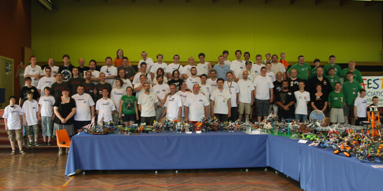](https://www.freelug.org/IMG/jpg/Art-01-28.jpg)

**Tous les exposants....**

L’association FreeLUG était présente avec des stands mais surtout avec une LGV de 35m de long et un concours "trial trucks".

## LGV

Le record de vitesse absolu est tombé, Daniel Stoeffler l’établissant avec son prototype à 1282,81 km/h vitesse LEGO soit 29,83 km/h vitesse réelle.

Le record en TGV officiel est toujours détenu par Pierre Laurenge ([établi à Saint-Rambert](/articles/1023/)). La première place dans cette catégorie pour l’épreuve de Fana’briques revient là aussi à Daniel avec son TGV Thalys avec 918,84 km/h vitesse LEGO soit 21,37 km/h vitesse réelle.

La nouvelle catégorie "rapidité au tour" revient à Jérome Tessier en prototype avec 19,336 s et à Pierre Laurenge en TGV avec 21,679 s. L’organisation considère que ce ne sont pas des records à battre, la longueur du tour pouvant varier d’une exposition à une autre.

**Trial Truck**

La victoire est allée à Guillaume/GuilliG, jeune participant du forum SeTechnic.com, qui a profité d’être seul compétiteur agréé pour emporter la victoire, et repartir avec le [camion 8041](http://www.brickset.com/detail/?Set=8041-1)

Suite à cette première, il faudra peut-être revoir le règlement si nous souhaitons renouveler l’expérience.

* * *

Bonjour les amis,

Pour ma troisième participation (2007, 2008 et 2010), je suis venu avec Thierry, Angélique, Nicolas et Mickael en minibus breton.

Cette année, j’ai amené mon bateau animé et un assortiment de trains 9v dont certains sont inconnus du public et des adhérents.

Comme mes précédentes participations, le public alsacien a apprécié nos réalisations bretonnes.

Coté organisation, un grand bravo à tous les niveaux et cette année, lors du repas, pour une fois, je suis revenu avec une grosse boîte de LEGO avec laquelle mes collègues essaieront de faire un diorama.

Coté salon, j’ai évidemment admiré des réalisations françaises et étrangères, la qualité artistique s’améliore terriblement...

Vive Fana’briques 2011, je ne serai plus seul...

à bientôt

_Jean-Marc_

* * *

L’année 2010 de Fana’Briques a été ma deuxième année d’exposition et ma troisième en tant que visiteur. Au cours de mes trois passages/participations, j’ai pu constater que l’équipe organisatrice, travaille d’arrache-pied, d’année en année afin de nous proposer une exposition toujours plus importante, toujours plus belle et toujours plus surprenante !

Pour la première fois j’ai pu montrer aux nombreux visiteurs ainsi qu’aux exposants mon Metroliner "extended", j’ai pu aussi pousser quelques trains à leur maximum grâce à la sublime LGV de Brique-à-Brac, ou encore rencontrer Eric Maugein... En bref, ce week-end 99% LEGO / 1% Gastronomie Alsacienne (quel bon souvenir ce samedi soir !) fut magnifique, je n’ai qu’une hâte, participer à l’édition 2011 sur le thème des Sapeurs-Pompiers, un domaine que j’affectionne et que je côtoie depuis 2003.

**–** [Article Fana’Briques 2010 sur BrickActu](http://www.brickactu.com/site/2010/06/fanabriques-2010-le-recit-dun-week-end-100-lego/)

_Joris_

* * *

Pour cette nouvelle édition de Fana’briques, j’ai participé d’abord à la mise en place de la LGV (une centaines de tables Bab à monter et assembler) avant d’aménager un peu de décor. Encore une fois, j’ai pu constater le gigantisme et l’ingéniosité des réalisations du duo Denis / Xavier, mais surtout l’incroyable organisation de Fanabriques (l’association) qui est parvenue à réaliser un événement de grande ampleur : rues coupées, parkings, navettes de bus... pour les visiteurs mais aussi pour les exposants, avec en point d’orgue le repas tartes flambées ! C’est toujours un plaisir de participer à cette exposition et ce le sera à coup sûr l’année prochaine !

_Laurent_

* * *

## Fana’briques 2008 : LGV. Fana’briques 2010 : LGV

Bon, la même chose mais rien de pareil. Déjà il faut apporter 100 tables plus le reste.

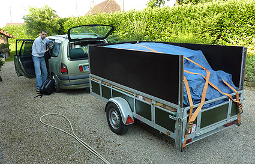

**Plus qu’un sac à faire rentrer !**

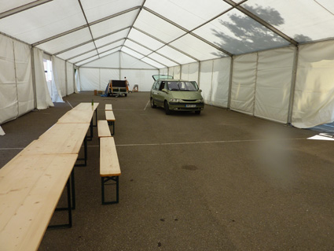

**Bon, c’est grand !**

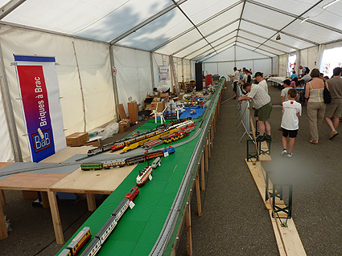

**Enfin, pas si grand que ça pour les 33m de LGV**

Alors après seulement les trains peuvent rouler sur la LGV 2 :  
**–** [ICE 7897](http://www.youtube.com/watch?v=w-SLL0P-0nQ&hd=1/)  
**–** [Maerks](http://www.youtube.com/watch?v=ocrNVBC1z-I&hd=1/)  
**–** [Panorama](http://www.youtube.com/watch?v=oLoYHABb2A4&hd=1/)  
**–** [Thalys](http://www.youtube.com/watch?v=P8zqAoyAfns&hd=1/)

Les trains et d’autres ’trucs’ pas possibles. Si si, ca roule, et même assez vite (mais pas longtemps...)

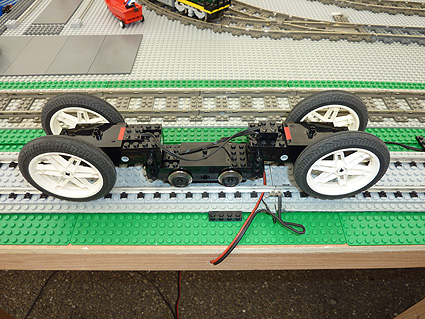

**Hum : ca ressemble à du Daniel un truc comme ça !**

Et il y a tous les autres exposants venus de toute l’Europe avec plein de MOCs aussi extraordinaires les uns que les autres. Fana’briques est bien la référence française. Je ne parlerai pas non plus de l’organisation et de l’accueil : nickel !

Allez, à la prochaine !

_cdhd_

* * *

Troisième participation pour ma part, ça a été encore un grand bonheur durant ces 2 jours... J’ai participé au layout de la LGV, j’ai réalisé un port, puis j’ai ramené mon centre commercial.

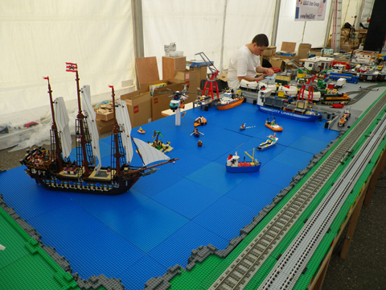

**la mer + le port**

J’ai pu aussi faire quelques runs sur la LGV, mais ce coup-ci c’est Daniel qui a été le plus fort ! Mais en repensant à cette magnifique LGV, BaB nous met maintenant à disposition une véritable piste de course pour TGV LEGO ;-)

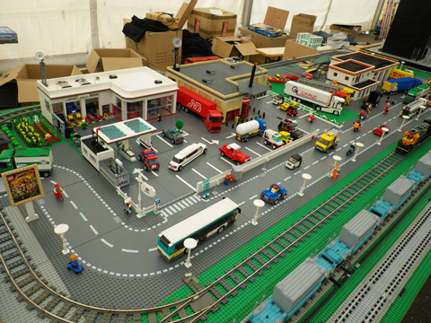

**le centre commercial**

Encore beaucoup de choses à voir, trop de choses puisque je sais que je n’ai pas tout vu... Et toujours les tartes flambées du samedi soir... un régal... :-D

Vivement l’édition 2011 !

_Pierre L./Pierrolego_

* * *

Quelques impressions personnelles :

L’édition 2010 de Fana’briques marque un tournant dans l’histoire de l’exposition avec une surface extérieure équivalente à la surface intérieure et la mise en place du village pour les visiteurs. Ainsi, on a pu voir de nombreux visiteurs prendre leur temps pour se restaurer à l’ombre des arbres à la sortie de la salle principale. A Rosheim, après la fête du munster, celle de l’escargot, voilà maintenant la fête du LEGO.

Il est difficile de résumer un tel week-end en quelques lignes ; aussi, je vais me limiter à quelques flashs (tout personnel) dans l’ordre du cheminement dans l’exposition :

1\. Stand "Espace 6:1" : projet complexe débuté en octobre 2009 formidablement réalisé par les membres de l’association ([article hexamodèles](http://fanabriques.free.fr/index.php?conect=&action=articles&catid=1&scatid=&artid=81)).

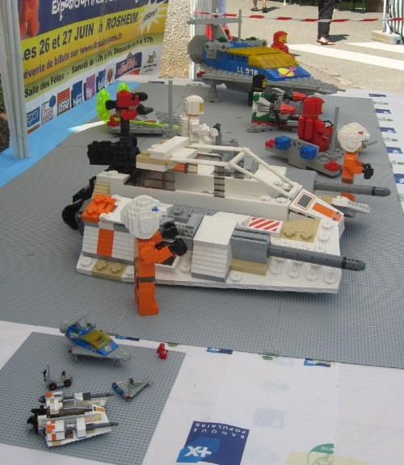

**Hexamodèles**

Layout hexamodèles de l’association Fana’briques

2\. LGV2 et Stand FreeLUG sous chapiteau : la formidable LGV2 de BaB avec virages en dévers (résultat de discussions lors de l’exposition de Saint-Rambert 2009) et le layout multi-thèmes des membres de FreeLUG.

3\. TGV Thalys : pour mon premier TGV, j’ai choisi de réaliser une version commerciale du train Thalys comportant 10 véhicules (3 mètres 40 de long) et 13 moteurs calibrés spécialement pour la LGV2 ([article plus complet](http://fanabriques.free.fr/index.php?conect=&action=articles&catid=2&scatid=&artid=120)).

4\. Le concours "création par les enfants" du dimanche matin : plus de 80 participants ont exposé leur création de plus en plus imposante sur plus de 20 mètres de tables ([article bilan](http://fanabriques.free.fr/index.php?conect=&action=articles&catid=2&scatid=&artid=131)).

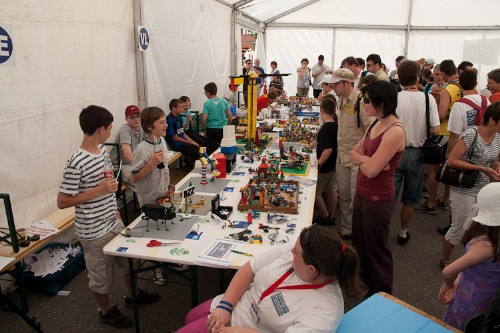

**Concours enfants**

Concours enfants du dimanche matin (photo Marc K.)

5\. Les stands Technic avec les imposantes grues : grande nouveauté de cette édition, la participation massive des forums Technic (SeTechnic et Brictechnic).

6\. Les stands de ma petite famille : premier stand de mon épouse avec le village de montagne été/hiver et de mon fils sur le thème Pirate.

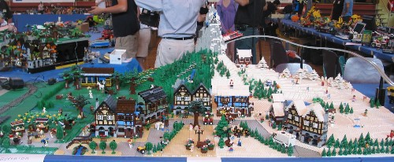

**Layout Clara**

Layout village de montagne été/hiver de Clara S.

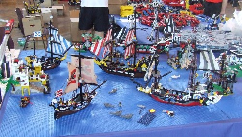

**Layout Alex**

Layout Pirates contre flotte impériale de Alexandre S.

7\. Le coin DUPLO pris d’assaut par les plus jeunes de nos visiteurs.

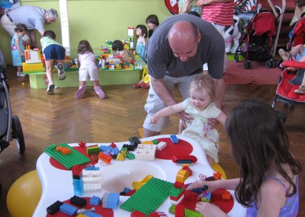

**Coin DUPLO**

L’espace DUPLO avec les futurs exposants de l’édition 2031.

8\. Le "village" qui a fait le plein pendant presque tout le week-end.

9\. Le gros cochon tirelire échelle 4:1 à la sortie faisant office d’urne pour le parcours du détective.

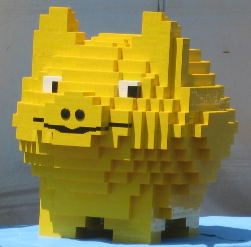

**Cochon tirelire**

Urne du parcours du détective correspondant à une tirelire réalisée à l’échelle 4:1 par rapport à la version originale conçue par Tobias Reichling.

10\. L’organisation impeccable dirigée par Thierry.

Je ne peux souhaiter qu’une chose : que l’Édition 2011 soit autant une fête que l’a été l’édition 2010.

_DanSto_

* * *

Pour cette cinquième édition, nous avions choisi le thème : L’espace.

Nous n’avons pas atteint le septième ciel, mais nous nous sommes fait plaisir.

Le beau temps, le public nombreux, des constructions incroyables, un vrai village détente avec restauration et magasins, tout était réuni pour faire une grande et belle fête.

N’hésitez pas à consulter l’article sur le site de  
[Fanabriques](http://fanabriques.free.fr/index.php?conect=&action=articles&artid=117&catid=2&langue=fr).

Encore merci à tous les exposants et tous les bénévoles pour leur participation.

Nous nous retrouverons en juin 2011 pour mettre le feu ! Enfin p’tet pas car les pompiers seront là.

Vous l’aurez compris, le thème 2011 sera : Les pompiers.

_Thierry_

* * *

Et de 3 ! Cette fois c’est pour un diorama ambiance Space Pirate. J’ai pu m’installer sur un emplacement suffisamment grand, même si je m’étais trompé au début ! La mise en place des plaques s’est faite entre beaucoup de discussion avec les AFOLs déjà présents dans la salle et aussi après un bon repas servi après quelques heures de route.

Nous avons dormi pas très loin de la salle. Le parcours à pied était très intéressant pour prendre des idées pour de futurs modèles. Peut être la ville de Rosheim une prochaine fois !

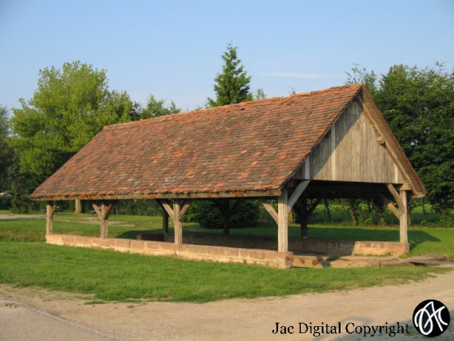

**Un très beau lavoir juste à côté de la salle.**

J’ai pu admirer aussi les superbes vaisseaux de Nico, qui ont pu avoir une très belle place face aux vaisseaux pirate de ma base. La bataille a été rude durant le week-end.

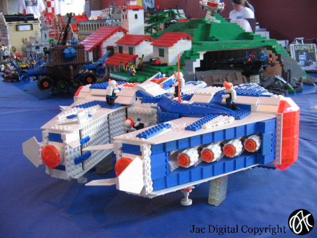

**Dure bataille !!!**

Juste en face de moi, la présence de l’île pirate de Mickael a fait sensation. Faut dire que le moindre tenon sert à une animation !

Ce week-end est d’ailleurs mémorable comme toujours, avec les tartes flambées, les concours de montage de sets et puis les runs interminables, jusqu’à minuit, peut être plus le samedi soir.

Je regrette juste que mon prototype n’ait pas pu rester plus sur les rails. Mais, ce n’est que partie remise...

_Jérôme/JAC_

* * *

## 835 km pour aller à Rosheim

C’est vous dire combien de fois, nous avions entendu même au fin fond de notre Cotentin (50) !  
**–** « Brigitte, Alain il faut voir cela ! »

Oui il faut voir, Que du beau ! Des artistes tous des passionnés, ces exposants.

Nous étions dans la catégorie "on veut bien aider".  
Vendredi matin notre ériba de suite accueillie et agréablement stationnée, nous découvrons l’étendue de la manifestation mais c’est bien la convivialité qui nous a séduit.

Nous n’exposions pas. Mais pipelette comme je suis... je me suis attardée un mot par ci, par là "Blabla LEGO"  
Ce week-end est passé si vite que j’ai, comme beaucoup la sensation d’avoir encore plein de choses à découvrir en 2011.

Pour mes petits plaisirs/souvenirs personnels j’ai fait graver des briques pour mes amis normands.  
Incroyable patience de ces commerçants souriants devant l’affluence des visiteurs. Chapeau.

Et mon Alain ? Ravi il a participé, parking, surveillance porte/sortie DUPLO, montage/démontage des tables et jolie promenade avec Marc à Obernai et j’en oublie.

Pour l’an prochain, Thierry je réserve une casquette FANA pour mon homme. Il fait chaud en Alsace !

_Brigitte et Alain EURY (FreeLUG)_

* * *

Encore une très belle réussite que cette édition 2010.  
Magnifiques organisation et innovations dans les animations.

En ce qui concerne ma participation, c’est la grande roue qui est venue s’installer à Rosheim pour ces 2 jours de fêtes.

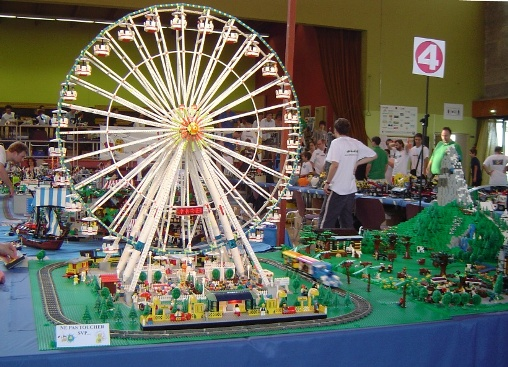

**La grande roue de Rosheim**

Le fameux petit train de Didier (Qdm) ajoutait joliement sa touche festive.

A bientôt.  
_DenisL_

Photos d’ambiance...

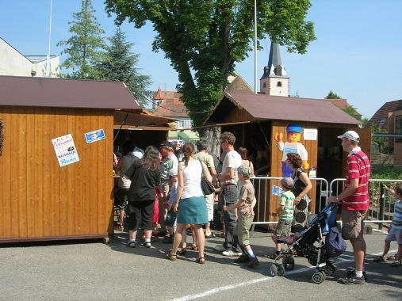

**On s’y presse !**

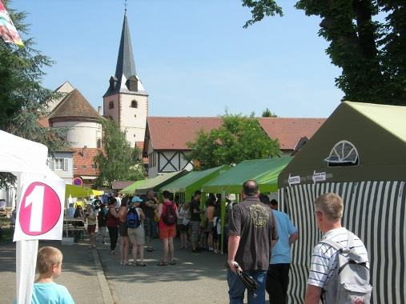

**Les boutiques**

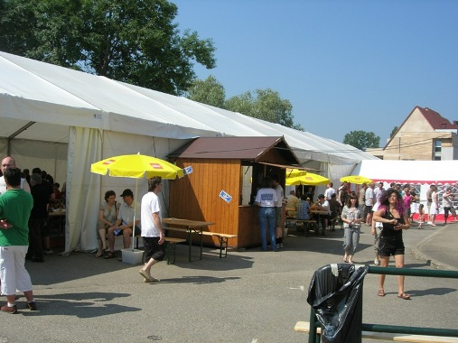

**Chapiteau**

* * *

## Galerie photos

**–** [Galerie de JAC](http://photos.freelug.org/main.php/v/JAC/Exposition/Expositions2010/Fanabriques/)  
**–** [Galerie d’Erik](http://photos.freelug.org/main.php/v/brickerik/expositions/2010/fanabriques/)  
**–** [Galerie de Daniela](http://photos.freelug.org/main.php/v/Daniela+et+Sylv1/Expositions/2010/Fana/)  
**–** [Galerie de Xavier Duvert](http://photos.freelug.org/main.php/v/XavierD/Fanabriques+2010/)  
**–** [Galerie de Pierre L.](http://photos.freelug.org/main.php/v/pierrel/exposition/2010/fanabriques10/)  
**–** [Galerie de DanSto](http://photos.freelug.org/main.php/v/DanSto/Evenements/Fanabriques_2010/)  
**–** [Galerie de Laurent](http://photos.freelug.org/main.php/v/LaurentT/Expositions/Fanabriques+2010/)
