Pour explorer les fonds marins, nos valeureux plongeurs possèdent un large choix de véhicules.

Référence : 8059  
**–** Nom : Le tout-terrain des profondeurs  
**–** Nombre de pièces : 119  
**–** Prix : 14,90€ sur le [S@H](http://shop.lego.com/ByTheme/Product.aspx?p=8059&cn=616&d=70)

Seul véhicule à roues de la gamme, ce tout-terrain a pour mission l’exploration des fonds marins.

Découvrons le sans plus tarder.

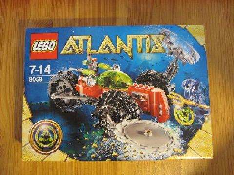

**La boite**

La face avant de la boîte nous montre le modèle ainsi que le type de clé présente dans le set, tandis que la face arrière nous indique les différentes fonctions du véhicule.

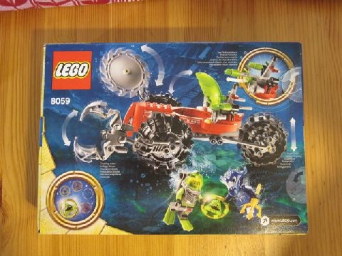

**L’arrière de la boite**

A l’intérieur de la boîte, un sachet, deux roues en vrac, la notice et bien sûr la planche d’autocollants.

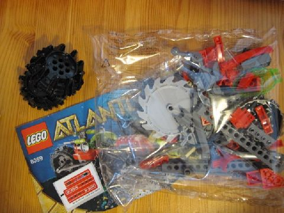

**Le contenu**

Passons au montage,

Etape 5, le châssis poutre du tout-terrain est en place

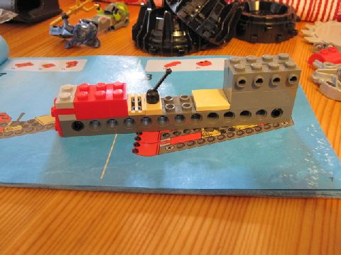

**Etape 5**

Etape 10, on commence à distinguer la carrosserie future

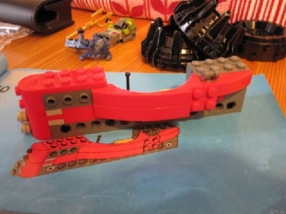

**Etape 10**

Etape 14, le coté gauche est fini.

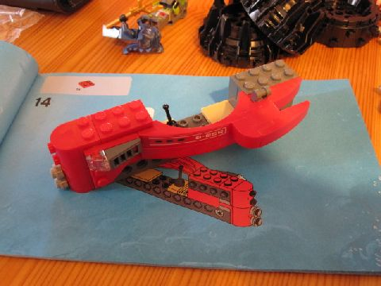

**Etape 14**

Etape 20, c’est au tour du coté droit

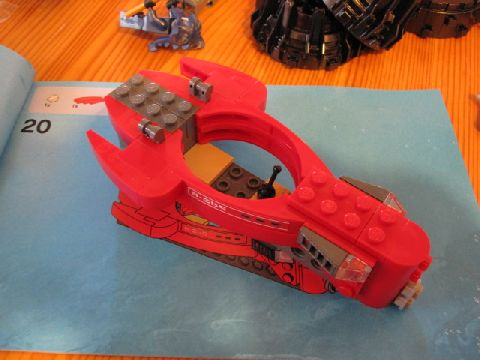

**Etape 20**

Etape 26, le cockpit est en place

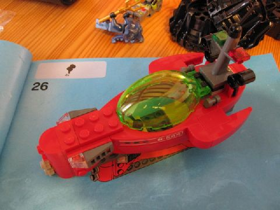

**Etape 26**

Etape 28, Installation de l’équipement, deux torpilles et deux projecteurs pour les recherches nocturnes

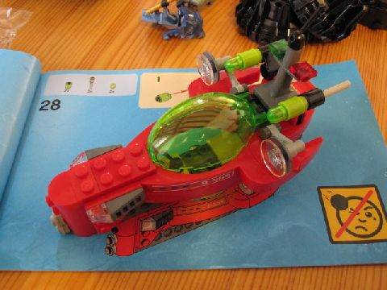

**Etape 28**

Etape 29, Mise en place des roues, avec suspension à barres

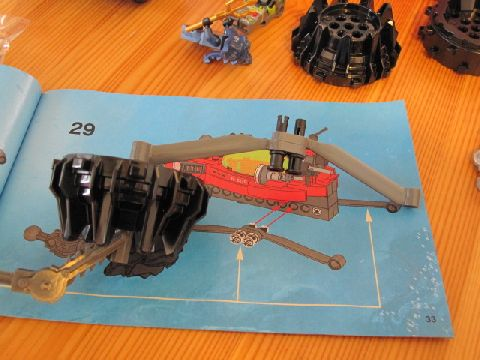

**Etape 29**

Etape 30, le véhicule est prêt pour l’aventure avec sa pince et sa scie rotative.

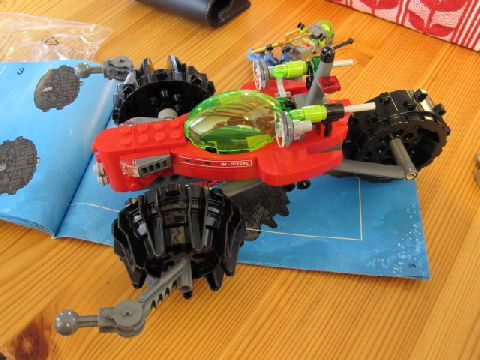

**Etape 30**

Le capitaine Ace Speedman sera le pilote de cet engin.  
Outre l’équipement habituel des plongeurs d’Atlantis, il possède comme les autres personnages de la série une tête double face.

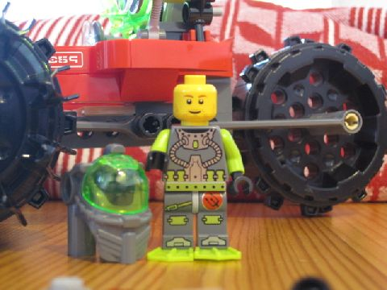

**Face 1**

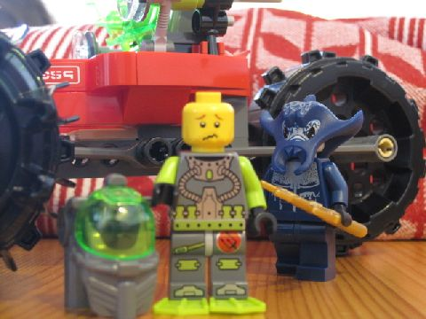

**Face 2**

Le rôle du méchant est tenu ici par un [guerrier Manta](/articles/1065/)

En route pour Atlantis...
