Pour livrer les boîtes LEGO dans les magasins Toy’R’us, TLC a dérivé le set 3221. De couleur jaune à l’origine, le camion passe au blanc et bleu.

**–** Référence : 7848  
**–** Nom : Le camion LEGO City "Toys’R’us"  
**–** Nombre de pièces : 355  
**–** Prix : 29,90€ chez Toys’R’us (exclusivité)

Pour rappel, le modèle de "série" (réf [3221](http://www.brickset.com/detail/?Set=3221-1)) comporte 278 pièces et est au prix de 24.90€ sur le LegoShop.

## La boîte

La face avant représente la scène d’une livraison avec le camion, le magasin, les quelques jouets et les trois minifigs. La face arrière montre l’intérieur du magasin, l’arrière et le coté du camion et quelques boîtes aéroport.

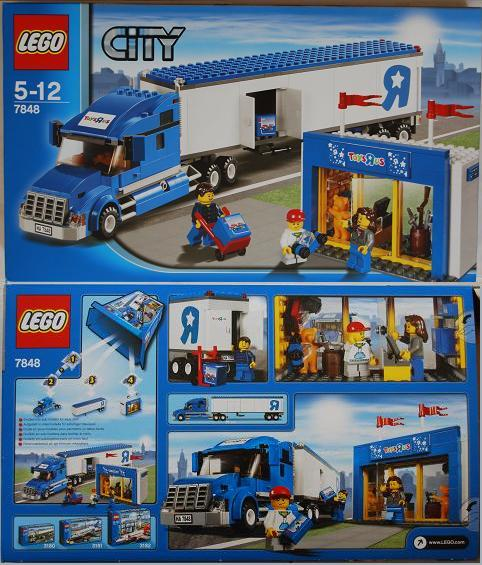

## Le contenu

La boîte est composée de 4 sachets et 2 notices, 2 plaques (6x16), une plaque de base (8x16) et une planche d’autocollants.

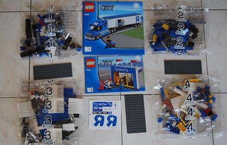

Le montage s’effectue en trois grandes étapes :  
**–** Le tracteur (2 sachets, notice 1)  
**–** La remorque (1 sachet, 2 plaques, notice 1)  
**–** Le magasin (1 sachet, 1 plaque de base, notice 2)

## Montage du tracteur

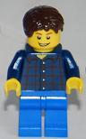

Le montage du tracteur se fait en 2 parties :  
**–** Le châssis (sachet 1)  
**–** La cabine (sachet2)

Le montage du tracteur commence par le montage de la minifig du chauffeur.

Après quelques étapes, on se fait rapidement une idée sur la taille de l’engin.

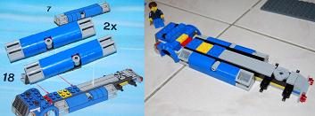

A noter la présence de 2 plates 2x6 avec trous, assez rare sur un set City.

Remarque : les clignotants de couleur orange sont plus foncés que dans les autres sets et que ceux de la remorque.

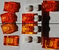

En haut :  
**–** Plate 1x1 orange (TrDkOrange) du set 7848.

En bas :  
**–** Plate 1x1 et slope 1x1 2/3 orange (TrDkOrange) issues des sets 7641 et 7945

L’étape 18 comporte 7 sous étapes pour construire les pontons latéraux. La particularité est que la notice propose de monter les deux pontons de façon identique (X2), ce qui provoque une dissymétrie une fois placés sur le châssis. J’ai directement modifié le montage pour retrouver cette symétrie.

Après l’étape 18 le châssis est terminé, on passe donc au montage de la cabine. Celle-ci bien que simple de conception est plutôt bien agencée :  
**–** Poste de pilotage  
**–** Tablette pour le café  
**–** Couchette  
**–** Télévision

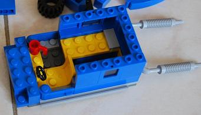

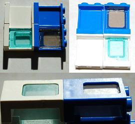

A noter que les fenêtres et les cotés de la cabine utilisent des panels 2x1x2 différents de par le passé. En effet, les vitres ne sont plus affleurantes, elles sont plus grandes et un rebord est présent sur les cotés du panel.

Les panels bleus sont les modèles actuels, et les blancs, les anciens modèles

Outre par les portes, un accès rapide à la cabine est facilité par le toit qui est articulé sur toute la longueur.

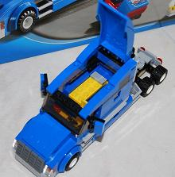

Voila pour le tracteur :

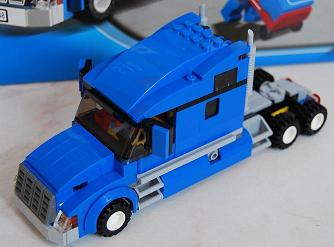

**Voila pour le tracteur :**

## Montage de la remorque

La remorque est de conception relativement simple :  
**–** 2 plaques de 6x16 pour le plancher  
**–** Des panels (4 par coté) de 6x1x5 et des portes de 3x1x4 pour les cotés  
**–** Deux portes 3x1x4 pour l’arrière  
**–** Un panel pour l’avant

Des traverses en 2x6 plates viennent renforcer la structure.

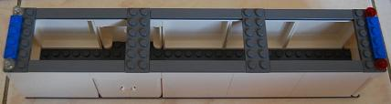

La remorque est couverte par un toit bleu en 6x10 plate.

Bien que les panels soient creux, la largeur maxi pour le chargement sera de 4 tenons.

Sous la remorque, il y a le système d’accroche, les patins pour pouvoir dételer et le train arrière.

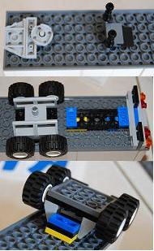

  
— Système d’arroche et patin pliant

— Train arrière avec un système d’accroche permettent aux 4 roues de toujours toucher le sol.

Il ne reste plus qu’à atteler la remorque sur le tracteur.

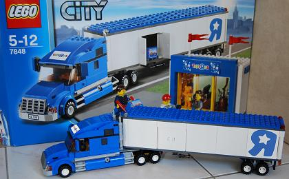

_Nota : sur la photo ci-dessus, les autocollants ont été ajoutés par photomontage_

## Montage du magasin

Le magasin, particularité de ce set par rapport au set 3221, représente un Toys’R’us. Il est assez simple mais s’intègre parfaitement aux autres sets City actuel (même format).

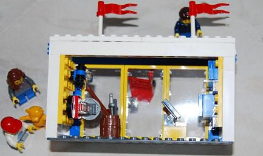

Il est composé de :  
**–** 1 panel blanc avec 2 grilles bleues par coté  
**–** 1 porte 4x1x6 et 2 fenêtres 4x1x6 sur la face avant  
**–** 2 présentoirs, un tonneau et une caisse à l’intérieur  
**–** 2 minifigs (une vendeuse et un enfant)

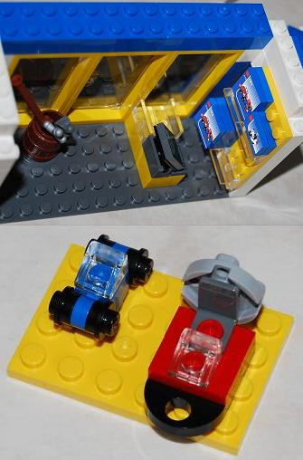

Présentoir LEGO :  
**–** la caisse  
**–** un tonneau :  
— 1 sabre,  
— 1 fusil  
— 1 épée

Présentoir jouet :  
**–** une voiture RC et un aéroglisseur

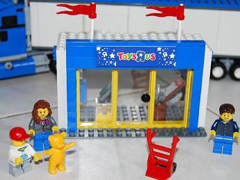

_Nota : sur la photo ci-dessus, les autocollants ont été ajoutés par photomontage_

## Conclusion

_Nota : sur la photo ci-dessous, les autocollants ont été ajoutés par photomontage_

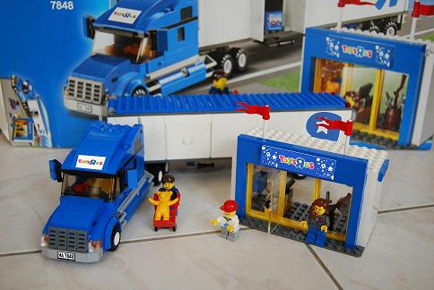

Le camion est sympa à monter, la cabine est bien détaillée, le magasin bien que petit est complet (différents jouets, boîtes LEGO, présentoirs...).

Le magasin peut parfaitement s’intégrer à une ville format minifig (même taille que la pizzeria, marchand de cycles...).

J’ai cependant quatre petites remarques :  
**–** Le camion et sa remorque sont un peu longs pour les routes des plaques de base  
**–** Les roues du camion sont un peu petites par rapport au reste (c’est plus des roues de camionnette ou de 4x4)  
**–** Les portes de la remorque sont plus petites que les panels et obligent à mettre une brick (1x6x1) au dessus  
**–** Très peu de boîtes LEGO à livrer (9 boîtes dans le set 3221 et 3 dans celui-ci)

Les pièces en plus dans le set :

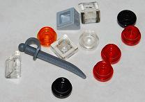

  
**–** 2 plates rondes noires  
**–** 3 plates rondes tr rouges  
**–** 1 plate ronde tr orange  
**–** 1 plate ronde tr blanches  
**–** 1 plate carrée tr blanche  
**–** 2 slopes tr blanches  
**–** 1 slope gris claire  
**–** 1 épée

La planche d’autocollant :

**La planche d’autocollant**
