Cette année, la REF2010 était organisée par Brigitte qui nous avait trouvé une très belle salle à Domjean dans la Manche (50), pour le week-end du 24 et 25 juillet.

La visite du très beau village fleuri de Domjean valait le coup d’oeil. Mais ce n’était pas la seule chose de prévue durant ce week-end de rencontre AFOL : tournoi, concours de construction, crash test, drafts, exposé sur le fonctionnement d’un moulin moderne, mosaïque et excursions touristiques étaient entre autres au programme.

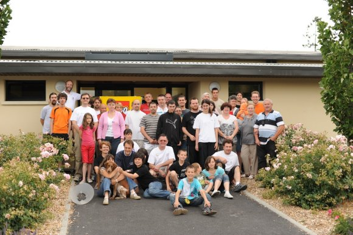

* * *

Salut tout le monde,

Après 3h 20mn 59secondes et des poussières de route, je suis arrivé à la luxueuse salle des fêtes du village bien fleuri de Domjean, mais avant, j’ai croisé une drôle de banderole : "Apéro géant" dans un petit village normand ? Ils ont Facebook ! les villageois font forts...

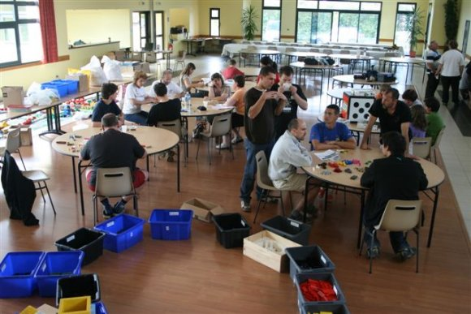

Revenons à la REF, je suis accueilli par Erik le prez flanqué de sa secrétaire du week-end, Daniela et de son sous-secrétaire, Sylvain junior, les parents d’Erik arrivèrent ensuite.

Pas de trace de Brigitte et d’Alain et pour cause, organisation oblige...

Plus tard, les normands, auvergnats, envahissent petit à petit la place à une heure très tardive. Puis arrivèrent le lendemain, les parisiens, les alsaciens, les beaucerons, les rennais, les nantais...

Pour ma part, j’ai déballé mon petit bazar : bateau animé, encore ! diront certains, rassurez-vous, c’est pour Thierry, Eliane et ses enfants qui ne l’ont pas vu depuis 2 ans et les nouveaux membres, j’ai amené aussi par hasard ma Z 850, automotrice de montagne... A défaut de suivre la conversation avec les autres, j’ai expliqué (voir photos) en long et en large mon diorama animé très prisé. J’ai admiré les autres créations sans participer aux jeux de société , trop fatiguant pour mes yeux, même chose pour l’exposé très fariné de JAC, excuse-moi...

En conclusion, REF très plaisante et BRAVO aux organisateurs...

_Jean-Marc qui arrête son monologue_

* * *

Bonjour tout le monde

C’était notre première REF, donc je ne vais pas comparer par rapport aux autres, mais c’est avec plaisir que nous reviendrons à la prochaine. On a pu rencontrer beaucoup de membres sympathiques, profité d’une très belle organisation (merci aux organisateurs) et on s’est vraiment beaucoup amusé. Mais la prochaine fois, je prends le camping que s’il n’y a pas de soirée dans le coin et de coq pour nous réveiller... L’après-midi de samedi était elle aussi agréable (surtout pour ceux qui sont moins fans de LEGO), mer pas trop froide, glace bien crémeuse et musée sympa.

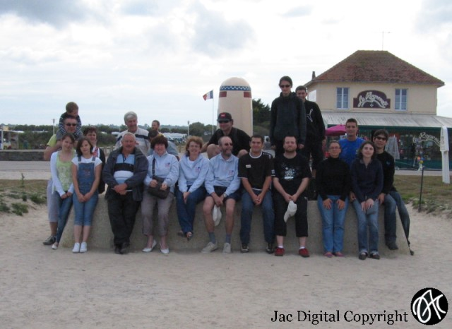

**Les afols à la mer...**

Bref c’est un weekend qui est passé trop vite, reste une petite année à attendre.

_Rémi B_

* * *

Bonjour,

Première année comme membre de FreeLUG, première REF et des rencontres avec des passionnés des LEGO. Découverte de mondes LEGO que je connaissais pas !! Moi qui ne "joue" qu’avec des briques 2x2 et 4x2 !

Merci à tous ceux qui ont participé pour créer la fresque et surtout à votre aide efficace pour la démonter et la trier. Cette partie du travail est la moins intéressante et j’apprécie donc votre aide.

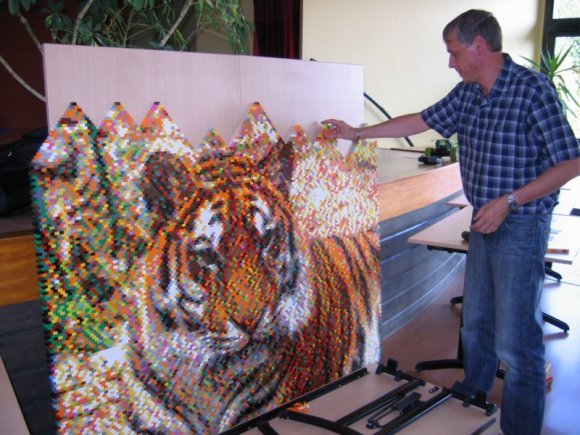

**Simon devant une mosaïque en cours de montage à Domjean en 2010**

J’ai rêvé de LEGO pendant les 3 nuits suivantes ! Il faut dire que je n’ai pas quitté la salle et ai fait un week-end exclusivement autour du LEGO !

Merci pour ce beau week-end avec une ambiance super sympa et une organisation sans faille !

Par contre j’ai été nul en photo et apprécie grandement toutes vos galeries photos !

A une prochaine...

_Simon P._

* * *

Pour cette année, nous avions décidé de faire du co-voiturage depuis Randan. De plus, nous devions aussi assurer la livraison de deux commandes groupées. C’est donc avec 4 personnes à bord et une remorque bien chargée de boîtes LEGO que nous arrivons enfin à Domjean, après 6h de route. Malgré l’heure tardive, nous étions attendus par Erik, ainsi que Pascal et Médérick. Pour conserver la remorque et son contenu, nous l’avons rentrée directement dans la salle. Désolé, Brigitte.

Une très bonne ambiance sur cette REF2010. Les activités se sont enchaînées, entre concours, tournoi et visite de la région.

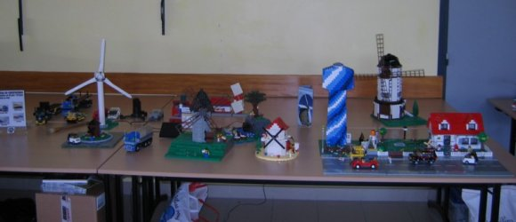

**Les moulins pour le concours**

J’ai été le seul à prendre un bain. J’en connais qui l’ont bien regretté. L’eau était à une très bonne température. Par contre, il a fallut que je me déguise pour pouvoir remonter dans la voiture de Daniel... Une bonne partie de rigolade et quelques photos supplémentaires !

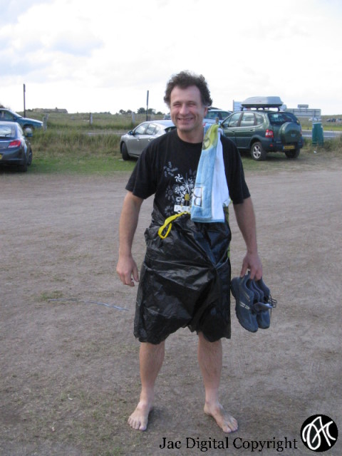

**Ma tenue ApocaLego !!!**

Merci à l’organisation qui était au top. Brigitte, on ne peut pas être au four et au moulin. Pour le record de rails Duplo, ça sera pour une prochaine REF.

_Jérôme/JAC_

* * *

Cette première REF a été, pour ma petite famille et moi, une très bonne surprise.

Il faut dire que l’organisation était de très haut niveau, tant pour la salle et les repas (impeccables), que pour l’hébergement (merci Jeanine !), ou que pour les activités LEGO (comme le draft ou les jeux de société).

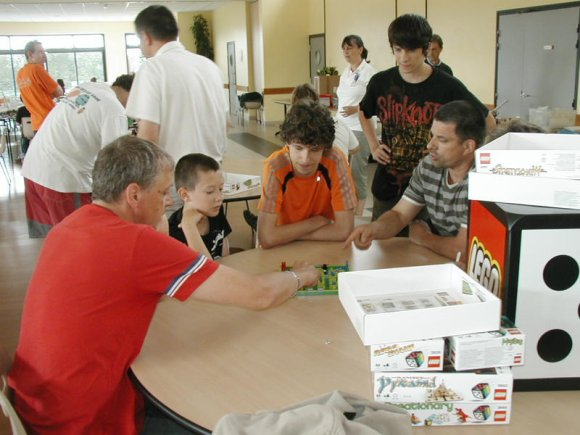

**Tournoi du minotaurus**

Mon seul regret ira pour la formidable fresque, beaucoup trop petite (15000 briques, ce n’est pas assez !) pour que nous puissions y participer après la petite balade sympa du samedi.

Un grand merci donc à Brigitte et à tous ceux qui l’ont aidée à préparer ce formidable week-end.

_Ghislain_

* * *

Organiser une REF, c’est surtout pour moi s’assurer que chacun, Freelugien ou conjoint, enfants et même parents passent un bon week-end. Pour les "Freelugiens", pas d’inquiétude, les membres du CA de FreeLUG ont accepté de louer cette très grande salle, ajoutez des briques LEGO et les voici occupés pour tout le week-end. Si en plus dès le vendredi soir les commandes LEGO sont en sécurité, c’est le top.

Je crois que dès le départ, le lieu a plu. Nous étions nombreux inscrits. De là, je n’étais plus seule, les Freelugiens, les amis amusés par ces grands enfants ont tous contribué à ce week-end.

Avec un peu de documentation sur la région, chacun s’est programmé des petites sorties d’une heure ou deux pour enfants, etc. J’en suis le témoin car j’ai plus parlé de ma Normandie que des LEGO pendant ces deux jours (c’est aussi un de mes sujets préférés !).

Pour les briques, il y avait bien plus qualifié que moi. Nous étions nombreux mais les conditions, cuisine, livraisons aliments ont grandement facilité la confection et le service des repas.

J’étais surtout inquiète de savoir qui apporterai des constructions. Cette grande salle ne serait-elle pas trop grande ? Jusqu’au bout ils ont gardé le secret... Donc très bonne surprise, chacun s’est empressé d’investir des tables et voici notre salle toute colorée de multitude de briques.

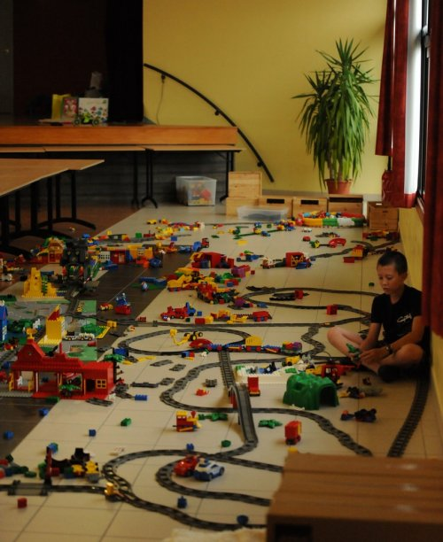

**Le coin DUPLO, après le passage des enfants :)**

J’ai été très touchée par les petites attentions de chacun  
Une ériba miniature, des minifigs, quelques bouteilles de vins, 2 beaux crustacées, des rails duplo, de la farine pour faire plein de gâteaux , de jolies sets de Bretagne, tout ce que j’oublie et les premiers LEGO pour mon ALAIN qui souhaitait le jour même, le 23/7 son anniversaire et tous deux nos fêtes et anniversaires dans la même semaine.

Ici les photos parleront pour moi.

Le scoop c’est que c’était ma toute première REF.

_Brigitte_

* * *

Et bien ce fut un week-end fort agréable. Encore trop rapide, forcement.

Je faisais parti du covoiturage partant de Randan, un peu serré dans la voiture ;-) mais le voyage a finalement été rapide grâce aux discussions et divers débats.

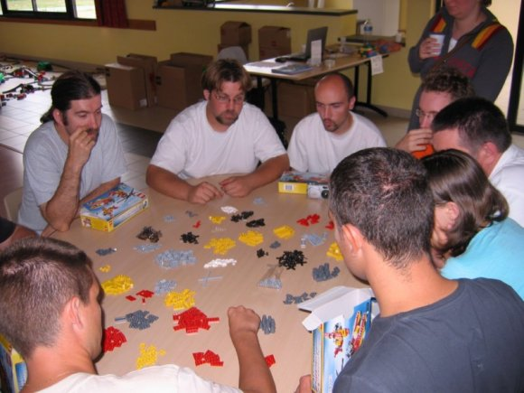

**Draft**

Après ce fut LEGO, discussions, LEGO, constructions, écoute d’un exposé, LEGO, miamiam, blablabla, promenade sur les plages du débarquement, LEGO, de nouvelles connaissances, LEGO et pis un peu de dodo...

Et sinon, elle se passe où la REF 2011...? ;-)

_Pierre L./Pierrolego_

* * *

Quelle aventure !

Pour ma première REF (deuxième en fait mais la première était en même temps que Fana’briques donc c’était bien différent) je ne suis vraiment pas déçu du voyage !

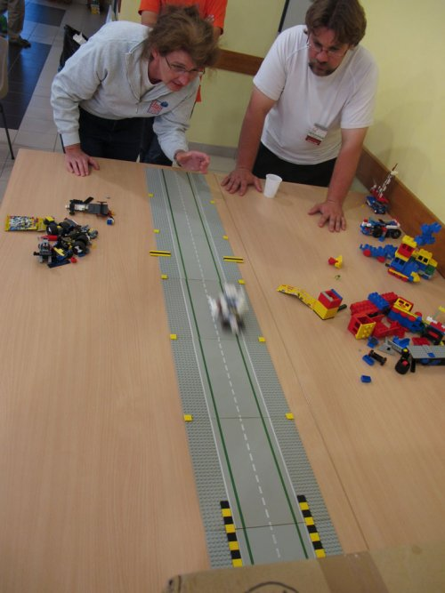

**Le crash test**

Nous nous sommes retrouvés Emilie et moi avec Pierre L. chez JAC pour "covoiturer" dans la coupée-sport de celui-ci.

Quatre jeunes dans une voiture de sport tirant une remorque pleine de boîtes de LEGO neuves (nous avions la commande groupée à livrer), heureusement que la police ne nous a pas arrêté sinon les agents se seraient posés pleins de questions !

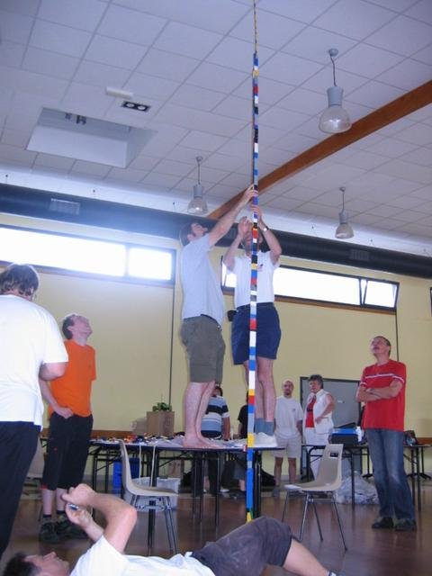

**Philo et Pascal à l’excercice de la tour la plus haute**

Le week-end était génial. Emilie et moi remercions Brigitte et tout ceux qui l’ont aidé pour l’organisation et Alain pour les visites du samedi après-midi ! Nous gardons un bon souvenir de la glace à Isigny !

Vivement l’été prochain !

_Pierre C./Tribolego et Emilie_

* * *

## Galerie photos

**–** [Galerie de Daniela](http://photos.freelug.org/main.php/v/Daniela+et+Sylv1/Expositions/2010/REF+2010/)  
**–** [Galerie de Rémi B](http://photos.freelug.org/main.php/v/Bug_s/REF10/)  
**–** [Galerie de Jean-Marc](http://photos.freelug.org/main.php/v/barr__/rencontres/REF2010/)  
**–** [Galerie de Philo](http://photos.freelug.org/main.php/v/philo/REF2010/)  
**–** [Galerie de Daniel et Béatrice](http://photos.freelug.org/main.php/v/goberville/ref2010/)  
**–** [Galerie d’Erik](http://photos.freelug.org/main.php/v/brickerik/expositions/2010/REF2010/)  
**–** [Galerie de Ghislain](http://photos.freelug.org/main.php/v/Dagobot/ref_domjean_2010/)  
**–** [Galerie de Jac](http://photos.freelug.org/main.php/v/JAC/REF/2010/)  
**–** [Galerie de Pascal](http://www.brickshelf.com/cgi-bin/gallery.cgi?f=440358)  
**–** [Galerie de Pascal sur le Crash Test](http://www.brickshelf.com/cgi-bin/gallery.cgi?f=440357)
