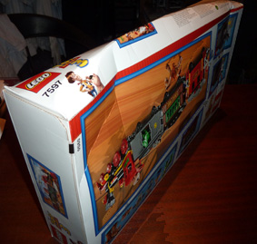
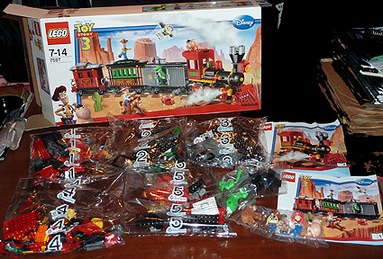
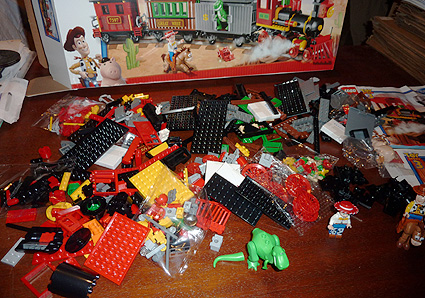
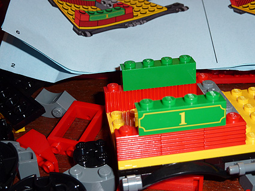
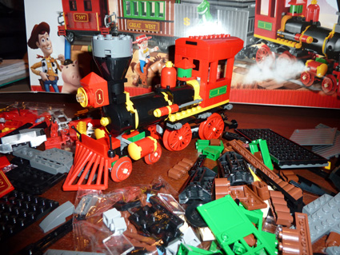
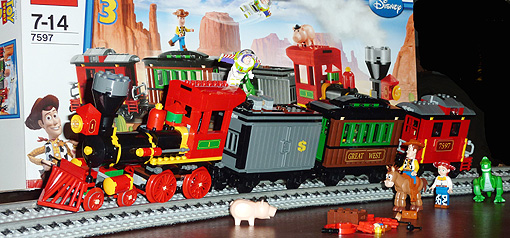

Toy Story 3, encore une licence, des boîtes chères avec pas beaucoup de pièces : jamais je n’en achèterai !

Bon, et puis le piège. Un petit tour sur un site de VPC, la boite à 70 euros. Un train LEGO pour 70 euros, ça se laisse pas trainer. Je craque !

Le colis arrive, mal calé et pas très bien emballé :

**Ca commence mal !**

J’ouvre. Plein de sachets prometteurs, pas de méta pièces, vite le trie des pièces.

**Plein de sachet, des notices : hum !**

**Bon, les pièces bien triées, c’est parti !**

Je commence donc le montage. Comme d’habitude la notice est bien faite. Je commence par la locomotive et première bonne surprise, les pièces de décoration sont sérigraphiées.

Et d’ailleurs, toutes les pièces de décoration de la boîte sont sérigraphiées. Pas un seul autocollant. On en avait perdu l’habitude.

**La locomotive**

Après la locomotive, les wagons. Il y en a trois. Je les trouve un peu court mais cela est sans doute à cause d’une métapièce qui sert de châssis. Une petite méta-pièce, certes, mais quand même !

Et voila, c’est déjà tout fini de monter.

J’ai trouvé ce modèle très agréable à monter. Le look final est très sympa. Et je me demande déjà si avec un peu plus de wagons un peu plus grands... Alors j’ai vite acheté trois autres boîtes au cas où !

**Premier run sur la LGV2.**

Un si joli train que je ne regrette pas d’avoir craqué.
