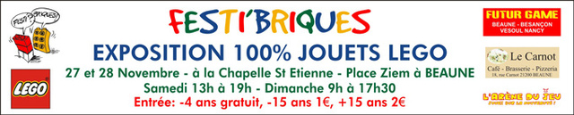
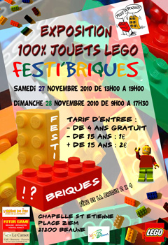

L’association Festi’briques organise sa troisième exposition **100% LEGO** les samedi 27 et dimanche 28 novembre 2010 à Beaune.

Vous pourrez y découvrir divers thèmes LEGO.

FreeLUG y sera présent.

_Lieu :_  
Chapelle Saint Etienne  
Place Ziem  
21200 BEAUNE

_Horaire :_  
**–** samedi : 13h - 19h  
**–** dimanche : 9h - 17h30

_Entrée :_  
**–** moins de 4 ans : gratuit  
**–** moins de 15 ans : 1€  
**–** + de 15 ans : 2€

FreeLUG organise une session [Crash Test](/articles/1162/) le samedi après-midi.

[Résumé de l’édition janvier 2010](/articles/1075/)
