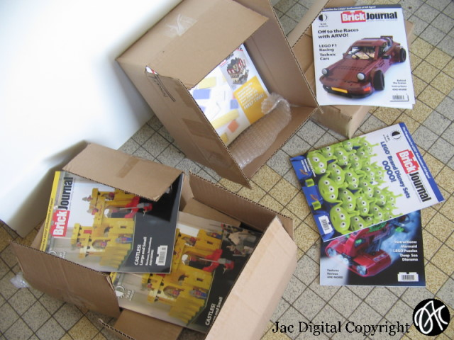

Depuis que la boutique 1001bricks a cessé de vendre le BrickJournal, il était devenu difficile d’acquérir le magazine BrickJournal en version papier. L’association a alors effectué une commande groupée des derniers numéros du magazine pour satisfaire à la demande de ses adhérents qui voulaient compléter leur collection.

Le [BrickJournal](http://www.brickjournal.com/) est une revue éditée par un passionnée de la brique LEGO, Joe Meno. A ses débuts, elle était disponible en version téléchargeable sur son site. Lors de son passage en édition imprimée aux Etats-Unis, Sylvain (1001 bricks) s’est chargé de sa distribution dans les autres pays. Mais cela lui donnait trop de travail, par rapport à son entreprise de vente de pièces détachée LEGO dont la taille est encore grandissante.

Il dut arrêter la distribution après la parution du numéro 8.

Etant un fidèle lecteur, je me disait qu’il fallait faire quelque chose pour l’obtenir en France. Cela a été possible grâce à l’association.

Après un premier sondage, il est apparu que nous pouvions commander les numéros 9, 10 et 11 par 25 exemplaires, ce qui permettait un prix d’achat intéressant. De plus, nous avons ajouté la commande de quelques compendiums et numéro 8 pour ceux qui n’avaient pu les obtenir.

Sylvain connaissant bien l’éditeur s’est chargé de tout commander aux Etats-Unis. Enfin, après un agréable voyage dans le Sud, j’ai pu à mon tour récupérer les colis et me charger de la distribution.

**4 cartons pour cette commande**

Voilà une collection qui s’enrichit, avec une belle revue destinée aux AFOLs du monde entier.

Pour nos adhérents retardataires, il reste encore quelques exemplaires des numéros 9, 10 et 11 ;)
