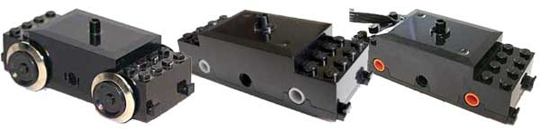
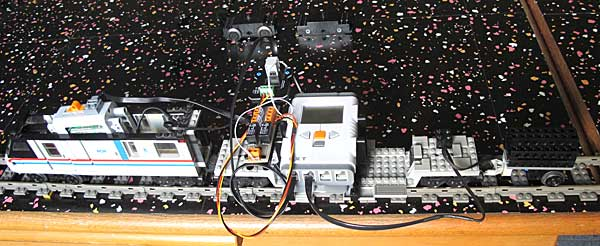
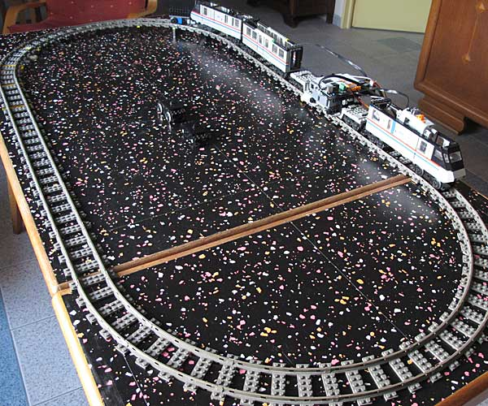
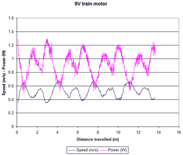
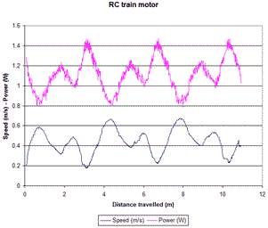
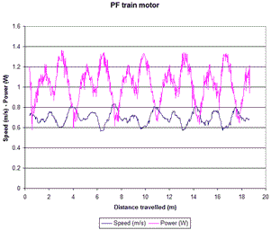
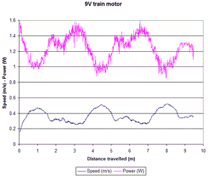
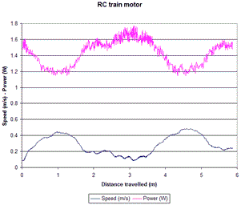
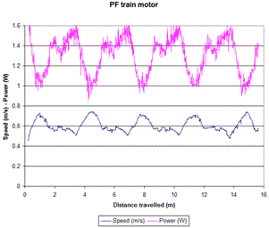
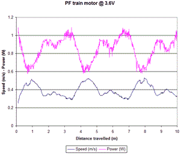

Comparaison entre les moteurs de train 9V, RC et Power Functions

**Moteurs 9V, RC et PFS**

Les [essais génériques de moteurs](http://www.philohome.com/motors/motorcomp.htm) m’avaient montré que le nouveau moteur de train Power Functions se comportait très bien, en particulier par rapport au moteur RC. J’ai donc fait un test plus approfondi en conditions réelles... Pour ce faire, j’ai embarqué sur un train un NXT équipé du capteur [PowerMeter de Mindsensors](http://www.mindsensors.com/index.php?module=pagemaster&PAGE_user_op=view_page&PAGE_id=125), chargé de mesurer en permanence la consommation du moteur.

La photo ci-dessus montre le train avec son équipement de mesure.

-   A gauche, la loco avec l’un des trois moteurs de train. Le bloc de piles fournit l’énergie au moteur et leste la loco. C’est un [bloc PFS modifié](http://www.philohome.com/alimservo/alimservo.htm) avec seulement 4 accus NiMH. Le moteur de train est donc alimenté en 5V permettant de rouler à une vitesse modérée (et de ne pas aller tout droit dans les virages !). J’ai évité d’utiliser le contrôle de vitesse en PWM car la tension hachée pourrait perturber les mesures.
-   Le wagon du milieu reçoit le NXT alimenté par batterie Li-ion, le capteur PowerMeter et une [carte de commande à relais](http://www.philohome.com/motors/measure-nxt2.jpg) que j’avais fabriquée pour mes tests de moteurs.
-   A droite, une petite voiture avec un capteur de rotation RCX sans friction permet de mesurer la distance parcourue sur la voie.
    
    
    
    La piste elle même est un simple ovale, avec l’un des virages surélevé (8 plates). La longueur de rail, mesuré au milieu de la voie, est d’environ 3.45m. Les tests ont été réalisés avec deux longueurs de trains. Le premier n’a que les trois voitures de test. Deux wagons ont étés ajoutés pour la seconde série de tests afin de stresser davantage le moteur. Tandis que le train avance, le NXT enregistre en permanence le temps, la tension, le courant et les impulsions sur le capteur de rotation. De ces valeurs une feuille Excel déduit la distance parcourue, la vitesse du train, la puissance instantanée et l’énergie consommée.
    

## Test à trois voitures

**Feuille Excel du test 3 voitures**

Le tableau ci-dessous résume les résultats. Toutes les valeurs données sont pour un tour complet.

**Comparaison des moteurs de train - 3 voitures**

|  |  |  |  |
| --- | --- | --- | --- |
| Temps par tour (s) | 6.71 | 8.23 | 5.01 |
| Dist. parcourue (m) | 3.43 | 3.44 | 3.45 |
| Vitesse moyenne (m/s) | 0.51 | 0.42 | 0.69 |
| Tension moyenne (V) | 5.40 | 5.33 | 5.38 |
| Courant moyen (A) | 0.11 | 0.16 | 0.16 |
| Puissance moyenne (W) | 0.59 | 0.85 | 0.85 |
| Energie consommée (J) | 6.30 | 9.61 | 5.21 |

-   La vitesse du train Power Functions est nettement plus élevée que celle du train 9V (+35%) et que du train RC (+64%).
-   Le train RC et le train PF consomment plus de courant que le train 9V, ce qui se traduit par une puissance instantanée consommée supérieure (+44%)
-   Mais comme le train PF parcourt le tour beaucoup plus rapidement, l’énergie consommée pour un tour est plus basse que pour le train 9V (-17%) et beaucoup plus faible que pour le train RC (-46%).

* * *

Les courbes ci-dessous (cliquer sur les vignettes pour agrandir) montrent les variations de puissance et de vitesse lors du parcours. Elles montrent un autre point fort du moteur PF : sa vitesse est beaucoup plus constante en dépit des variations de charge. Dans les graphiques on voit la chute de vitesse qui se produit dans les virages (plus de frottements). Bien sûr la vitesse chute encore plus dans le virage en montée.

La variation de vitesse est de

-   +/- 23% pour le train 9V
-   +/- 52% pour le train RC
-   +/- 17% pour le train PF

## Test à cinq voitures

**Feuille Excel du test 5 voitures**

Le tableau ci-dessous résume les résultats. Toutes les valeurs données sont pour un tour complet.

**Comparaison des moteurs de train - 5 voitures**

|  |  |  |  |  |
| --- | --- | --- | --- | --- |
| Temps par tour (s) | 9.88 | 17.22 | 5.81 | 8.98 |
| Dist. parcourue (m) | 3.44 | 3.45 | 3.45 | 3.44 |
| Vitesse moyenne (m/s) | 0.35 | 0.20 | 0.59 | 0.38 |
| Tension moyenne (V) | 5.29 | 5.20 | 5.16 | 3.71 |
| Courant moyen (A) | 0.19 | 0.24 | 0.30 | 0.26 |
| Puissance moyenne (W) | 1.01 | 1.22 | 1.54 | 0.98 |
| Energie consommée (J) | 12.70 | 26.40 | 7.72 | 7.83 |

Cette fois j’ai effectué un quatrième test, avenc une tension plus faible sur le train PF. La performance du train PF est toujours meilleure que celle des autres moteurs à tension plus élevée, mais sa consommation devient nettement plus faible.

La charge accrue met encore mieux en évidence les différences entre les moteurs.

-   Le train PF est 68% plus rapide que le train 9V, et presque trois fois plus rapide que le train RC ! Alimenté par seulement 3 accus NiMH, il est encore plus rapide que ses concurrents avec 4 accus.

-   La performance du train PF a un prix : sa consommation électrique instantanée est significativement plus élevée. Mais à tension réduite il surpasse les autres trains avec une puissance plus faible.
-   Si on compare l’énergie nécessaire pour parcourir un tour, le train PF est 40% plus efficace que le train 9V, et plus de trois fois meilleur que le train RC !

* * *

Les courbes ci-dessous (cliquer sur les vignettes pour agrandir) montrent les variations de puissance et de vitesse lors du parcours.

Ici encore les variations de vitesse en fonction de la charge est nettement plus faible pour le train PF. Le train RC est quasiment bloqué dans les virage et ne récupère que dans la descente.

La variation de vitesse est de

-   +/- 36% pour le train 9V
-   +/- 90% pour le train RC
-   +/- 15% pour le train PF
-   +/- 27% pour le train PF

## Conclusion

PF rocks !!! ( (c) Didier Enjary)
