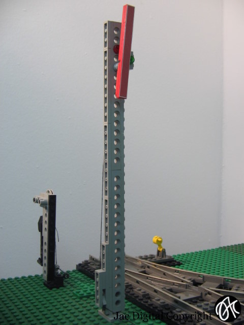
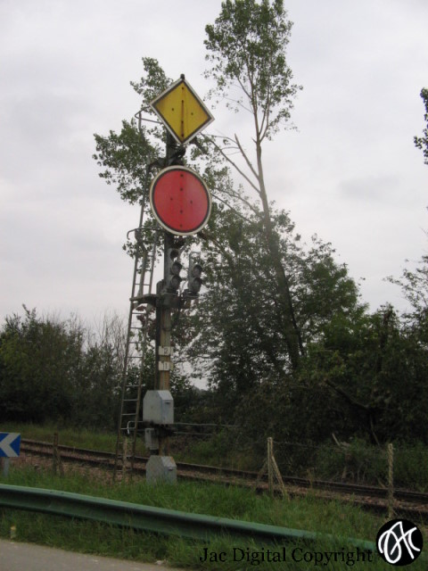
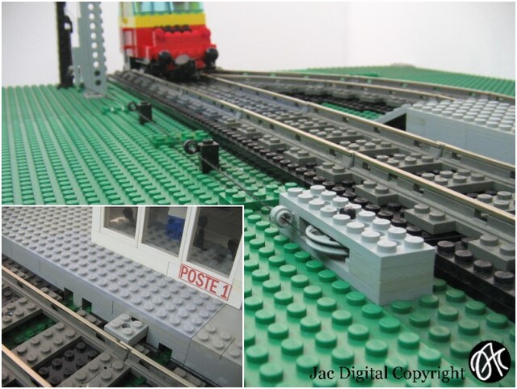
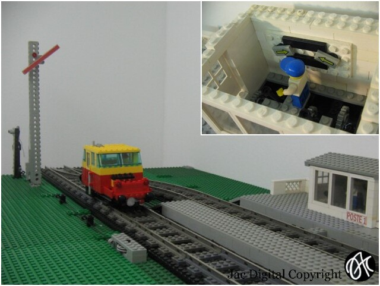
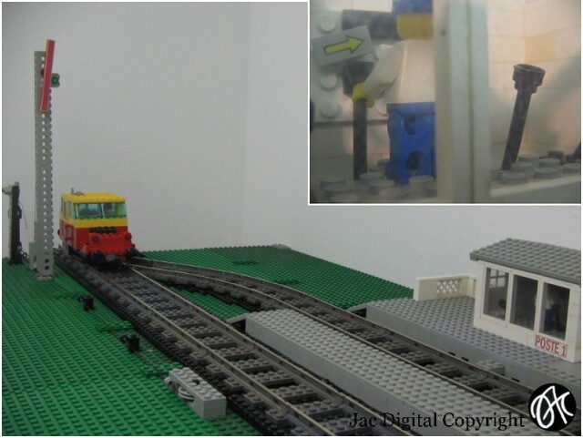
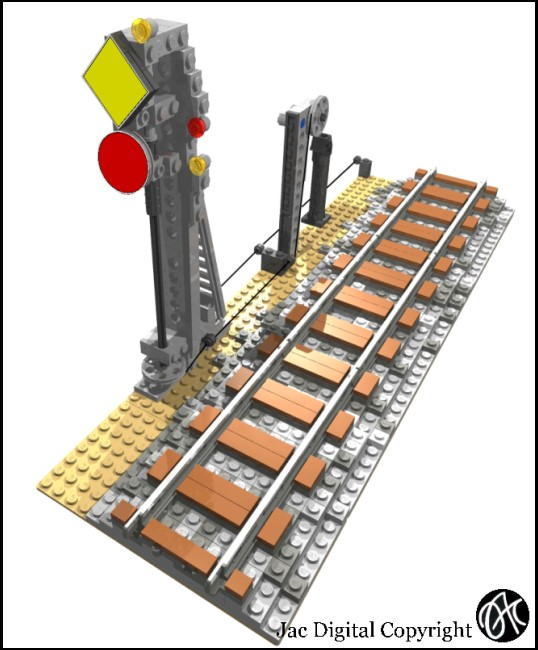

Dans cette dernière partie, description du fonctionnement des signaux mécaniques.

Suite et fin des articles sur la Gare de Fay aux Loges :  
**–** [Article 1, l’abri de quai](/articles/907/)  
**–** [Article 2, le bâtiment](/articles/994/)  
**–** [Article 3, accessoires de la petite gare](/articles/996/)

La gare de Fay aux Loges, en plus d’être pour moi une gare rurale mythique, à cause de la maquette d’Alain Pras, voir l’article 1, a été la base de mon installation de signaux mécaniques.

On pourrait dire que j’ai gardé le meilleur pour la fin, même si les articles suivent un ordre précis, avec un début concernant la base de la gare en elle même et son abri de quai.

Au début des installation ferroviaires et pour l’aide du trafic grandissant, il a bien fallu penser à la bonne gestion de tout cela. C’est là qu’interviennent les signaux mécaniques, le plus connu d’entre eux étant le sémaphore.

**Sémaphore SNCF indiquant "Voie libre".**

Aujourd’hui, quasiment disparus, il en reste vraiment très peu, ces signaux étaient implantés le long des voies, comme le sont aujourd’hui les feux de signalisation. Ils étaient commandés par un jeu complexe de leviers et de câbles, suivant que l’on bouge tel ou tel aiguillage, ou que l’opérateur ouvre une voie. L’électricité et la programmation ont remplacé tous cela. Coïncidence, j’ai retrouvé exactement le signal que j’ai reproduit, en rentrant chez moi après une bonne visite chez Fred.

**Signal réel, près d’Auxerre, merci Fenix**

Je me suis amusé à reproduire tout cela autour de ma gare. C’est à dire que, du "Poste 1", il est possible de commander deux sémaphores et deux signaux indicateurs à l’aide de cordage, qui représentent les câbles. Dans la réalité, les aiguillages sont aussi commandés mécaniquement par le même système de câbles. Ce qui donnait un réseau de poulies et levier assez important, suivant la taille des gares.

**Passage du câble.**

De chaque côté de la gare on trouve un sémaphore (grande barre rouge) qui autorise le conducteur à parcourir la portion de ligne à voie unique jusqu’à la prochaine gare. L’ordre est donné par le chef de gare, il en est le responsable. Plus loin, il faut que le train est le temps de freiner, est implanté un double signal plus compliqué avec un fixe (losange jaune) qui annonce au conducteur qu’il va franchir un aiguillage par la "pointe" à vitesse limitée et un panneau mobile (disque rouge) qui lui indique l’arrêt en gare s’il est présenté face à lui. Je me suis inspiré de livres expliquant tout cela, pour placer mes signaux et tracer les voies de la gare. Les signaux sont aussi flanqués de lumière, que les panneaux viennent cacher ou libérer. C’est à dire que lorsque le sémaphore est ouvert : "voie libre", la grande barre rouge cache le feux rouge et laisse apparaître le feu vert.

**Sémaphore fermé, voie occupée.**

**Sémaphore ouvert, voie libre.**

Sur les photos, on peut voir en même temps le changement de position du levier de commande. J’utilise du fil de lin car il est très solide. Les modélistes s’en servent aussi pour faire tous les cordages sur les bateaux miniatures. On peut le trouver en mercerie.

La notice fournie à cet article est celle du double signal implanté à un peu plus d’un mètre de la gare, à notre échelle. Comme pour le sémaphore il est actionné par les câbles guidés le long de la voie. Le câble passe sur la commande du signal : la barre du sémaphore ou le disque rouge d’arrêt en gare. Il rejoint ensuite un autre portique avec poulie et contre-poids constitué d’aimants de train. Il sert à ramener le signal en position fermé ou passage libre en gare, lorsqu’on lâche le levier. Le passage des câbles n’est pas toujours facile. J’ai toujours une pince à épiler dans mes bagages. Il faut du doigté et prévoir du temps pour la mise en place. Pour ne pas replacer les câbles dans les tambours qui sont sous le poste 1 à chaque fois, je m’arrange pour les bloquer avec une brique en position tendue, avant de démonter les signaux.

**Représentation virtuelle du signal.**

Notice de construction du signal avec MLCad

**Montage du signal**

Du fait de ces commandes, il m’est très difficile de construire la gare sur des plaques de base 32X32 tenons comme je le fais en ce moment pour mes décors. C’est beaucoup plus pratique pour le transport d’exposition en présentations. Malgré ces difficultés, cela a été vraiment un plaisir de la présenter. Le public m’a rendu un bon accueil, soit en reconnaissant la gare qui est très connue surtout près d’Orléans, soit en contemplant les signaux mécaniques fonctionnels.

Merci à vous pour le suivi de ces quatre articles, bien étalés dans le temps (plus d’un an...) ! Je désire renouveler ma gare, il me sert donc de mise en mémoire de cette petite construction, en même temps que de vous faire partager cette carte postale. La destruction ne va pas être facile, mais 8 ans pour une construction en LEGO, ça commence à faire long, enfin pour moi !

## Galerie photos

**–** [La gare en briques LEGO](http://photos.freelug.org/main.php/v/JAC/MOC/Train/Fayologes/),  
**–** [Fay aux Loges](http://fr.wikipedia.org/wiki/Fay-aux-Loges),  
**–** [Les signaux mécaniques français](http://www.carreweb.fr/european-railway-signalling-server/stfr/smfr_fr.html).
