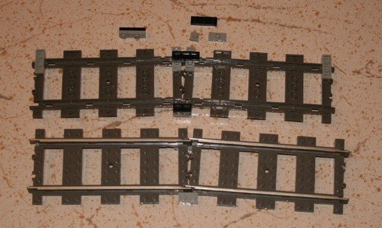
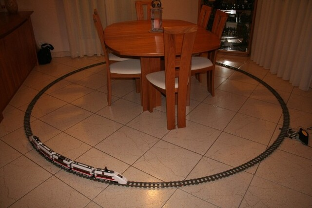
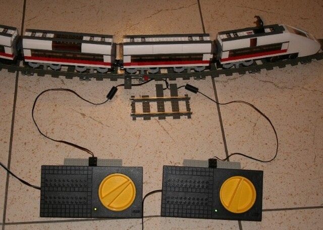

La mise au point de trains pour la LGV2 est particulièrement délicate puisqu’on ne dispose que d’un week-end par an pour les faire circuler sur la ligne. Cet article décrit la réalisation d’une ligne moyenne vitesse avec des rails droits LEGO et des alimentations LEGO classiques reproduisant les virages de grand rayon de courbure de la LGV2.

La version actuelle de la LGV2 avec ses virages relevés de grand rayon de courbure et la course au record de vitesse au sein de la communauté AFOL rend la mise au point des trains de plus en plus pointue et délicate. L’accès à la LGV2 étant très limité (un week-end par an actuellement), la mise au point est encore plus difficile. L’objectif de cet article est de présenter la façon de réaliser une ligne moyenne vitesse 100% LEGO permettant de reproduire les virages de la LGV2 et de mettre au point les futurs trains en compétition pour le record de vitesse.

## Un anneau de 3 mètres de diamètre

La version minimale correspond à un anneau de 3 mètres de diamètre réalisé à partir de 75 rails droits légèrement désorientés en ne les emboitant pas entièrement à l’extérieur du virage. L’ouverture angulaire de 5 degrés est obtenue à l’aide d’un écart d’un demi-tenon au niveau du rail extérieur en juxtaposant un [jumper](http://www.bricklink.com/catalogItem.asp?P=3794) et une [plaque 1x1](http://www.bricklink.com/catalogItem.asp?P=3024) sur une [plaque 1x3](http://www.bricklink.com/catalogItem.asp?P=3623). Pour compléter l’assemblage, deux autres plaques 1x3 sont fixées sur les traverses extrêmes (qui sont creuses au niveau du rail extérieur) et deux [plaques 1x2](http://www.bricklink.com/catalogItem.asp?P=3023) prennent les traverses extrêmes en sandwich à l’intérieur du virage.

**Assemblage des rails**

Ce mode d’assemblage introduit un dévers d’environ 8 degrés (2 plaques d’écart sur une largeur de 6 tenons) que l’on peut augmenter à 12 degrés en ajoutant une plaque 1x3 sous celle en noir et à 14 degrés (proche de l’angle de la LGV2) en ajoutant un morceau 1x3 découpé dans une plaque de base sous cette seconde plaque 1x3.

**Anneau de 75 rails droits entourant la table du séjour**

La continuité électrique est très bonne et un seul point d’alimentation de la voie s’avère suffisant.

## Deux alimentations en série pour booster les trains

Avec une alimentation LEGO, les trains paraissent particulièrement lents sur cette ligne. Pour les booster, il est possible de mettre deux alimentations en série en interposant un rail indépendant permettant de connecter la borne "plus" d’une alimentation avec la borne "moins" de l’autre. Ainsi, les tensions de 9,3 volts de sortie s’additionnent pour produire une tension finale de 18,4 volts.

**Mise en série de deux alimentations via un rail indépendant**

Attention, je décline toute responsabilité en cas de dégâts à vos alimentations ou moteurs si vous réalisez ce montage. En ce qui concerne mes moteurs et mes alimentations, ils n’ont pas montré de signes de faiblesse lors d’essais d’une durée de 30 secondes. L’expérience des LGV montre que les moteurs supportent aisément 30 volts et on devrait donc pouvoir mettre jusqu’à 3 alimentations en série. Par contre, lorsque la tension augmente à résistance constante, le courant qui circule dans tout le circuit augmente proportionnellement à la tension ce qui risque d’endommager le régulateur de tension LEGO.

## Ca booste !

Une petite [vidéo avec la locomotive de mon Shinkansen](http://www.youtube.com/watch?v=DT3HJgHq5v8) équipée de 2 moteurs 9V : on notera que le train pousse beaucoup sur la voie qui n’est presque pas fixée au sol carrelé.

[Vidéo de la publication d’origine](http://www.youtube.com/v/DT3HJgHq5v8?fs=1&hl=fr_FR)

Voilà, vous n’avez plus d’excuse pour ne pas tenter d’établir le record de vitesse sur la LGV2 lors de sa prochaine sortie.
