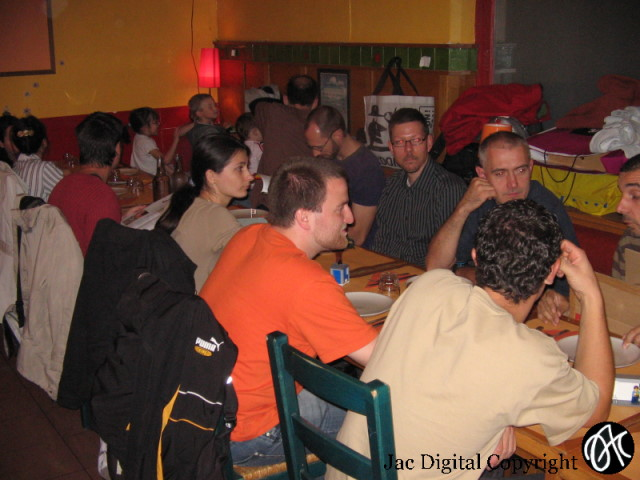
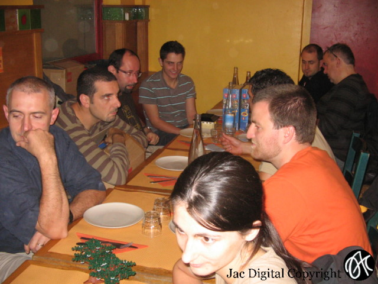
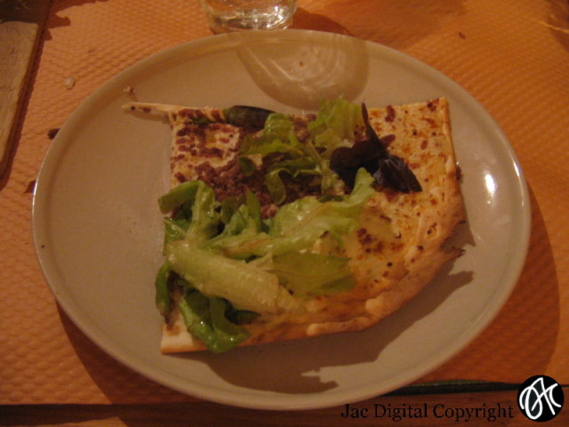
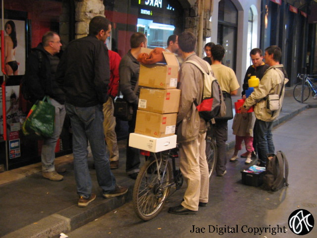

Pour ce 18 septembre 2010, le rendez-vous était pris devant le restaurant qui promet les tartes flambées à volonté. Voilà le résumé de cette soirée.

Le restaurant est situé dans le centre de Lyon, pour éviter de chercher trop longtemps une place très cher pour la voiture, nous avons pris le métro de chez PierreC. Les frères Laurenge nous y ayant rejoint, c’est à 5 que nous nous engouffrons dans les tunnels grouillants et chauds ! Une petite frénésie nous secouait, sûrement le fait de cette balade en transport en commun et de la soirée qui nous attendait. Mais il y avait tout de même un petit pincement, avec le déménagement de Pierre et Emilie pour rejoindre la capitale.

Comme d’habitude, enfin pour nous, les briques LEGO ont envahi la table largement avant l’apéritif. Pour honorer le thème du [triffouillis du mois de septembre](http://photos.freelug.org/main.php/v/FreeLUG/Triffouillis/toilettes/), ce sont des toilettes publiques qui se sont dispersées devant certains convives.

Nous avons dû faire de la place pour recevoir les planches qui supportaient les tartes. Comme expliqué plus haut les tartes étaient servies à volonté. C’est-à-dire jusqu’à rassasiement complet des Afols affamés que nous étions. Etions car nous nous sommes "gavés", jusqu’à ne plus avoir de place pour le dessert.

**Et une part de plus.....**

Comme d’habitude, ben oui encore une fois, la discussion s’est terminée tard dans la nuit, d’abord dans la rue devant le restaurant, qui n’avait plus de place pour nous garder. Ensuite chez Pierre et Emilie.

**Fin de la soirée dans la rue.....**

Encore une belle soirée. merci aux Lyonnais pour l’idée, le resto et l’accueil. A bientôt à tous.

_Jérôme/JAC_

* * *

Centre de Lyon, 19h, en voiture (pour les LEGO, forcément) : la galère ! mais c’est très vite oublié, il y a déjà des Afols devant le restaurant.

Et c’est parti : on oublie tout, il n’y a plus que nos briques dans la conversation... et des tartes flambées !  
Merci Pierre d’avoir lancé ce restaurant, merci à tous les participants et à bientôt.

_Laurent_

* * *

Des restos sympas, des visites de villes lors des expos ou même des descentes de l’Ardèche en canoë.

J’apprécie de plus en plus l’accueil que les fanas de la brique peuvent faire aux conjoints et aux familles prouvant qu’ils ne sont pas (complètement) monomaniaques.

_Didier_

* * *

Encore un bon repas en bonne compagnie ! Entre les Flammekueches et les dicussions LEGO, le temps est passé vite. Les toilettes se sont invitées à tables, c’était pratique pour les envies pressantes ;-)

Alors, où est-ce qu’on mange au prochain resto ?

_Pierre L./Pierrolego_

* * *

Les restos sont toujours d’excellents moments que je conseille à tous les amateurs de la petite brique qui n’ont pas forcément le temps de s’investir dans une expo. C’est l’occasion de rencontrer, partager sur cette passion commune, et accessoirement de manger et boire un coup ensemble, dans une ambiance bon enfant.

Dommage que la soirée n’ait pas durée plus longtemps et qu’on se soit fait mettre à la porte du resto assez tôt.

Vivement le prochain

_Yannoch_

* * *

Notre dernière soirée de FreeLUGiens lyonnais !

Avec des gens biens sous tout rapport, c’était forcement super !

Promis nous reviendrons vous voir à Lyon à l’occasion !

_Pierre C. & Emilie_

* * *

## Galerie photos

[Galerie de JAC](http://photos.freelug.org/main.php/v/JAC/Exposition/Expositions2010/Resto2Lyon/)
