Le set Dacta 9688 est très intéressant sur le papier. Qu’en est-il vraiment ?

J’ai reçu fébrilement ce set :

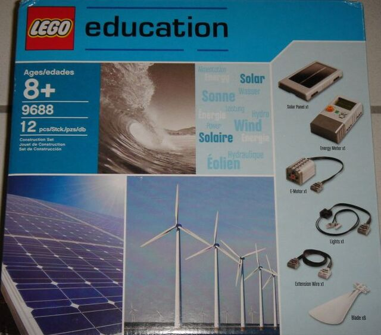

Voici le détail de la boîte (dessous et les 4 côtés) :

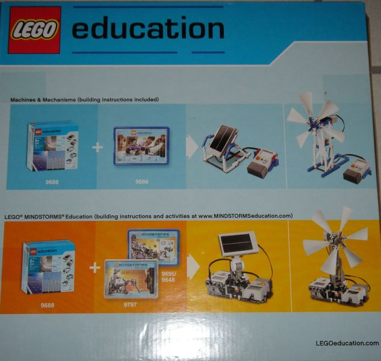

[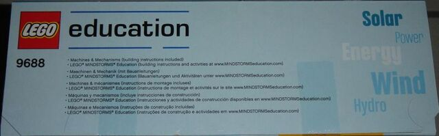](https://www.freelug.org/IMG/jpg/Lego_Dacta_9688_-_03_-_Cote_1.jpg)

[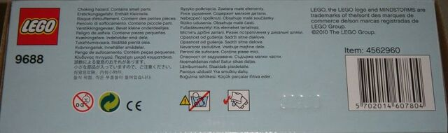](https://www.freelug.org/IMG/jpg/Lego_Dacta_9688_-_04_-_Cote_2.jpg)

[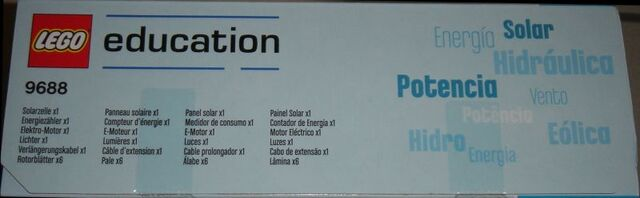](https://www.freelug.org/IMG/jpg/Lego_Dacta_9688_-_05_-_Cote_3.jpg)

[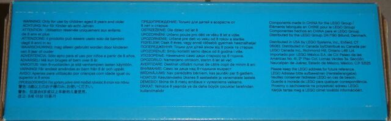](https://www.freelug.org/IMG/jpg/Lego_Dacta_9688_-_06_-_Cote_4.jpg)

Après l’avoir longuement observée, l’idée de l’ouvrir m’a subitement traversé l’esprit :

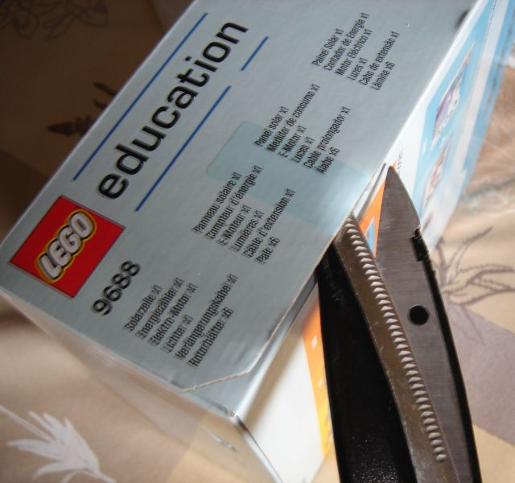

J’ai alors aperçu le Graal :

[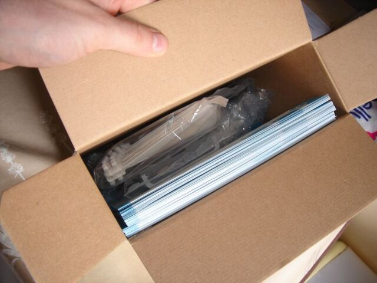](https://www.freelug.org/IMG/jpg/Lego_Dacta_9688_-_08_-_Contenu_1.jpg)

Que j’ai déballé avec l’impatience d’un président de FreeLUG attendant l’ouverture d’un Pick-a-Brick :

[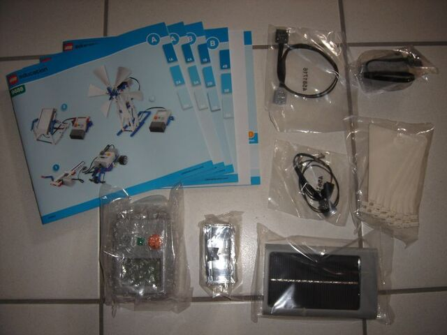](https://www.freelug.org/IMG/jpg/Lego_Dacta_9688_-_09_-_Contenu_2.jpg)

Sans les notices :

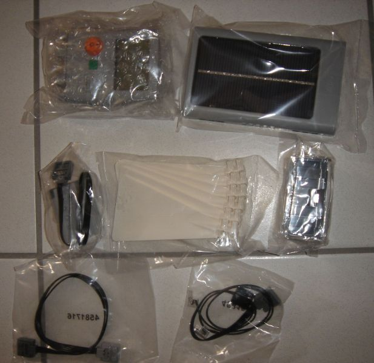

Bien emballé, "l’energy meter" :

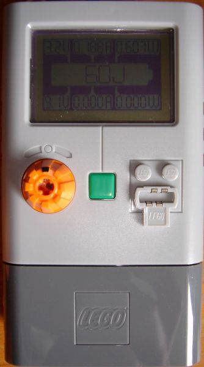

avec le détail de son accumulateur (de 150 mAh ! Attention les yeux ! Livré vide, évidement) :

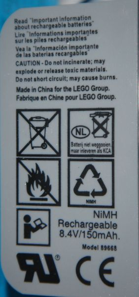

Voici les autres pièces composant ce set :  
**–** La cellule solaire :

[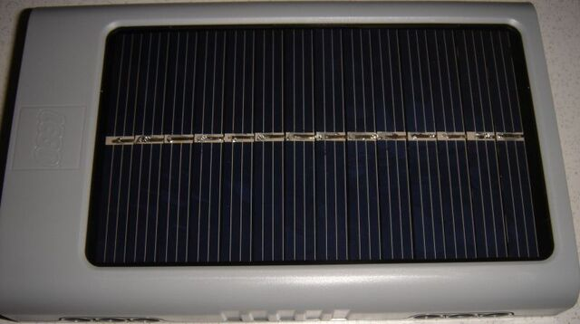](https://www.freelug.org/IMG/jpg/Lego_Dacta_9688_-_14_-_Cellule_solaire_dessus.jpg)

[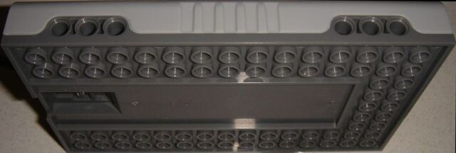](https://www.freelug.org/IMG/jpg/Lego_Dacta_9688_-_15_-_Cellule_solaire_cote.jpg)

**–** Le moteur-générateur (que Philo va certainement tester bientôt pour compléter son comparatif des moteurs LEGO) :

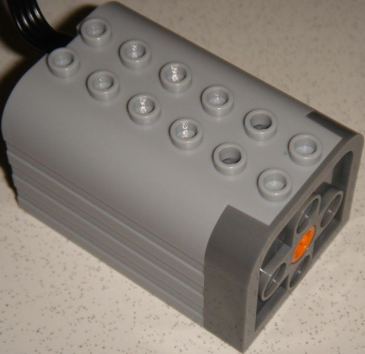

[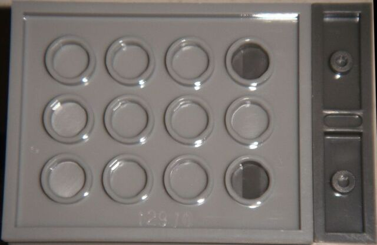](https://www.freelug.org/IMG/jpg/Lego_Dacta_9688_-_17_-_Moteur_generateur_dessous.jpg)

**–** Les pales :

[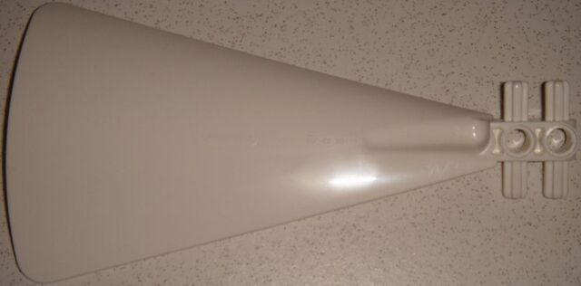](https://www.freelug.org/IMG/jpg/Lego_Dacta_9688_-_18_-_Pale_dessus.jpg)

[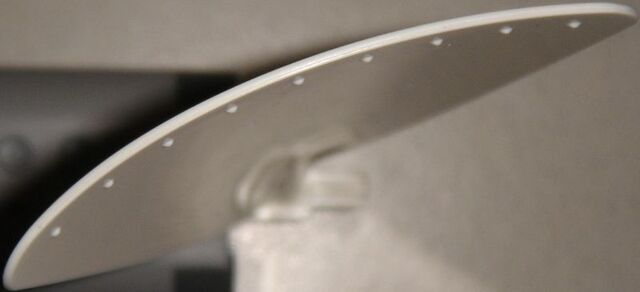](https://www.freelug.org/IMG/jpg/Lego_Dacta_9688_-_19_-_Pale_profil.jpg)

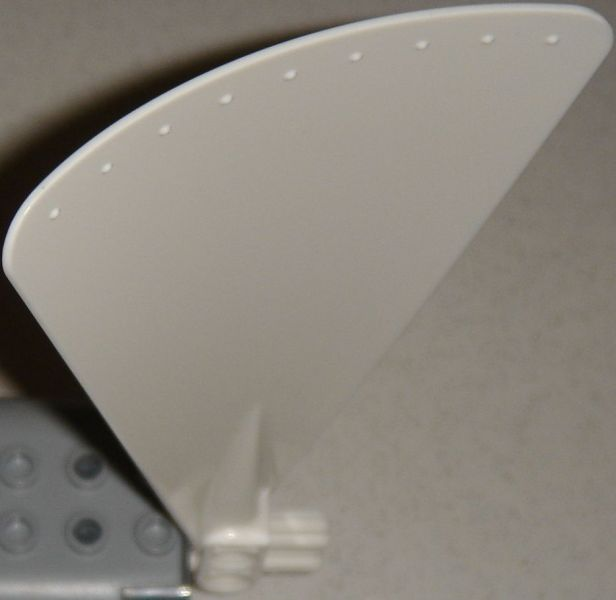

A noter que cette fois, on a enfin des vrai pales, avec un vrai profil !

**–** Ainsi que des lumières PFS

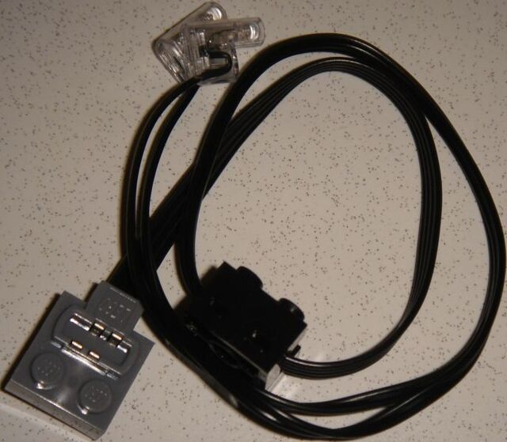

et un câble PFS de 50 cm.

LEGO conseille de charger l’accu de suite (en effet, il est livré vide, totalement vide). Je l’ai donc connecté à la cellule solaire, mais vu le temps qu’il a fait aujourd’hui sur Paris, ça n’a pas bien fonctionné (j’avais un peu de tension, mais aucun courant).

Je l’ai donc connecté à la batterie PFS, mais ça n’a pas marché non-plus (contrairement à la vidéo sur TechnicBricks). J’ai du rater un truc.

Je l’ai donc connecté à un bloc de piles (battery pack). Là, ça a commencé à charger. Voici différentes étapes :  
**–** vide :

[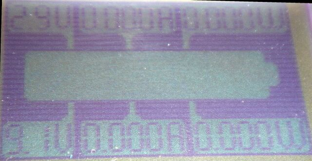](https://www.freelug.org/IMG/jpg/Lego_Dacta_9688_-_23_-_En_charge_1.jpg)

  
**–** en charge :

[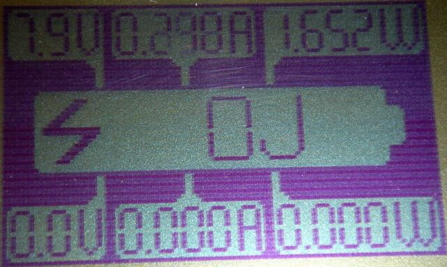](https://www.freelug.org/IMG/jpg/Lego_Dacta_9688_-_22_-_Charge_avec_battery_pack.jpg)

Notez le symbole de courant qui clignote.

[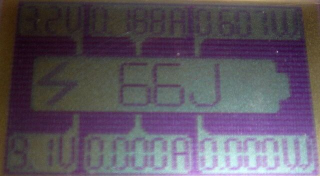](https://www.freelug.org/IMG/jpg/Lego_Dacta_9688_-_24_-_En_charge_2.jpg)

  
**–** complètement chargé :

[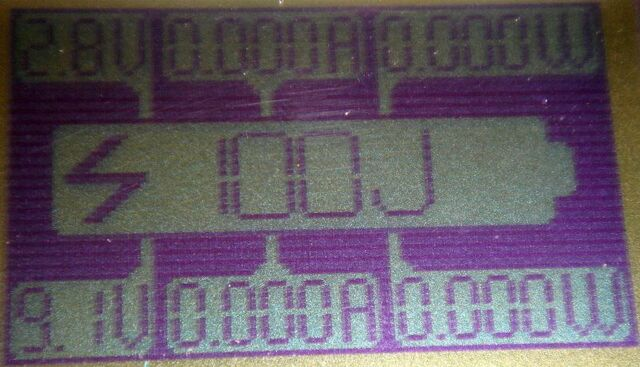](https://www.freelug.org/IMG/jpg/Lego_Dacta_9688_-_25_-_En_charge_3.jpg)

Hé oui, l’accu n’accepte que 100 Joules maximum !  
Cela représente 0,027777778 Watts !  
Impossible d’utiliser cet accu pour recharger un NXT par exemple, et je ne pense pas que le moteur XL-PFS fonctionne bien longtemps.

A l’heure actuelle, je ne sais pas si on peut utiliser plusieurs energy-meter en parallèle pour augmenter un peu la capacité...

A noter que 5h après, il était toujours plein ; pas trop de fuite de courant donc ! (ajout : il semble quand même qu’il y ait des pertes)

[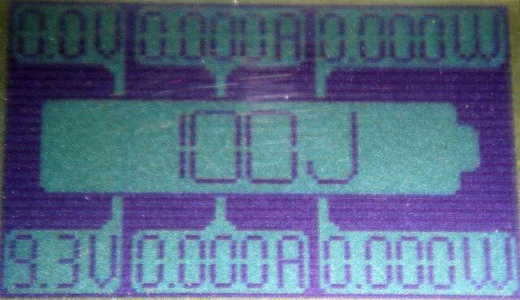](https://www.freelug.org/IMG/jpg/Lego_Dacta_9688_-_26_-_Accu_toujours_charge_apres_5h.jpg)

J’ai repris la batterie PFS pour refaire un essai et m’apercevoir de l’obligation de passer par le dessous de l’appareil.  
J’ai un peu déchargé l’accu avec le moteur puis branché la batterie.

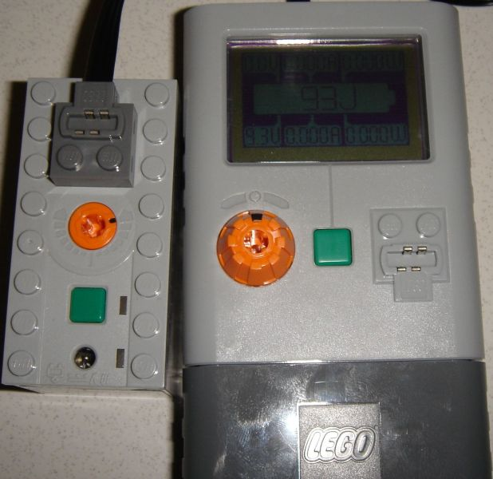

Les clichés suivants ont été pris à quelques secondes d’intervalle :

[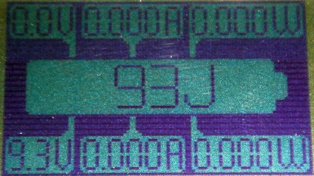](https://www.freelug.org/IMG/jpg/Lego_Dacta_9688_-_28_-_Recharge_avec_batterie_PFS_2.jpg)

[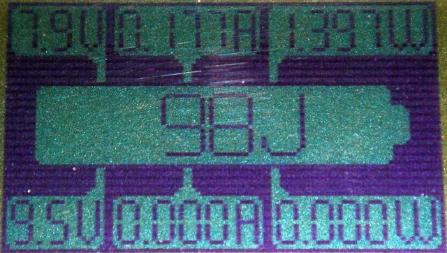](https://www.freelug.org/IMG/jpg/Lego_Dacta_9688_-_29_-_Recharge_avec_batterie_PFS_3.jpg)

[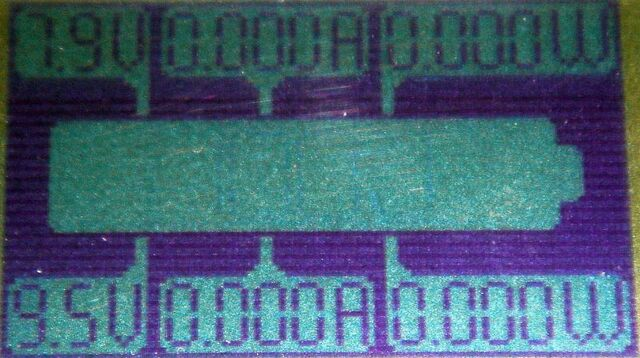](https://www.freelug.org/IMG/jpg/Lego_Dacta_9688_-_30_-_Recharge_avec_batterie_PFS_4.jpg)

[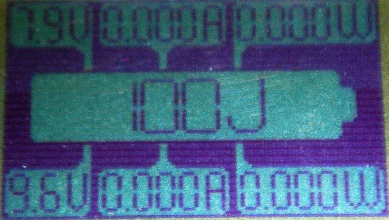](https://www.freelug.org/IMG/jpg/Lego_Dacta_9688_-_31_-_Recharge_avec_batterie_PFS_5.jpg)

(à 100%, ça clignote !)

Donc environ 10% en une dizaine de secondes, ça montre bien que l’accu a une capacité très faible.

A ce stade de la revue, je vois donc 2 points négatifs majeurs :

1.  ce set ne comporte aucune pièce classique. Si vous n’avez pas d’autres sets, impossible de construire quoi que ce soit. A part regarder l’accu se charger via la cellule solaire, et se vider en regardant le moteur tourner, vous n’irez pas loin (pas possible de construire l’éolienne par exemple).
2.  la capacité utilisable\* de la batterie est vraiment trop faible. C’est vraiment dommage car une capacité digne de ce nom aurait permis des montages vraiment intéressants et ouvert de nombreuses perspectives. Là, inutile d’imaginer un montage autonome, il ne passera jamais la nuit. A part habiter dans un coin où il y a toujours du vent, la batterie ne tiendra jamais le coup sur un montage un tant soit peu évolué. Pourtant, le prix des batteries aujourd’hui n’est pas si exorbitant, un accu d’1 ou 2 Ah aurait bien pu être intégré, ne serait-ce qu’avec des piles rechargeables...

\* : en effet, LEGO fournit une batterie de 150 mAh, soit 4536 Joules (0,15 A x 8,4 V \* 3600 s), mais ne nous en laisse utiliser que 100 Joules, soit 1/45ème ! A priori, cette limitation est arbitraire et uniquement destinée à éviter que la recharge ne prenne trop de temps durant un cours scolaire.

Je ne comprends pas cette limitation. Au pire, les enseignants auraient utilisé cette batterie à 10% de sa capacité, et puis c’est tout... Ca n’empêchait pas les expériences, et même mieux, ça en ouvrait d’autres. Par exemple faire des véhicules plus gros et étudier l’influence du poids, de la conception, de la mécanique, etc. sur l’autonomie. Si LEGO pense à sortir ce type de set pour le grand public, il faudra qu’il revoit ce point. Les enfants et les Afols ne paieront pas ce prix-là pour voir la batterie se décharger en 4’15" du fait d’une limitation arbitraire !

En parlant de prix, 122 € pour ça, c’est, pour moi, le prix de l’exclusivité Dacta et de la nouveauté, mais pas un prix raisonnable :  
**–** un moteur PFS-M (à peu près équivalent à celui du set) est à 9 € sur le Sh@h,  
**–** les lumières à 8 €,  
**–** le câble de 50 cm à 5,50 €, ce qui fait 22,50 € pour ces 3 articles.  
**–** ce ne sont pas les pales qui coûtent cher, on va dire 1 € pièce en étant super large, donc 6 €, ce qui nous amène à 28,50 €.

Autrement dit, il y a environ 95 € pour l’energy-meter, l’accu et la cellule solaire.

Vu la puissance de l’accu, ça ne doit pas représenter plus de quelques €, donc on peut dire que 90 € pour la cellule et l’energy-meter, c’est pas donné-donné... surtout qu’il faut d’autres pièces pour pouvoir faire des montages intéressants...

Et encore, si j’étais passé par Jeulin, en France, cela m’aurait coûté au moins 100 € de plus...

Évidement, il faut garder à l’esprit qu’il s’agit d’un set Dacta, donc réservé à l’Education Nationale, à la formation, etc. et que ce n’est pas un set grand public. Il faut croire que TLC et ses partenaires considèrent que les ministères de l’Education Nationale (au moins l’Allemagne et la France) ont les moyens...

Est-ce que TLC va un jour sortir un set équivalent pour le grand public ? Est-ce que ce set Dacta est plus ou moins un test avant d’envisager un lancement grand public ? Seul l’avenir nous le dira... En tout cas, j’ose espérer que si c’est le cas un jour, la capacité de la batterie sera revue (largement) à la hausse, sans limitation, et que le set sera autonome (avec des pièces LEGO classiques).

Voici maintenant quelques photos de l’avertissement, des notices, ainsi que du "mode d’emploi" de l’energy-meter :

[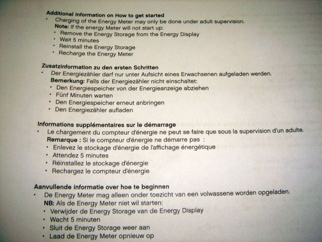](https://www.freelug.org/IMG/jpg/Lego_Dacta_9688_-_32_-_Avertissement.jpg)

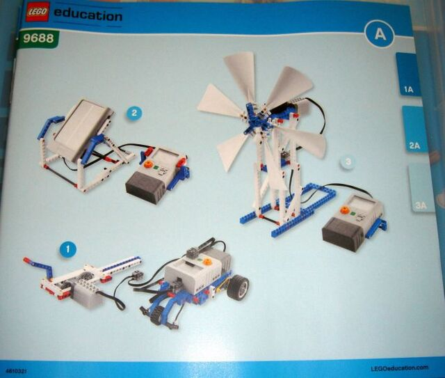

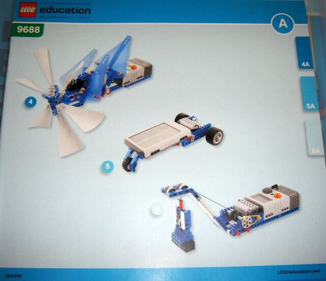

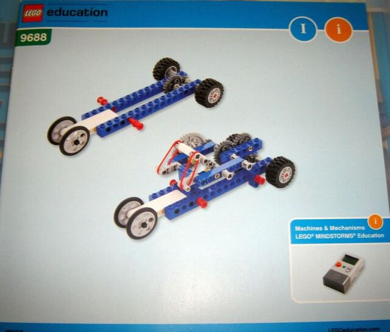

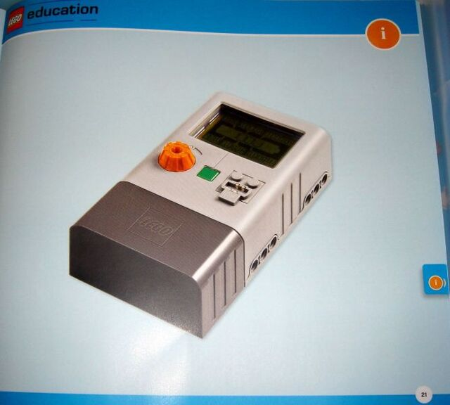

[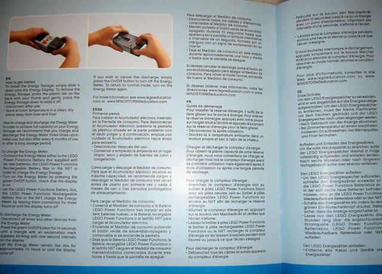](https://www.freelug.org/IMG/jpg/Lego_Dacta_9688_-_37_-_Mode_op_dans_3eme_notice_2.jpg)

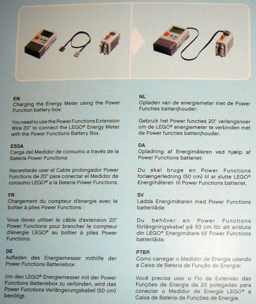

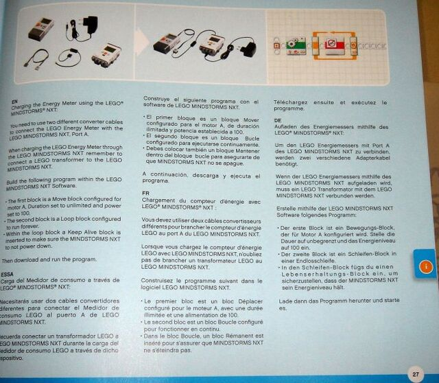

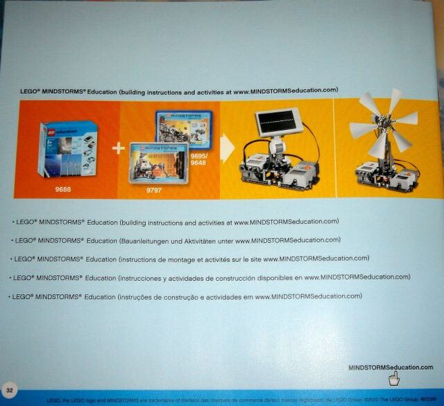

Petite aparté : le système de connexion PFS est bien, mais pas évident à déconnecter. La plupart d’entre nous tirent sur le câble, faute d’une autre solution.

Ici, sous la cellule solaire comme sous l’energy-meter, la prise PFS est dans un creux plus grand que le volume de la fiche. Du coup, en ce qui me concerne, j’utilise un bout de ficelle :

[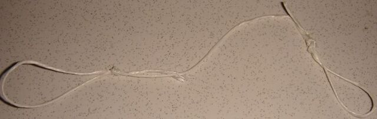](https://www.freelug.org/IMG/jpg/Lego_Dacta_9688_-_41_-_Schuss.jpg)

[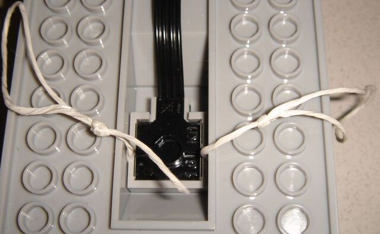](https://www.freelug.org/IMG/jpg/Lego_Dacta_9688_-_42_-_Schtuss_en_place.jpg)

Il suffit de rentrer la ficelle dans le trou pour qu’elle ne gêne pas la connexion avec d’autres briques. J’ai fait un noeud de chaque côté pour y passer un doigt, mais je pense qu’un simple bout de ficelle suffit (et donc prendra moins de place).

## Quelques tests

**Test 1 :** 1’10" pour recharger de 0 à 100 J avec la batterie PFS (7,9 V x 0,2 A affichés = 1,58 Ws)

**Test 2 :** 3’35" pour vider la batterie avec 46 mA pour le moteur PFS-M à 8,3 V.

0,046 A x 8,3 V x 215 s = 82 J.

En effet, le compteur est descendu régulièrement jusqu’à environ 24 J puis pouf, 0 J et le moteur s’arrête (donc la batterie est vide, manifestement).

Plus probablement il se coupe si la tension de batterie tombe sous un certain seuil de tension, pour éviter d’endommager l’accu.

Un peu de calcul : si on prend 100 J / 8,4 V / 0.046 A, on devrait avoir 259 s, ce qui colle avec le test.

Si on prend maintenant les 100 J / 3600 s / 8,3 V = 0,0033 A. Il faut juste trouver un truc qui ne tire que 3 mA... Il est 19h02, je viens de mettre les lumières PFS sur l’energy-meter, elles tirent 1 mA d’après l’appareil. Je vais laisser tourner, on verra si ça tient toujours dans 3h. Retour 1h après, je trouve l’appareil éteint. Encore une limitation qui empêche d’utiliser l’appareil complètement (soupirs...). Je tâcherai de mesurer ce temps dès que possible.

**Test 3 :** cette fois 2’ ont suffit pour vider l’accu, que je venais juste de recharger avec la PFS ! Là, c’est à 50 J qu’il est tombé à 0 et que le moteur s’est arrêté !

**Test 4 :** cette fois, fonctionnement correct : 4’15" pour vider l’accu (255 s, c’est tout à fait en ligne avec le calcul).  
Note : comme l’indique LEGO, il faut charger/décharger l’accu plusieurs fois avant qu’il atteigne sa pleine capacité.

Pour rappel, les caractéristiques de l’accu : 150 mAh / 8,4 V. A titre de comparaison, la batterie PFS fait 1100 mAh / 7,4 V, pour un volume comparable... (même si c’est du LiPo et là du NiMH).

Pour info, j’ai fait mes tests avec le moteur PFS-M qui tire environ 46 mA. Le moteur livré avec le set tire environ 18 mA.

Pour ceux qui souhaitent voir les entrailles de la bête, je vous suggère l’[article de Xander Soldaat](http://mightor.wordpress.com/2010/08/06/exposed-the-lego-e-meter/).

Pour les notices : [Brickset](http://www.brickset.com/detail/?set=9688-1)

Voilà pour l’instant. Je n’ai pas encore pris le temps de tester avec un NXT pour voir le fonctionnement de l’energy-meter en tant que capteur.

## Conclusion

En conclusion, pour moi, ce set est à la fois intéressant et décevant.

Intéressant car sur un thème important, avec des vrai pales (qui permettent de faire une hélice digne de ce nom), un moteur qui semble être optimisé pour consommer peu, des expériences amusantes à faire.

Décevant car la couche matérielle est limitée arbitrairement par le firmware du microprocesseur qui gère l’energy-meter, bridant celui-ci au 45ème de ses possibilités !

Si vous souhaitez faire des expériences en tout genre, faire découvrir les énergies renouvelables à vos enfants, c’est un bon set (à conditions d’avoir d’autres LEGO pour les montages).  
Si vous attendiez ce set pour faire un montage autonome en énergie, passez votre chemin !
