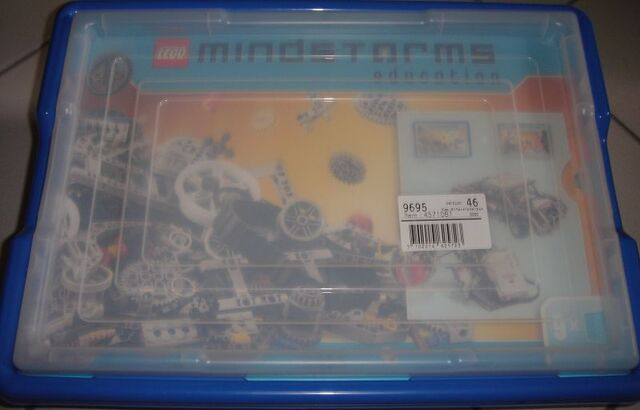
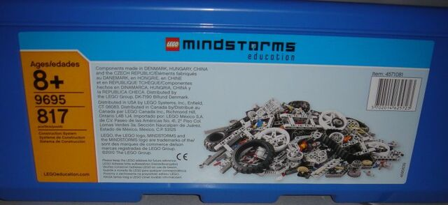
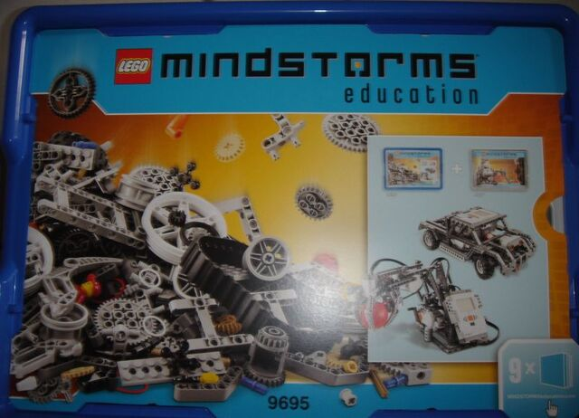
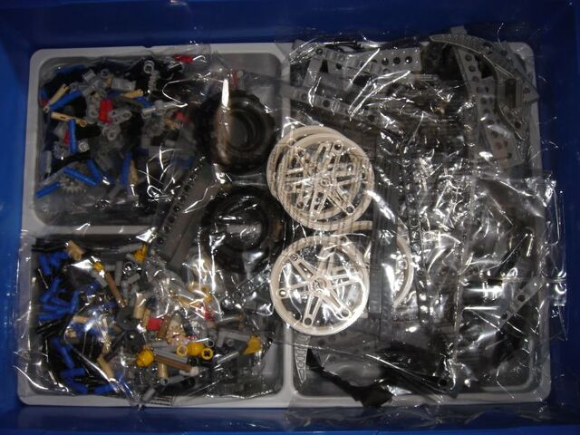
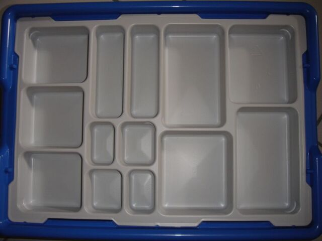
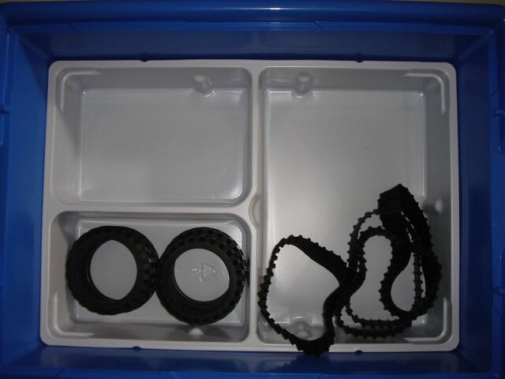
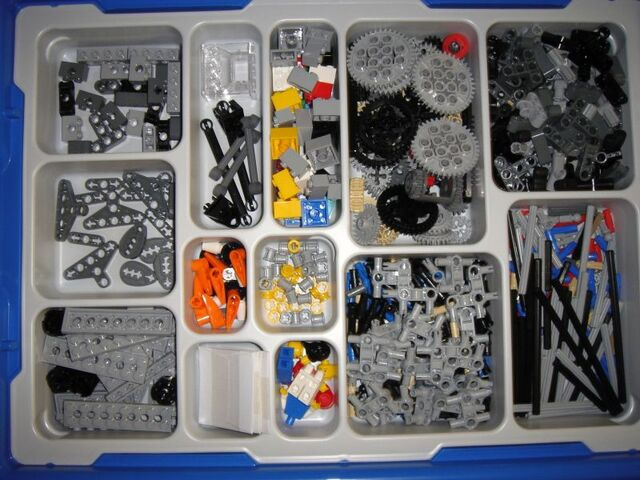
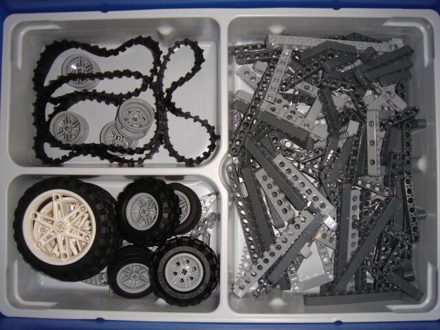
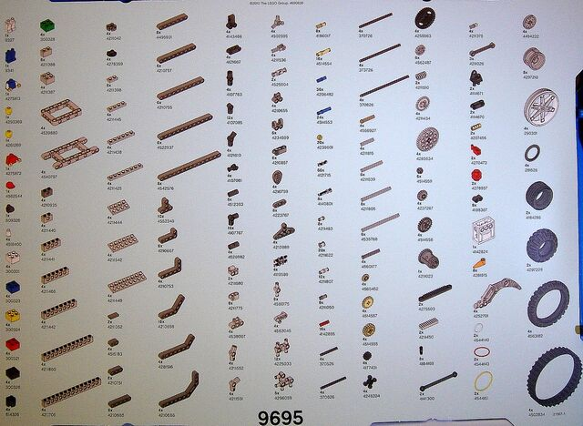

En complément du set [Dacta 9688 (renewable energy set)](/articles/1200/), j’ai aussi commandé le 9695. Petite revue.

Lors de ma commande du 9688, j’ai découvert sur le site du marchand le set 9695. J’en ai pris un, il me paraissait intéressant.

Bonne affaire ?

Pour vous en faire un idée, voici quelques éléments de réponse sous forme de photos :

Quand on ouvre la boîte, via un système de fermeture que je trouve astucieux (à base d’ergots), on trouve un riche contenu :

La boîte comporte deux étages de rangement :

Une fois trié/rangé, ça donne ça :

L’étage de rangement supérieur est fermé par la plaque cartonnée, en plus du dessus en plastique. Je pense que cette plaque cartonnée est nécessaire car elle doit empêcher les petites pièces de sortir, le plastique de fermeture n’étant pas vraiment totalement étanche.

Au dos de cette plaque cartonnée, il y a la liste des pièces :

Un set plutôt complet, avec plein de liftarms, des engrenages, des minifigs (sisi, des minifigs, pas de bonhommes Technic...), des courroies, des roues et chenilles, et des connecteurs à foison.

Pour 85 €, 817 pièces (environ), je trouve que c’est bon marché.

En complément du 9688, je pense que c’est très bien, vu que ce set ne contient aucune pièce classique LEGO. Au niveau tarif, les 2 pour 200 € font un ensemble à un tarif correct.
