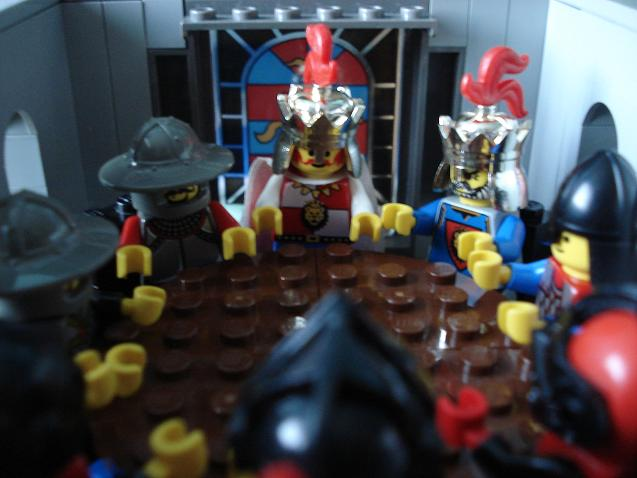
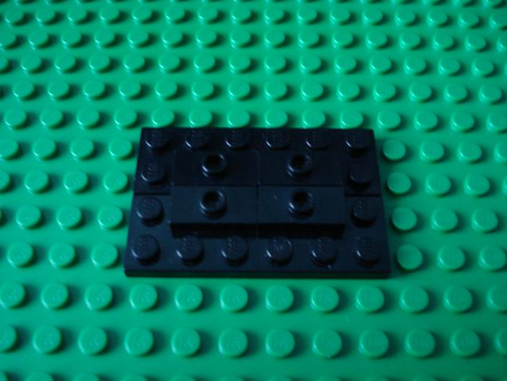
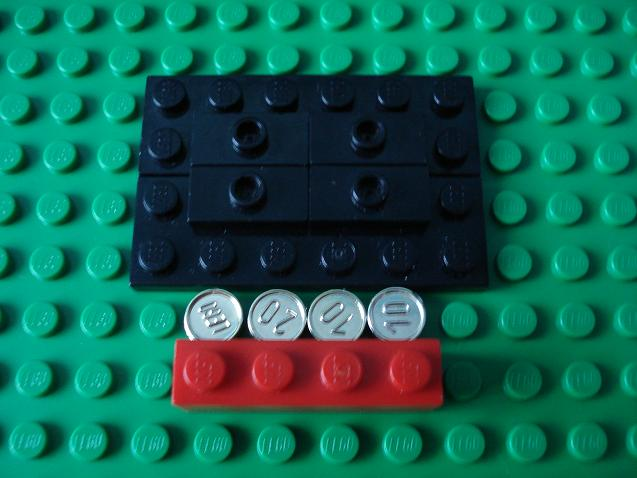
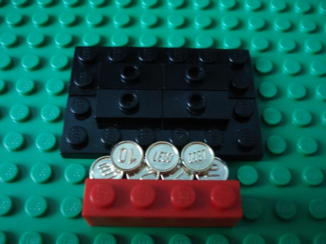
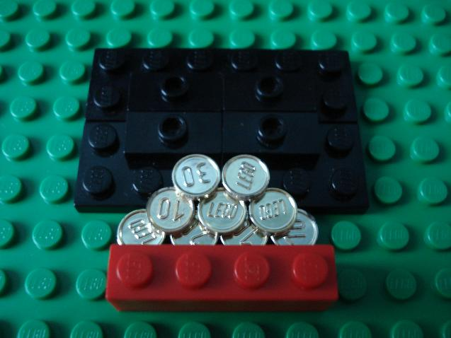
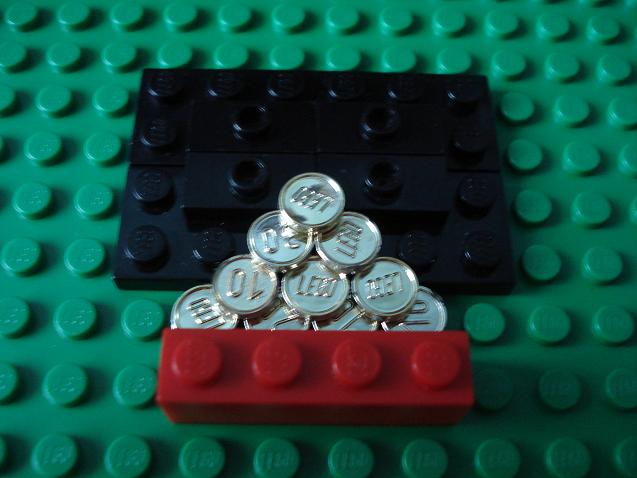
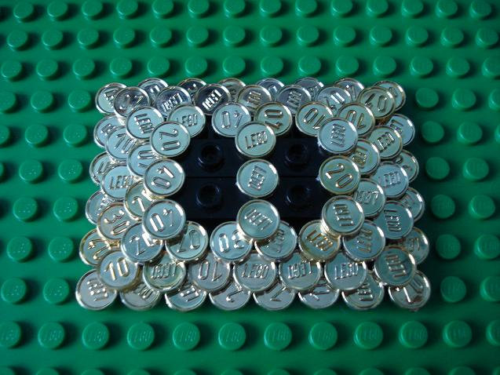
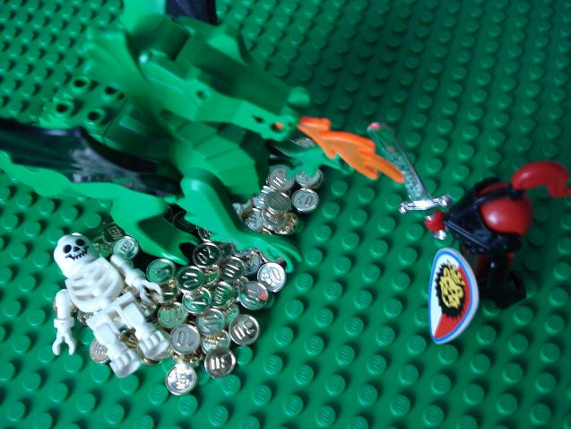

Que serait un dragon sans son fameux tas de pièces d’or à protéger ?

## Pendant ce temps, à Kaamelott

Les preux chevaliers de la table ronde ont ouï dire qu’un précieux butin était protégé par un farouche dragon.

**Les chevaliers de la table ronde**

Le brave Lancelot accepte cette périlleuse quête et s’en va pourfendre le monstre de la grotte maudite...

## Réalisation du tas de pièces

Il semble logique de posséder :  
**–** un nombre de pièces dorées conséquent (dans mon exemple, il en faudra au minimum 69)  
**–** des plates pour réaliser le support  
**–** une pièce longue et fine pour remettre les pièces d’or qui auraient bougé pendant la réalisation, comme une flamme minifig par exemple.  
**–** de l’adresse et de la patience ^^

Voici mon support :

Pour commencer, il faut placer une pièce d’or sur chaque tenon qui entoure la plate qui se trouve au niveau le plus bas. Conseil : placez des briques 1x2x1 ou plus longues comme indiqué pour une plus grande stabilité des pièces :

Ensuite, faire en sorte que les pièces du niveau supérieur soient placées contre les tenons du support :

Mettre les pièces du niveau suivant sur les tenons du support :

Et ainsi de suite... :

Voici le résultat après beaucoup d’efforts !

Pour finir en beauté, placez le dragon sur les plates centrales, rajoutez des pièces (s’il vous en reste) un peu partout (un vrai tas de pièces n’est pas uniforme), un squelette et un preux chevalier : voilà une magnifique scène pour vos créations du Moyen-âge !

