Participation à l’exposition de modélisme ferroviaire d’Orléans des 6 et 7 novembre 2010. Quatrième participation pour FreeLUG.

Pour la quatrième fois, FreeLUG a participé à l’exposition bisannuelle de modélisme ferroviaire d’Orléans qui a eu lieu les 6 et 7 novembre 2010.

Résumé factuel rapide :  
**–** lieu de l’exposition : Parc des Expositions de la ville d’Orléans ;  
**–** organisateur de l’exposition : Association des Modélistes Ferroviaires du Centre (AMFC) ;  
**–** thème de l’exposition : train miniature ;  
**–** date de l’exposition : 6 et 7 novembre 2010 ;  
**–** horaires d’ouverture au public : samedi de 10h à 19h et dimanche de 10h à 18h ;  
**–** tarifs d’entrée : 5,50€/personne (et 3€ pour les 6-16 ans) ;  
**–** thème du stand : train et ville moderne, steam-punk, science-fiction.

Pour cette récente édition nous avons eu le plaisir de voir défiler 10500 visiteurs sur les deux jours d’exposition. Cerise sur le gâteau, un repas entre AFOLs a eu lieu le samedi soir dans un restaurant proche du parc des expositions. Nous fûmes 35 à nous retrouver autour de plats fumants eux aussi... Un merci particulier à Béatrice Goberville pour l’organisation de cette soirée. Laissons maintenant la place aux participants pour lire leur récit de cette aventure collective.

* * *

**Module Pascal Legnome et Florence**

Le Corner Café et les blocks de cette série collent parfaitement au thème du film Blade Runner. Donc, après quelques customisations, dont l’ajout de tuyaux, clims, et panneaux publicitaires, ils ont pris place sur une esplanade haute d’une vingtaine de briques.

[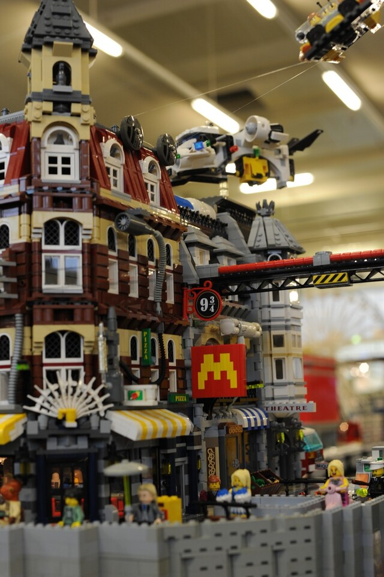](https://www.freelug.org/IMG/jpg/corner.jpg)

**Corner Café**

Un grand écran intégré dans un immeuble de bureaux diffusait des images du film, et des vidéos LEGO.

[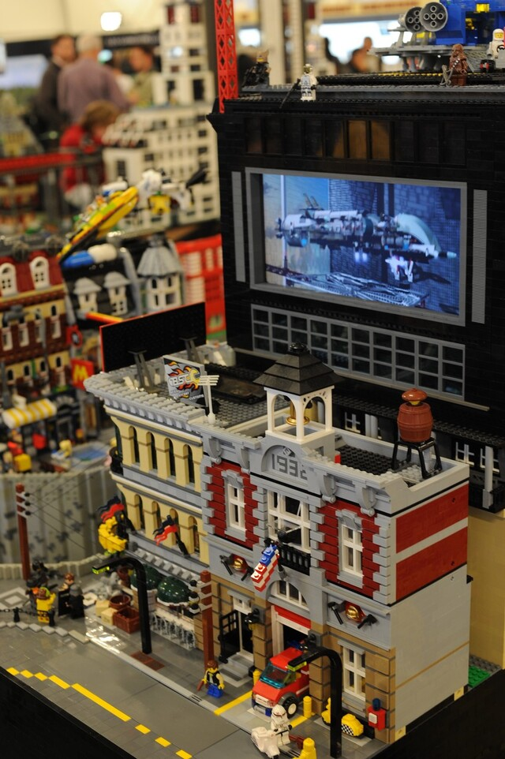](https://www.freelug.org/IMG/jpg/ecran.jpg)

**Ecran Géant**

Le Grand Emporium a été transformé en armurerie, car il faut bien se défendre dans ce monde de brutes ! :) L’occasion aussi de présenter les armes fraîchement arrivées de brickarms et brickforge.

[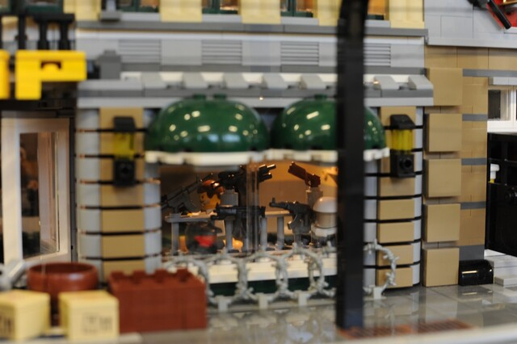](https://www.freelug.org/IMG/jpg/armurerie-2.jpg)

**Armurerie**

Mon module se terminait par une vallée engloutie, en direction de Médérik.

J’y ai réalisé les ponts et les piliers, de mon côté, sans jamais les avoir mis sur leur emplacement dans les rues de Médérik. Tout a été parfait du premier coup. Les modélistes ne feraient pas mieux !

Juste à noter que pour une fois que j’avais transporté mon double module en entier dans le coffre, je me suis retrouvé tout de même le dernier à boucler le réseau, avec un trou de 4 tenons au bout de mon pont...  
Heureusement que Philippe avait de petits bouts de rails de 4 tenons de long, et que je prévois toujours des briques au cas où... Une faille de 4 tenons sur 96 de large dans la montagne à combler, et hop, les trains ont tournés pendant 2 jours sans problème.  
Personne n’a vu le raccord.

Florence nous a apporté sa première création de Locomotive, avec sa petite Vapeur Electrique.  
Cette machine a réellement existé, et circulait en Suisse. L’électricité servait à faire chauffer l’eau pour produire la vapeur, et faire fonctionner la locomotive. En cas de besoin, le foyer pouvait toujours fonctionner au charbon. Le premier moteur Hybride ! :)

L’envie de faire cette loco lui est venue lors de la précédente édition de cette exposition, lorsqu’elle a vu ce modèle réalisé en Meccano...

[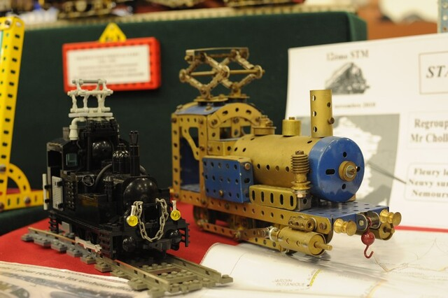](https://www.freelug.org/IMG/jpg/loco-2.jpg)

**Vapeur Electrique**

Malheureusement, elle n’a pas circulé, car elle n’était pas équipée en DCC. Elle est restée exposée à l’opposé du réseau, avec une petite description du fonctionnement.

* * *

**Module Médérick**

De mon côté, la vallée engloutie représentait les rues du centre ville du Havre, reconstruit après-guerre par Perret.  
Un camp de réfugiés a pris place sur les toits, et des épaves de voitures ainsi que des sous-marins et des bestioles de la gamme Atlantis se promenant dans les rues.

[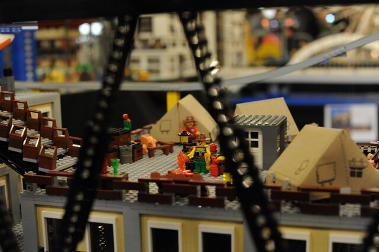](https://www.freelug.org/IMG/jpg/camp.jpg)

**Campement**

[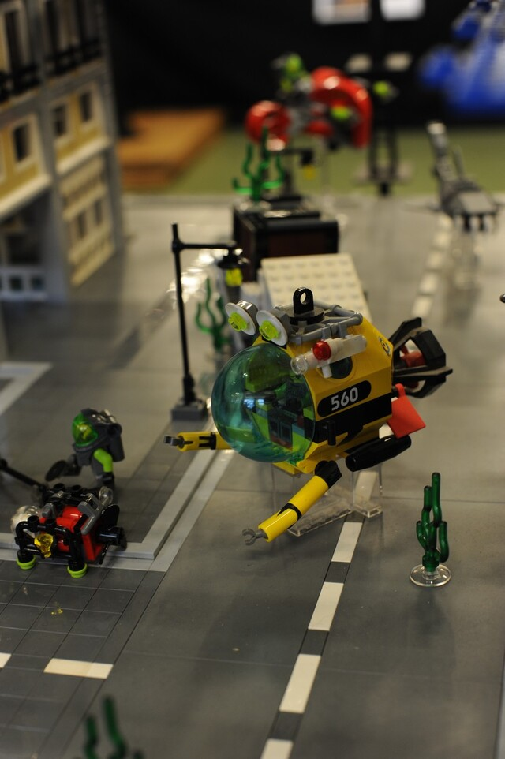](https://www.freelug.org/IMG/jpg/sousmarin.jpg)

**Sous-Marin**

Une tour de Denis a pris place en bout de module, pour recevoir les navettes.  
Le système a très bien fonctionné, sans catastrophe, sauf à la fin au démontage...

* * *

**Module Sébastien et David**

Pour cette partie je n’ai fait que conseiller David dans l’organisation du module.

_Pont Sébastien_

Le thème proposé pour le diorama de 2010 est le film "BLADE RUNNER", film assez futuriste pour son époque.  
A Orléans, le dernier pont construit en 2000 est le [pont de l’Europe](http://fr.wikipedia.org/wiki/Pont_de_l%27Europe_%28Orl%C3%A9ans%29) avec 2 points assez difficiles : l’arche excentrée et inclinée, et le tablier posé sur 2 tripodes dont chacun a un pied dans l’alignement de l’arche. Une fois l’idée lancée, reste de plus difficile : reproduire le pont en LEGO. Le plus compliqué fut de reproduire l’arche pour avoir une bonne forme et une bonne dimension par rapport au reste du pont. Enfin le challenge était assez ambitieux d’autant plus que les rames de trains, le tablier devait être assez rigide pour supporter le poids. Résultat :

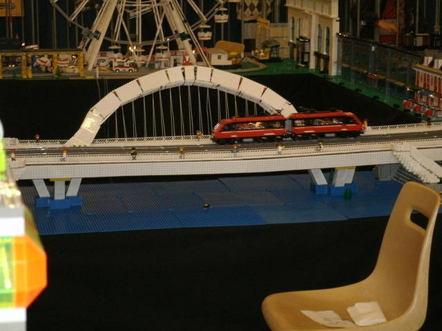

**Pont de l’Europe**

Seb

* * *

**Module Denis**

Encore un grand moment aux cotés de visiteurs toujours surpris et d’enfants émerveillés. Certains échanges avec les adultes sont emprunts de nostalgie.  
Pour cette sortie de la Grande roue, il a fallu penser les plaies d’un accident aérien faisant seulement deux victimes humaines : le pilote du vaisseau égaré et Agrid.

Cette expo a aussi mis au monde un ensemble de deux gares aériennes accueillant tour à tour deux vaisseaux navettes.

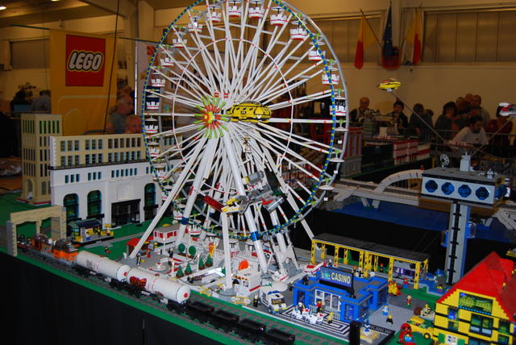

**Roue + Gare Aérienne bleue**

Merci à Médérick d’avoir accueilli la gare rouge sur son module. La fin brutale de cet édifice n’a pas perturbé le spectacle pendant ces deux jours de magie.

A très bientôt !

* * *

**Module Gilles**

Comme j’avais dit à Philippe que je n’aurais surement pas beaucoup de temps il ma confié une petite partie... Une façade pour masquer la zone de triage... de plus de 7 mètres de long ! Me serais-je fais avoir ? ;-)

[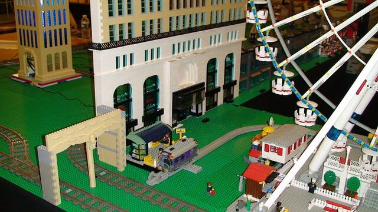](https://www.freelug.org/IMG/jpg/101106-LG-ORLEANS-71.jpg)

[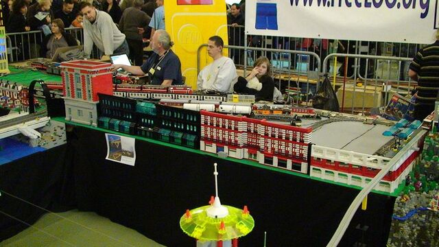](https://www.freelug.org/IMG/jpg/101106-LG-ORLEANS-59.jpg)

Au moins cela ne prenait pas trop de place dans la voiture et j’ai pu emmener des briques pour essayer de finir. Et du matériel de bricolage pour les ajustements de tables.  
Merci à Daniel d’avoir réparé un de mes oublis, un plateau de table, pour que le monorail de Denis puisse rouler.

Une remarque quand on ne positionne pas tout en entier avant : on peut avoir des surprises lors de l’installation.  
Exemple : ils sont pas trop mal mes tunnels mais avec une montagne derrière cela aurait fait beaucoup mieux...

J’ai aussi pris ma nouvelle tour "FreeLUG" reconstruite car l’ancienne avait subit un accident chez mon père.

[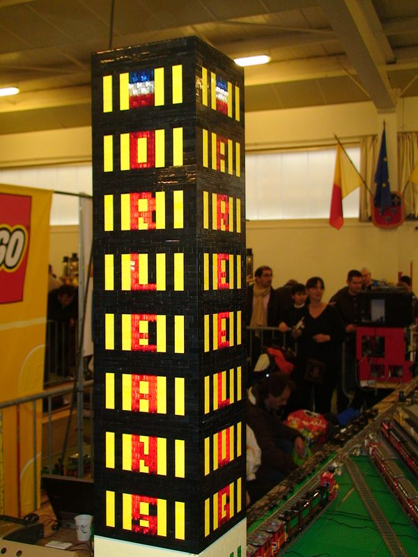](https://www.freelug.org/IMG/jpg/101106-LG-ORLEANS-53.jpg)

Maintenant les lettres sont amovibles, ce qui a permis d’écrire Orléans à la place de Kidexpo. Merci à ce qui ont positionné les lettres, presque 2 fois, car j’avais compté une lettre de plus au nom "Orléans" et décalé la position des lettres.

Encore une fois nous nous sommes bien amusés et c’est toujours une admiration de voir les réalisations des autres. Et de partager aussi bien entre nous qu’avec les visiteurs.

* * *

**Module Philippe**

Sans surprise, je me suis chargé de faire rouler les trains pendant le week-end de l’exposition. Tous équipés en [DCC](/articles/491/) (digital command control), cela permet de faire rouler plusieurs trains sur la même voie, en les pilotant individuellement. Le réseau était équipé de trois boucles indépendantes reconfigurables. Avec l’assistance de l’ordinateur qui [pilotait les aiguillages](/articles/175/), ce fut littéralement un jeu d’enfant. Quoi de plus naturel pour du LEGO :) Moyennant seulement un peu d’attention, cela permettait de faire circuler quatre rames simultanément sans collisions.

[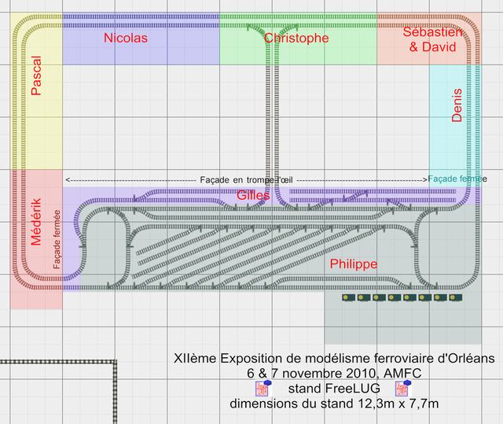](https://www.freelug.org/IMG/png/PlanReseauFreelugAMFC2010.png)

**plan du réseau Orléans 2010**

Voici le plan du réseau complet. Essayez de deviner comment faire circuler trois trains en même temps sans qu’ils se touchent là-dessus ?

En effet, deux rames pouvaient occuper la plus grande boucle ensemble, à charge du "surveillant" d’éviter qu’elles ne se rattrapent. Au besoin (ce qui est arrivé), on pouvait laisser trois rames circuler en totale sécurité anti-collision pendant les pauses repas. Cela participait au spectacle d’objets mobiles sur le stand, s’ajoutant aux multiples animations préparées par chacun. L’ensemble du réseau permettait de garer 13 rames, ce qui offrait beaucoup de possibilités de manoeuvres pour interchanger, sous les yeux attentifs de nombreux spectateurs, les rames en circulation et celles au garage. Heureusement, quelques collisions ont pu avoir lieu :) Il faut bien jouer au LEGO quand même !

Encore un grand plaisir de voir les ami(e)s et jouer ensemble pendant deux jours et demi (le montage héhéhé).

Merci à tous !

Philippe.

[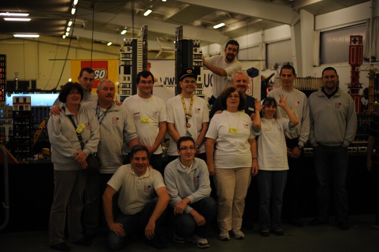](https://www.freelug.org/IMG/jpg/groupe-2.jpg)

**Une partie des exposants, certains étant en vadrouille...**

* * *

## Les galeries sur l’exposition :

**–** [Pascal BRÉARD](http://www.brickshelf.com/cgi-bin/gallery.cgi?f=446891)  
**–** [Gilles MICHELETTI](http://photos.freelug.org/main.php/v/gmifr/Expositions/2010/ORLEANS+2010/)  
**–** [Sébastien HAMON](http://photos.freelug.org/main.php/v/sebhamon/Orleans+2010/)  
**–** [Béatrice GOBERVILLE](http://photos.freelug.org/main.php/v/goberville/orleans2010/)  
**–** [Rémi BOURRE](http://photos.freelug.org/main.php/v/Bug_s/Orlean+2010/)  
**–** [Denis LAURENÇON](http://photos.freelug.org/main.php/v/dlaurencon/Expo/Orleans+2010/)

* * *

Montage des vidéos de Pascal tournées pendant le week end

**–** [vue d’ensemble](http://www.youtube.com/watch?v=fKj69LYFnpw)  
**–** [crash des trains](http://www.youtube.com/watch?v=jRAcQdX9H3w)

Revoir les expositions précédentes :  
[2008](/articles/820/), [2006](/articles/545/), [2004](/articles/323/).
