FreeLUG et Fanabriques y sont allés ! Suite à notre prestation de l’année dernière, le rendez-vous avait été pris pour cette année, car c’était les 10 ans ! Récit d’une aventure et d’une exposition hors normes !

Et si la durée pouvait donner quelques appréhensions, c’est surtout la pénurie d’essence qui nous faisait le plus peur. Nous étions en effet en plein conflit sur la réforme des retraites, et les stations essence étaient en rupture les unes après les autres. Si le jour J nous avions finalement tous le plein, c’était au tour des opérations escargot de nous faire craindre des ennuis. Mais finalement, le voyage s’est très bien passé.

## Le stand FreeLUG

C’est donc à une douzaine que nous nous sommes rendus au LEGOWorld cette année. Plus que l’année dernière (6) mais toujours moins que les premières années.

Pour l’occasion, nous avions 30 mètres de stand.

**Le diorama des ferries de Jean-Marc**

[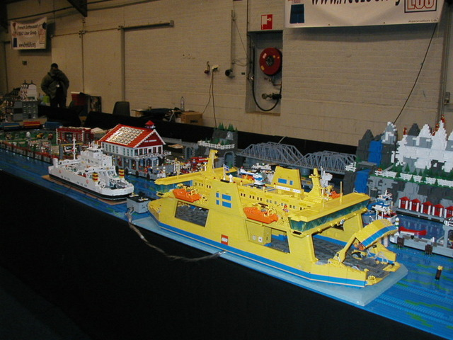](https://www.freelug.org/IMG/jpg/PA240053.jpg)

**Le diorama City**

Nous étions cinq à nous partager l’espace City, 4 personnes sur un layout commun (Eric, Pierre, Christophe, Jérémy) et Laurent qui n’a pu se raccorder avec les autres à cause des différences de niveaux de son layout (ou inversement).

**–** Module de Laurent : ville et parc

[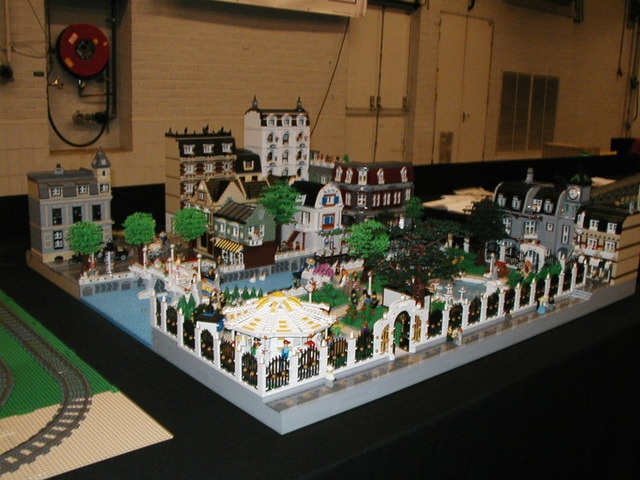](https://www.freelug.org/IMG/jpg/PA240068.jpg)

**–** Module d’Eric : immeuble de bureau, bâtiments modulaires, temple

[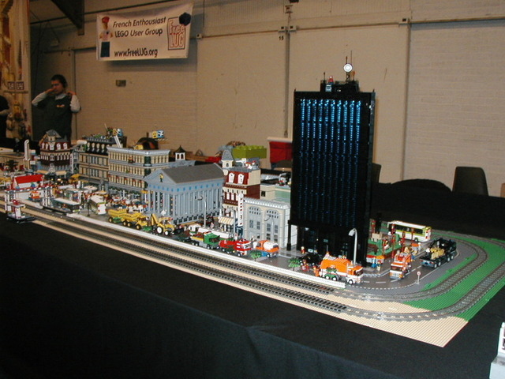](https://www.freelug.org/IMG/jpg/PA240056.jpg)

**–** Module de Jérémy :  
Le module est composé principalement de bâtiments modulaires.  
Sets officels : caserne de pompier, green grocer, corner café.  
Sets modifiés : cinéma et mairie du TownPlan (2 boîtes), legoshop (3 boîtes) : une boite construite normalement (en angle), une boîte pour la version "droite" et une boîte pour rajouter un étage sur les 2 précédents.  
Construction personnelle : le LEGO Store et le Starbuck Café : ce montage est une reproduction d’un autre montage réalisé par un employé d’un LEGO Store en Allemagne, ma version inclut cependant une version agrandie du Starbuck Café (+16 tenons).  
Sur le devant on retrouve une gare routière pour les bus.

[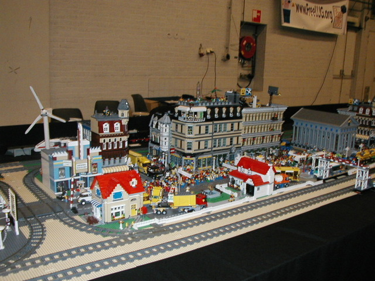](https://www.freelug.org/IMG/jpg/PA240066.jpg)

**–** Module de Pierre : centre commercial

[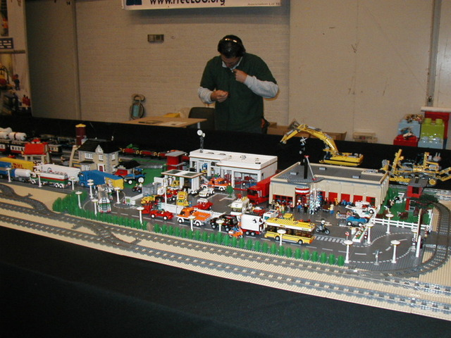](https://www.freelug.org/IMG/jpg/PA240058.jpg)

**–** Module de Christophe : voies de garage, aiguillages télécommandés

[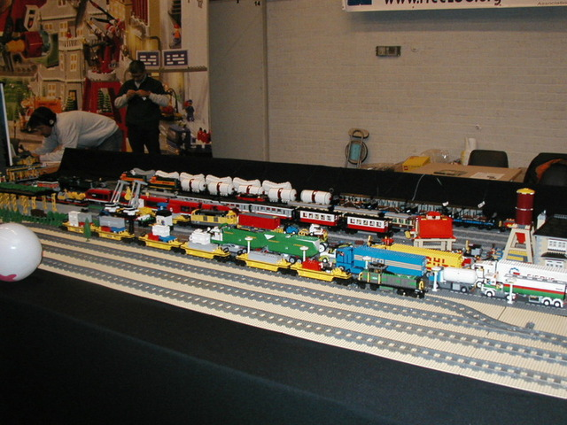](https://www.freelug.org/IMG/jpg/PA240059.jpg)

**–** La manifestation :  
Afin de rester solidaire avec les membres restés en France, nous avons nous aussi fait notre manifestation :

[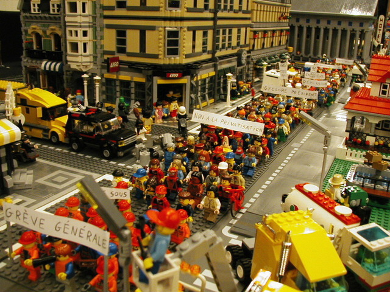](https://www.freelug.org/IMG/jpg/PA220048.jpg)

Les évènements en France étant relatés aussi aux Pays-Bas, notre manifestation faisait bien sourire le public :)

**Le diorama Atlantis**

Après les Power Miners l’année dernière, je cherchais un nouveau thème pour les dix ans. Tout est parti d’une boutade avec Erik : "Et si on faisait de L’Atlantis et du Space Police", créations de Mark Stafford déjà père de la série Power Miners. Il m’aura fallu l’année pour réunir tous les sets sortis, le dernier set le [30040](http://www.bricklink.com/catalogItem.asp?S=30040-1) rejoignant le layout en pleine installation sur place.

Au programme : ruines, temple sous la pression d’Eric, falaise pour la porte d’Atlantis et durant le salon de nombreuses plantes piochées au Pick-a-Brick ou chez les revendeurs, un container merci Erik, et bien sûr la gamme au grand complet parfois en plusieurs exemplaires.

Un seul regret, l’éclairage, il me manquait une lumière noire pour un effet plus spectaculaire...

[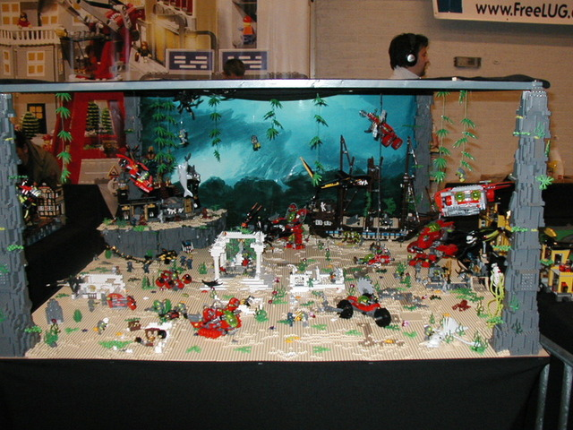](https://www.freelug.org/IMG/jpg/PA240060.jpg)

**Le diorama Pirates**

[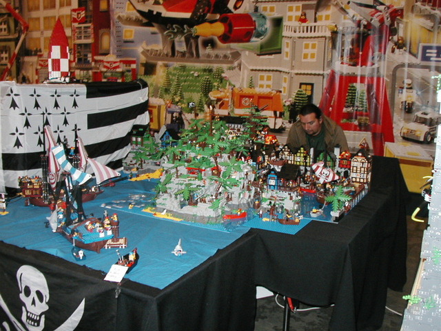](https://www.freelug.org/IMG/jpg/PA240061.jpg)

**Le diorama Space Police**

Friand de la nouvelle gamme Espace, les SpacePolice III, j’ai jeté mon dévolu sur un diorama Space Police.

A l’exception de la verrière, tout a quasiment été construit en 72 heures, avant le départ. Les derniers préparatifs ont été fait en compagnie des Rhône-Alpiens à minuit la veille du départ... Un diorama à usage unique, détruit le soir du démontage.

Le diorama se séparait en deux zones :  
**–** la cité, composée de grands immeubles futuristes, qui n’étaient que des façades  
**–** l’extérieur de la cité, avec rochers et météorites construites sur place...

Toute la gamme SpacePolice III était présente, ainsi que des minifigs de chaque gamme Espace.

[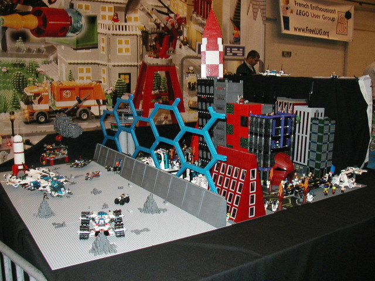](https://www.freelug.org/IMG/jpg/PA240062.jpg)

**Le stand Fanabriques**

[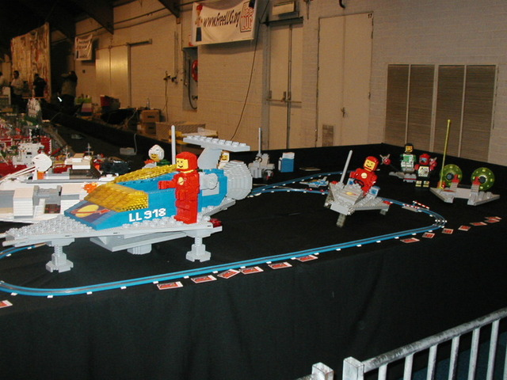](https://www.freelug.org/IMG/jpg/PA240051.jpg)

**Le coin Mindstorms**

Philo n’est arrivé qu’à partir du week-end. Il a présenté son scanner 3D laser, qui permet, après retouche, la modélisation des pièces au format LDraw.

## Le salon

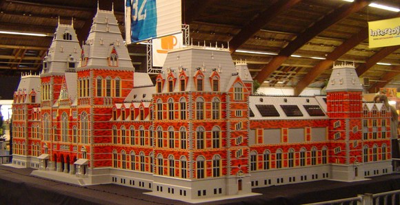

**Chateau réalisé par l’équipe hollandaise**

## La fin d’Atlantis et du Space Police

Pour respecter la tradition, les dernières heures du salon ont été consacrées au massacre de quelques dioramas. Il y a trois ans, c’était à coup de bulldozer. Cette année, ce fut avec les excavatrices achetées sur place, à 115 euro :)

[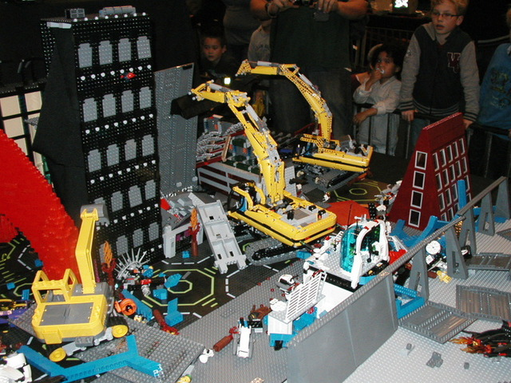](https://www.freelug.org/IMG/jpg/PA270257.jpg)

[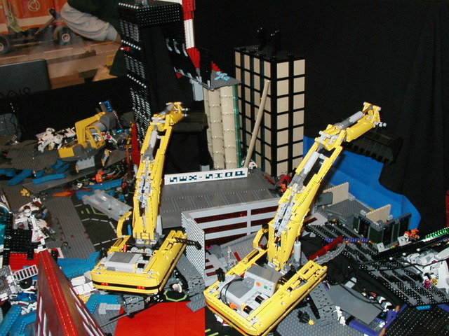](https://www.freelug.org/IMG/jpg/PA270259.jpg)

## La vie à côté sur le salon

**–** le LEGO store :  
Cette année nous avions la possibilité de trouver (et d’acheter) différents goodies : briques géantes de rangement, têtes de minifigs de rangement, miniset Halloween et Noël, porte-clef, mug, polo, banderoles...  
**–** le LEGO Shop  
Dans la boutique officielle on pouvait trouver les dernières boîtes exclusives comme la navette spatiale, la navette StarWars, la boutique de Noël ou encore la boulangerie de Noël. On trouvait également les minifigs série 1 et 2.

**–** le Pick-a-Brick  
comme chaque année, des grandes bassines remplies de pièces LEGO, mais beaucoup de briques de base cette année. Ce n’était pas aussi riche que les années précédentes  
**–** le stand designer  
  
**–** Intertoys  
super promo sur l’excavatrice Technic  
**–** les vendeurs de pièces détachés

## Des visiteurs de marque

Nous avons reçu sur notre stand quelques visiteurs : les minifigs requin Atlantis et Max du LEGO Club

[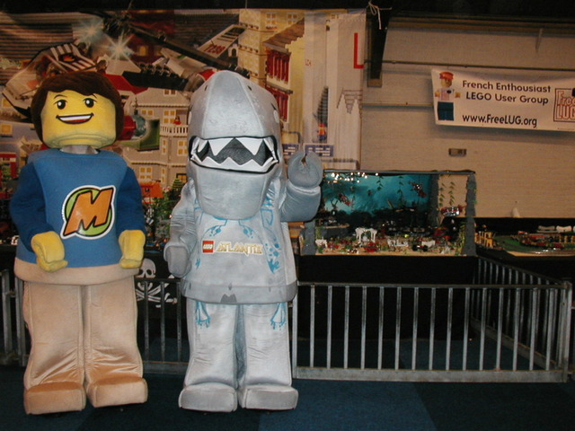](https://www.freelug.org/IMG/jpg/PA260245.jpg)

mais aussi les designers

[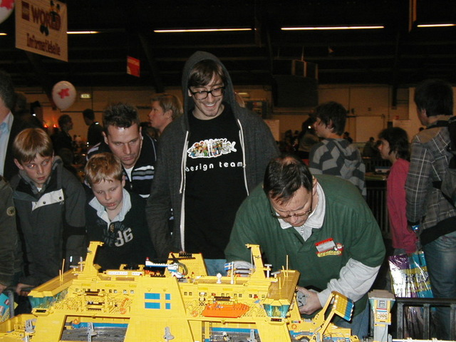](https://www.freelug.org/IMG/jpg/PA260249.jpg)

[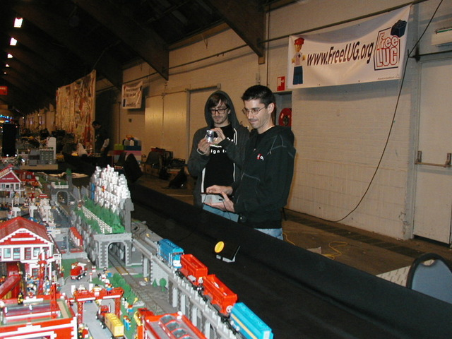](https://www.freelug.org/IMG/jpg/PA260251.jpg)

**Jamie Berard aux commandes des trains de Jean-Marc**

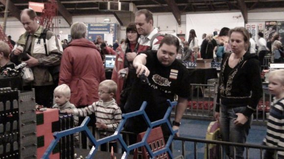

**Mark Stafford photographiant le diorama SpacePolice (designer de la gamme)**

## Le rangement

Comme toute bonne chose à un fin, il faut à un moment se décider à ranger.

[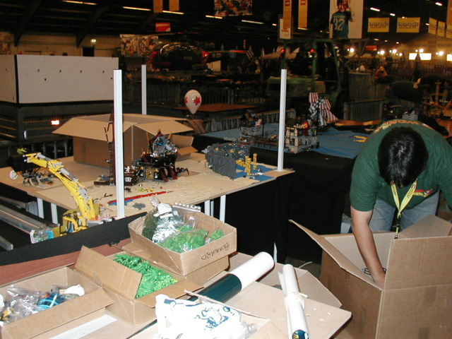](https://www.freelug.org/IMG/jpg/PA270261.jpg)

**Ca emballe...**

mais on s’aperçoit sur cette photo que ce n’est pas sans conséquence :)

[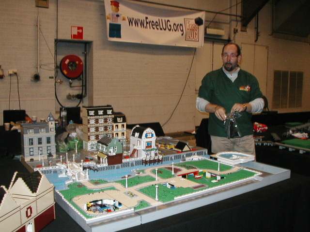](https://www.freelug.org/IMG/jpg/PA270263.jpg)

**Ca démonte...**

[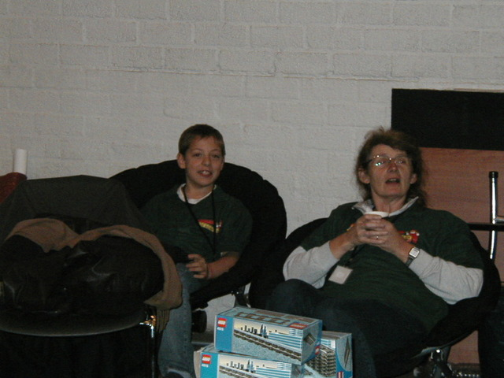](https://www.freelug.org/IMG/jpg/PA270264.jpg)

**Et ça se tourne les pouces**

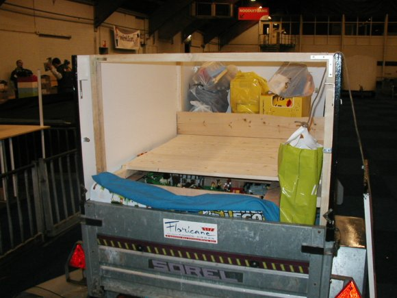

**Mince, les clés sont restées au fond de la remorque**

## Le mot d’Eric :

De nouveau du voyage pour la dixième édition du LEGO WORLD de Zwolle. Ma cinquième participation, ce n’est pas avec une certaine appréhension que je me suis inscrit, 8 jours c’est long et très éprouvant.

Tout d’abord un grand merci à Manu, Erik, Jérémy, Laurent, Christophe, Pierre, Jean-Marc, Thierry, Mickael, Benoît, Hugo, Philippe, Annie, Marie pour avoir partagé l’aventure avec moi !

La préparation a été laborieuse, beaucoup de choses s’étant faite quasiment au dernier moment ! Je me dis toujours qu’il faudrait prendre plus de temps pour se préparer.

Le voyage est long jusqu’à Zwolle, mais tout est oublié dés que l’on arrive ! L’équipe hollandaise avait tout préparé, l’installation a pu se faire facilement et sans difficulté.

L’organisation de ce salon est bien établie, malgré que nous regrettons toujours notre bonne cuisine française !  
L’exposition offre toujours d’excellentes surprises, tous les thèmes sont abordés ; il y a toujours quelque chose à découvrir !

Avec autant de LEGO sous les yeux , difficile de ne pas faire d’achats ! J’ai fait beaucoup de visite au PàB ! Bon j’espère ne pas avoir trop manqué sur le stand :o)  
J’ai aussi appris de nouveaux mots anglais : loco garage, yellow level, stop, gold book suivi de Guest book... Bref, notre ami Jean-Marc a bien animé son stand et ses bateaux, malgré toutes les bêtises que nous lui avons faites. Il a bien participé à la bonne ambiance et la bonne humeur du groupe !

Manu toujours fidèle à lui même et infatigable pour les afters ! Thierry et son grand appétit ! Marie pour les petits gâteaux de Noël alsaciens ! Erik toujours stoïque ! Hugo qui a peut être révélé sa passion pour les LEGO et sa gentillesse !

Même si les derniers jours ont eu à souffrir du rhume, j’espère ne pas avoir été trop taciturne ! J’ai donc passé de très bons moments au LEGOWORLD 2010, Bravo et merci à tous l’équipe De Bouwsteen, FreeLUG et Fanabriques.

## Mot de Manu

Exposition sans aucun intérêt, surtout n’y allez pas !!!!! :D

## Mot de Christophe

En plus ils parlent que Hollandais. Sinon une bonne expérience de salon/exposition à faire au moins une fois dans sa vie d’Afol.

## Mot de Jean Marc

Comme novice du LEGOWORLD, après 4 ans de réflexion (j’y vais ou j’y vais pas !!!), le rêve s’est enfin réalisé au retour de Fana’briques en discutant avec Mickael. Après plusieurs mails concernant le chargement (20m2 en tout), nous sommes partis avec la peur au ventre : aura-t-on de l’essence pour arriver à Lille ? ouf ! Oui prés d’Amiens.

Nous sommes donc arrivés à Zwolle la veille de l’installation, hôtel trop cher, nous avons du dormir dans la voiture sous un déluge, parait-il, je suis sourd quand je dors (pour mémoire).

Le lendemain matin, nous nous installâmes, les autres potes arrivèrent comme prévu en milieu d’après-midi. Nous sommes prêts, on aurait du chanter la Marseillaise et faire la levée des couleurs française et bretonne... non... A l’entrée, le public, impatient, en masse compacte, attend fébrilement l’ouverture des portes solidement gardées par des vigiles et c’est la ruée générale... Pour ma part, les gens regardent avec étonnement mon grand diorama animé. Je venais de terminer ma petite séance de rodage... Place à la sélection d’un enfant, j’en choisis un, j’élimine les enfants qui mâchent un chewingum (ex : des j’enfoutistes), les parents inquiets au départ se laissent aller par mes propos cool (_no problemo_). A la fin de la démonstration, livre d’or obligatoire au passage, thank you, ou bedankt (merci) (j’ai appris quelques mots en Dutch au passage), bye bye, et sourire surtout d’un enfant heureux de cette inoubliable expérience. Changement d’enfant, boy or girl, garçon ou fille, rebolote avec l’inquiétude des parents. A la fin, tout le monde avait compris mon système, et à ce moment là, des dizaines de mains apparaissent et me demandaient de jouer avec moi. Malheureusement, je ne suis pas un robot pour satisfaire tout le monde, certains déçus le matin ont tenté leur chance le soir... Ca a été comme ça pendant les 8 jours de ce salon hors norme.

Avant l’ouverture, photos des autres stands, idem le soir avant la soupe. Le stand FreeLUG était superbe, beaucoup de créations. L’ambiance fut excellente, je laisse passer les énormes bêtises de certains, j’ai vu des photos bien bizarres, étranges, parmi elles, mon ferry jaune, le plus difficile, a été piloté par un certain pierre L. J’ai gardé mon sourire difficilement tout en ayant un oeil sur eux. J’ai conversé avec beaucoup d’exposants très sympas, par chance, j’ai pu avoir des personnes qui parlaient un peu français, ce n’était pas évident pour un sourd, mais j’adore les défis. J’ai secrètement invité pour FreeLUG les Designers de LEGO (Megan Rothrock, Mark Stafford, Jamie Berard, Irdig Gallum , et Pierre Normandin), un très bon moment pour le stand français. Je passe sous silence la nourriture locale. Je remercie l’organisation fort remarquable de De Bouwsteen et ses nombreux cadeaux. J’ai fait des achats comme les autres mais je fais le difficile même si les prix sont intéressants. Enfin, c’est l’heure de repartir avec arrêt chez Charlie et ses drêles de Loustics. Quant à nous , notre arrivée en Bretagne fut très tardive.

Grand merci à mon chauffeur Mickael et surtout la patience à mon égard (chut, il parle trop vite, je ne comprends pas toujours... chut

## Mot de Laurent

Pour ma première participation au LEGOWorld, j’ai choisi l’année des 10 ans. Départ de Lyon avec Pierrolego, tout a tenu dans la voiture, le plein est fait : c’est parti pour les Pays-Bas via Paris, pour équilibrage des charges : les LEGO dans le fourgon, des FreeLUGiens dans la voiture.

Une fois arrivés, l’installation avance bien, quelques soudures à refaire au niveau des lampadaires, et presque tous les arbres à reconstruire. Et c’est parti pour 8 jours de LEGO.

J’ai beaucoup apprécié ce premier LEGOWorld, grâce à l’organisation exemplaire de De Bouwsteen, à celle de nos habitués du LEGOWorld et la bonne humeur de tous malgré quelques rhumes... A une prochaine fois !

## Le mot de Pierre

Et ben que dire ? Pour la deuxième année consécutive, je suis retourné au LEGOWorld, et je ne regrette rien ! Encore du LEGO de partout, plein de choses à voir. Les soirées au chalet ont aussi été de très bons moments et de bonnes parties de rigolade ;-)

Alors peut-être à l’année prochaine... Qui sait... :-D

## Le mot d’Erik

Et de cinq !

2003, 2005, 2007, 2009, je romps le rythme de tous les deux ans, pour participer au dixième anniversaire du LEGOWorld.

Un superbe stand, une ambiance toujours excellente. Sur les huit jours, j’ai enfin trouvé le temps d’aller faire une petite visite en ville. Il était temps :)

Une organisation rodée que ce soit le transport ou le séjour.

Quelques regrets :  
**–** finalement, il n’y avait rien de spécial d’organisé pour les 10 ans ;  
**–** pas de Billy Ranch Party, visiblement le restaurant avait fermé ;  
**–** un Pick-à-Brick décevant (mais ça nous fait des économies).

On retiendra :  
**–** le chauffage en rade dans le bungalow. 13°C au réveil, ça fait froid (heureusement le chauffagiste est intervenu au deuxième jour) ;  
**–** la nourriture hollandaise, notamment la sauce cacahuète omniprésente et la soupe à la moutarde ;  
**–** les soirées endiablées sur la Wii ;  
**–** un diorama SpacePolice que je croyais plus fragile que ça : les excavatrices ont eu du mal - bon, à leur décharge elles ne sont pas puissantes ;  
**–** le passage toujours apprécié de Pierre Normandin au chalet ;  
**–** l’infidélité de notre trésorier ch’ti, qui a participé au diorama de nos confrères de BeLUG et qui a été présent le soir de l’installation :)

## Le mot de Thierry

Mince, mais que c’est grand !

Les bâtiments totalisent une longueur de 320 mètres pour une largeur de 45 mètres, à la louche, ce qui fait 15.000 m2 remplis de gamins et de briques.

Et quelles briques !!!!

De toutes les formes, de presque toutes les couleurs.  
Du beau, du génial, de l’étonnant, du classique, du gigantisme...

Et toujours les yeux pétillants des mômes et qu’un seul mot en bouche : ’LEGO’

Bizarre ? Non ?

Bin non, car on est dans le temple XXXL du LEGO !

C’est une expérience à tenter.

Merci à Erik pour l’organisation et aux copains pour les bons moments passés ensemble.

## Les liens vers les galeries photos

**–** [Photos d’Eric](http://photos.freelug.org/main.php/v/f1tvf/expositions/legoworld2010/)  
**–** [Photos de Jérémy](http://cid-c7c201d465957006.skydrive.live.com/browse.aspx/.res/C7C201D465957006!4688)  
**–** [Photos d’Erik](http://photos.freelug.org/main.php/v/brickerik/expositions/2010/Legoworld/)  
**–** [Photos de Jean-Marc](http://photos.freelug.org/main.php/v/barr__/expositions/2010/Legoworld/)  
**–** [Photos de Christophe](http://photos.freelug.org/main.php/v/Tof92/LEGO-WORLD+2010/)  
**–** [Photos de Laurent](http://photos.freelug.org/main.php/v/LaurentT/Expositions/Legoworld2010/)

## Le mot de la fin

Nous avons passés une excellente semaine, du LEGO tous les jours du matin au soir, des constructions de tous style, de toutes tailles ! Nous ne pouvons espérer qu’une chose revenir et être encore plus nombreux !

Merci aux participants et à l’équipe de De Bouwsteen
