Annoncé depuis un petit moment maintenant, j’ai trouvé le premier vase, parmi les trois à collectionner, chez le fleuriste Happy.

Nous attendions ces vases depuis qu’ils avaient été [annoncés pour octobre](http://www.femmeactuelle.fr/jardin/plante-d-interieur__1/vases-en-lego-monceau-fleurs-00476). Me rendant chez mon fleuriste, régulièrement, je n’ai pu les acquérir qu’après le weekend du 11 novembre.

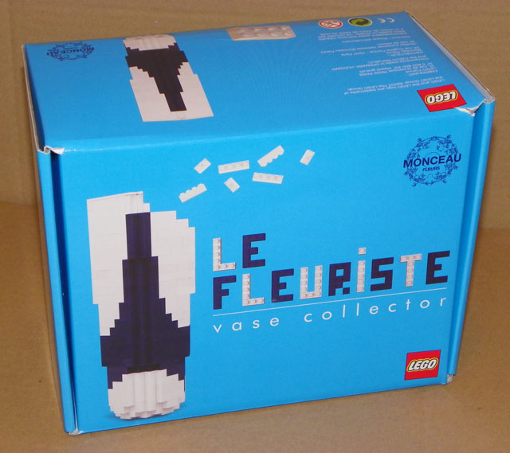

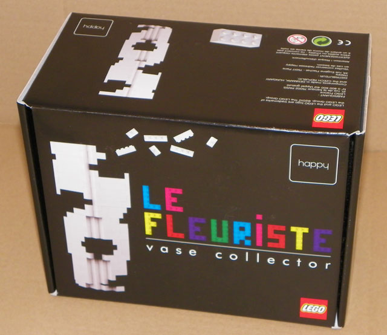

A ma grande surprise, la demande est très forte sur ce produit et j’ai raflé les derniers disponibles. Ce sont des éditions numérotées.

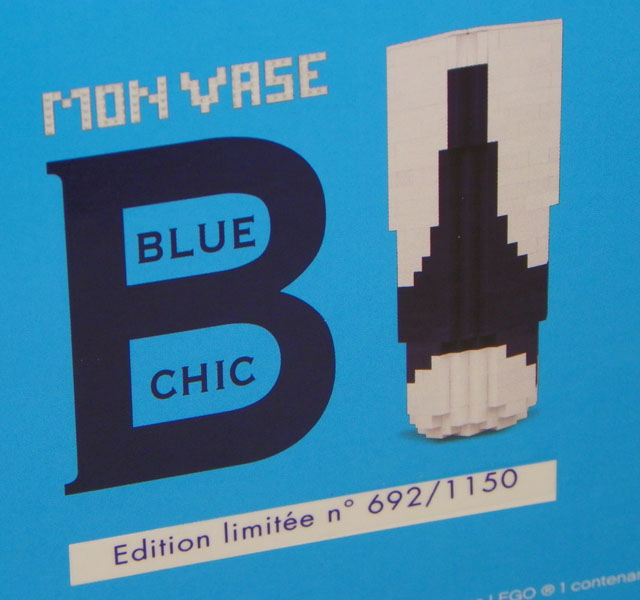

Il s’agit plus précisément de trois vases, commercialisés sous le nom de gamme "LE FLEURISTE", conçus par le [LEGO Certified Professional René Hoffmeister](http://www.certified-pro.de/index.html). Ils ont la même forme mais ils varient par le choix des couleurs. Ils sont en outre distribués séparément par trois chaines de fleuristes : [Happy](http://www.happy.fr/) (Arty), [Monceau](http://www.monceaufleurs.com/) (Blue Chic) et [Rapid’Flore](http://www.rapidflore.fr/dhtml/home.php?id=144). C’est a priori une exclusivité pour la France mais il n’est pas interdit de penser que d’autres variations pourraient être disponible à l’étranger dans d’autres chaines de fleuristes.

Le prix varie de 19.50 à 19.90 euros pour plus de 300 pièces (pièces basiques - briques, plaques, plaques lisses). Le coût est donc raisonnable si l’on tient compte de l’ensemble : boitier-coffret plus solide et soigné que les boîtes habituelles, un récipient-vase translucide.

[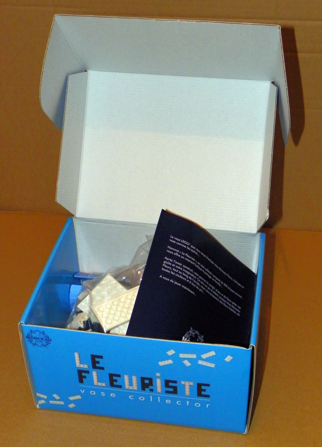](https://www.freelug.org/IMG/jpg/Photo_024.jpg)

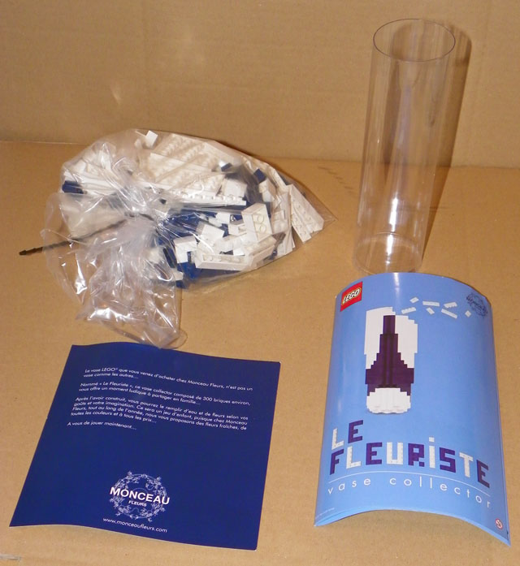

Un récipient en plus car cette ensemble de briques n’est en fait pas un vase (les montages en LEGO ne sont pas étanches) mais plutôt un cache-pot. On regrettera que les pièces soient toutes en vrac dans un sachet fermé d’un lien plutôt que des sachets individuels auxquels nous sommes habitués.

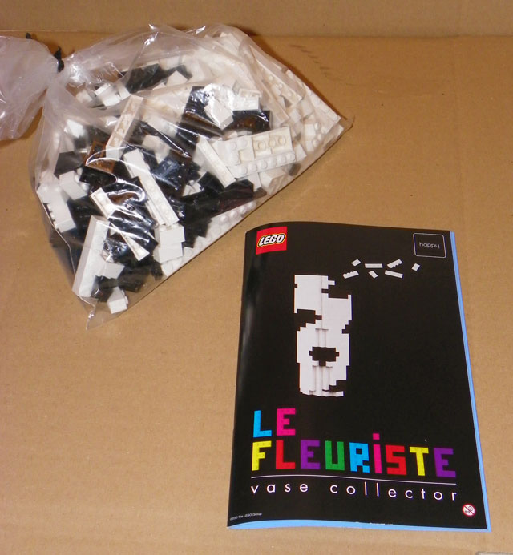

La notice n’a rien de particulier, on y retrouve les images en perspectives des étapes de montage et la liste des pièces à la fin.

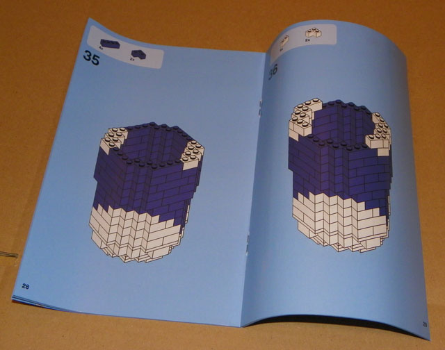

Les pièces ne raviront a priori pas les fans de LEGO - que du très courant, sauf en ce qui concerne le modèle "Blue Chic" (Monceau) qui se détache avec une quantité non négligeable de pièces bleu-foncé. Mais ces modèles pourraient, pour une fois, plaire à madame, surtout si vous les agrémentez de [roses... en LEGO](http://www.brickshelf.com/cgi-bin/gallery.cgi?f=350924).

## Revue du montage du vase version Happy

Alors tout d’abord, la boîte

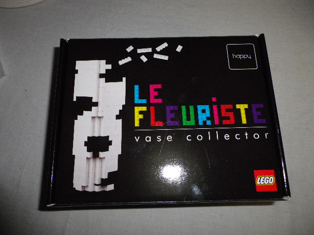

**la boite**

Une belle boîte, qui met bien en avant la gamme "Le fleuriste" avec un petit logo LEGO en bas pour rappeler de quoi sera fait le vase.

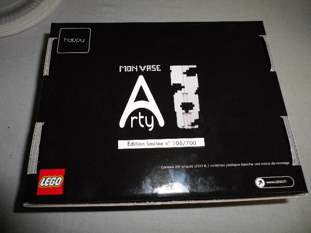

**l’arrière**

A l’arrière, on trouve le numéro attribué à la boîte. A savoir qu’il y a 700 exemplaires du vase Happy et 1150 exemplaires des vases Monceau et Rapid Flore.

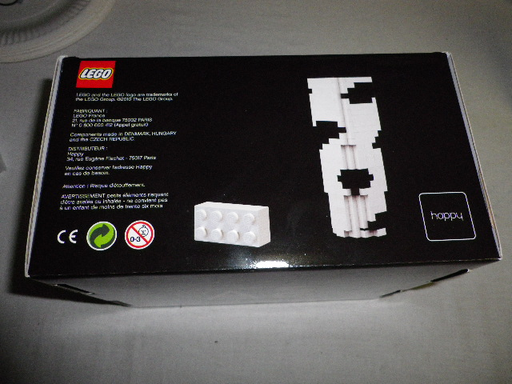

**le côté**

Sur le côté, on trouve le distributeur, ici Happy.  
Le fabriquant est LEGO France, vraisemblablement cela a été fait en collaboration directe avec LEGO France.

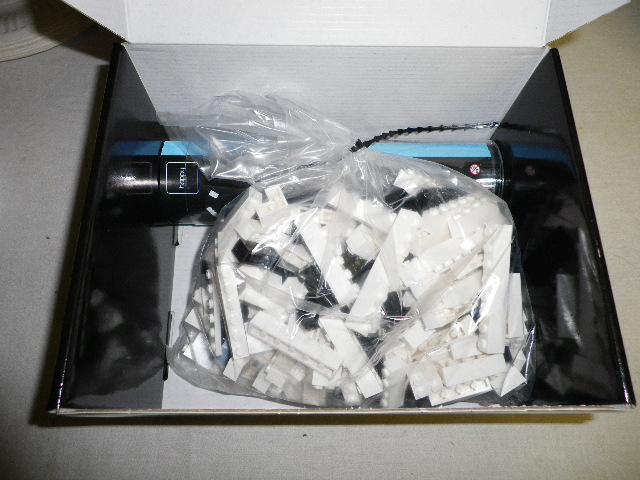

**l’intérieur**

On ouvre la boîte par le dessus, sans aucune déchirure de la boîte, elle pourra être refermé par la suite.

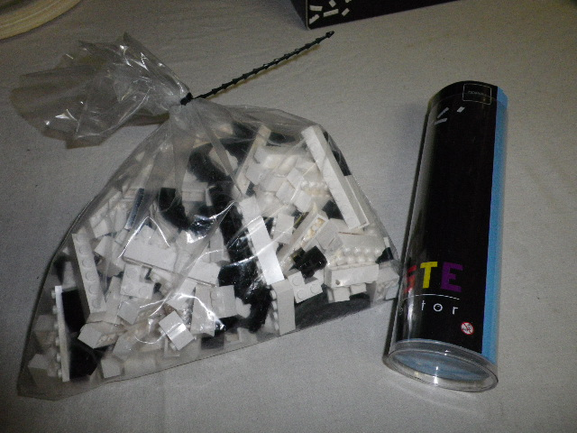

A l’intérieur on trouve les pièces dans un unique sachet. La notice a été roulé dans le récipient plastique qui fera office de vase.

On commence alors le montage...

La base...

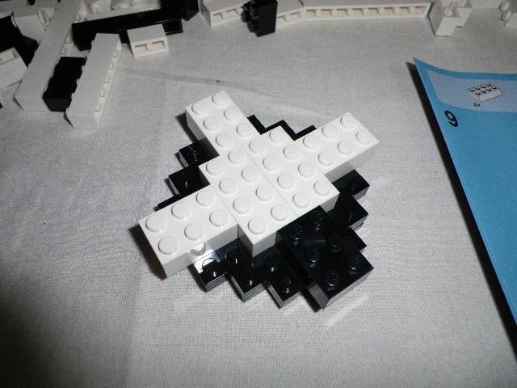

On monte sans problème...

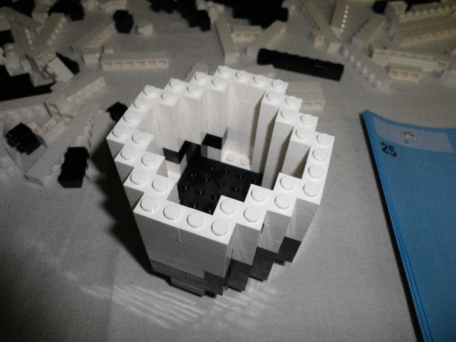

Et puis on arrive vite à la fin...

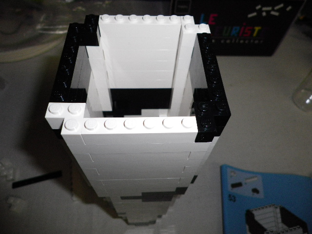

Le montage est assez simple et répétitif.

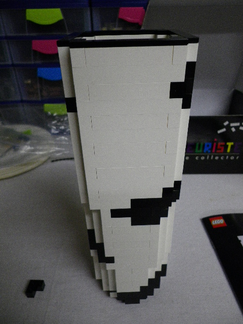

Donc voilà pour le montage, On met ensuite le pot à l’intérieur. Il n’est pas très bien calé, puisque juste posé sur des tenons.

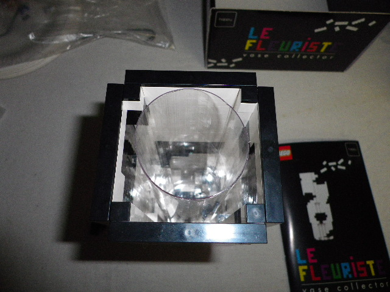

Enfin normalement il y a juste des fleurs dedans, donc ça ne devrait pas trop bouger.

Pour le montage des deux autres vases, rien ne change. Les vases sont identiques au montage.

Juste une petite chose change, ce sont les pièces.

Toutes les pièces ne sont pas disponible dans toutes les couleurs. Par exemple, on utilise 3 plates 1x2 et 3 plates 1x1 pour faire les briques en angle dans la couleur bleu claire. A d’autres moments, la plus longue brique est la 1x4 alors que l’on a besoin de 1x6 ou 1x8.

Voilà pour le montage.

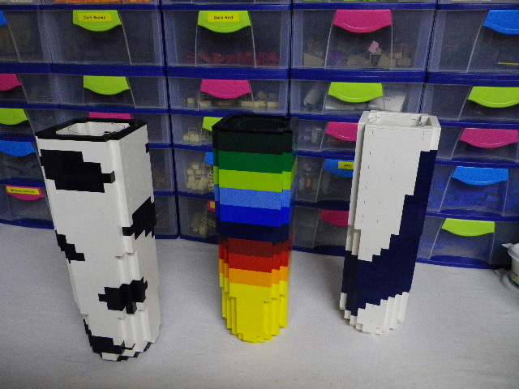

**les 3 vases !**
