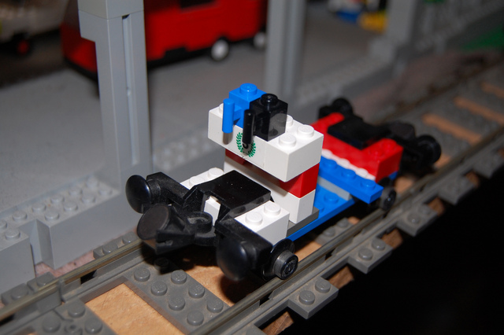
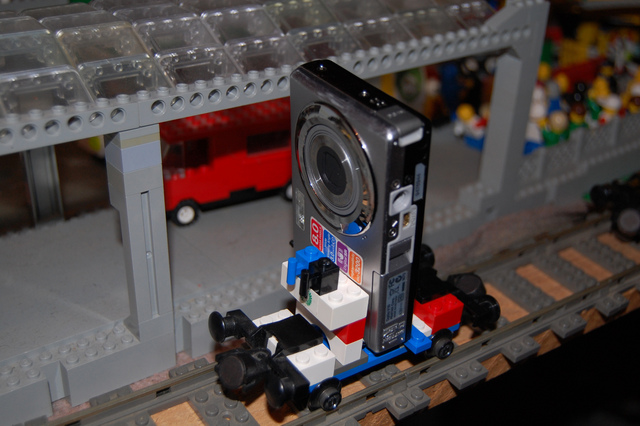
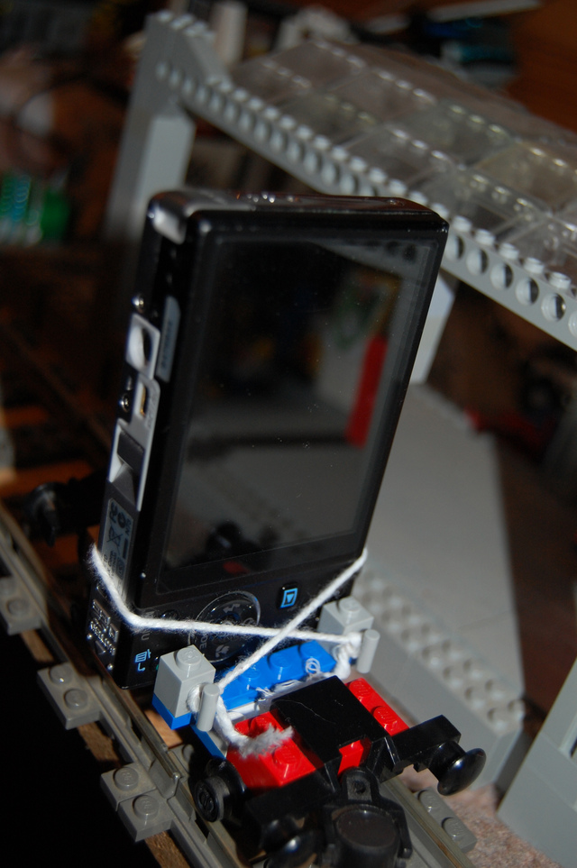
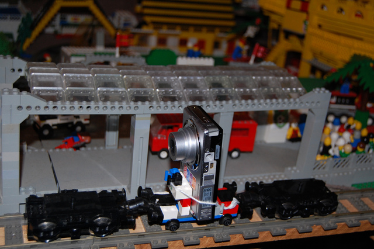

L’idée est d’embarquer un appareil photo numérique de type compact à bord d’un train 9v et de largeur 6 tenons.

Ces appareils standards, largement démocratisés depuis des années, offrent pour la plupart une fonctionnalité "prise de vidéo" dont la qualité variera énormément d’un modèle à un autre, mais présentent cet avantage d’avoir, pour la plupart également, des dimensions très similaires, ce qui permet de standardiser un modèle de chariot ferroviaire (il ressort dès la conception du prototype qu’il sera impossible d’en faire un véritable wagon sur certains circuits) sur lequel charger ledit appareil.

**wagonnet 1**

L’intérêt de l’ouvrage est simple, immédiat, et à mon sens assez énorme : une fois votre compact installé et prêt à l’emploi à l’avant de votre train, vous n’aurez plus qu’à lancer le moteur pour avoir un enregistrement palpitant et émouvant de votre circuit, exactement comme si vous vous trouviez à la place du chauffeur. Pour cela, la construction d’un wagonnet adapté au transport d’un compact standard devra impérativement respecter trois directives.

## En matière de longueur

La contrainte de la longueur sera la plus simple à appliquer ; on préférera un wagonnet aussi court que possible, le châssis pourra consister en une plaque de 4x10, afin de concentrer au maximum le poids de l’appareil et minimiser les risques de désaxement de l’objectif, liés au balancement dans les phases d’accélération. L’appareil sera en effet bloqué contre une colonne de trois briques de hauteur, placée vers l’avant du wagonnet, et dans une fente de deux tenons et demi de large (voire trois pour des modèles pour épais), côté objectif vers le haut. On préférera ne pas disposer de colonne pour bloquer l’appareil par l’arrière, car les briques ne manqueraient jamais d’appuyer accidentellement sur les boutons de réglage, et rendraient la manipulation du chargement excessivement délicate. Dans le cas de mon appareil, la saillie pour la boucle de la dragonne permet un calage supplémentaire entre les tenons du châssis.

**wagonnet 2**

## En matière de largeur

La contrainte de la largeur pose deux problèmes ; le premier est lié directement à l’environnement de votre réseau ferroviaire, car la largeur d’un appareil compact tiendra rarement en six tenons, et devra donc déborder le train par les deux côtés. Dans la mesure où cette largeur n’excédera cependant pas les huit tenons que font les rails plus leurs traverses, il faudra simplement veiller à ce que l’environnement direct du circuit (passants, arbres, panneaux, murs irréguliers...), ne heurte pas l’appareil à son passage.

Le second problème est celui de la force centrifuge dans les virages ; le poids de l’appareil est si important qu’il faudra immanquablement trouver une solution pour l’immobiliser dans la fente de deux tenons et demi. Je propose à cette fin l’emploi d’une cordelette nouée à deux briques de 1x1 et dotées de crochet, que l’on disposera de part et d’autre d’une barrette de 1x6 fixée juste derrière l’appareil, et le ceinturant fermement en s’enroulant autour de la colonne de trois briques à l’avant.

**wagonnet 3**

## En matière de hauteur

La contrainte de la hauteur sera sans aucun doute la plus difficile à vaincre, car la plupart des appareils placés sur la largeur, seront plus hauts que la hauteur totale des trains 9v, d’environ trois ou quatre briques (ma référence étant la locomotive rouge du set 4563). Afin de minimiser cet écart, la solution que je propose est de rabaisser le wagonnet en le construisant sur des roues de petit diamètre, du même genre que celles employées dans le set Spiderman 4855 pour le métro, puis de monter les aimants sur deux briques standard de 2x4 que l’on placera alors à chaque extrémité du châssis afin d’assurer la compatibilité avec la locomotive. Même dans cette configuration, le compact aura toujours deux briques de plus en hauteur qu’un train standard, ce qui vous obligera à prévoir de la marge lors de la construction des tunnels et des ponts sous lesquels devra passer votre train.

## Pour profiter du spectacle

Je ne sais pas si cela serait le cas avec tous les autres trains, mais il se trouve que mon appareil est si lourd qu’une locomotrice seule n’est pas si suffisante pour le pousser sur tout le circuit, c’est pourquoi j’en emploie également une pour le tirer.

**wagonnet 4**

L’embarcation est relativement stable, mais je vous déconseille d’aller à pleine vitesse, car cela menacerait l’équilibre du wagonnet et gâcherait le rendu de la vidéo qui doit être aussi harmonieuse et éclairée que possible.

Cette vidéo, lorsque vous l’exporterez sur votre ordinateur, sera d’ailleurs verticale du fait de la position de l’appareil lors de la capture d’image ; prévoyez donc cinq minutes pour la réorienter à l’horizontale en la manipulant sous Windows Movie Maker, qui demeure la solution la plus simple et la plus gratuite :o)

Évidemment, n’oubliez pas de prendre votre ordinateur avec vous lorsque vous irez en exposition et que vous testerez le wagonnet-appareil photo : si vous lui réservez une place sur votre stand et que vous y mettez en boucle la vidéo de votre train préalablement enregistrée, vous verrez rapidement se former devant l’écran une foule de badauds amusés et tendant la main devant votre locomotive lorsqu’elle passe, croyant que la vidéo est en direct, fous rires et émerveillements assurés. Il n’y a d’ailleurs aucun doute à avoir sur le fait que les technologies permettent dès aujourd’hui de monter sur nos trains en LEGO une caméra qui retransmettrait instantanément l’image sur l’ordinateur, j’y travaillerai bientôt.

En attendant, je vous invite à aller voir cette prise de vue que j’ai faite entre autres à partir de ce wagonnet lors de ma première exposition :

[Vidéo de la publication d’origine](http://www.youtube.com/v/gK23juZ8ayg?fs=1&hl=fr_FR)

[Vidéo 2](http://www.youtube.com/watch?v=UWNmzUKehrY)

Notez dès le troisième tour, l’effet euphorisant chez les jeunes en face de mon stand.

En attendant, j’espère ne pas vous avoir trop pris la brique et je vous remercie d’avoir lu mon article.

A très bientôt, legordialement.
