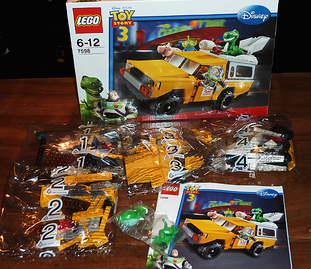
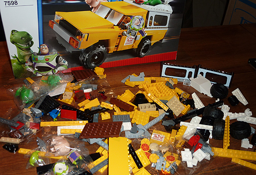
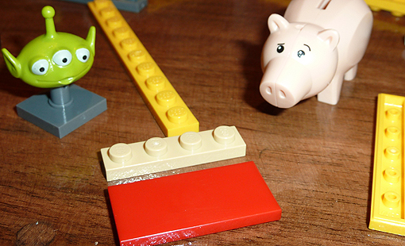
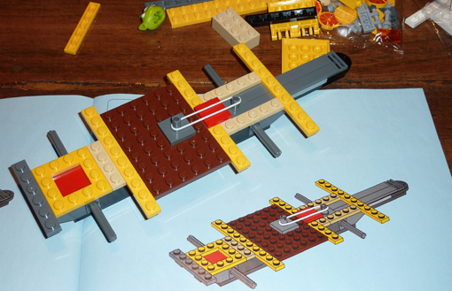
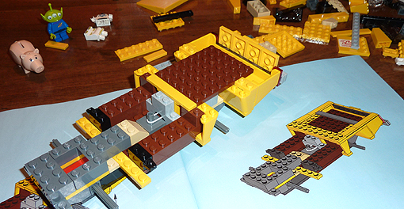
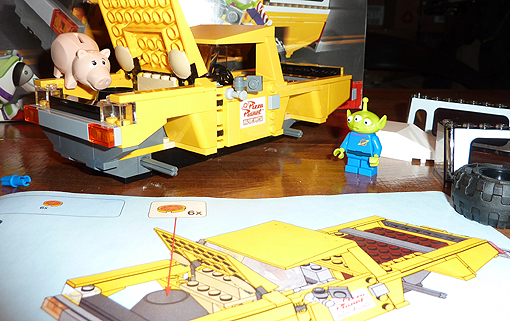
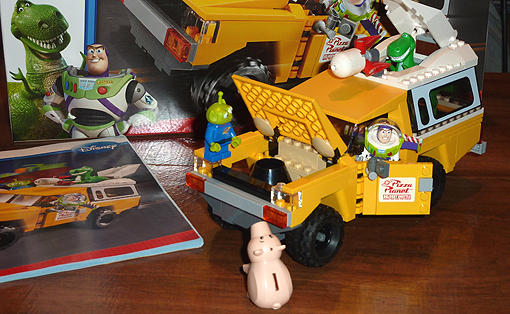

Bon, alors, après le train Toys Story 3 : jamais un sans deux !

J’ai dit que je craquerais pas pour des modèles produits sous licences (rapport prix/nombre de pièces pas intéressant du tout). Mais voilà, mon marchand de VPC préféré propose cette boîte à prix cassé : 28 Euro. Alors petit et faible comme je suis devant le LEGO, je craque.

Livraison rapide et livré en bon état.

Fidèle aux leçons reçus des spécialistes de FreeLUG et autres diplômés MBA _montage set neuf_, je trie soigneusement les pièces avant de commencer le montage.

Ho ! une tile 2x4 rouge, je n’en crois pas mes yeux !  
Oui, ce n’est pas cochon ça !

Je m’applique, et après un certain temps voici une première étape de faite. Cela a l’air de ressembler à la notice de montage.

Cela dit, il n’y a pas de quoi être fier car le niveau de détail de la notice est impressionnant comme par exemple cette page 15 uniquement consacré à la mise en place de l’élastique blanc (certes très important car lui seul va permettre de lancer des pizzas depuis la voiture... mais chut, on ne le sait pas encore ! )

On remarque en passant l’usage de pare-brise jaune comme garde boue dont un X10 ressuscité des mythiques Model Team...

Bon, les gars, encore un effort, ce n’est pas fini !

Bon, le moteur et monté mais il tourne pas.  
Grouin, grouin ; c’est normal t’as pas mis les pizzas ! C’est pourtant clair dans la doc technique.

Encore quelques heures de montage et voilà, c’est fini. On notera en passant les fenêtres arrières : la aussi des pares brises X10 sérigraphiés.

Ben voilà, c’est fini.

Quoi, la conclusion ?, vous voulez savoir ce que j’en pense ? Vous êtes sûrs ?

Alors je pense que 28 euro c’est très bien même si ce modèle terminé est plutôt réussi coté look. Mais au prix de vente conseillé par LEGO (55 Euros) : on la sent passer la licence ! et cela même avec 4 minifigs du film.
