Un grand classique de la gamme City a été renouvelé cette année : la caserne des pompiers.

**–** Référence : 7208  
**–** Nom : La caserne des pompiers  
**–** Nombre de pièces : 662  
**–** Prix : 69,90€  
**–** Temps de montage : 79 min (1h19)

Pour rappel, la première caserne des pompiers date de 1970 ([réf : 347](http://www.peeron.com/inv/sets/347-1)) et depuis ce premier exemplaire, il y a eu 12 casernes avant celle-ci (plus des versions Duplo et Fabuland).

## La boîte

La face avant représente la caserne vue de face avec les véhicules en intervention et un encart pour montrer le nouvel accessoire : le filet pour amortir les chutes. La face arrière reprend la photo de la face avant et y ajoute des possibilités de jeu et une partie de la gamme pompier (bateau et 3 véhicules)

[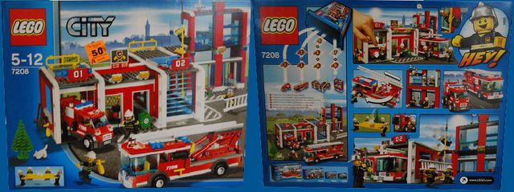](https://www.freelug.org/IMG/jpg/boite-3.jpg)

## Le contenu

La boîte est composée de 9 sachets (dont 8 numérotés) et 4 notices, 2 plaques voie (16x16), 2 plaques de base (8x16) et une planche d’autocollants.

[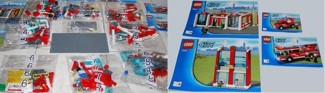](https://www.freelug.org/IMG/jpg/sachet_notice.jpg)

Le montage s’effectue en 3 grandes étapes :  
**–** La camionnette (1 sachet, notice 1)  
**–** La grande échelle (2 sachets, notice 2)  
**–** La caserne (5 sachets, 4 plaques de base, notice 3 et 4)

## Montage de la camionnette

Le sachet N°1 se compose de 2 sachets : un pour les grosses pièces et un plus petit pour les petites pièces. Il contient aussi 1 minifig, le chat et un arbre.

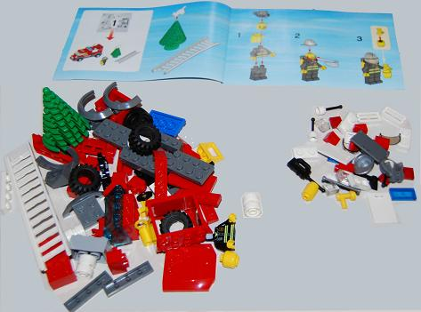

La camionnette est basée sur un classique châssis de voiture, mais dont le renfoncement habituellement utilisée pour la minifig est ici comblé par une plate de 2x4 bleue.

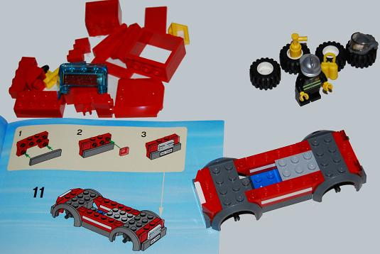

Le montage se fait rapidement, sans difficulté, la notice étant très (trop) détaillée (22 étapes).

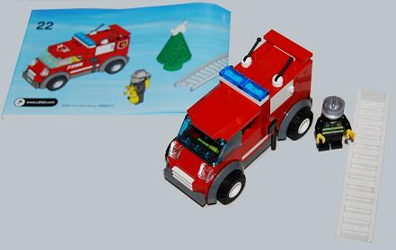

La camionnette est fonctionnelle, pas mal équipée (3 rangements, extincteur, masque, hache, radio, oxygène), mais je ne la trouve pas particulièrement esthétique. A noter la présence d’un aileron qui aurait pu permettre de placer une échelle, mais étant en tile, rien ne peut être fixé dessus.

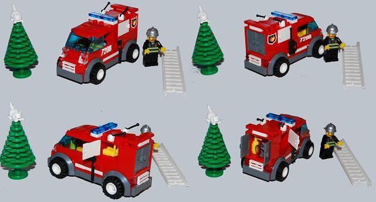

## Montage de la grande échelle

Le montage de la grande échelle se fait sur une notice (la N°2) mais avec 2 sachets. Comme pour la camionnette, chaque sachet numéroté en contient un plus petit.

Ce modèle contient deux nouvelles pièces : une plate de 2x6 (en haut) qui permet de fixer l’échelle tout en permettant son coulissement et une plate de 2x6 particulière (en bas). Celle du bas est disponible en rouge (2 exemplaires) et en blanc (1 exemplaire).

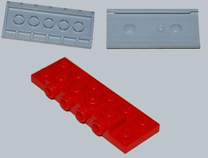

Le montage de la grande échelle se fait donc en 2 étapes sur la même notice :

-   le châssis du camion
-   la cabine et l’échelle pivotante

Le châssis part d’une base symétrique en assemblage de plate puis se construit de l’arrière vers l’avant.

[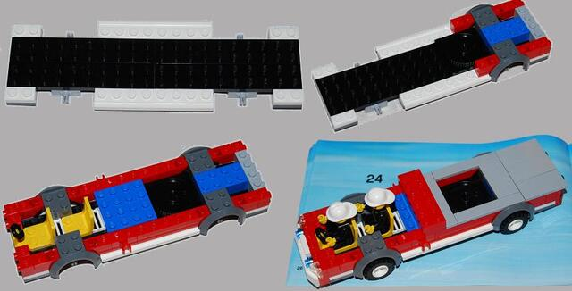](https://www.freelug.org/IMG/jpg/gr_echelle.jpg)

C’est le sachet qui contient le plus de minifig (2). Le châssis est très robuste de par sa conception (assemblage de 3 niveaux de plate) et permet une cabine plus légère.

L’assemblage se poursuit avec la cabine. La partie basse est rapidement assemblée (grande verrière) et laisse suffisamment de place pour mettre les deux minifigs. Le toit pivotant est astucieux et bien dissimulé une fois fermé. Il permet un accès rapide à l’intérieur sans démontage.

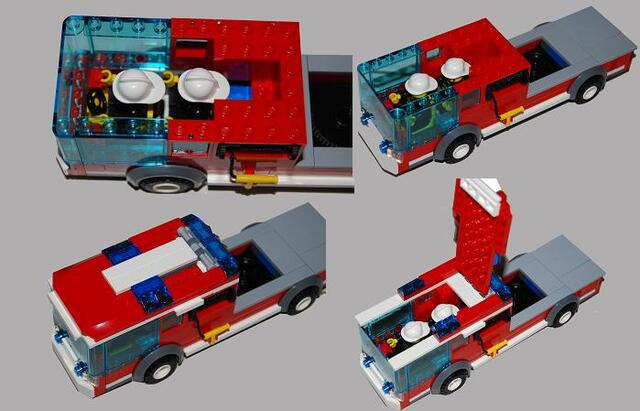

Le montage se termine par la partie échelle pivotante qui a un aspect assez réaliste, dommage que l’échelle soit si courte, qu’elle pivote si peu (1/4 de tour de chaque coté) et que le camion ne possède pas de béquilles.

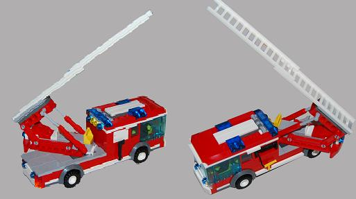

## Montage de la caserne

Le montage de la caserne se fait sur deux notices (la N°3 et la N°4) et avec 5 sachets. Comme pour les autres, chaque sachet numéroté contient un (ou deux suivant les sachets) sachet plus petit pour les petites pièces.

Ce modèle contient deux nouvelles pièces : une brique de 2x5x1 rainurée (à droite) qui permet de faire coulisser les portes de garage et un filet pour rattraper les minifigs qui sautent des immeubles.

photo

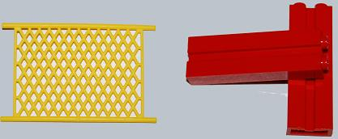

Le montage se décompose en 5 parties (autant que de sachets, c’est bien fait, hein !) :

-   Le garage de la camionnette
-   Le garage du camion
-   Le bâtiment qui relie les deux garages
-   Le rez-de-chaussée du bâtiment principal
-   Le 1er étage du bâtiment principal

A noter que toutes les briques 2x2 de cette partie sont spécifiques :

-   -   [Rainurée](http://www.peeron.com/inv/parts/4216)
    -   [A clips](http://www.peeron.com/inv/parts/30237)

Le montage est simple et accessible au plus jeune. Petite nouveauté : l’utilisation des pare-brises comme verrière de toit. Inconvénient, elles ne sont que posées sur le toit et non pas fixées.

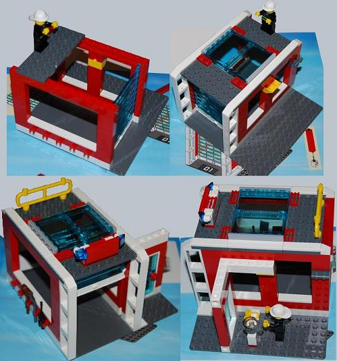

Le montage du second garage est similaire au premier, il est simplement plus long et symétriquement opposé au premier.

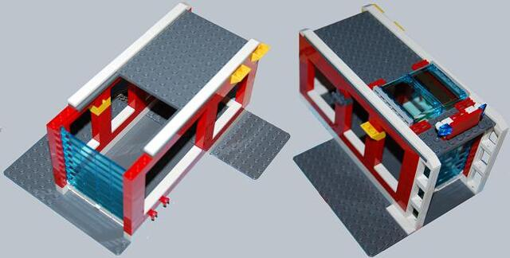

La partie centrale est vite montée. Elle est composée d’une porte, une vitre le toit et le filet.

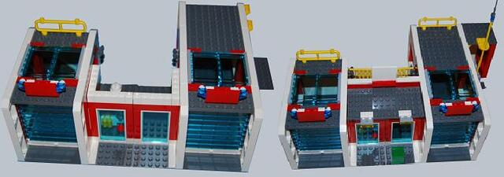

Le bâtiment principal est composé de deux niveaux (1 sachet par niveau). Le rez-de-chaussée est aménagé en accueil et le 1er étage en pièce de repos pour les pompiers (lit, TV). L’ensemble du bâtiment est très vitré (panel et portes) et comporte un accès (porte) par étage.

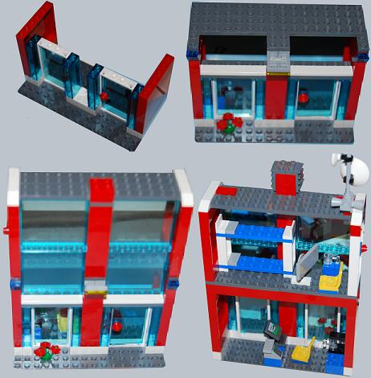

Je n’avais jamais remarqué auparavant, la précision de la tile clavier, on peu y lire les lettres dessus.

photo

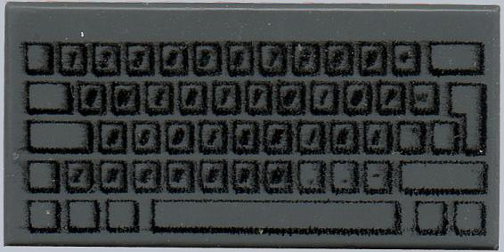

## Conclusion

_Nota :_ sur la photo ci-dessous, les autocollants ont été ajoutés par photomontage

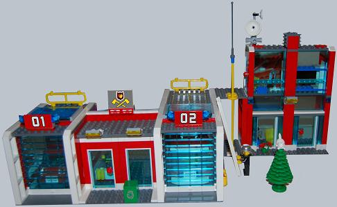

L’ensemble de la caserne a un design sympa et moderne, beaucoup de détails pour un set destiné aux enfants (écran plat, couchette, ordinateur, cafetière...) et peu d’autocollants. Depuis pas mal de modèles, les casernes possédaient une vigie, celle la n’en a pas, mais ça ne manque pas. A noter, la présence de 4 minifigs et d’un petit chat blanc. Bref, c’est un set que je recommande.

J’ai cependant quelques petites remarques :  
**–** Par rapport aux anciennes casernes, je trouve qu’il manque les cotés des garages  
**–** L’ajustement de la verrière sur la façade du bâtiment n’est pas optimum  
**–** Elle n’est pas facilement intégrable à une ville sans modification (comme celle des années 80-90)  
**–** L’échelle du camion un peu courte  
**–** Dans certaines étapes du montage, peu de pièces sont ajoutées (1 pièce entre l’étape 22 et 23 de la caserne)

Les pièces en plus dans le set :

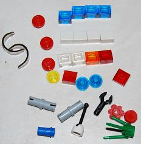

-   4 slopes tr bleues
-   4 slopes blanches
-   2 slopes tr blanches
-   1 slope tr orange
-   1 slope tr rouge
-   2 plates rondes rouges
-   3 plates rondes tr bleus
-   1 plate rondes tr jaune
-   2 visières
-   2 tiles tr rouges
-   2 tenons gris
-   1 ½ tenon bleu
-   1 antenne
-   1 fleur
-   1 tige de fleur
-   1 pince

La planche d’autocollant :

**La planche d’autocollant**

## Annexe

| Réf | Année | Nb de pièces | Nb minifig |
| --- | --- | --- | --- |
| [347](http://www.peeron.com/inv/sets/347-1) | 1970 | 320 | 0 |
| [357](http://www.peeron.com/inv/sets/357-1) | 1973 | 239 | 0 |
| [374 / 590](http://www.peeron.com/inv/sets/374-1) | 1978 | 349 | 4 |
| [6382](http://www.peeron.com/inv/sets/6382-1) | 1981 | 390 | 4 |
| [6385](http://www.peeron.com/inv/sets/6385-1) | 1985 | 407 | 3 |
| [6389](http://www.peeron.com/inv/sets/6389-1) | 1990 | 533 | 4 |
| [6478](http://www.peeron.com/inv/sets/6478-1) | 2000 | 237 | 4 |
| [6554](http://www.peeron.com/inv/sets/6554-1) | 1997 | 255 | 4 |
| [6571](http://www.peeron.com/inv/sets/6571-1) | 1994 | 428 | 4 |
| [7208](http://www.peeron.com/inv/sets/7208-1) | 2010 | 662 | 4 |
| [7240](http://www.peeron.com/inv/sets/7240-1) | 2005 | 260 | 3 |
| [7945](http://www.peeron.com/inv/sets/7945-1) | 2007 | 600 | 4 |
| [10197](http://www.peeron.com/inv/sets/10197-1) | 2009 | 2231 | 4 |
