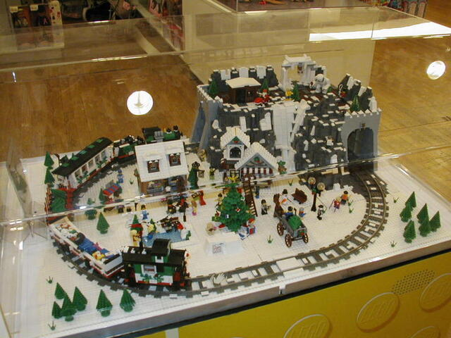
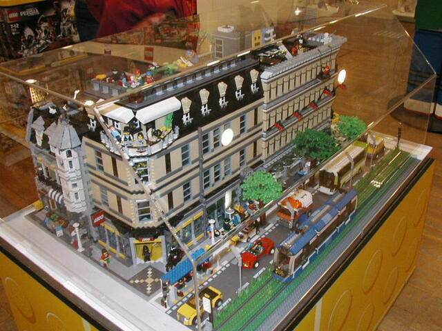
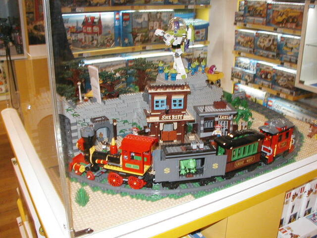
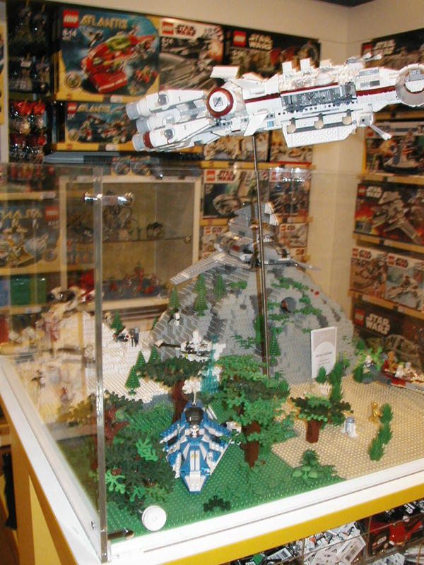
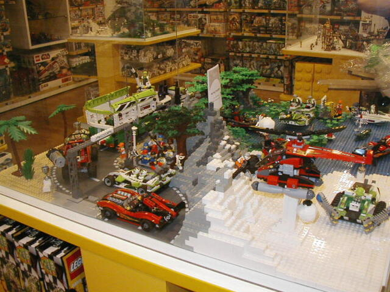

Avec les achats de Noël qui se préparent, LEGO a souhaité marqué le coup à son rayon aux Galeries Lafayette à Paris. LEGO a ainsi proposé à FreeLUG de nous mettre à disposition deux vitrines afin d’y exposer nos créations, durant la première quinzaine de novembre.

La première, réalisée par Jérémy, contenait des bâtiments modulaires.

La seconde, réalisée par Erik, portait sur le thème de Noël.

Cet évènement n’a duré que deux semaines parce que l’espace alloué à LEGO est mis à disposition par les Galeries Lafayette, et que cet espace est à partager avec les autres vendeurs. De plus pour des raisons de sécurité à l’approche de Noël, il ne fallait pas encombrer le passage dans les allées.

_Quelques questions/réponses :_

**–** Y a t-il eu une contribution de la part des Galeries ou de LEGO / les pièces étaient-elles fournies ?  
LEGO France nous a mis à disposition deux vitrines. Les pièces n’ont pas été fournies, tout est issu de nos collections personnelles.

**–** Combien de temps cela vous à pris ?  
L’installation a été un peu rapide. On a installé à 20h00, après la fermeture des Galeries jusqu’à 22h00.

**–** Et le montage ?  
Quant au temps de montage, Erik construit le diorama de Noël la veille de l’installation, en une après-midi. Pour l’autre diorama, les bâtiments étaient déjà construits. Pour Jérémy, ça a surtout été de préparer les éléments de décors.  
Le plus compliqué était d’estimer les dimensions de la vitrine pour ne pas avoir de problème au montage. Pour Jérémy il a fallut procéder à quelques modifications de dernières minutes par rapport au prototype : enlever une voie de circulation sur la route pour mettre la voie du tramway dessus (elle se trouvait à l’extérieur de la vitrine) et enlever quelques cheminées aux bâtiments.

**–** Est ce que le train fonctionne ?  
Le train pourrait fonctionner... si il y avait du courant :) En tout cas, le diorama est prévu pour : un régulateur 9V est caché dans la montagne, et une prise LEGO 9V sort à sa base pour y brancher par exemple des lumières qui pourraient éclairer les boutiques.

**–** Que faire quand il n’y a pas de planche pour soutenir le diorama dans la vitrine ?  
On prend le couvercle de la vitrine (quand on transporte la vitrine, il y a des parois en bois et un couvercle pour protéger le plexiglas) que l’on pose sous la vitrine et on cale la vitrine avec des briques (briques que les employés ont souvent du remplacer, elles avaient tendance à fondre et s’évaporer).

LEGO proposait également des vitrines sur le thème SW, WorldRacer, ToyStory ou encore Prince of Persia.

**–** [La galerie d’Erik](http://photos.freelug.org/main.php/v/brickerik/expositions/2010/GaLaf/)  
**–** [La galerie de Jérémy](http://cid-c7c201d465957006.photos.live.com/browse.aspx/Lego%20-%20Galerie%20Lafayette%202010)

Nous en avons également profité pour mesurer précisément [les dimensions de la vitrine](http://wiki.freelug.org/tiki-index.php?page=VitrineMicroShow) pour le jour où l’opération serait renouvelée.
