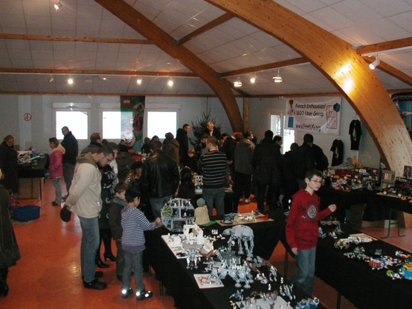
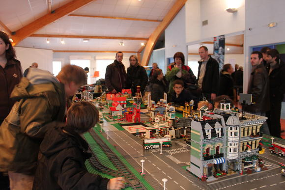
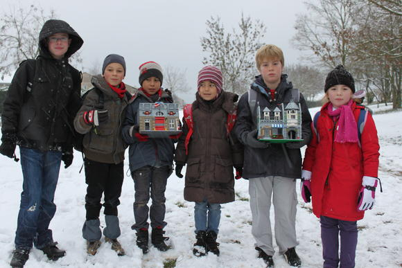
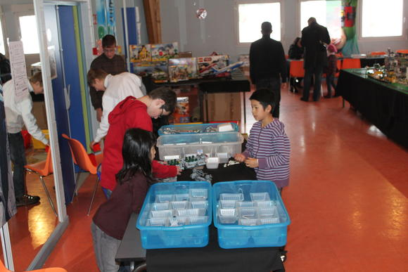
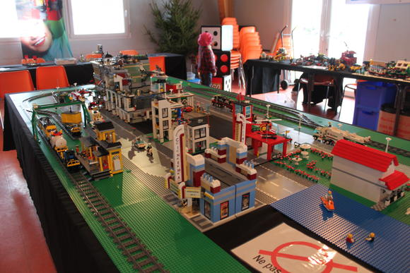
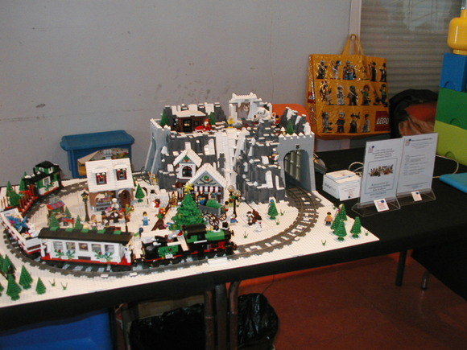

Une exposition sans prétention, mais qui ne mérite que de croître.

Malgré la neige et le Saint Nicolas, le public était au rendez-vous. L’un des objectifs était de rencontrer des fans de LEGO de la région, ce qui fût le cas.

En effet une rencontre informelle avec ces derniers aura lieu en début d’année pour la programmation de l’événement 2011 en Lorraine, et la mise en place des commissions, du plan de communication...

Nous étions trois, Clotilde, Dr Erik et moi-même. Quelques enfants de Saizerais se sont joints à nous (Antonin, Pierre, Elliot, Eléonor, Lucie, Enzo, Nicolas).

**Les enfants acteurs du projet**

Le samedi un petit groupe s’est attelé à construire le Tower Bridge, et le dimanche le Dropship et AT OT Walker.

**L’atelier Tower Bridge**

Après plusieurs reports de la date d’un repas, nous avons enfin pu nous restaurer longuement samedi soir, avant de nous rendre sur le lieu qui inspirera notre prochain défi : la réalisation de la fameuse place Stanislas de Nancy.

Un grand merci à Jean-Christophe, Thierry Olivier, Jean-Marc et la boutique Grands z’enfants pour leur aide.

Sans oublier les visiteurs et les membres de FreeLUG qui se sont rendus à l’exposition.

_Samuel Faugier  
Association PHILEAS_

* * *

Pour cette première, j’ai fait le déplacement depuis la région parisienne pour aider Samuel, et apporter un peu de matériel, nappes et banderole notamment.

J’ai exposé le petit diorama de Noël que j’avais réalisé pour les [Galeries Lafayette un mois auparavant](/articles/1223/).

Mais c’était aussi surtout l’occasion de rencontrer les passionnés et adhérents de la région, ce qui fut chose faite.

La région a un beau potentiel, et je souhaite que Samuel arrive à fédérer autour de lui suffisamment de monde pour faire encore une plus belle exposition !

_Erik_

* * *

Première exposition, un peu peur au début mais au final que du bonheur, m’a donnée envie de créer pleins de nouvelles choses, et à refaire. Le petit point noir, les petites mains qui essayent de toucher à tout mais enfin je les comprends, c’est frustrant.

_Clotilde_

## Galeries photos

**–** [Galerie de Samuel](http://photos.freelug.org/main.php/v/samuel/Lorraine+2010/)  
**–** [Galerie d’Erik](http://photos.freelug.org/main.php/v/brickerik/expositions/2010/Saizerais/)
