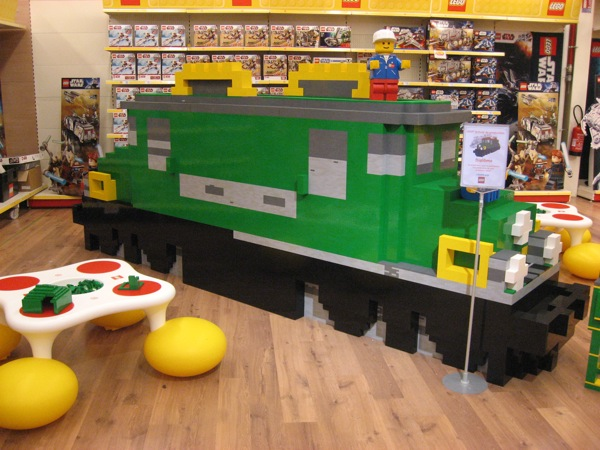
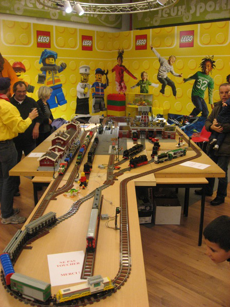
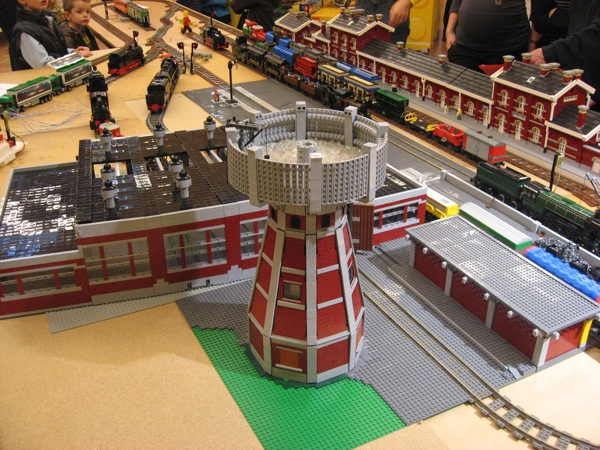
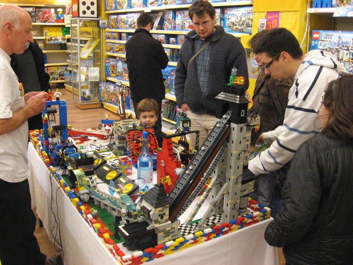
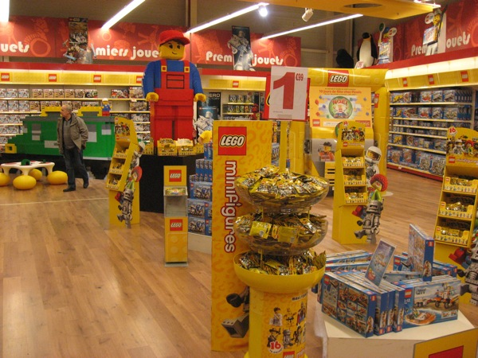
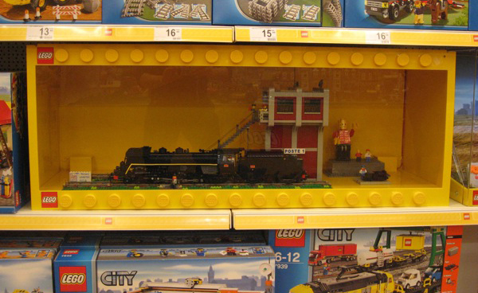
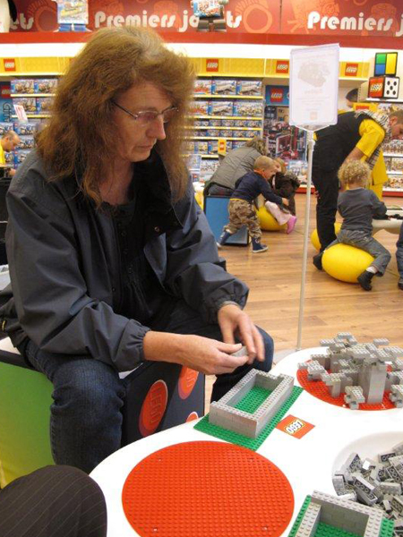

Comme en 2009, le magasin PicWic de Lomme et LEGO se sont associés pour faire une semaine d’animations du 27 octobre au 8 novembre 2010 au moment des vacances de la Toussaint. Cette année le thème était le train, avec notamment la réalisation au 30/1ème de l’ancienne locomotive verte du set RC Marchandise.

**Train RC au 30/1 ème**

En relation avec le directeur du magasin depuis la précédente édition de 2009, c’est tout naturellement qu’il s’est adressé à l’association pour réaliser une animation complémentaire, sur la journée du samedi 30 octobre.

C’est à 5, un français et 4 amis belges ( Vincent, Ludo et Jean-François de BeLUG et Michel de FreeLUG), que nous avons imaginé l’installation et l’animation sur la journée, dans l’espace permanent LEGO du magasin, créant ainsi un second point d’animation dans le magasin, avec l’espace créé spécifiquement pour LEGO à l’entrée.

Lors de la préparation, PicWic nous fournissant l’espace et les tables nécessaires, nous nous sommes arrêtés sur un réseau de trains et une animation inédite pour eux, du GBC (Great Ball Contraption) ou GBB (Grand bidule à balles). Pour rappel, [le GBB est un parcours de balles sur un circuit composé de plusieurs modules](/articles/362/) souvent appréciés pour l’ingéniosité et la technique employées.

Pour le réseau de trains, ayant participé indirectement au [LEGOWORLD 2010](/articles/1209/) qui se terminait deux jours plutôt (j’y reviendrais), en réalisant une modeste partie du réseau de BeLUG de 35m de long avec la reproduction d’une partie de la gare de Mariembourg ; avec Vincent, Jean-François et Ludo, nous avons imaginé une compression de ce réseau en rapprochant les 2 gares distantes de 35m en une seule.

**Réseau de trains**

Le cœur de la présentation au PicWic de Lomme réunissait ainsi la reproduction de la gare voyageur de Treignes avec son bâtiment voyageur et le dépôt de Mariembourg avec sa rotonde, son parc à charbon, sa fosse et son château d’eau. Le tout agrémenté de locomotives vapeur, trains marchandises...

**Mariembourg et Treignes réunies**

A deux pas, se tenait Michel, avec son parcours de GBB.

**Michel et son GBB**

Au final, une journée bien chargée, un public ravi, le personnel de PicWic enchanté et des animateurs LEGO qui se demandaient où étaient les enfants qui avaient désertés leur stand...

**Espace spécifique pour les animations LEGO**

Cerise sur le gâteau, le directeur du magasin a mis à disposition une vitrine LEGO pour y exposer quelques réalisations originales, j’y ai glissé pour quelques semaines ma 141R accompagnée d’un poste d’aiguillage, plus quelques petites choses.

**Vitrine mise à disposition**

**Mot de Michel**

Un très bon accueil et un très bon contact avec le personnel du magasin. Surprise, curiosité et enthousiasme des clients devant nos réalisations en LEGO.

J’ai eu de très bons contacts avec les clients qui posent des tas de questions au sujet des modules GBB, avec quelles pièces, plans ou notices sont-ils réalisés ?

Une très bonne et très agréable journée et partant pour la refaire !

Le seul bémol est la rapidité avec laquelle nous avons du démonter et "évacuer" le magasin sous l’œil du garde qui avait l’air très pressé d’en finir.

**Mot de Jean-François**

Très bon accueil aussi bien du personnel que du public.  
Beaucoup de questions, des enfants émerveillés (et surtout très calmes et respectueux du matériel dans l’ensemble)  
et surtout un stand bien plus actif que le stand officiel LEGO.

Expérience à renouveler sans aucun doutes

## Rendez vous a déjà été pris pour 2011

**LEGOWORLD 2010,** de retour de Hollande, le jeudi 28, les FreeLUGiens se sont arrêtés en chemin pour enfin faire un vrai repas après dix jours à Zwolle, l’occasion de manger tous ensembles et faire un petit tour au PicWic, comme Annie en pleine action pour construire une grande brique.

**Annie en action**
