[Premières parties](/articles/1221/)

## Quatrième étape : Construction de la proue et de la poupe

Nous allons ensuite commencer la base de la proue, puis de la poupe.

[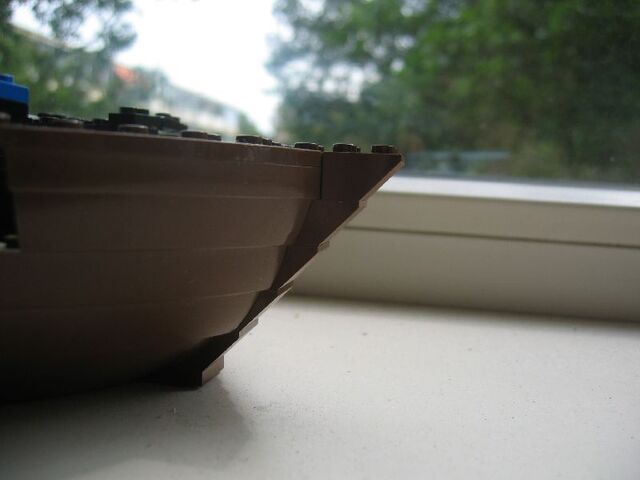](https://www.freelug.org/IMG/jpg/step4-a.jpg)

Pour la poupe nous allons nous servir de drapeaux noirs pour fermer les deux ouvertures de part et d’autre du gouvernail.

[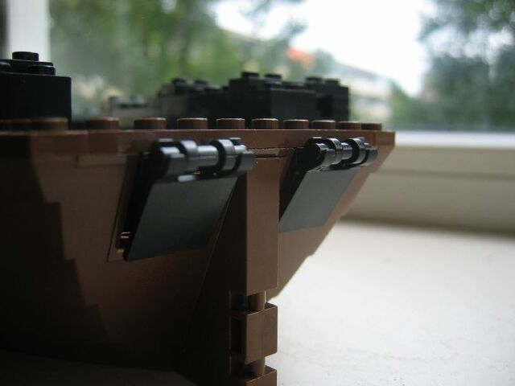](https://www.freelug.org/IMG/jpg/step4-b.jpg)

Toujours rien derrière, comme vous pouvez le voir.

[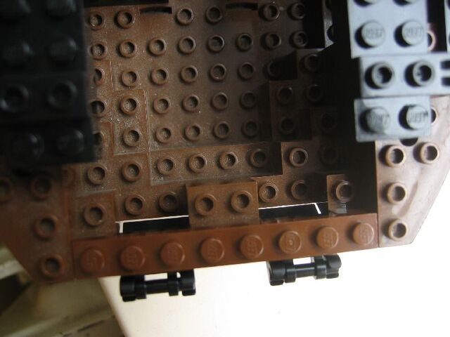](https://www.freelug.org/IMG/jpg/step4-c.jpg)

Ensuite nous allons nous servir de charnières horizontales pour arrondir la proue.

[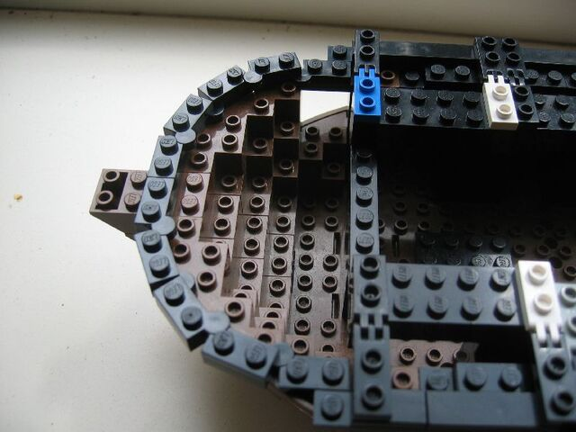](https://www.freelug.org/IMG/jpg/step4-d.jpg)

A l’avant, il y a une barre de 1x4 sous les charnières.

[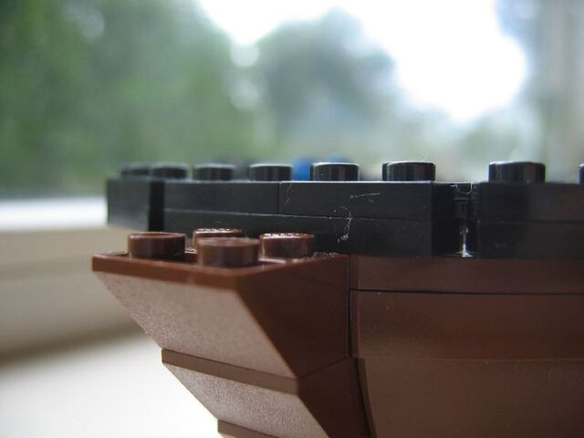](https://www.freelug.org/IMG/jpg/step4-e.jpg)

## Cinquième étape : Mise en place de la muraille

Nous commençons par placer les barrettes sous les charnières, ce qui nous donne immédiatement le bon angle.

[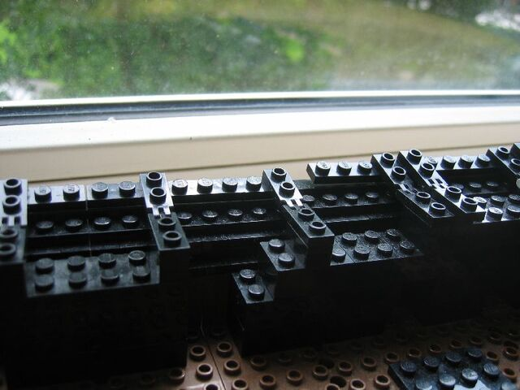](https://www.freelug.org/IMG/jpg/step5-a.jpg)

[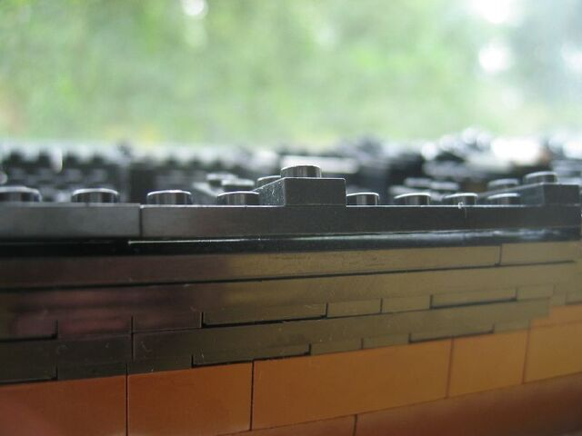](https://www.freelug.org/IMG/jpg/step5-b.jpg)

Ensuite nous plaçons les plaques entre les charnières, comme cela :

[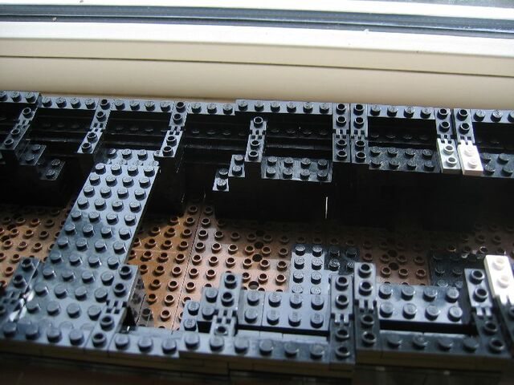](https://www.freelug.org/IMG/jpg/step5-c.jpg)

Les deux premières à partir du milieu sont chevauchées, ce qui connecte les sections :

[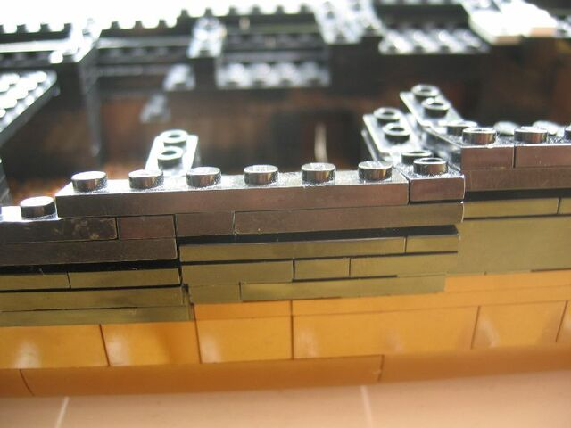](https://www.freelug.org/IMG/jpg/step5-d.jpg)

Enfin nous disposons la partie du pont d’artillerie qui sera visible.

[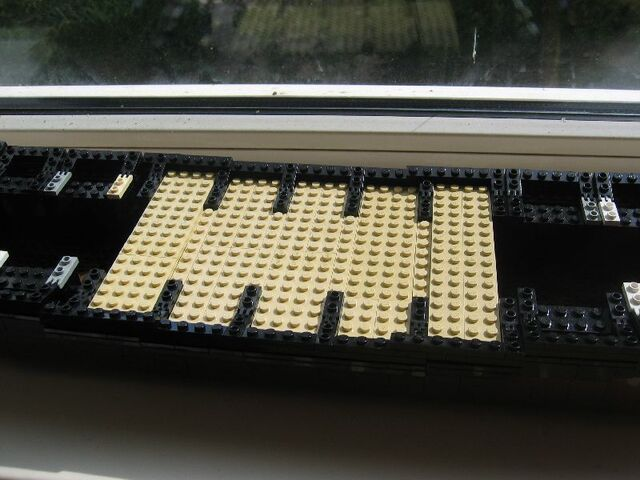](https://www.freelug.org/IMG/jpg/step5-e.jpg)

Nota : Si vous préférez ne pas avoir d’intérieur et un pont supérieur fermé, vous pouvez dès à présent commencer à poser les bandes colorées pour les faire moins hautes.

OK, avant de continuer, je précise que j’ai fait un petit changement : les chevilles du milieu, sous le pont, ont été écartées de 5 tenons, cela afin de pouvoir tenir un espace de 4 tenons entre chaque sabord, mais si vous voulez en garder 3 afin de disposer d’une plus grande batterie, ne touchez plus à vos chevilles.

## Sixième étape : Construction des batteries.

Sur les trois sections du milieu j’ai rajouté une barrette noire. On voit clairement que les autres sont plus fines.

[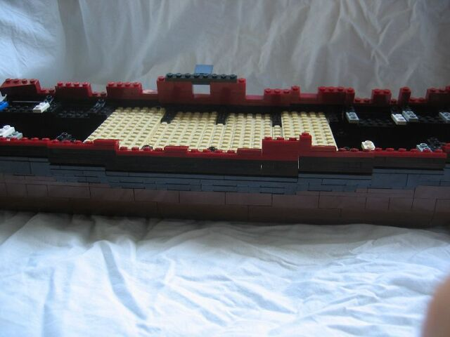](https://www.freelug.org/IMG/jpg/step6-b.jpg)

Ensuite, j’ai rajouté une épaisseur d’une barrette rouge sombre et ai commencé à espacer les sabords. Sur cette photo vous pouvez encore remarquer le changement de place des chevilles.

[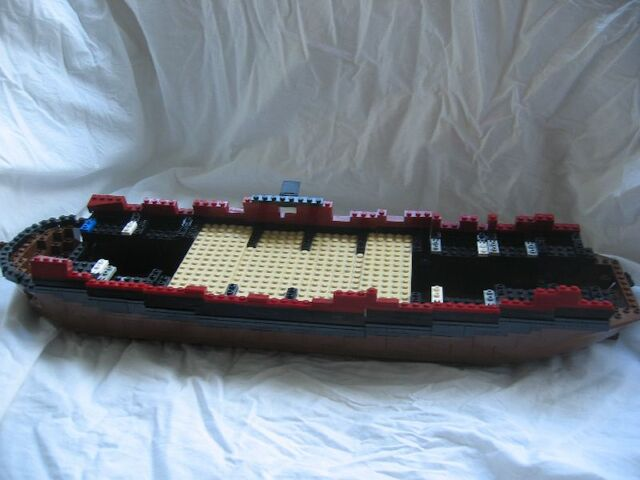](https://www.freelug.org/IMG/jpg/step6-a.jpg)

A présent, j’ai terminé de construire les murailles.

[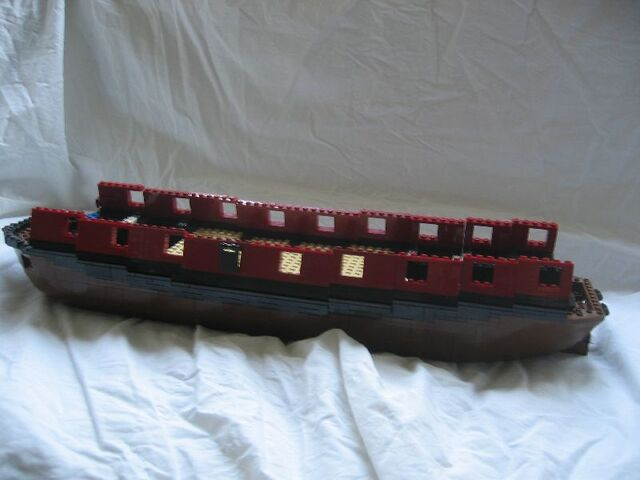](https://www.freelug.org/IMG/jpg/step7-a.jpg)

Regardons de plus près :

[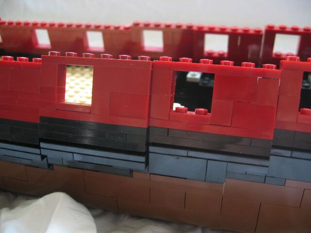](https://www.freelug.org/IMG/jpg/step7-b.jpg)

Nota : Toutes les sections de la muraille sont encore séparées et ne doivent pas être connectées !

J’ai également commencé à travailler sur la proue, où un joli faux-sabord complètera le nombre total des bouches à feu à 20 pour le premier pont.

[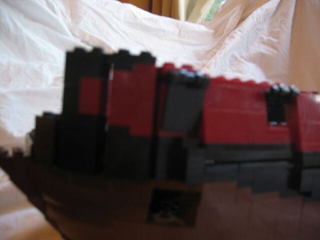](https://www.freelug.org/IMG/jpg/step7-c.jpg)

Avec le panneau ouvert :

[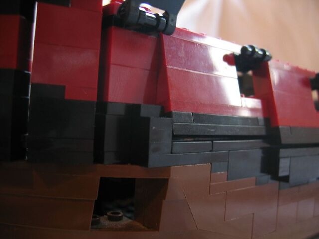](https://www.freelug.org/IMG/jpg/step7-d.jpg)

Notez aussi les chevilles supplémentaires que j’ai placées dans cette partie de la muraille.

[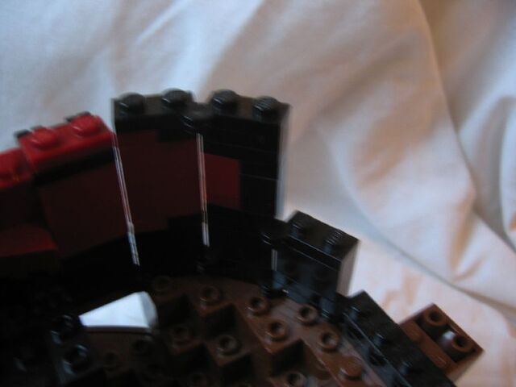](https://www.freelug.org/IMG/jpg/step7-e.jpg)

Il est temps de commencer à poser des supports pour les ponts supérieurs, notez qu’il est important de les construire sur les charnières pour consolider l’ensemble.

[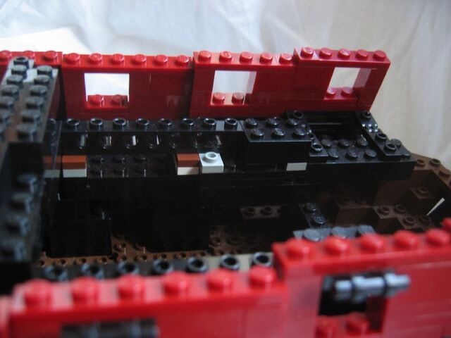](https://www.freelug.org/IMG/jpg/step7-f.jpg)

Je ne me préoccupe pas vraiment d’avoir un intérieur, mais si c’est votre cas il vous faut poser des supports pour les colonnes dans le prolongement vertical des chevilles, comme je le fais ici au milieu du pont d’artillerie qui sera visible.

Et un dernier coup d’oeil sur les échelons que j’ai failli oublier :

[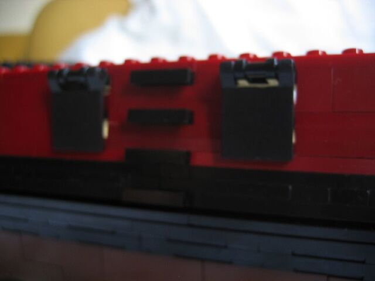](https://www.freelug.org/IMG/jpg/step7-h.jpg)

Important : j’ai déplacé le pont inférieur de 6 tenons vers l’avant, en changeant de 5 tenons la position des chevilles qui nous intéressent.

[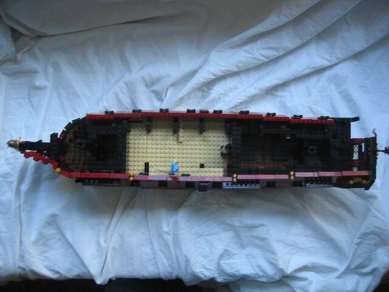](https://www.freelug.org/IMG/jpg/step8-o.jpg)

[La suite dans le prochain article.](/articles/1246/)
