**–** [Etapes 1 à 3](/articles/1221/)  
**–** [Etapes 4 à 6](/articles/1245/)

## Septième étape : Finitions de la coque.

J’ai pas mal avancé, et j’ai terminé le design d’un côté du navire.

[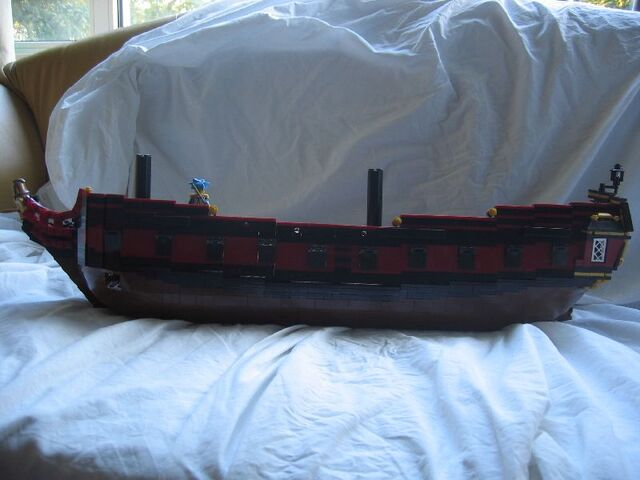](https://www.freelug.org/IMG/jpg/step8-a.jpg)

Notez la hauteur de la muraille en son milieu, le petit trou d’eau, ainsi que les échelons. Toutes les sections sont maintenant connectées les unes aux autres.

[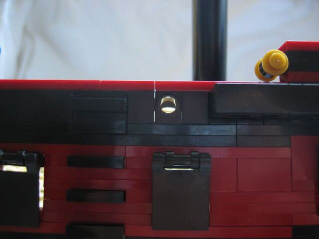](https://www.freelug.org/IMG/jpg/step8-b.jpg)

Notez également les barrettes crochetées sur l’intérieur de la muraille, elles sont destinées à nouer les cordages et doivent être placées au plus proche des mâts.

[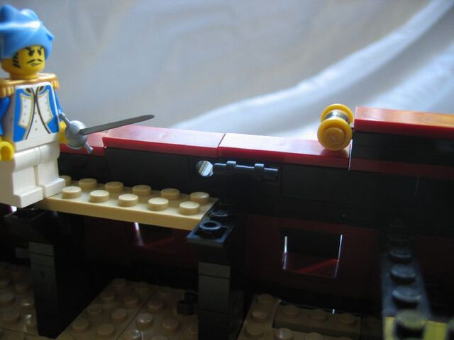](https://www.freelug.org/IMG/jpg/step8-c.jpg)

J’ai fini les supports pour le pont du milieu.

[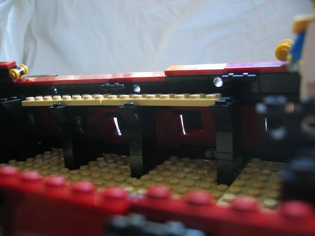](https://www.freelug.org/IMG/jpg/step8-d.jpg)

Concevoir les croisillons de proue, c’est toujours pénible, mais voici ce à quoi ressemblent les miens :

[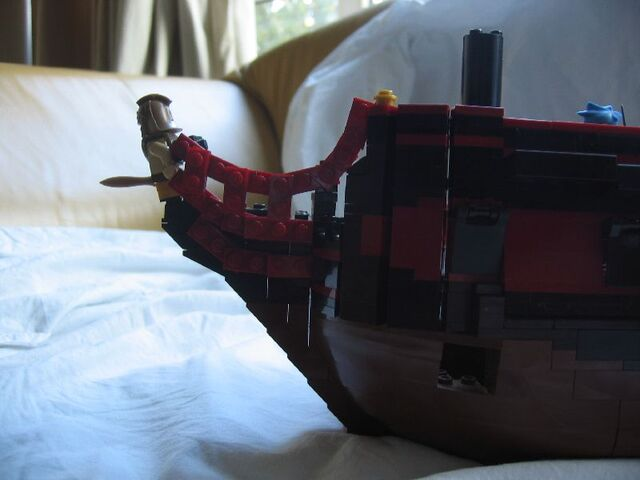](https://www.freelug.org/IMG/jpg/step8-e.jpg)

Vous remarquerez que ce n’est que le premier jet, les retouches seront très appréciables.

[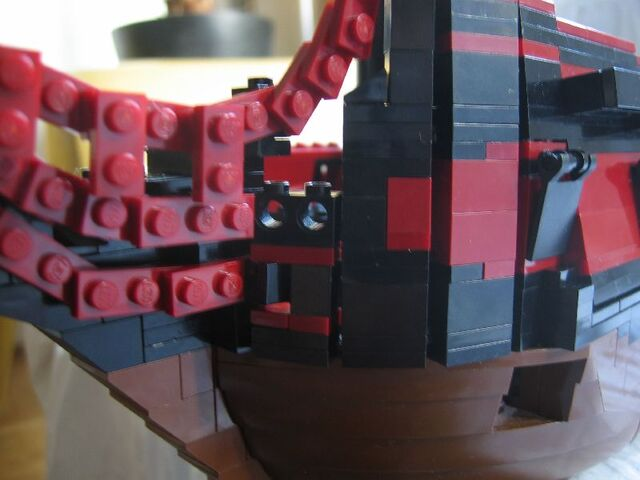](https://www.freelug.org/IMG/jpg/step8-f.jpg)

Et voici la manière dont ils sont fixés :

[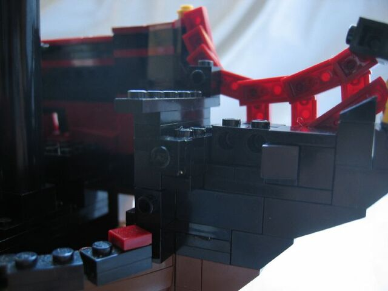](https://www.freelug.org/IMG/jpg/step8-g.jpg)

Les plates-formes de haubans ont également été placées, il s’agit d’une brique Technic montée sur des headlights.

[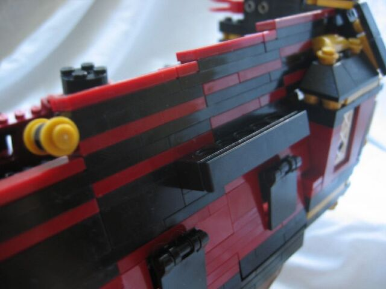](https://www.freelug.org/IMG/jpg/step8-h.jpg)

L’extrémité des plates-formes doit s’aligner avec les mâts.

[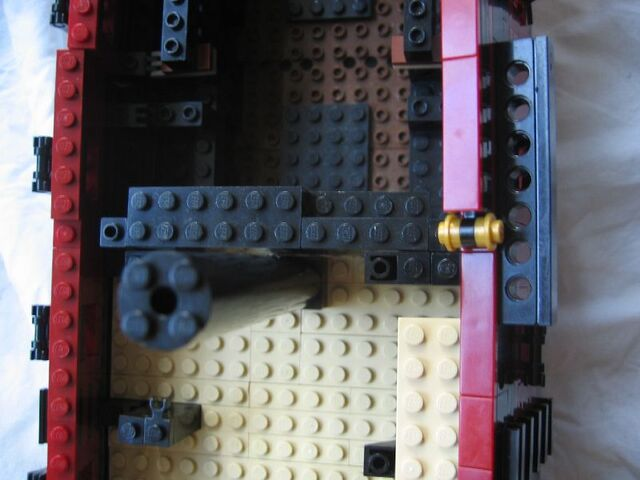](https://www.freelug.org/IMG/jpg/step8-i.jpg)

J’ai également conçu un premier tableau de poupe. Les retouches sont là aussi très appréciées.

[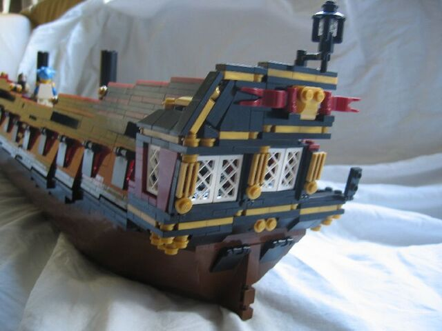](https://www.freelug.org/IMG/jpg/step8-j.jpg)

Par en-dessous :

[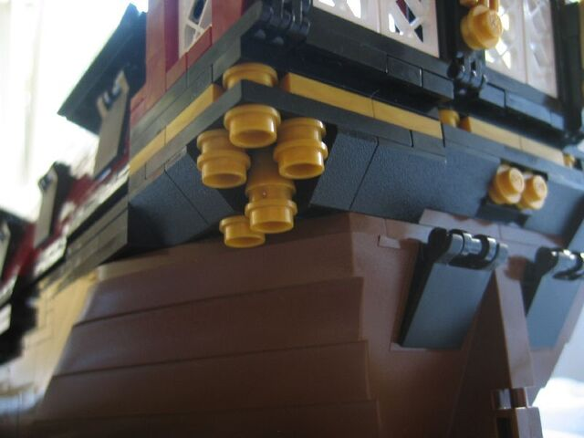](https://www.freelug.org/IMG/jpg/step8-k.jpg)

Les galeries :

[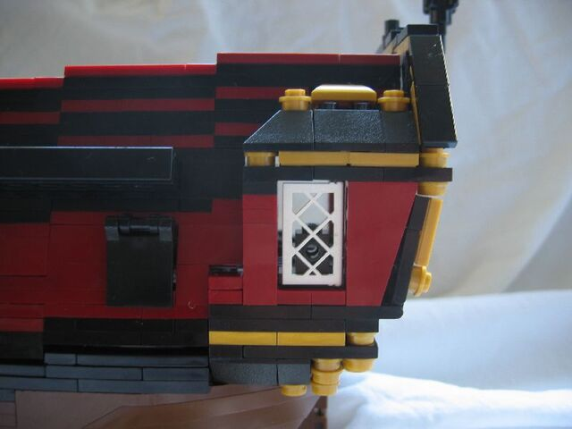](https://www.freelug.org/IMG/jpg/step8-l.jpg)

Ici vous pouvez voir de quelle manière la muraille chevauche la galerie ; désolé pour le flou artistique.

[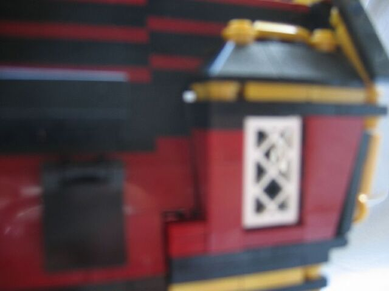](https://www.freelug.org/IMG/jpg/step8-m.jpg)

Ici vous pouvez voir comment c’est construit à l’intérieur.

[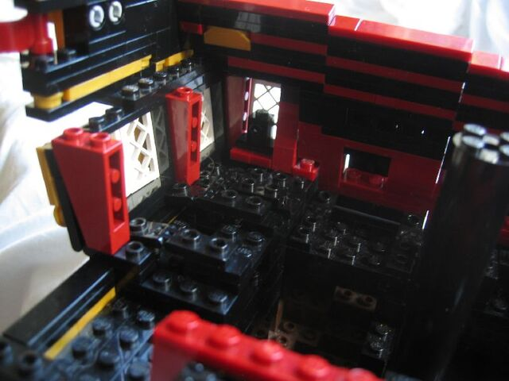](https://www.freelug.org/IMG/jpg/step8-n.jpg)

## Huitième étape : Mise en place du gaillard d’arrière.

OK, voici quelques photos sur la manière dont va être construite la proue. Notez les chevilles sous les fenêtres, et comment le volet seul est attaché.

[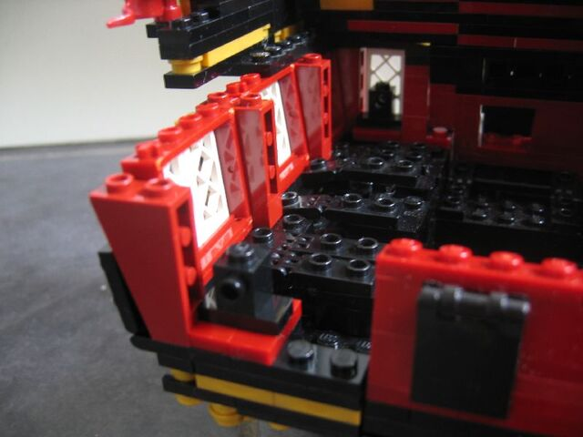](https://www.freelug.org/IMG/jpg/step9-a.jpg)

[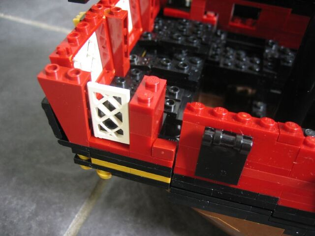](https://www.freelug.org/IMG/jpg/step9-b.jpg)

J’ai commencé à poser les structures porteuses sur la section arrière, notez que tout est construit sur les charnières.

[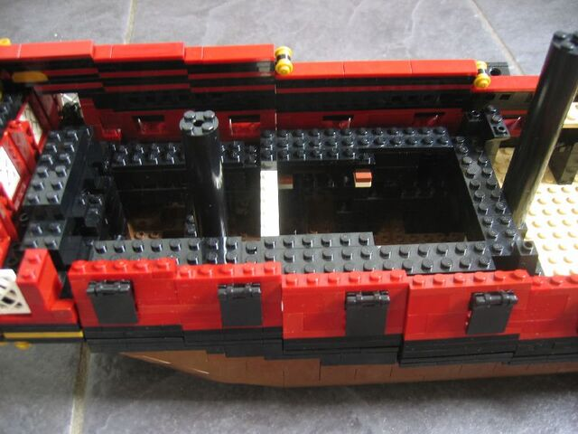](https://www.freelug.org/IMG/jpg/step9-c.jpg)

[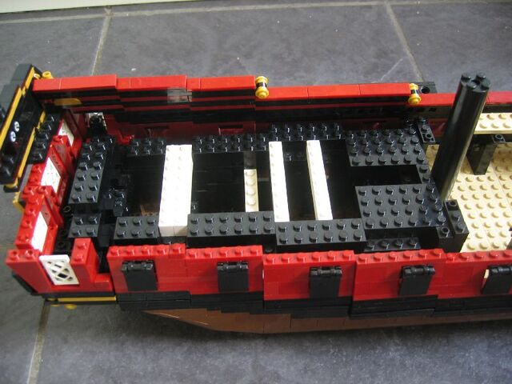](https://www.freelug.org/IMG/jpg/step9-d.jpg)

Remarquez le nivellement par rapport aux petits supports sous les allées.

[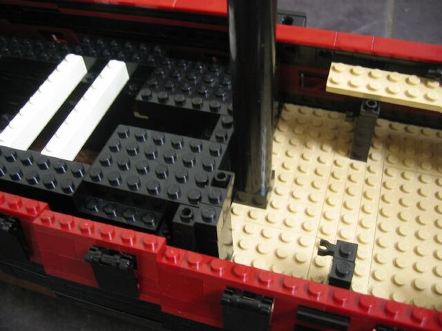](https://www.freelug.org/IMG/jpg/step9-e.jpg)

La première partie de ce pont est désormais installée :

[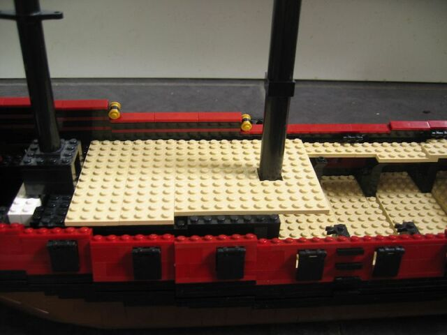](https://www.freelug.org/IMG/jpg/step9-f.jpg)

Nous pouvons dès à présent choisir où mettre la barre à roue, les instruments de navigation, ainsi que les canons de petit calibre.

[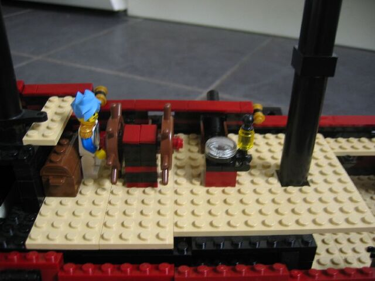](https://www.freelug.org/IMG/jpg/step9-g.jpg)

[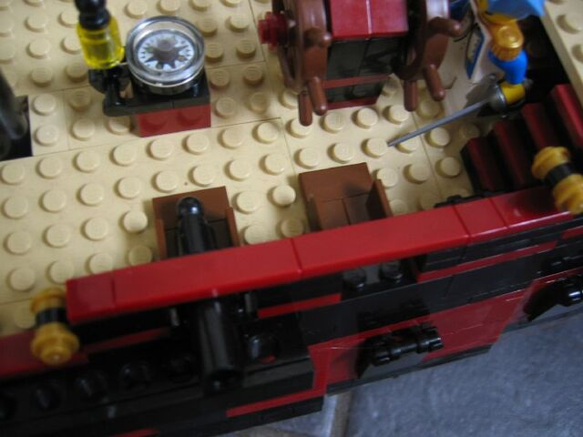](https://www.freelug.org/IMG/jpg/step9-h.jpg)

## Neuvième étape : Finition de la proue.

Regardons la proue de plus près.

[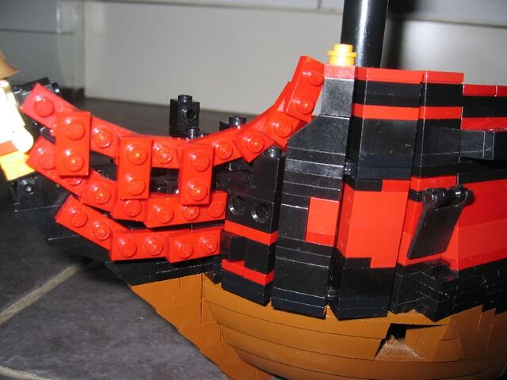](https://www.freelug.org/IMG/jpg/step9-i.jpg)

J’ai également installé une première figure de proue. Notez comment les croisillons se connectent à la brique de trois tenons sur l’armure de la minifig. L’armure vient de Brickforge, mais vous pouvez très bien obtenir le même résultat avec un assemblage de votre propre composition.

[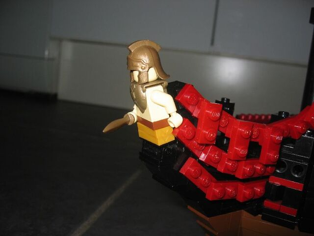](https://www.freelug.org/IMG/jpg/step9-j.jpg)

[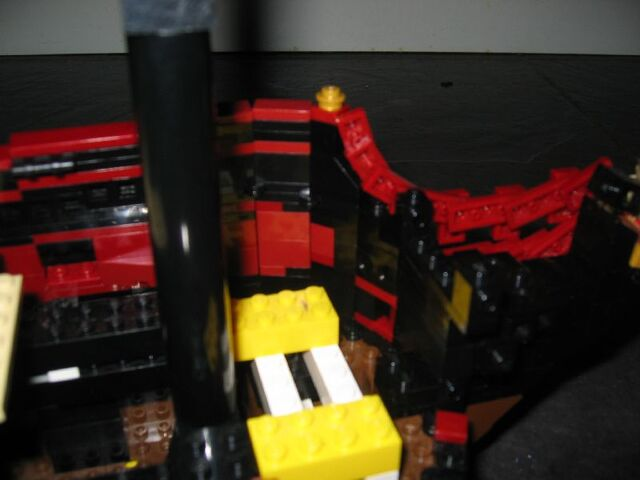](https://www.freelug.org/IMG/jpg/step9-k.jpg)

N’oubliez pas les commodités sur la poulaine, entre les croisillons. (Propriété intellectuelle de l’amiral Bejaune)

[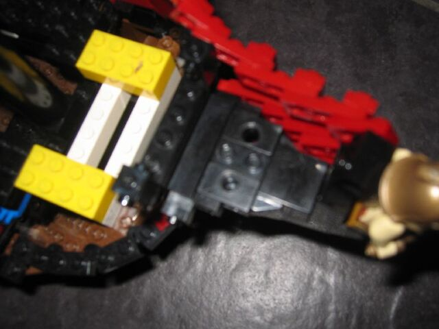](https://www.freelug.org/IMG/jpg/step9-l.jpg)

Une nouvelle fois de l’intérieur :

[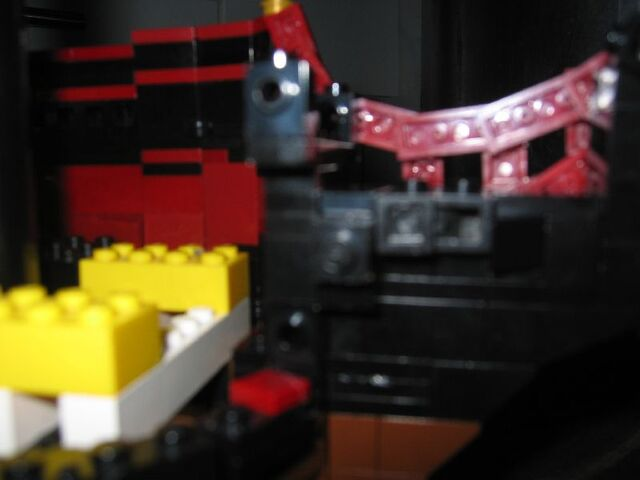](https://www.freelug.org/IMG/jpg/step9-m.jpg)

Ajoutons-y le beaupré :

[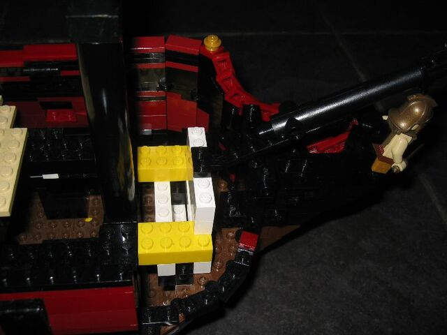](https://www.freelug.org/IMG/jpg/step9-n.jpg)

[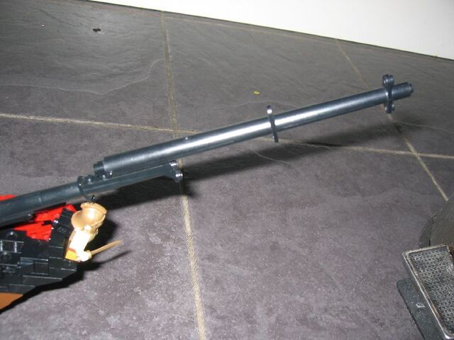](https://www.freelug.org/IMG/jpg/step9-o.jpg)

[Les finitions et les derniers détails dans le prochain article.](/articles/1247/)
