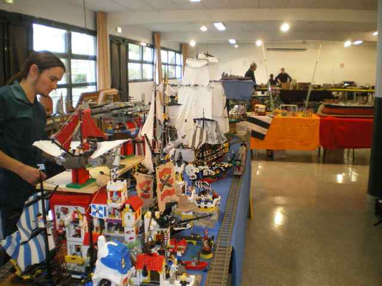
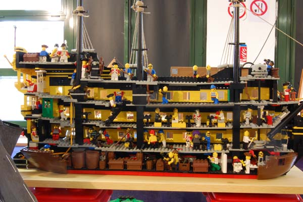
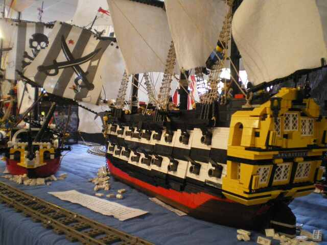
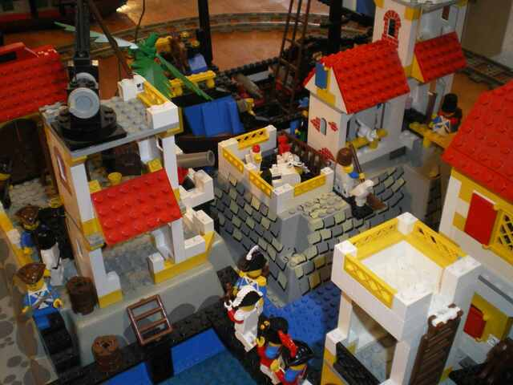
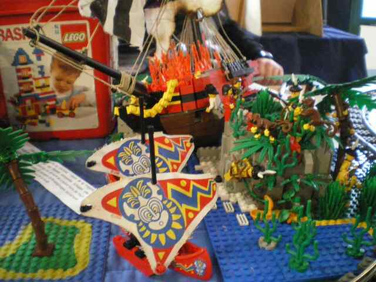

Outré de ne pas avoir vu de LEGO lors de l’édition 2009, je prends le taureau par les cornes et pose mon inscription sur un stand de 4 mètres. Grande première pour mes LEGO : c’est la première fois qu’ils prennent la voiture. Enfin, la camionnette de mon papa.

A peine de retour de Rennes, je passe mon vendredi soir à mettre mes pièces et mes dioramas dans des cartons que j’entasse joyeusement dans la camionnette de mon père qui m’aidera à tenir le stand pour cette première exposition. Première inquiétude aussi : mes vaisseaux de ligne ne tenant dans aucun contenant, je n’ai pas d’autre choix que de les transporter à même le plancher, à condition de bien les caler.

La mâture est visiblement plus solide que ce que j’ai pensé, et nous arrivons au complexe de l’Astrolabe à 9h30 le samedi matin, sans déplorer le moindre dégât. Placé dans la salle du sous-sol, au milieu du quartier manifestement consacré au modélisme naval, j’ai jusqu’à midi pour mettre mon stand en place, ce qui n’est, en fait, pas une mince épreuve. Aussitôt arrivé, je peux cependant compter sur l’efficacité et la cordialité des membres du club hôte, lesquels m’ont rapidement accueilli et m’ont aidé à installer l’indispensable électricité sur mon stand. Bon, au final je n’aurai reçu aucun prix, mais ils étaient bien sympathiques !

**Stand1**

Je m’occupe des derniers préparatifs avant l’arrivée des visiteurs.

Avant même l’ouverture au public, j’engage une conversation passionnée en anglais, avec la mère britannique de l’un des exposants vedettes du week-end, tandis qu’un photographe de BrestMiniRail tombe sous le charme de mon vaisseau de ligne en coupe, et que mon larbin de petit frère balaye la poussière sur toute ma collection de bateaux pirates des années 90.

A 13h, je finis de poser le dernier rail pour le train que j’ai tout spécialement conçu sur le modèle du Christmas Train, et ce n’est pas plus mal, car c’est le début de l’affluence, et de plus en plus de curieux s’arrêtent en face de mon stand ; je commence à faire de la sérieuse concurrence aux modélistes confirmés qui tiennent les stands voisins. Sans réelle surprise, mon train, équipé de sa lampe frontale, attire l’attention des petits et des grands, lesquels gratifient mon enthousiasme de toutes sortes de questionnements au sujet de notre brique en plastique préférée. Juste après, ce sont mes engins volants steampunk (quoi qu’un peu enrayés de la machinerie), qui ont la côte du public, suivis de mon vaisseau de ligne en coupe : tous ces petits personnages entassés dans de si petits compartiments amusent les observateurs les plus attentifs, mais tous ont l’air de saluer la créativité et l’animation de mon stand.

**HMS Promotheus**

Vaisseau en coupe, mais pièce à succès !

Ce sont d’ailleurs ces critères qui attirent l’attention d’un homme d’apparence sympathique sur mes dioramas ; il se présente comme le designer de la vitrine d’un magasin de jouets à Brest, et insiste pour prendre mes coordonnées en vue d’une collaboration pour son projet de Noël. Je n’aurai en fait jamais de nouvelles de cet individu qui n’a suscité en moi que de grands faux espoirs. Avis s’il se reconnaît =) L’après-midi passe lentement, pour mon plus grand plaisir, mais bientôt je réalise qu’un "bide cuisant" s’est glissé dans mon stand : le diaporama que j’avais amené pour passer en boucle sur l’écran de mon ordinateur les photos du reste de ma collection et de ma ville en LEGO, n’a intéressé strictement personne.

**Duel**

Vent en poupe, l’Archiviste compte porter le coup fatal à la corvette des pirates.

Contrarié par cet échec, je décide d’inaugurer la journée du dimanche sous le signe de l’interactivité en prenant avec moi le chariot permettant à mon train de tracter un appareil photo ; mis en mode caméra, ce dernier assurera à lui seul le spectacle durant toute la journée, puisque je retransmets ensuite la vidéo sur l’écran de mon ordinateur. Immanquablement, tous les curieux qui passent devant mon stand et voient à quelques instants de décalage la vidéo, puis mon train, se disent que c’est le train qui les filme en direct. Fou rire garanti lorsque les mamans et les papas et les enfants se succèdent pour faire coucou à la locomotive en espérant voir leur trombine apparaître sur les quelques vidéos qui tournent en boucle depuis le matin !

[Vidéo de la publication d’origine](http://www.youtube.com/v/gK23juZ8ayg?fs=1&hl=fr_FR)

Tour de chauffe pour mon appareil, et c’est dans la boîte !

Je rencontre successivement un bonhomme qui me donne cash une invitation pour exposer sur huit mètres au festival de Sainte-Catherine au mois de juillet prochain, puis des amis de Jean-Marc Barré en personne qui me poussent à m’inscrire à FreeLUG, et même un jeune homme amusé par le chariot de mon appareil photo, et qui me prête son téléphone pour lui faire faire un tour de circuit à bord de mon train ! Sans compter un flux intarissable d’enfants hypnotisés par mes grandes créations qui bougent de partout, de jeunes adultes émerveillés par les LEGO, des parents nostalgiques se mordant les lèvres, et de grand-parents se rappelant de leurs toutes premières briques. Plus dense, plus amusant, plus extravagant, le dimanche passe plus vite, et je me suis amusé comme presque jamais auparavant lorsqu’il faut déjà procéder au démontage du salon, ce qui ne prendra qu’une déchirante demi-heure.

**Fort Coq**

A l’intérieur du bastion, la vie des soldats français s’active.

L’angoisse est d’autant plus prononcée que le temps s’est gâté, et dehors il souffle des bourrasques ; un vent mortel pour mes navires qui sont toutes voiles dehors. L’Archiviste franchit bravement les quelques mètres qui séparent la sortie de service de la porte du fourgon, mais le Rose n’aura pas la même chance puisque l’instabilité de sa mâture et la fragilité de ses cordages l’abandonnent rapidement à un coup de vent : le navire démâte brutalement, emportant une partie de la coque et disloquant le pont, le tout dans un inextricable fatras de cordes distendues. Le malheureux bateau, ainsi que mes deux machines volantes rouillées, seront ensuite démantelés pour mettre leurs pièces au service de constructions plus ambitieuses.

**Naufrage**

L’épave du Rouge-Gorge se consume tandis que ses survivants tentent d’échapper aux anthropophages.

De cette première expérience extrêmement positive des expositions, j’ai retiré une invitation pour un festival de grande importance cet été, mais également un faux-espoir de participer à l’élaboration d’une vitrine, mais surtout j’ai vu toutes sortes de gens émerveillés et convaincus par mon stand qui n’a pas défailli un seul instant face à ses voisins modélistes confirmés, et des sympathisants de la petite brique ont achevé de me convaincre de m’inscrire à FreeLUG !

Vivement la prochaine, à Parigné-L’Évèque, qui portera un autre lot de promesses à vous montrer !

[Vidéo de la publication d’origine](http://www.youtube.com/v/GqhyZnH0Cdo?fs=1&hl=fr_FR)
