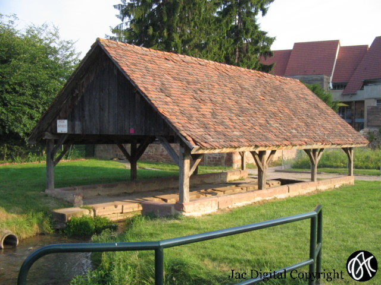
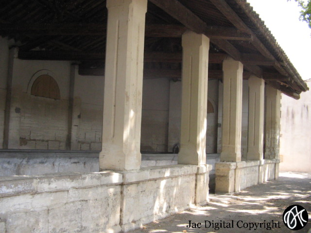
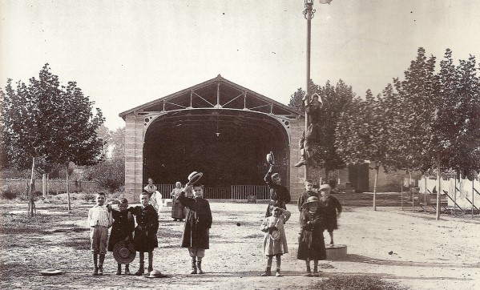
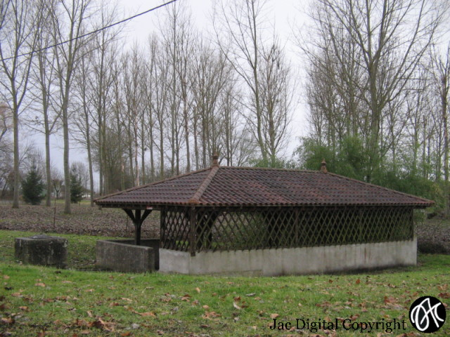
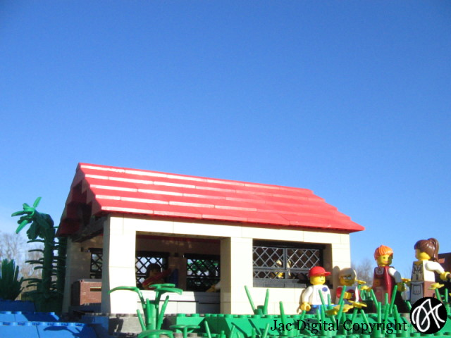

Quand j’étais gamin, il y avait dans le village où j’habitais un lavoir immense. Aujourd’hui il a été aménagé en salle des fêtes, c’est pour vous dire ! Fasciné par ces constructions, je vous présente une de mes créations.

## Utilité et réalité

Avant l’invention de la machine à laver, il fallait bien pouvoir laver son linge. De plus, dans le temps, toutes les maisons n’avaient pas l’eau courante, même aucune je pense, alors que ça existait dans les villas romaines, allez comprendre ! Le lavoir permettait de laver son linge. Cela ne se faisait pas en famille, mais ça permettait d’avoir un lieu convivial qui réunissait presque tous les gens du village.

**Style des constructions**

Le style architectural varie en fonction des régions et des matériaux disponibles. Ils sont aussi pour certains classés et font partie intégrale des villages ou des villes. On en trouve encore en très bon état et entretenu. Dans mes souvenirs, c’est un grand bâtiment en pierre Provençale. Elle est de couleur jaune pâle. Dans l’Yonne, je connais aussi le lavoir de Tonerre, construit en cercle autour de la source.

**Lavoir à Rosheim (67)**

**Lavoir de Maussanes les Alpilles (13)**

Ils sont constitué d’une fontaine et de 2 bassins au minimum. Le deuxième bassin, le plus grand en général, a des bords inclinés pour pouvoir frotter les vêtements avec les gros morceaux de savon.

**Le lavoir de Grans en Provence (13)**

Je garde en souvenir des images de ce lavoir qui était immense. Un très grand hall avec une multitude de bassin de lavage, au moins 6. C’était impressionnant car en général, les villes ont plusieurs petits lavoirs plutôt qu’un seul très grand.

**Le grand lavoir au début du XXe siècle**

**Le lavoir de Villeneuve Les Cerfs (63)**

Pour ma construction, je me suis inspiré du lavoir de Villeuneuve les Cerfs, à quelques centaines de mètres de Randan. C’est un petit lavoir avec des grilles en bois, une petite difficulté dans la construction qui était intéressante.

**Le lavoir de Villeneuve les Cerfs (63)**

## La reproduction en LEGO

Chaque fois que je prends mon trajet du travail, je passe devant le lavoir de Villeneuve. Mais sans jamais penser à m’y arrêter, j’ai bien du inventer un peu sa situation. J’ai enfin pris le temps d’aller le prendre en photo. Ca ne ressemble pas beaucoup à ma construction, mais ce n’est pas grave. Je me suis bien creusé pour placer les grilles comme celles en bois. Et puis, j’ai voulu qu’ils soit en pierre, ça me semblait plus solide.

J’ai profité d’une belle journée de soleil pour faire quelques photos de la construction, que j’ai sélectionnées et placées dans ma galerie. Avec de l’herbe et un peu d’arbre ça fait plus présentable.

Ce modèle n’est pas facile à placer car construit sur une plaque de base de 48x48 tenons. Aujourd’hui pour les dioramas, je préfère les plaques de 32x32 tenons. C’est moins encombrant et plus facile à insérer en exposition. Ce sera pour une prochaine fois, une prochaine inspiration. Mais il me plait beaucoup et j’ai du mal à le détruire. Cet article me permet de vous le présenter et de l’immortaliser, si je peux dire !

Dans la notice jointe vous trouverez ma méthode de construction des montagne. Je prends une plaque de base 32x32, je fais les bord et je remplis de briques qui ne servent pas beaucoup, en général des 2x4 rouge, jaune ou bleues, pour renforcer la construction. Je mets au moins deux rangées. Ensuite, je continue la construction en renforçant à chaque fois sous les différentes plaques, pour éviter que ça s’enfonce quand je rajoute les plantations ou les minifigs.

Il n’y a aucune plante dans la construction de la notice. Il faut laisser libre cours à son imagination. Je les replace à chaque fois. Donc c’est aléatoire. Enfin, j’essaye...

La représentation de l’eau est un peu simpliste. Sur que si je devais refaire cette construction aujourd’hui, ça serait différent. Mais c’est normal, tout évolue !

**Ma construction en briques**

[Galerie photos](http://photos.freelug.org/main.php/v/JAC/MOC/Diorama/Lavoir-01/)

**Notice de construction.**
