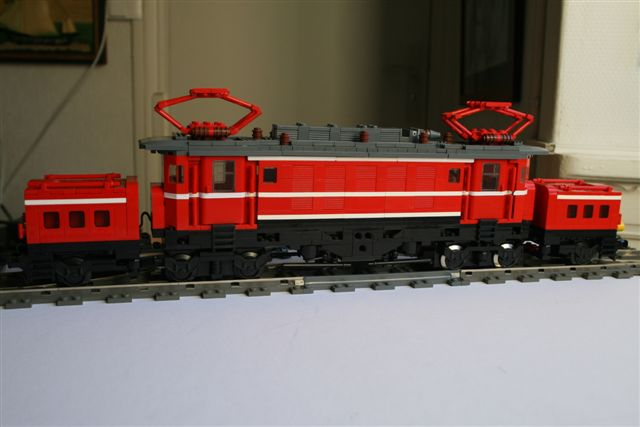
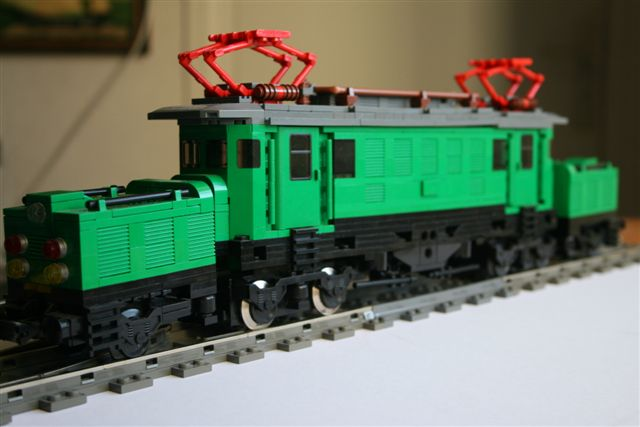

Deux versions d’une CC classe 1020 en petites briques.

Sans entrer dans les détails techniques, sachez que cette locomotive électrique d’origine allemande fut produite en grande série (202 exemplaires dont 47 pour l’Autriche) en 39-45 et après la guerre.

Nous trouvons donc la série E94 (il existait d’autres sous séries 194 et 254 lors des deux Allemagne, ultérieurement pour amélioration des performances), livrée verte pour la DB (réseau allemand), et la série 1020 (livrée verte d’origine puis rouge) des ÖBB, réseau autrichien.

Ces machines, très robustes, performantes, étaient parfaitement adaptées aux lignes de montagne.

Retirées du service, il ne subsiste plus que quelques locomotives soigneusement restaurées par des associations pour le plus grand bonheur des passionnés de cette machine.

De cette présentation, et, à la suite du [HOBBY TRAIN SET, référence 10183](/articles/582/) sortie en 2007, j’ai construit une locomotive en deux versions.

Voici leurs caractéristiques :  
**–** livrée verte d’origine et livrée rouge du réseau autrichien .  
**–** longueur : environ 62 tenons tampons inclus  
**–** largeur : 6 tenons. Je travaille toujours en 6 de large pour les besoins de mes réseaux.  
**–** feux avant et arrière alimentés par boitier 9v  
**–** 1 moteur 9v sous châssis .

[http://photos.freelug.org/main.php/...](http://photos.freelug.org/main.php/v/barr__/creations/locomotives/)
