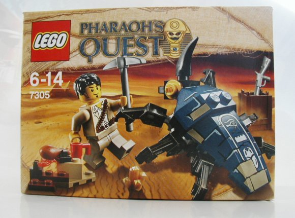
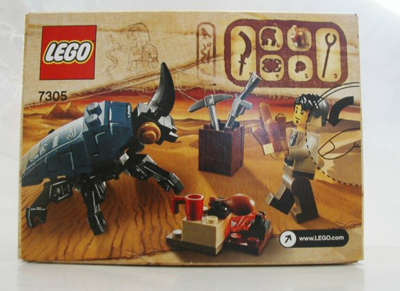
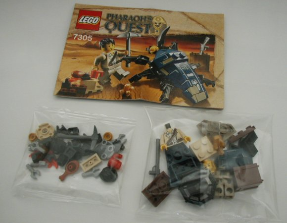
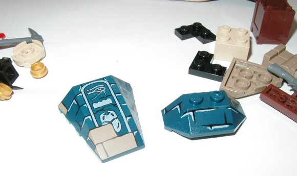
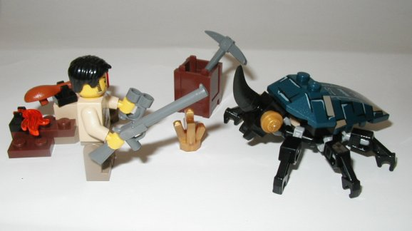
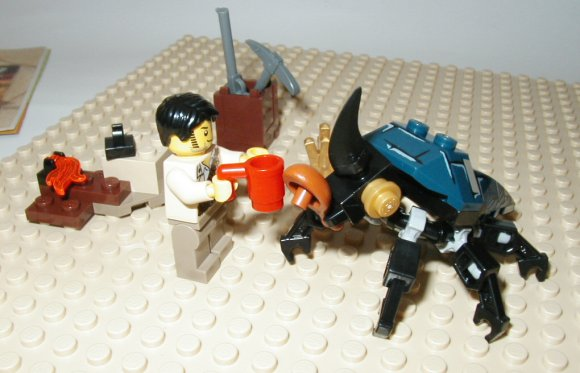

En attendant ma commande Peek&Poke avec le reste de la gamme, je vous propose dès à présent la revue de la petite boîte de la nouvelle gamme Pharaoh’s Quest.

## La boîte

Résumé :  
**–** Référence : 7305  
**–** Nom : L’attaque du scarabée  
**–** Nombre de pièces : 44  
**–** Minifig : 1  
**–** Prix : 4,90 euro  
**–** Gamme : Pharaoh’s Quest  
**–** Année : 2011

Petite boîte, le recto et le verso présente à vrai dire la même chose.

Au dos, toutefois, on découvre une liste d’accessoires dont on devine qu’il s’agit des objets de la quête. Six accessoires, six boîtes. Pour celle-ci, il s’agit d’une pierre précieuse dorée.

Le contenu est réparti dans deux sachets, et on retrouve la notice qui semble bien grande pour ce si petit contenu.

L’agréable surprise, c’est l’absence d’autocollants, et donc la présence de jolies pièces sérigraphiées pour les élytres et le prothorax de notre coléoptère.

L’ensemble est constitué d’une minifig, d’un scarabée, d’un petit rocher permettant un feu de camp, et de quelques accessoires.

Le scarabée est joliment réalisée, doté d’une grande corne et de yeux dorés. Notre aventurier va devoir faire preuve de courage pour vaincre la bête et s’emparer de la pierre dorée !

Finalement, il partagera son poulet et trinquera un verre avec le scarabée.

## Conclusion

Un chouette petit set accessible, et qui peut permettre de construire une belle armée de scarabées ! Vivement la suite de la gamme.
