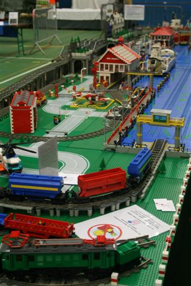

Inscrit en 2009, les organisateurs se sont aperçus qu’il n’y avait plus de place pour mon diorama trains et ferries, ils m’avaient donc aiguillé sur les [24h de jeux à Theix](/articles/1044/), ville voisine de Séné.

En octobre dernier, les mêmes organisateurs m’avaient retrouvé à Neuville de Poitou et m’ont tout de suite réservé la place promise.

Me voilà donc à Séné...

Après une route sans histoire avec ma Kangoo fraichement acquise, je suis arrivé, j’ai inspecté les lieux par curiosité vers midi.

AIE ! Les tables n’étaient pas posées. A 16h, après un gros coup de main, j’ai commencé enfin le montage du grand réseau jusqu’à 1h30 du matin, une gardienne de la sécurité m’a tenu compagnie, tellement elle était intéressée par mes LEGO.

Comme d’habitude, j’ai dormi à coté de mes briques.

Le lendemain matin, j’ai procédé au rodage général du réseau et une heure avant l’ouverture (11h), le public était déjà là.

A partir de ce moment là, je n’ai pas arrêté de faire la démonstration à des centaines et des centaines d’enfants et d’adultes.

Le samedi soir, un repas des exposants fut offert par le salon et j’ai dormi dans un vrai lit chez un organisateur.

Dimanche matin, nouvelle journée de démonstration à une cadence plus soutenue, rencontre avec Gaelle et sa petite famille et visite de deux passionnés de LEGO.

A 18 h, j’ai commencé le démontage du diorama.

En conclusion, très bonne fréquentation, 2000 visiteurs payants et 3000 enfants, très bon plateau du modélisme, accueil très chaleureux pour mes LEGO, un moment très fort avec un jeune handicapé qui ne demandait qu’à jouer avec moi, il m’a chaudement remercié... sans oublier Gaelle l’affol locale.

[Photos et coupure de presse d’Ouest France](http://photos.freelug.org/main.php/v/barr__/expositions/2011/sene/)

Prochain salon : [Salon des collections à la Chapelle des Fougeretz (35) , 6 février 2011](/articles/1264/) avec la team breizh.
