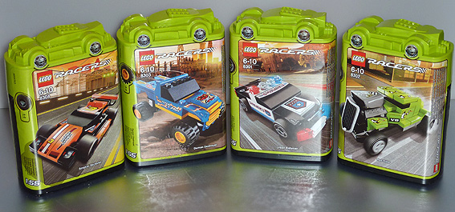
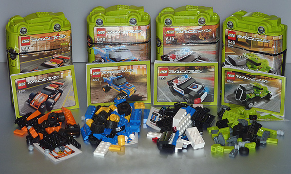
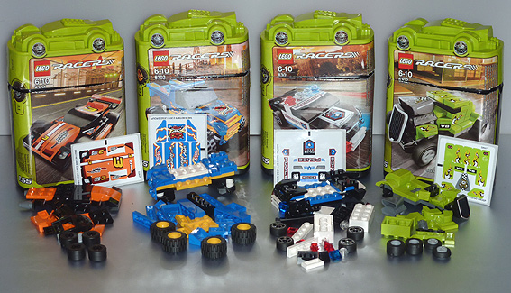
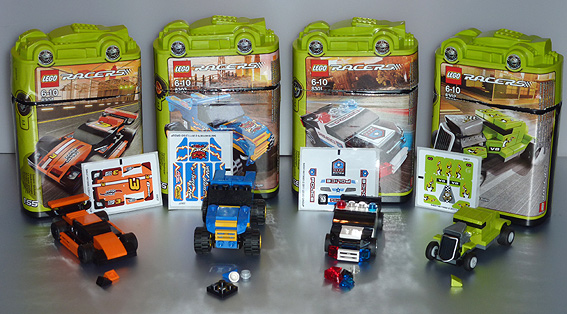
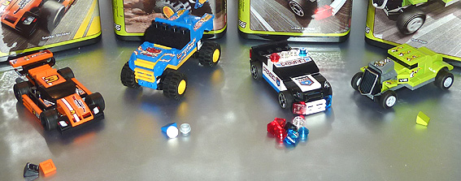

Depuis plusieurs années, LEGO suit la série des mini racer.  
J’avoue que je suis assez accro à cette série, qui est tout le contraire de ce que je MOC pour les expositions.

Donc, à peine sortie des presses, j’ai acheté les 4 derniers mini racer, cuvée 2011.

A chaque année, la couvercle des boites sa couleur : c’est citron vert en 2011.

Après ouverture des boites, premier changement : il n’y a plus de petit sachet pour les pièces qui sont directement en vrac dans la boite avec la notice et la (mini) planche d’autocollants. Oui, jamais de pièces sérigraphiées dans cette série à prix d’appel.

Vite, je me lance dans le montage. Pour faire plus riche, je dis que je commence par faire tous les ’châssis’.  
Pas de nouvelles pièces surprises.

Encore quelques pièces sur chaque châssis et voila la carrosserie terminée.

Là on commence à mieux voir : alors comme ’d’hab’, il y a la voiture de course, le 4X4, la police et le super turbo vitaminé lemon.

Et aussi quelques petites pièces en plus.

Reste le plus précis à faire, mettre tous les autocollants qui vont réellement habiller ces quatre voitures pour pouvoir les sortir décemment en public.

En final, quatre nouveaux modèles tout à fait dans la ligné de la série. Pas de nouvelles ’minimétapièce’ (c’est un nouveau concept uniquement accessible aux fans des miniracer).

Donc sans surprises pour ceux qui connaissent et à essayer absolument pour les autres.

Bonne route !
