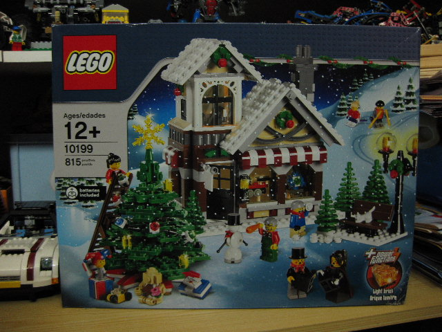
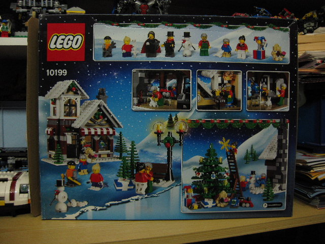
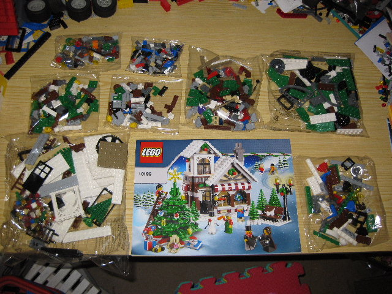
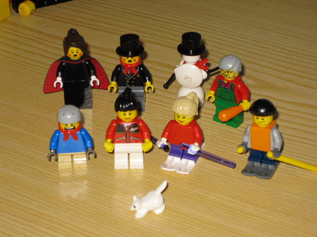
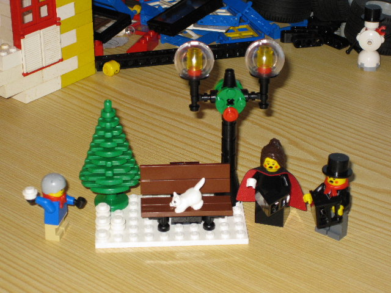
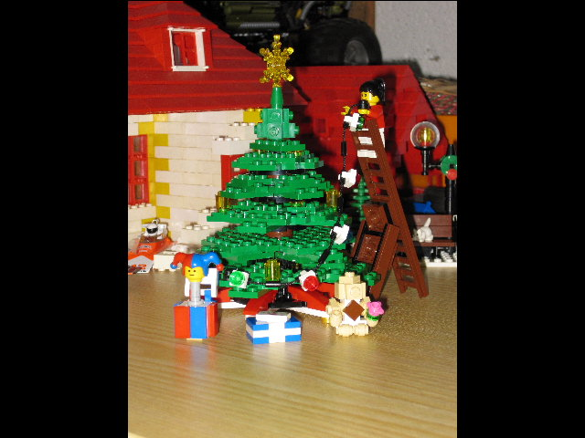
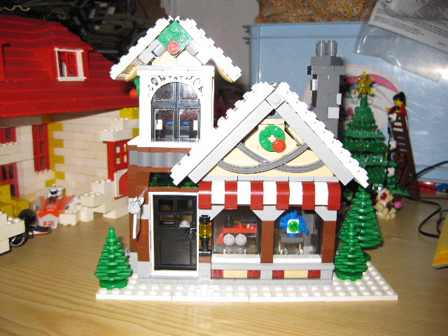
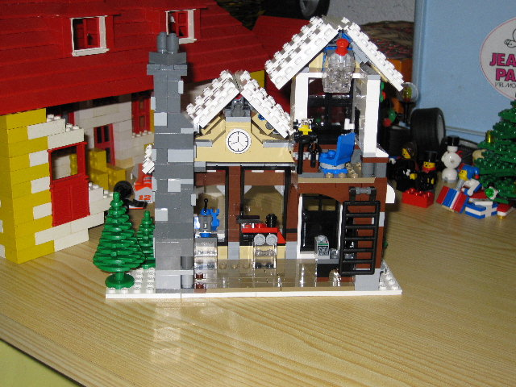
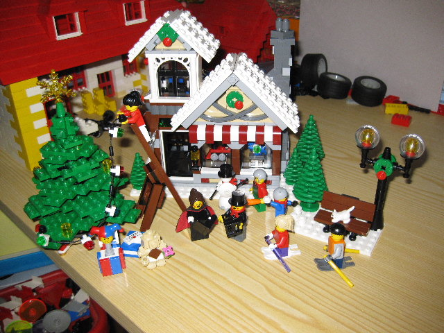

Je vous propose une petite description du set 10199 : la boutique de jouets d’hiver ou pour faire plus french (et plus cohérent) le magasin de jouets de Noël.

Tout d’abords la fiche signalétique  
**–** référence du set : 10199  
**–** nom : la boutique de jouet d’hiver / Winter Toy Shop  
**–** année : 2009  
**–** nombre de pièces : 815  
**–** minifigs : 7  
**–** prix (shop LEGO) : 72,90 €  
**–** age : 12+  
**–** gamme : Articles Exclusifs & Difficiles à Trouver / Articles de Saison

## La boîte

Devant

**devant**

Derrière

**derrière**

Les sachets et la notice

**Les sachets et la notice**

## Première étape : les minifigs et le bonhomme de neige

Bon et bien c’est des minifigs donc c’est du grand classique à monter. Il y en a 7, 3 enfants et 4 adultes, plus 1 bonhomme de neige à construire qui est très réaliste et très sympa.

**Etape 1 : les minifigs**

## Seconde étape : le banc et le lampadaire

On commence à attaquer la construction par le lampadaire qui a une structure très intéressante car pouvant être reproduit facilement avec beaucoup de variante sans les globes (pièces plus difficiles à avoir dans son stock).

Cela étant dit, dans sa forme présente je le trouve vraiment parfait, et d’un réalisme saisissant. Le banc n’appelle également que des compliments. Composé de pièces très courantes il est facile à reproduire. Et son apparente fragilité disparaît dès qu’il est fixé sur la plaque de base.

Et donc avec les minifigs et les accessoires ça donne ça :

**Etape 2 : le banc et le lampadaire**

## Troisième étape : le sapin de noël, ses cadeaux, l’échelle et la décoratrice

La construction du sapin est plutôt simple mais ingénieuse, et très pratique à reproduire pour celui qui dispose d’un stock important de plates vertes et qui voudra se constituer une forêt de sapins.

Le sapin est construit par niveau autour d’un axe Technic central et il est très solide. Puis on construit l’échelle pour la minifig qui décore le sapin, la guirlande et les cadeaux.

Et puis il est bien grand ce sapin.

**Etape 3 : le sapin, les cadeaux et l’échelle**

## Quatrième étape : le boutique de jouets d’hiver.

Bon maintenant on rentre dans la construction de la partie la plus importante de ce set : le magasin de jouets.

Le montage de cette partie ne présente pas de difficulté particulière. L’accent est mis sur le réalisme, avec un magnifique parquet, une cheminée très détaillée, et un petit atelier de réparation à l’étage très bien conçu et qui s’éclaire grâce à un élément 4526177.

La construction est très intéressante car elle propose des concepts d’assemblage judicieux, notamment pour la conception des toits, qui pourront être utilisés pour d’autres MOC. Les toits sont d’ailleurs particulièrement bien intégrés.

Et voilà le magasin est prêt à accueillir tous ces clients.

**Etape 4 : magasin vue avant**

**Etape 4 : magasin vue arrière**

En conclusion je dirais que ce set 10199 est très agréable à construire et la mention 12+ est un peu dure car il est accessible à des enfants plus jeunes, même s’il y a beaucoup de petites pièces.

Les composants de ce set sont très réalistes et s’intègreront parfaitement dans une ville ou un village.  
Le nombre de pièces est important et peut constituer un excellent stock pour d’autres créations.

Un mot sur le prix, il est quand même un peu élevé vu qu’il contient beaucoup de toutes petites pièces, alors guettez les soldes.

Un set à conseiller à tout le monde, passionné ou pas.

**Le set complet**

A bientôt

Raoulz
