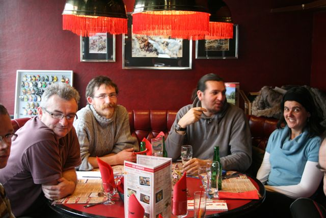

Une éclaircie sur la pointe bretonne ? Une petite faim pour faire une pause pendant les soldes ? Jean-Marc qui promène sa kangoo ? Allez hop, tout le monde au Buffalo pour ce qui était annoncé comme le plus gros restolego en Bretagne à ce jour !

Bon, une courroie qui saute, une petite grippe qui pointe son nez, plus quelques désistements, nous étions un peu moins que prévu, mais on s’est bien amusés !

Avec les minifigs de Ronan, les nouvelles de SeTechnic, les préparatifs des prochaines expositions avec Jean-Marc dont le dernier camion était tout rouillé, et enfin le passage du permis sur pelleteuse, la réunion des Breizh AFOLs s’annonçait chargée et est passée rapidement.

C’était la première fois que je prenais part à une manifestation FreeLUG, et j’en garde un très bon souvenir, notamment au côté de Mickbatto qui a assuré le spectacle, et de Julien que l’on introduisait également dans le cercle. Mention spéciale pour la serveuse  
qui a quand même été très patiente avec nous ;)

_LaurentB_

* * *

A l’heure de midi sous un vent glacial et un soleil peu généreux, dix Breizh Afols sur 15 ont répondu présents, les absents ont connu des fortunes diverses, revenez vite la prochaine fois !

Après les présentations, nous avons rejoint notre table au chaud.

Ce premier restolego de l’année fut l’occasion de saluer l’arrivée de Julien, Laurent et Bruno, Jean-Noel, Thierry, Laurence, de présenter le calendrier 2011 des salons bretons et surtout de discuter.

Pour ma part, j’avais amené la 8043, 8258, un camion JouéClub et en exclusivité, mon dernier bateau, un canot SNSM. Je laisse le soin aux autres de présenter leurs créations, collections...

En conclusion, un resto très sympathique, de nouvelles têtes, de nouveaux projets.

_Jean-Marc, qui vous donne rendez vous à Morlaix pour le restolego estival mi-aout_

* * *

A peine inscrit sur FreeLUG depuis quelques jours seulement, que l’occasion se présente déjà de participer à mon premier restolego. J’ai chaleureusement accepté l’invitation de Jean-Marc, maître de cérémonie, et j’ai ainsi rejoint les AFOLs du bout du monde.

C’était très intéressant de rencontrer d’autres fans de LEGO dont plusieurs autres nouvelles recrues. Nous ne sommes donc pas une espèce en voie de disparition bien au contraire, la tribu s’agrandit. Nous avons donc discuter de LEGO, de LEGO et aussi de LEGO, chacun ayant un univers de prédilection. Un restolego finalement bien sympathique pour marquer la nouvelle année sous un beau petit soleil breton.

_Julien_

* * *

**–** [Photos de Jean-Marc](http://photos.freelug.org/main.php/v/barr__/rencontres/restobrest2011/)
