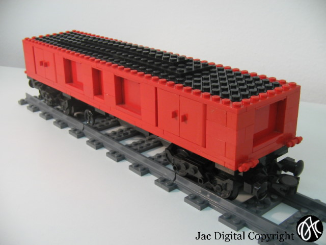
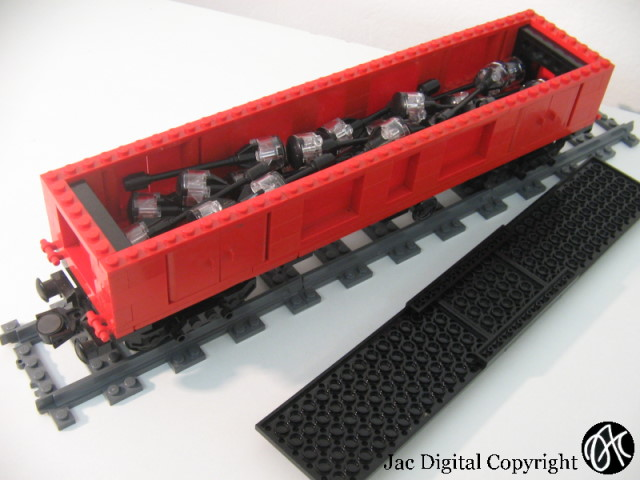
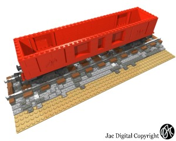

Pour garder l’échelle de ma BB 67020, j’ai eu besoin de wagons marchandises de la même largeur. Le long tombereau à boggies s’est avéré très utile, en plus d’être un simple élément de train.

Si on construit les locomotives en 8 tenons de large, il faut aussi que ce qui est derrière fasse la même largeur. Sans pour autant vouloir rechercher à faire correspondre les échelles, c’est surtout là, une question d’esthétique.

Ma [BB 67020](http://www.brickshelf.com/cgi-bin/gallery.cgi?f=209565) avait besoin de quelques wagons à tracter. J’ai donc construit un wagon couvert à portes coulissantes, un wagon citerne, un wagon de transport de bois (que je ne sors pas souvent) et un wagon tombereau. Tous sont montés sur boggies car ils sont assez longs. Ils pèsent aussi bien lourds et du coup, avec 3 wagons, le train est suffisamment chargé, malheureusement.

Mon préféré étant le wagon tombereau, c’est ce dernier que je vais vous décrire dans ces quelques lignes. Il a une double utilité :  
**–** il sert pour le réseau en étant tracté par ma locomotive ;  
**–** il permet de transporter des pièces de décorations.

Un wagon tombereau dans la réalité sert justement à transporter toute sorte de choses sans aucune distinction. Il est constitué de parois un peu hautes et de portes latérales. Il est soit à essieux, soit à boggie, en fonction de sa longueur mais aussi de sa capacité de charge à laquelle il peut être affecté.

Ce wagon tout simple en apparence a fait son lot de tours de roues sur nos réseaux et même quelques manœuvres. J’ai essayé de reproduire les boggies des wagons marchandises de la SNCF. Le wagon est construit sur un châssis utilisant des poutrelles Technic. On se rapproche de la réalité et on gagne en solidité. Il a aussi une bonne tenue sur les voies. La couleur rouge ne représente pas vraiment la réalité, mais je n’ai pas les pièces nécessaires en rouge foncé. J’aimerais en faire un ou deux de plus, mais les portes en rouge ne sont pas bien courantes. Il faudrait peut-être que je travaille une autre version et essayer de me passer de ces portes. En fait, le wagon me plait beaucoup comme ça.

**Simulation de charge du wagon**

Comme vous le savez, lorsque l’on charge une voiture pour une exposition, toutes les places disponibles sont bonnes à prendre. C’est d’autant plus valable lorsqu’on prépare ses affaires et surtout ses constructions pour exposer. Donc, trimbaler un grand wagon vide, cela aurait été bien dommage. J’ai construit un système simulant le wagon plein avec de grande plaques noires. Cela m’a permis de le transporter effectivement plein, mais avec les [lampadaires](http://photos.freelug.org/main.php/v/FreeLUG/Triffouillis/Lampadaire/LampadaireJac.jpg.html) qui servent à aménager la ville. Et c’est vraiment dingue la quantité que j’ai pu en mettre ! Ceux qui ne prennent pas place dans le décor restent dans le wagon, sans être vue...

**Les lampadaires en vrac dans le tombereau**

J’ai choisi ce wagon comme exemple. On peut très bien se servir d’un autre véhicule camion, container ou même une maison sans décor intérieur, pour rentabiliser l’espace. Enfin, les idées ne manquent pas quand il faut caser des petites constructions.

[Galerie photos](http://photos.freelug.org/main.php/v/JAC/MOC/Train/Wagontombero8t/)

[Liens wikipédia "wagon tombereau"](http://fr.wikipedia.org/wiki/Wagon-tombereau)

**Fichier MLCad.**
