L’association ayant bénéficié d’un [don en briques de la part de la société LEGO](http://photos.freelug.org/main.php/v/FreeLUG/Dons/LEGOFrance2010/vrac_fusee.JPG.html) contenant une belle petite Ariane 5 collée, nous nous sommes dit qu’elle devait servir de modèle pour la construction d’une plus grande.

De plus elle était accompagnée d’un maillet et d’une cale martyre, accessoires utilisés pour l’assemblage de grande structure.

Seul soucis, pas de notice ni de photo du modèle final... Le seul modèle à notre disposition est le modèle réduit.

Jérémy nous a convié chez lui le samedi 05 février afin que nous essayons de faire un premier essai.

Le but étant d’arriver à faire des modules qui seront montés par le public et assemblés au marteau par nos soins.

Pour ce genre d’animations, l’échelle standard est du x4. Une brique 2x4 est donc représentée par une brique 8x16. Cette option nous convenait puisque le vrac de pièces est constitué exclusivement de briques 2x4 et 2x8.

Avant de se retrouver, Gilles a [modélisé un essai de brique x4 et essayé de faire une partie des boosters pour estimer le nombre de briques](http://photos.freelug.org/main.php/v/gmifr/album41/fusee/Model_01/).

* * *

Après les arrivées au compte-goutte et les cafés chamallows, nous sommes montés dans la pièce où Jérémy avait entreposé les caisses. Heureusement, il avait vidé la pièce pour l’occasion (et aussi un peu pour ses travaux d’agrandissement).

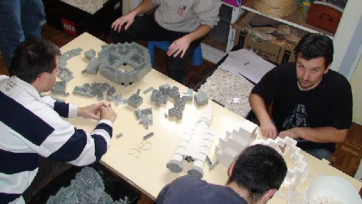

Après plusieurs essais et discussions, nous somme partis sur la base de construction de la fusée et boosters par tranches de 4 briques de hauteur, pour les parties qui seront montées par les visiteurs. Le reste (base, tuyères, coiffes) sera déjà assemblé car il ne présente pas assez de parties similaires.

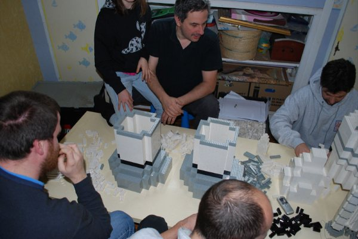

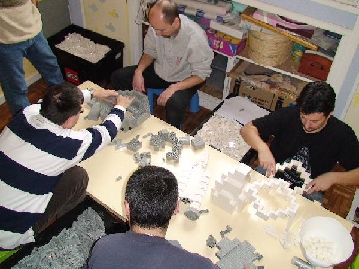

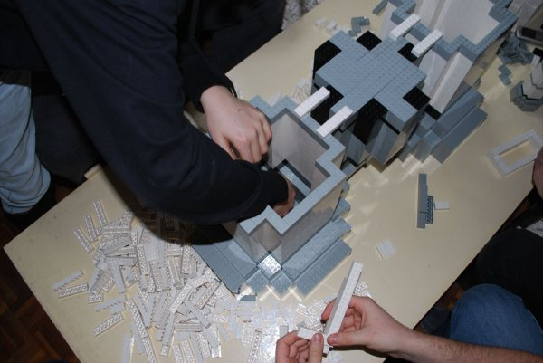

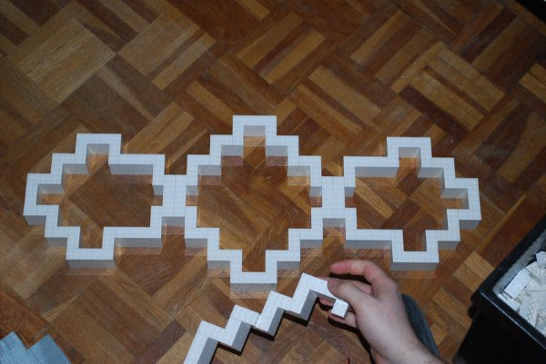

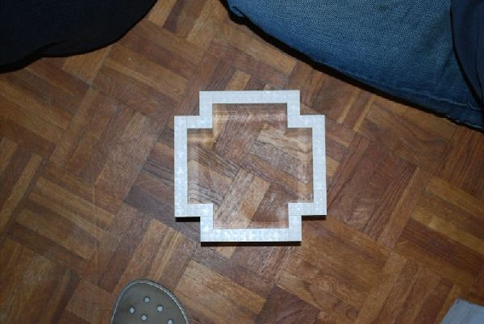

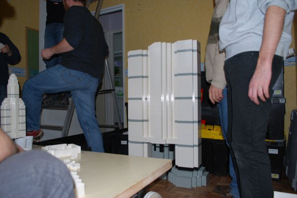

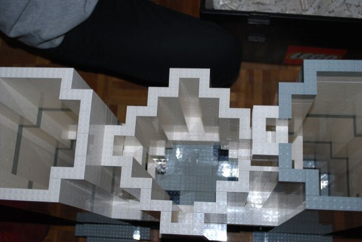

Voila le résultat que nous avons obtenu après quelques heures de travail.

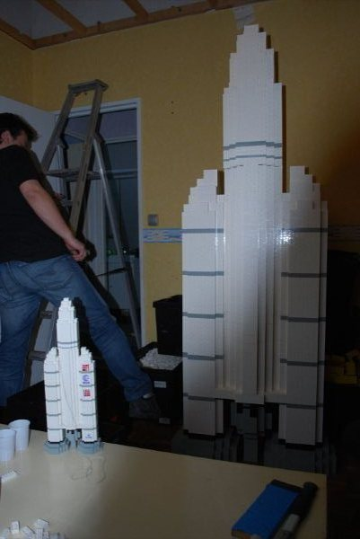

Tout ceci n’est qu’un début, nous validerons surement cela à l’assemblée générale en essayant un montage à partir des plans.

Pour l’instant, la fusée culmine à presque 2 m, mais nous n’avons même pas utilisé la moitié des briques blanches ! Pour un montage en exposition, cela nous parait suffisant. Il vaut mieux démonter 1 ou 2 fois dans la journée une fusée de 2 mètres, qu’en démonter une de 4 mètres tout seul le soir en plus du reste du stand.

Et pour transporter toutes les caisses, il faut au minimum un Scenic... et être tout seul. A trois, nous avons été obligés de laisser 3 caisses chez Jean-Claude ;-)

De plus, une fusée de 4 mètres serait beaucoup plus dangereux, il faudrait instaurer un périmètre de sécurité.

Il reste aussi beaucoup de briques jaunes qui servent à faire la rampe de lancement, mais nous n’avons pas jugé nécessaire de le faire. La construction est relativement basique. Les briques jaunes pourraient servir par exemple à faire une énorme pyramide puisqu’en ce moment il y a la gamme Pharaoh’s Quest.

Gilles est en train de modéliser les éléments que nous avons créés à partir des photos prises.

* * *

Comme d’habitude, quand nous nous rencontrons l’ambiance fut calme et studieuse. Donc chahut, blagues et bêtises en tout genre, plus concours pour trouver quelles farces faire aux autres

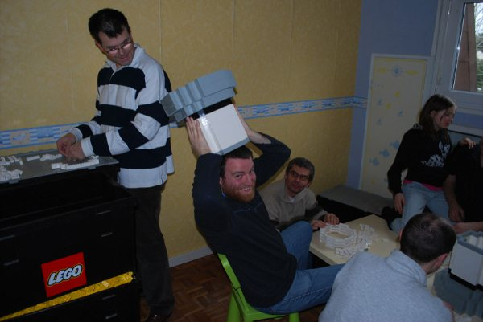

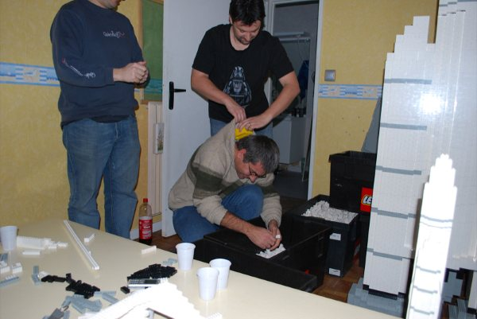

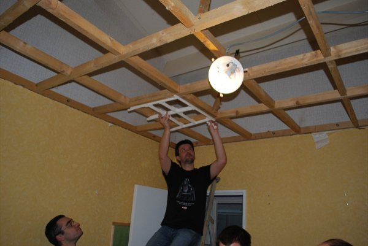

Malheureusement il n’y a pas de photos de tout ;-)

Merci à Nelly qui nous a gavés de pizzas maison ;-)

Merci à Jérémy d’avoir fait de la place pour que nous soyons bien installés, et démonté une porte pour que nous puissions travailler assis.

[Lien de la galerie vers les fichiers MLCAD](http://photos.freelug.org/main.php/v/gmifr/album41/fusee/)

* * *

_Mot de Eric :_

Merci à Nelly et Jérémy pour l’accueil. Merci à Erik, Manu et Pierre pour le transport.

Maintenant Jérémy a une fusée chez lui. Il cherche un spationaute ou une tenue de spationaute :o)

Il lui faut aussi des dalles de faux-plafonds, il faut voir avec Manu pour le gabarit :o)

Excellente journée !
