L’assemblée générale ou la REF est souvent l’occasion de concours de MOC. Si vous résidez à l’étranger, il est parfois frustrant de ne pas pouvoir venir et y participer. Une seule solution, trouver un membre se rendant à la rencontre et qui soit prêt à vous aider.

## Le principe

Il s’agit donc d’une collaboration entre deux personnes, que l’on pourrait appeler un **MOCeur** et un **Constructeur**. L’idée est que le MOCeur construise son modèle chez lui avec ses briques et qu’ensuite il crée une notice de montage à destination du Constructeur.

La notice de montage peut prendre toutes les formes possibles et imaginables. Bien sûr le plus courant reste un fichier [LDraw](http://www.ldraw.org/), mais le MOCeur peut aussi envoyer des photos, voir des vidéos, surtout si le montage utilise des techniques non conventionnelles.

Le Constructeur, quant à lui, s’engage à construire le modèle avec ses propres briques et à l’amener lors de la rencontre pour le concours ou l’exposition.

## Les enjeux

**Pour le MOCeur :**  
**–** Ne pas penser avec son stock de pièces, mais avec celui du Constructeur : oubliez les montages qui utilisent une pièce rare de votre stock, même si le rendu est cool.  
**–** Fournir une notice de montage suffisamment claire pour permettre à l’autre de reconstruire.  
**–** Finir le montage suffisamment tôt, bien avant la date limite de la rencontre, afin de laisser suffisamment de temps au Constructeur.

**Pour le Constructeur :**  
**–** Faire preuve d’initiative pour adapter le modèle en cas de besoin.  
**–** Pouvoir changer de pièces en fonction du stock en essayant de garder l’esprit initial du MOCeur.

## Quelques exemples de télé-construction de Banban

Depuis que je vis en Chine, il m’est arrivé à plusieurs reprises de participer à distance à différentes rencontres :

**Un minigolf pour l’exposition Saint Rambert 2007** (Constructeur : Loys et Denis. Voir [la galerie de Loys](http://photos.freelug.org/main.php/v/Chimere/Minigolf/) pour plus de photos)

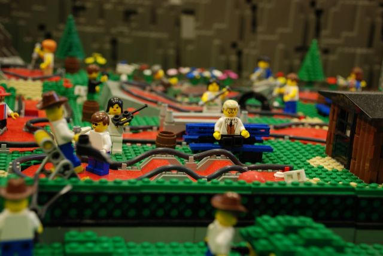

**Vue rapprochée du minigolf**

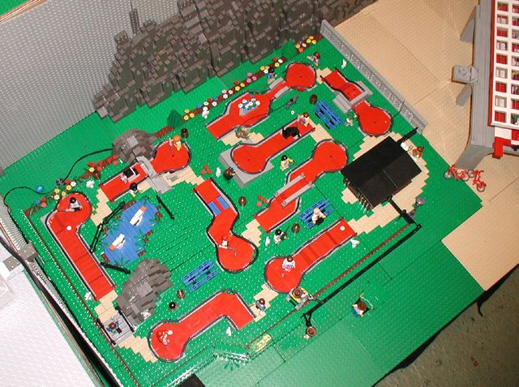

**Vue d’ensemble du minigolf conçu par Banban, construit par Loys**

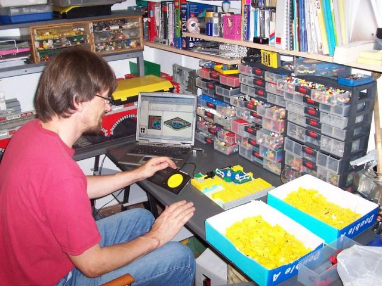

**Loys construisant le minigolf avec la notice MLCAD sur son portable.**

**Une loco Maersk pour JeanG**, dévoilée à l’exposition d’Orléans 2008 (Constructeur : JeanG). Notez que toutes les pièces ne sont pas disponibles en Bleu Maersk, JeanG les a peintes.

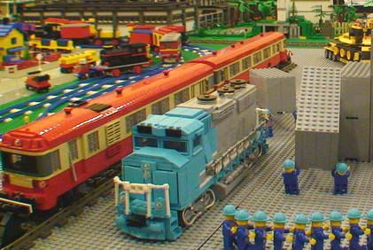

**Loco Maersk conçue par Banban, construite par JeanG**

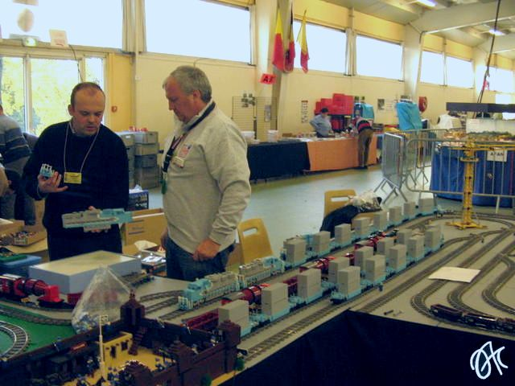

**JeanG montrant la loco Maersk a Phillipe**

**Concours Snot Qui Peut** (Constructeur : Erik)

Réalisé pour l’assemblée générale de 2010

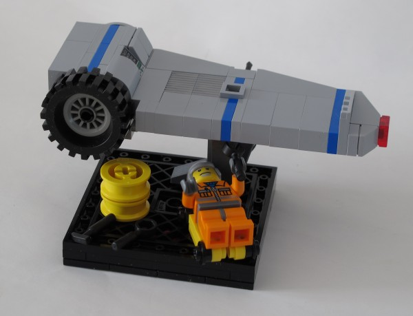

**Concours de Construction de Container** (Constructeur : Erik)

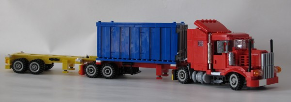

**Le camion conçu par Banban et construit par Erik**

## Un exemple détaillé : le container

Pour l’AG 2011, un concours sur le thème du transport de container imposait la construction d’un container et d’un camion avec remorque pour son transport.

Ce concours m’a tout de suite inspiré, car j’ai plusieurs fois tenté vaguement de faire un container, mais jamais vraiment sérieusement. Cette fois c’était l’occasion. J’ai envoyé un mail à Erik pour lui demander s’il était intéressé et disponible pour être le Constructeur comme l’année dernière, et il a gentiment accepté.

J’ai commencé par définir les dimensions du container. Je me suis décidé sur un container 20 pieds, car cela permettrait de faire un camion avec une double remorque, beaucoup plus intéressant en terme d’esthétique du modèle.

Un rapide saut sur mon [convertisseur d’échelle](http://www.suave.net/~dave/cgi/scale.cgi) préféré, et je décide des dimensions LEGO :  
**–** Largeur : 7 tenons, car c’est ce qui est le plus proche d’un point de vue échelle minifig et parce que ça se marie bien avec des wagons de 8 tenons de large.  
**–** Longueur : 16 tenons pour une question pratique, en fait il aurait plutôt dû faire 17 tenons de long si on voulait respecter l’échelle. Mais les barres d’ouverture le rallonge un peu.  
**–** Hauteur : 6 briques et une demi-plate. Bon la demi-plate n’est pas fait exprès, c’est juste une conséquence du montage SNOT.

Lorsqu’on cherche à modéliser un container, qui n’est en fait qu’une simple boite, il est très difficile de donner cette impression de container, car il y a très peu de détails. C’est pourquoi, je pense que les proportions largeur/longueur/hauteur sont un point critique pour donner cette impression. Si les proportions ne sont pas très bien respectées, inconsciemment, vous n’allez plus reconnaître un container de 20 pieds, mais un simple parallélépipède en LEGO.

Ensuite pour ce qui est des parois du container, je voulais bien sûr créer du relief. Cependant, l’épaisseur d’une plate me semblait beaucoup trop pour représenter la tôle ondulée des parois. J’ai donc cherché à créer un montage d’une demi-plate, et la solution est venue grâce à la brique de Erling.

J’essaye toujours de construire en vrai le MOC pour vérifier que les assemblages sont possibles. Cependant, je ne me fatigue pas à trouver les pièces dans les bonnes couleurs, je laisse cela au Constructeur. :-)

Mais pour la conception du container, j’ai été un peu fainéant et en fait je n’ai construit avec mes briques qu’une moitié du container, en assumant que l’autre coté était symétrique. Mais en fait comme le container fait 7 tenons de large, l’autre coté n’était pas tout à fait identique. Erik s’est arraché le peu de cheveux qui lui reste pour comprendre pourquoi ça n’arrivait pas à s’emboiter.

Bien sûr grâce à son expérience de MOCeur, il a fini par identifier le problème. L’assemblage n’était pas réalisable, et on n’a pas vu que dans MLCAD les briques s’interpénétraient. Il a immédiatement, corrigé le problème et m’a soumis ses modifications, que j’ai bien sûr validées dans la foulée.

Erik en a profité pour consolider le modèle à l’intérieur, car il est vrai que j’ai tendance à construire un peu fragile. Cela vient aussi de la peur d’utiliser trop de pièces ou des pièces que le constructeur n’aurait pas en quantité suffisante.

En fait, il ne faut pas hésiter à utiliser des couleurs voyantes ou rares (comme le rose par exemple) pour les pièces de consolidation interne et préciser au constructeur qu’il peut utiliser n’importe quelle couleur pour ces pièces là.

La construction du camion a aussi apporté son lot de discussions par mail. Je lui demandais par exemple : "Est-ce que tu as cette pièce là ?" et il me répondait "Oui dans telle ou telle couleur, en telle quantité". De là je pouvais choisir un design et continuer le MOC.

A un moment donné, j’ai même glissé un "Illegal Move" dans le montage, sans le dire à Erik, juste pour voir sa réaction. Il s’en est bien sûr plaint à juste titre, je lui ai envoyé la photo pour lui prouver que c’était possible, mais je l’ai quand même retiré, pour ne pas heurter la sensibilité des puristes. :-)

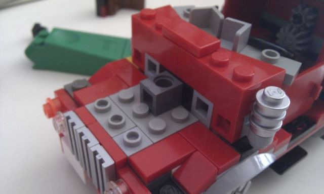

**Illegal Move : le bas de la brique technique 1x1 coince fortement sur le tenon de la plate 2x3**

Pour réaliser ce montage, il faut vraiment y aller en force. Bref, de quoi heurter la sensibilité de certains :-)

## La banbanterie

Etre Constructeur peut parfois révéler des surprises. En suivant la notice de montage du MOCeur, on peut y découvrir des assemblages originaux voir parfois incongrus. Sans que je sache vraiment pourquoi, le Constructeur de mon minigolf s’est amusé du montage de mon banc, et a décidé de qualifier cela de "banbanterie".

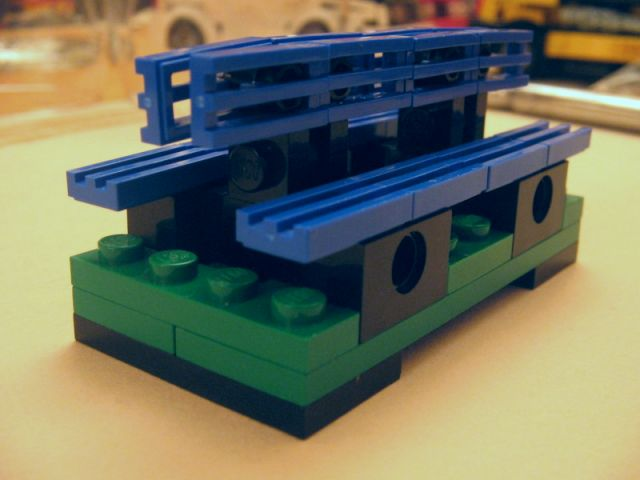

**Le banc qui a donné naissance au terme "banbanterie"**

Depuis la banbanterie désigne un montage réalisé par Banban sur MLCad et (presque) impossible à reconstruire en vrai.

## Les Notices de Montage

Ci-dessous vous pouvez télécharger les fichiers [LDraw](http://www.ldraw.org/) que j’ai créés lors des différentes aventures de construction à distance :

[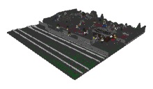](https://www.freelug.org/IMG/zip/Minigolf.mpd.zip "Zip - 26.1 kio")

**MLCad du minigolf**

[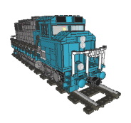](https://www.freelug.org/IMG/zip/Loco_Maersk.mpd.zip "Zip - 6 kio")

**MLCad de la Loco Maersk**

[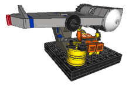](https://www.freelug.org/IMG/zip/SNOTWing.mpd.zip "Zip - 1.6 kio")

**MLCad du Concours Snot Qui Peut**

[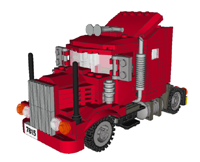](https://www.freelug.org/IMG/zip/Truck.mpd.zip "Zip - 3.9 kio")

**MLCad du Camion**

[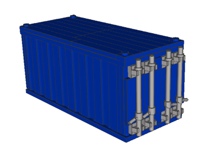](https://www.freelug.org/IMG/zip/Container.mpd.zip "Zip - 1.4 kio")

**MLCad du Container**

[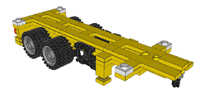](https://www.freelug.org/IMG/zip/BackTrailer.mpd.zip "Zip - 1.3 kio")

**MLCad de la remorque de derrière**

[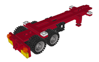](https://www.freelug.org/IMG/zip/MiddleTrailer.mpd.zip "Zip - 1.3 kio")

**MLCad de la remorque du milieu**
