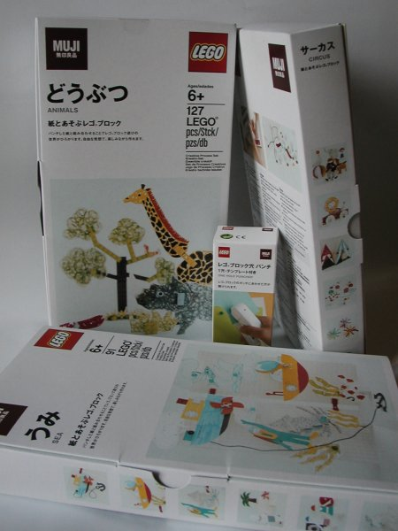
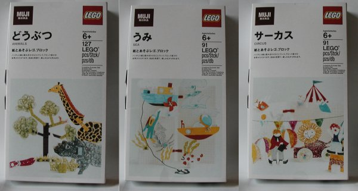
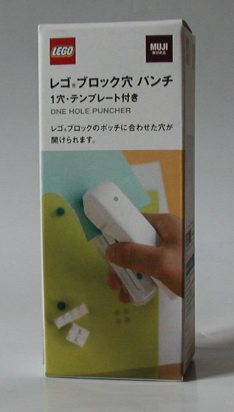
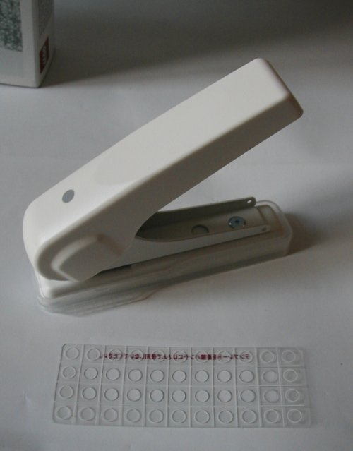
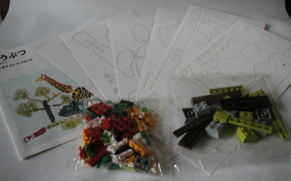
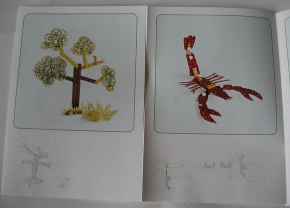
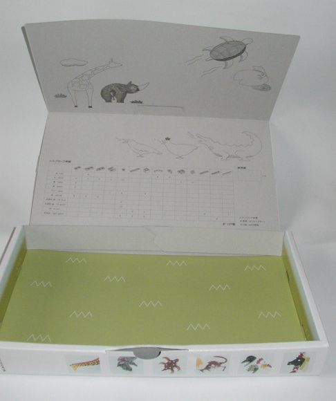
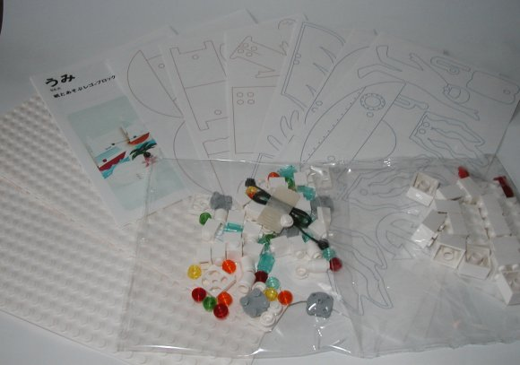
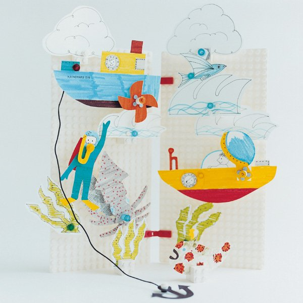

MUJI est une marque japonaise proposant divers articles pour la maison, des vêtements ou encore des produits cosmétiques, mais aussi de la papeterie. Car c’est bien de cela qu’il s’agit ici, une alliance entre MUJI et LEGO pour proposer une activité basée sur le papier et les briques LEGO.

Mais avant de rentrer dans le détail, précisons que ces produits sont distribués de façon très exclusive. En France, les boutiques MUJI se situent exclusivement à Paris, et seules deux proposent les sets LEGO MUJI.

Une exclusivité qui se paye au prix fort, comme nous allons le voir...

## L’assortiment

Nous avons trois références disponibles : MUJI Circus, MUJI Sea et MUJI Animals. Le Japon dispose de deux références supplémentaires, MUJI Transparent et MUJI Christmas.

A cela, il faut ajouter en supplément la perforeuse qui permet de faire des trous. Des trous - au standard LEGO - qui permettront de fixer papier et briques LEGO ensembles, c’est en effet tout le concept du produit.

## Les boîtes

Tout comme les [boîtes Architecture](/articles/831/) ou [les vases](/articles/1212/), l’emballage reflète la production en petite série.

De couleur blanche, elles sont richement illustrées par des photos sur la face et les côtés.

Au dos, des explications dans diverses langues et les mentions légales, le tout étant collé sur le texte d’origine, en japonais.

Je vous sens impatient de connaitre le contenu. Ne tardons pas plus.

**MUJI Circus**  
**–** Nombre de pièces : 91  
**–** Feuilles de papier : 6  
**–** Prix : 28 euro

**MUJI Sea**  
**–** Nombre de pièces : 91  
**–** Feuilles de papier : 6  
**–** Prix : 28 euro

**MUJI Animals**  
**–** Nombre de pièces : 127  
**–** Feuilles de papier : 6  
**–** Prix : 28 euro

**MUJI perforeuse**  
**–** Prix : 18 euro

Et non, il n’y a pas d’erreur sur le prix. Pour l’ensemble, 102 euro, pour un total de 309 pièces LEGO. Un des pires ratios, portant à 33 centimes la brique LEGO en moyenne.

Pour information, les briques sont fabriquées au Danemark et en Hongrie, tandis que le papier provient du Japon.

## La perforeuse

La perforeuse est livrée avec une petite réglette en plastique souple.

La réglette permet de tracer les ronds (9 x 2) aux emplacements standards des tenons sur le bord d’une feuille.

[Vidéo de la publication d’origine](http://brickerik.free.fr/autre/muji_perforeuse.ogg)

_Je m’excuse pour la piètre qualité de la vidéo, et l’absence de son. C’est mon premier essai, et le son était vraiment trop mauvais - et moi trop fainéant pour refaire une prise de son._

La perforeuse ne perce qu’un trou à la fois, la profondeur maximum par la feuille est de deux tenons. Il ne sera donc pas possible de percer un trou au milieu d’une feuille A4 (sauf à la plier). Les briques seront donc limitées à être fixées en bord de feuille.

## MUJI Animals

Commençons par la boîte contenant le plus de pièces...

Deux sachets de pièces, l’un contenant les briques et grandes plates, l’autre les petites pièces.

Ces petites pièces sont principalement des plates rondes 1x1, des charnière plates, et des plates avec clip ou barres ; en gros tout ce qui permet de réaliser des liaisons pivots.

Il y a également 6 feuilles de papier préimprimées, à colorier et découper, et un petit livret imagé avec les photos des animaux à réaliser.

Le couvercle de la boite a deux volets, l’un contenant l’inventaire du contenu.

Et ça s’arrête là...

## MUJI Circus et Sea

Les deux autres boîtes, bien que sur des thèmes différents, partagent le même inventaire. Notez la présence de deux plaques de base blanches 16 x 32 dans chaque boîte.

L’inventaire en pièces est moins riche : principalement de la brique 2x2 blanche, des ronds 1x1 et des plaques tournantes.

On retrouve les 6 feuilles de papier, chacune propre à leur thème.

Et voilà ce que ça peut donner :

**Exemple tiré du site MUJI**

Je vous rassure, ce n’est pas de moi. Je n’ai pas la prétention de faire du découpage/coloriage, que ce soit sur papier ou sur brique ;)

## Conclusion

Que dire... D’un point vue purement LEGO, c’est hors de prix, pire que du StarWars ou autres licences.

Sur le concept, ma foi, ce mariage papier-LEGO est plutôt étonnant. La brique LEGO remplace ici l’attache parisienne, pour plus de fantaisie. Les enfants pourront lors de leurs activités manuelles faire, défaire et refaire leurs assemblages, on y retrouve en fait tout l’esprit LEGO, tout en s’alliant à la richesse du papier qui permet d’infinies possibilités.

Mais bon, pour le collectionneur, cela reste un produit exclusif à posséder, même si ça ne sert à rien et que ça finit au fond d’un placard avec tout le reste. Toutefois, un intérêt pourrait être trouvé dans la perforeuse par qui veut glisser quelques papiers dans ses créations.

Tant que nos briques ne se transforment pas en papier...

## En savoir plus

**–** [Le site officiel de MUJI](http://www.muji.com/)  
**–** [La page consacrée aux sets LEGO sur le site MUJI](http://www.muji.com/lego/)  
**–** [Le site français MUJI](http://www.muji.fr/)  
**–** Articles LEGO disponibles aux boutiques Faubourg Saint-Antoine et Francs Bourgeois.
