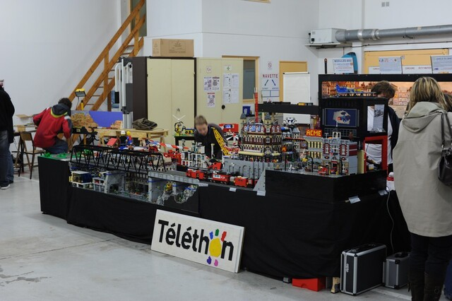

Fidèles au rendez-vous donné l’année dernière, une équipe de joyeux modélistes a exposé ses créations dans le garage de la caserne des pompiers de Criquetot l’Esneval.

On a eu froid l’année dernière, on a eu froid aussi cette année.

La neige étant tombée toute la nuit, la route sous la neige avec la remorque, c’est galère !

Quand à Médérik, le camping-car à propulsion, ce n’est pas mieux...

Bref, on est arrivés sans tôle froissée, un peu plus tard que prévu, mais sans perdre de briques.

Montage, placement des tables, et réglage des cales sous les pieds, on est fin prêts, mais vu la météo, ce n’est pas l’affluence.

**Il fait froid !**

Avec le froid, et la neige, le lavage de voiture a été abandonné.

Journée calme donc. Le fil rouge lancé cette année était le montage de la caserne des pompiers, et ses véhicules.  
A la mi-journée, pas beaucoup d’avancement.

Un peu plus de monde dans le milieu de l’après-midi, mais cela n’a pas permis de finaliser le montage.  
Une exposition agréable, mais pour ce qui est du résultat, les dons ont été nettement inférieurs à l’année dernière.

On fera mieux l’année prochaine, avec on espère une météo plus favorable.

[Les Photos](http://www.brickshelf.com/cgi-bin/gallery.cgi?f=465313)
