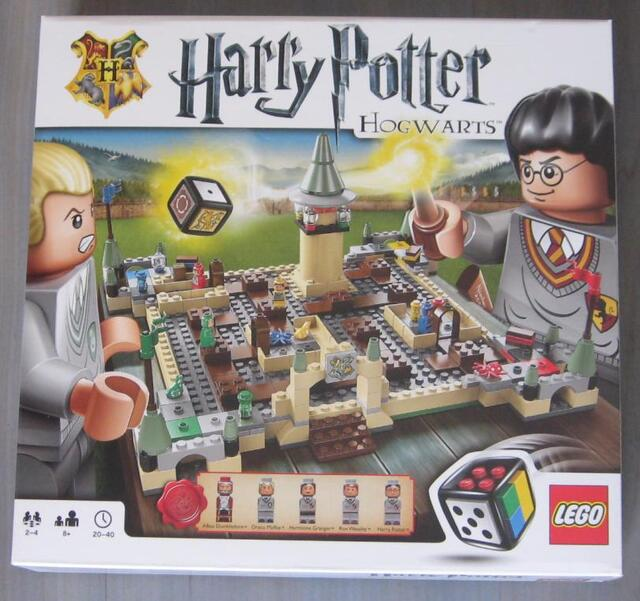
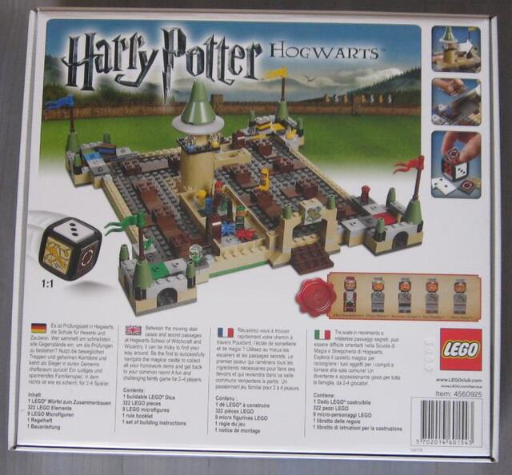
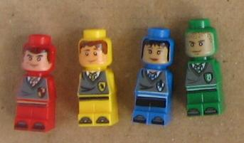
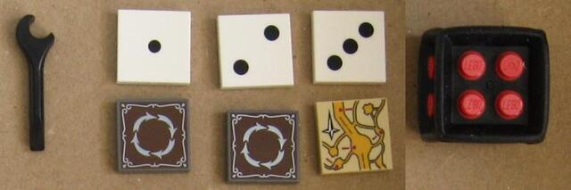
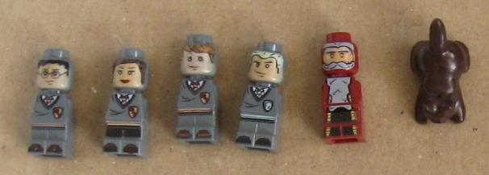
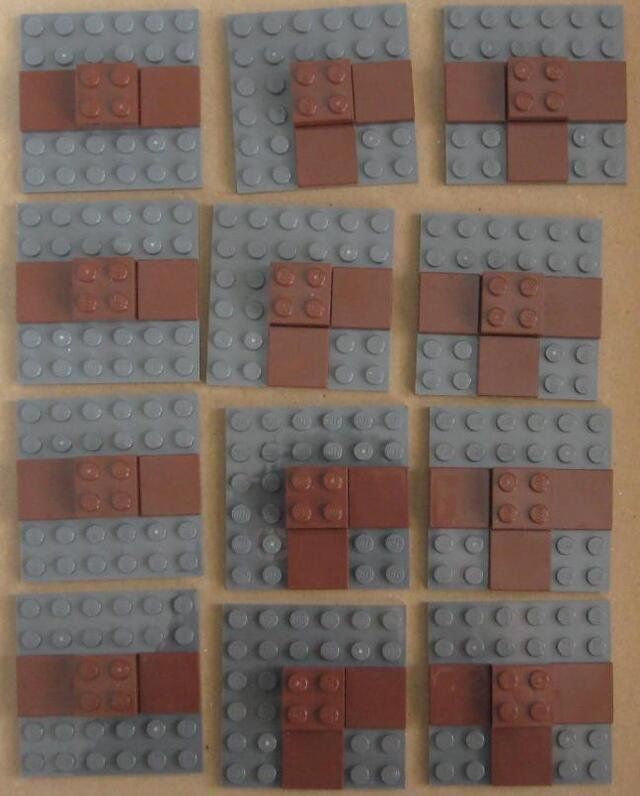
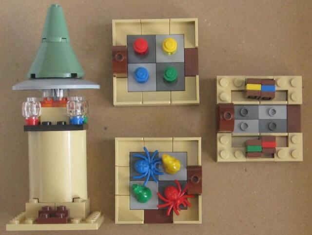
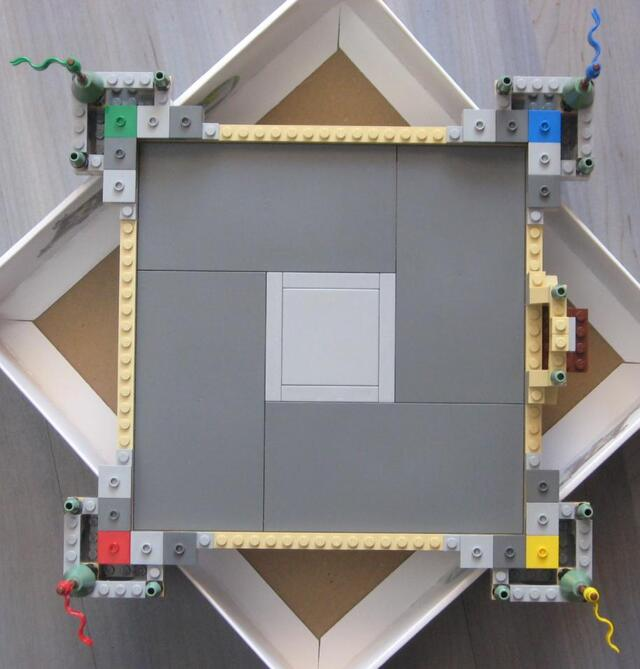
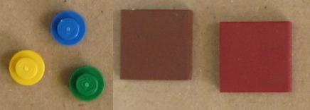
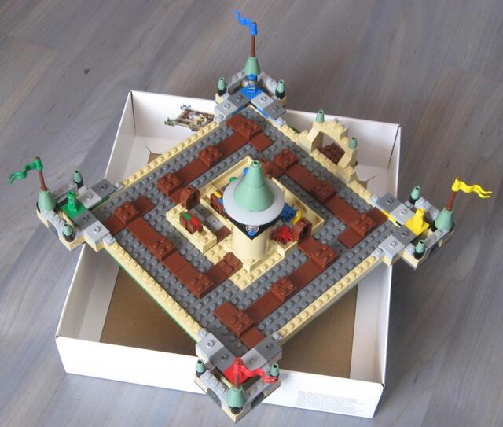

Après les premiers jeux de société sans thème particulier, la société LEGO nous propose maintenant des jeux en rapport avec certains des univers de ses collections. Cet article présente le jeu de stratégie dans l’univers magique de Harry Potter et l’école de Poudlard.

La boite (référence 3862) annonce la couleur : ce jeu de société se déroule dans l’école de Poudlard de l’univers Harry Potter reproduite sous forme d’un plateau à dominante beige, brune et grise.

**Boite coté face.**

La face arrière de la boite permet de se faire une idée plus précise du contenu c’est à dire 322 pièces, un dé, 9 micro figurines, une notice et une règle.

**Boite coté pile.**

Elle résume l’objectif du jeu pour les 2 à 4 écoliers-joueurs : réunir les 4 ingrédients magiques (une boule de cristal, une potion, un animal et un livre) se trouvant dans les 4 salles de classe nécessaires pour faire les devoirs et revenir dans sa salle commune en parcourant l’école et ses escaliers magiques.

Passons les différents éléments du jeu en revue.

Les pions micro figurine qui représentent les joueurs.

**Les joueurs en 4 couleurs.**

Le dé, son outil de démontage de faces et les 6 faces : 1, 2 ou 3 points, 2 faces rotation et une face "carte du maraudeur".

**Le dé et ses faces.**

Les personnages supplémentaires qui permettent de varier le jeu : Harry, Hermione, Ron, Draco, Dumbledore et Miss Teigne.

**Les personnages en extra.**

Les 12 cases 6x6 qui constituent les escaliers mobiles.

**Les escaliers mobiles.**

Les 4 cases 6x6 qui constituent les salles de classe : la tour de divination avec 4 boules de cristal, la salle des potions, la salle de zoologie et la bibliothèque. On notera qu’à part la tour de divination, les salles ont toutes 2 entrées.

**Les 4 salles de classe.**

Le plateau de jeu avec les 4 salles communes.

**Le plateau nu.**

Les quelques pièces en extra dont 2 faces alternatives pour le dé.

**Les pièces en extra.**

Au début du jeu, le plateau est entièrement rempli avec les salles de classe et les escaliers.

**Le plateau au début du jeu.**

Le principe de chaque tour est simple : selon le résultat du lancé de dé, le joueur peut  
**–** soit (i) retirer un escalier, faire 1, 2 ou 3 glissements de ligne ou de colonne s’il obtient 1, 2 ou 3 points sur les faces blanches du dé, remettre l’escalier comme il le souhaite et ensuite déplacer son pion selon un chemin qui s’ouvre à lui,  
**–** soit (ii) tourner un seul escalier s’il obtient une face brune avec un symbole de rotation et ensuite déplacer son pion selon un chemin qui s’ouvre à lui,  
**–** soit (iii) faire sauter directement son pion dans une case voisine de la sienne s’il obtient la face carte du maraudeur.

Vous l’aurez compris, il faudra doser vos actions entre la volonté de s’ouvrir un passage vers les salles et la volonté d’empêcher les autres joueurs d’y arriver.

C’est un jeu de stratégie intéressant et varié où le résultat du lancer de dé a une forte incidence sur l’action des joueurs à chaque tour.

C’est un bon achat pour un prix officiel un peu cher (36,90 EUROS) mais que l’on peut aussi trouver autour de 26 EUROS.
