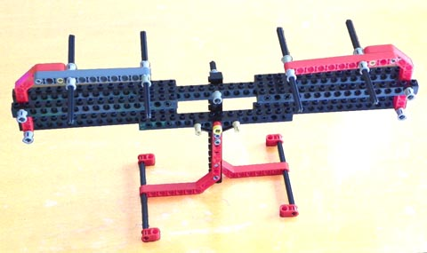
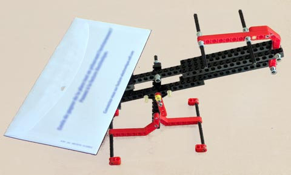
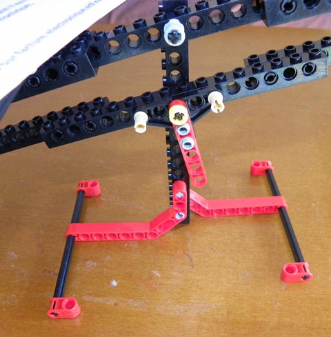
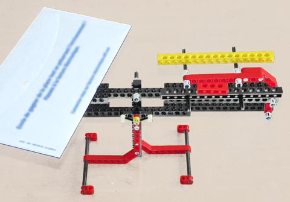

Depuis que j’ai (ré)ouvert mon magasin BrickLink, j’ai besoin d’une balance pour peser mes envois postaux afin de les affranchir au bon tarif.

Il s’agit généralement de lettres de l’ordre de quelques dizaines de grammes (20g à 250g).

On peut bien sûr se procurer des pèse-lettres pour quelques euros, mais en tant que fan de LEGO, je ne pouvais pas résister à l’envie de fabriquer ma propre balance en LEGO.

## Know your subject [^1]

Avant tout il faut faire le tour de ce qui existe. En LEGO, je n’ai pu trouver qu’[un seul exemple](http://www.instructables.com/id/Lego-pan-balance/). Il s’agit d’une balance à fléau classique. Il est clairement souligné dans les commentaires qu’il faut limiter au maximum les frottements (ça va faire plaisir à Tribolego [^2]) au niveau des pivots.

Mais cette balance à deux défauts mineurs : son encombrement conséquent et l’impossibilité de peser des objets un peu volumineux (à vue de nez, la largeur maxi est de 8cm).

Les balances au cours de l’histoire ont beaucoup évolué avec des variations subtiles : balance à fléau, romaine, pesons, Roberval, électronique... Il ne s’agit pas ici de réaliser un pèse-personne, une balance micro-analytique ou une balance électronique - les fans de MindStorms ont peut être leur propre solution à présenter.

## Roberval

La balance à fléau, purement mécanique, rudimentaire, est ce que je recherche. Sa variation, la balance de Roberval, emporte mon adhésion. Elle permet de peser des objets plus volumineux, même si cela implique une précision plus faible à cause de frottements plus nombreux. Elle est aussi plus robuste.

**Balance vide équilibrée**

Le principe de la balance de Roberval repose sur un quadrilatère déformable. On détermine le poids d’un objet en comparant son poids avec d’autres objets de masse connue : les poids [^3].

**Balance chargée déséquilibrée**

Pour limiter les frottements, j’ai privilégié un montage "léger" ; par exemple les plateaux sont constitués uniquement d’axes Technic, il n’y aucun habillage (pas une seule plaque ou panneau). Le pèse-lettre est avant tout pratique avant d’être esthétique. Il peut être encore amélioré (allégé), en employant par exemple uniquement des poutres studless plus légères que les briques Technic et le dédoublement du fléau supérieur est, je pense, superflu.

**Détail - Flèche facilitant le repérage horizontal**

## Les pièces vont faire le poids

Pour peser, en plus de la balance, il faut des accessoires : les poids. Dans mon cas je veux une solution "tout LEGO" et j’utilise des briques Technic en guise de poids, poutres préalablement pesées sur une balance de laboratoire (voir le tableau récapitulatif ci-après).

**Les "poids" à l’œuvre**

Poids des différentes Briques Technic

|  |  |  |  |  |  |  |  |  |
| --- | --- | --- | --- | --- | --- | --- | --- | --- |
| Taille | 2 | 4 | 6 | 8 | 10 | 12 | 14 | 16 |
| Poids (g) | 0.760 | 1.466 | 2.151 | 2.851 | 3.545 | 4.274 | 4.925 | 5.635 |

La précision est superflue, elle est simplement le reflet d’un calcul de moyenne. A titre d’anecdote, ces valeurs peuvent faire l’objet d’une régression linéaire, dont curieusement(?) l’origine n’est pas nulle (0.068 g à l’ordonnée pour une pente de 0.696).

En première approximation, un "tenon" de brique Technic pèse donc environ 0.35g.

## Précision

**–** une enveloppe nue a été pesée équivalente à une brique Technic 1x14, soit 4.9g. Le poids de l’enveloppe sur la balance de laboratoire : 4.5g. C’est une erreur faible en valeur absolue (0.4g) mais forte en valeur relative (10%). Toutefois, ce poids est en dessous de la valeur cible minimum (20g).

**–** un gâteau (que j’ai mangé après l’avoir pesé - 30g), a été pesé équivalent à 2x16 + 3x14 + 1x 12 = 30,3g. Une erreur de 1% seulement !

**–** Un objet de 70g a été évalué à 72.1g. (3% d’erreur)

**–** Un colis de 183g a été évalué à 175g. (environ 4.5% d’erreur)

Je n’ai donc pour le moment pas beaucoup de recul sur la précision de mon pèse-lettre mais les premiers éléments, avec des erreurs inférieures à 5%, sont très encourageants.

Toutefois, les pesées au-delà de 150g sont très délicates car mon modèle est trop instable et mérite donc une nouvelle conception pour les poids entre 100 et 250g.

[^1]: Connais ton sujet

[^2]: Un membre de notre association expert en tribologie, science des frottements

[^3]: En physique, poids et masse sont des concepts connexes mais bien distincts. En pratique, dans la vie courante, on fait la confusion sans conséquence fâcheuse
