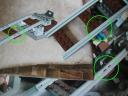
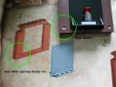
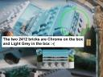
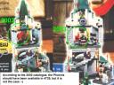
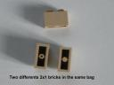
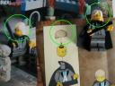

Peut être avez vous déjà remarqué certains de ces détails, mais certaines "anomalies" apparaissent dans des sets Harry Potter, tout comme dans d’autres collections, comme le montre l’article [Bizarreries de l’espace.](/articles/101/).

**–** Commencons par le set [4714](http://guide.lugnet.com/set/4714) _La banque Gringotts_, où les deux rails gris sur la boite sont différents de ceux présents dans la boite. Sur les photos et dans la notice, ce sont les anciens rails gris avec fentes qui sont adaptés aux traverses à clip (générations de train à rails gris). Dans la boite, ce sont des rails sans fente. On retrouve ce même problème dans le set [6761](http://guide.lugnet.com/set/6761) _La mine d’or_ (série Western).

**–** La pièce [40253](http://www.peeron.com/inv/parts/40253) présente dans le set [4702](http://guide.lugnet.com/set/4702) _Challenge final_ est remplacée sur la notice par la pièce [30101](http://www.peeron.com/inv/parts/30101) et 2 briques 1x1. Plus étrange, cette même pièce apparait dans le set [4709](http://guide.lugnet.com/set/4709) _Le château de Poudlard_ (sorti la même année) et la pièce sur les instructions est correcte !

**–** Dans le set [4728](http://guide.lugnet.com/set/4728) _La fuite de Privet Drive_, la calandre de la voiture (pièces 2412) est chromée sur la photo, mais malheuresement pas dans le set :-( .  
Toutefois, notre ami Gunter me signale qu’il a bien eu les grilles chromées dans son set.

**–** Dans le catalogue 2002(2), on peut appercevoir que le set [4729](http://guide.lugnet.com/set/4729) _Le bureau de Dumbledore_ contient le Phoenix. Or sur la boite (et dans la boite) l’oiseau ne s’y trouve pas. La correction a été apportée sur le catalogue 2003(1). Résultat, le Phoenix n’est disponible que dans le 4730, une des plus grosses boites de la série (bien que le 4729 reste aussi une belle boite). A noter tout de même que c’est la première brique LEGO® bicolore (rouge et orange).

**–** Dans le set [4730](http://guide.lugnet.com/set/4730) _La chambre des Secrets_ , des briques 2x1 de même couleur mais de différentes générations peuvent être trouvées ensembles ! Les plus récentes ont le petit cylindre intérieur creux.

**–** Dans le set [4731](http://guide.lugnet.com/set/4731) _La libération de Dobby_, les cheveux de Malfoy figurant sur la photo et dans la boite ne sont pas les même que ceux de la notice !

**–** Toujours d’après Gunter, certains sets [4727](http://guide.lugnet.com/set/4727) _Aragog dans la Forêt interdite_ possèdent des feuillages en deux verts différents. Personnellement, mon set ne contient des feuilles que d’un même vert.

Tout ceci nous montre bien qu’il existe de nombreux changements entre la présentation des prototypes, les modèles pré-série servant aux photos et le contenu final de la boite. Les erreurs de notice sont, quant à elles, plus rares mais surprenantes.

Si vous trouvez d’autres anomalies, n’hésitez pas à en faire part !
