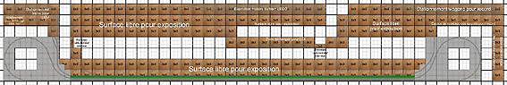

Festi’briques 2011 - 29 et 30 octobre 2011 : la LGV et la LGL seront réunies pour la première fois en un seul méga réseau train.

L’exposition Festi’Briques 2011 aura pour thème le train 9V et son environnement.

Dans ce cadre général, BàB va participer avec la [LGV V2](https://www.freelug.org/spip.php?article1045) dont ce sera la seule sortie en 2011. Comme les autres fois, l’ensemble des tables de la zone LGV sont mises à la disposition de Freelug pour en faire son layout train ville et autres trucs de cette exposition (ou d’autres thèmes).

Mais ce n’est pas tout : l’association Fanabriques viendra avec une LGL qui sera cantonnée. (voir article [cantonnement appliqué à une "LGL" en exposition](https://www.freelug.org/spip.php?article1234))

Et, puisque c’est la fête du train LEGO, nous allons réunir ces deux voies de train en un immense layout commun (35m x 5m). Du jamais vu ! Ce sera l’équivalent de plus de 1500 rails 9V LEGO (et sans les triages...) c’est à dire le plus grand réseau de train LEGO jamais vu en France.

La disposition des voies sur ce layout a été choisie pour permettre à un maximum de membres (FreeLUG ou Fanabriques) de venir exposer avec leurs modules sur ce réseau exceptionnel.

Le fait de se regrouper sur un seul layout doit aussi permettre que chacun puisse profiter au maximum des autres membres exposants tout en restant proche de sa réalisation et du public.



**Vue générale du layout**

Voir détails : [Layout FestiBriques](http://photos.freelug.org/main.php/v/dhuot/Expo/festi2011/)

La zone FreeLUG (surface pour exposition derrière la LGV) est coordonnée par CDHD/Denis.

La zone Fanabriques (les 3 surfaces pour exposition coté LGL) est coordonnée pas Daniel.

Vous pouvez choisir l’une ou l’autre zone pour vos modules.

Mais en fait nous pourrons aussi, avec l’accord des exposants, ’échanger’ des modules entre les deux zones principales (Fanabriques/FreeLUG) si cela permet d’améliorer globalement l’ensemble pour le plaisir des visiteurs et des exposants (comme par exemple la circulation des trains).

Il est bien sûr possible, voir indispensable de faire un maximum de petits sous-réseau : tram, train 12V, train 4,5V, PFS, western, monorail, etc.

Vous pouvez aussi vous coordonner à plusieurs pour un méga sous-module sur un thème qui vous plait, etc.  
Et comme le thème est le train LEGO, nous pouvons aussi imaginer des triages de présentation de tous les trains LEGO (nous avons la place).

Quelques indications ’pratiques’ pour ce layout.

Tous les thèmes sont possibles avec quand même une zone principale ville/campagne/ etc.

Les deux voies LGV et LGL seront bien sûr ouvertes aux exposants du layout pour y faire rouler (et donc conduire) leur trains sur les deux exceptionnelles voies misent en place pour la première fois ensembles et interconnectées.

En marge de l’exposition au public, la LGV sera opérationnelle dès le vendredi à partir de 15h : cela pour permettre à ceux qui le veulent de venir s’y amuser sans le public dès vendredi après midi... fun garanti et no limit ! (réservé uniquement aux adhérents).

Il y a aussi toute une zone prévue pour exposer le maximum de trains officiels LEGO : n’hésitez pas à y participer.

Evidemment, battre le record du monde de vitesse d’un train LEGO est au programme :  
**–** [Le record du monde de vitesse d’un train LEGO](https://www.freelug.org/spip.php?article1177)  
**–** [Règlement : record du monde de vitesse d’un train LEGO](https://www.freelug.org/spip.php?article1205)

Si vous décidez de participer à ce layout :  
**–** Vous devez impérativement vous inscrire vous-même à l’exposition Festi’Briques (voir détails ci-dessous)  
**–** Vous devez aussi vous inscrire auprès du coordinateur Freelug (CDHD) : une page Wiki est ouverte pour les membres FreeLUG qui veulent exposer sur ce layout : [wiki Festibriques 2011](http://wiki.freelug.org/tiki-index.php?page=Festi%27Briques+2011)

* * *

## S’incrire à l’exposition Festi’briques

Limité à 70 exposants, premiers arrivés, premiers servis !  
ouverture des inscriptions du 6 mars au 15 septembre 2011.  
Toutes les informations sont sur l’affiche.

Pour le bulletin d’inscription, il suffit d’envoyer les informations suivantes à festibriques@yahoo.fr :

```
- Nom et prénom de l'exposant:
- date de naissance:
- adresse postale:
- Téléphone fixe:
- Téléphone mobile:
- adresse e-mail:


Si vous êtes sur le layout LGV/LGL indiquez seulement LGV/LGL  pour les 3 points ci dessous :
- Superficie Largeur par Longueur : en module (0,76x0,76m)
- Commentaire sur le diorama:
- Thème(s) du diorama:

Sera présent sur l'exposition à partir du : jeudi (réservé aux monteurs de la LGV et de la LGL), vendredi ou samedi.
- l'heure de votre arrivée :
- Nombre de personne(s) accompagnante(s) (maximum: 2): 
- Demande à être logé par les organisateurs: oui/non - Hôtel ou salle ?
```
