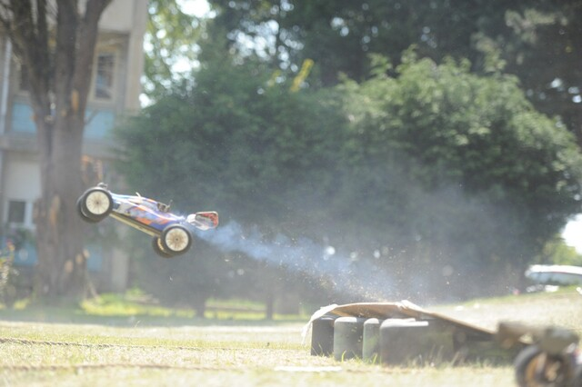
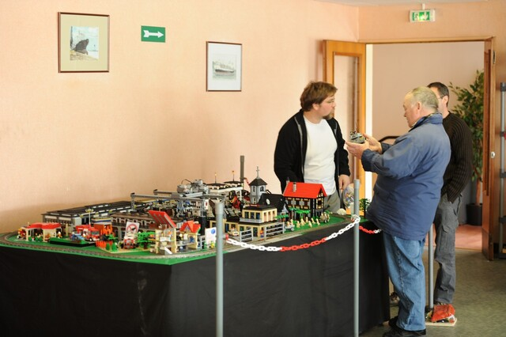
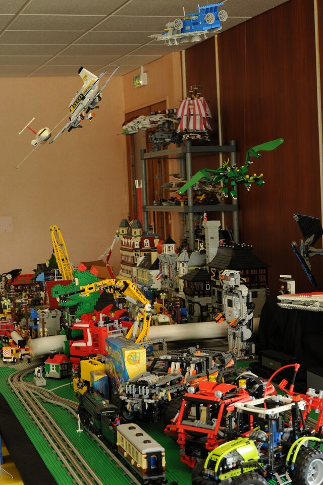
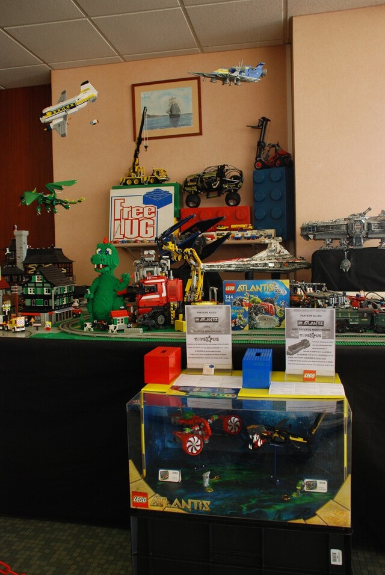
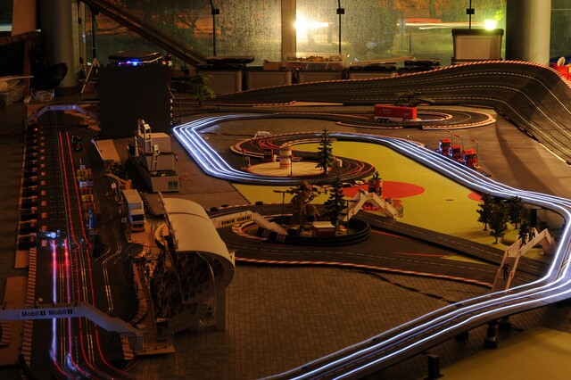

Changement de lieu et de date, cette année, l’exposition se tient à l’ENMM. Les années précédentes, celle-ci se tenait dans un gymnase, en hiver, et sans lumière du jour.  
C’était un peu froid, et ça donnait mal aux yeux. Maintenant, on a récupéré un lieu bien plus convivial : l’Ecole Nationnale de la Marine Marchande.

Nous prenons donc place dans le hall d’accueil, ainsi qu’à l’étage, dans le réfectoire. Les modélistes naval ont eux pu installer leur bassin géant en extérieur, car au mois de mai, fais ce qu’il te plait. Ils ont pris le risque d’éventuelles averses, mais au final nous avons eu du beau temps tout le week-end. L’occasion aussi pour les buggys thermiques de s’éclater sur la pelouse avec un circuit et une rampe de saut.

**Tous les matins, démarrez comme une fusée !**

Les mini-Z et assimilés aussi étaient dehors, sous abris, et les camions radio-commandés ont profité de l’occasion pour sortir faire une "parade" plusieurs fois par jour.

Nous étions pour notre part à l’étage ( ascenseur en panne, il a fallu tout monter à la force des bras... et des jambes). Les tables étaient fournies, ce qui a pas mal réduit la logistique.

C’était grand, mais pas encore assez, et nous avons dû nous diviser en 3 zones.

Frédéric qui nous a rejoint pour cette édition a trouvé une étagère qui trainait là, et par manque de place sur les tables, a donc présenté une partie de ses merveilles sur ce présentoir improvisé.

Médérik nous a présenté sa base militaire du jeu "Warm Battle Bricks", avec son train 9V faisant le tour.

**La table de Médérik**

Florence et moi avions l’autre partie de tables, avec du Technic, du StarWars, du train 12v bien sûr, et de la ville. Florence a pour sa part présenté son marché médiéval.

**De tout...**

Une étagère murale avec un bateau sous vitrine faisait un peu hors sujet... Pas de soucis, on déplace l’intrus, et hop, encore quelques modèles Technic à présenter.

Le magasin Toys’r’Us du Havre nous avait prêté pour l’occasion une vitrine Atlantis, et fait don de quelques boites pour notre concours organisé en échange de cette petite pub.

**Le concours**

Deux concours sont mis en place par jour, avec un niveau simple pour les petits, qui devaient trouver les personnages Atlantis cachés parmi les différentes zones d’exposition LEGO, et pour les plus grands, il fallait trouver le nombre de pièces composant ma locomotive orange BB63000.

On a donc imprimé des petits bulletins de participation, avec tirage au sort le soir parmi les bonnes réponses pour les petits, et le dernier jour, dépouillement des réponses pour trouver la plus approchante pour le gagnant de la plus grosse boite.

Une bonne ambiance comme à l’habitude, avec un voisin ayant installé un circuit de voitures "Carrera", immense, avec prêt de manettes pour les visiteurs.

**Circuit Carrera**

Les habituels des expositions locales étaient présents également, dont les organisateurs des expositions de Blobec, et Fontaine la Mallet.

Les LEGO au Havre commencent à être vraiment reconnus comme activité "modéliste" à part entière.

[Les photos](http://www.brickshelf.com/cgi-bin/gallery.cgi?f=431911)
