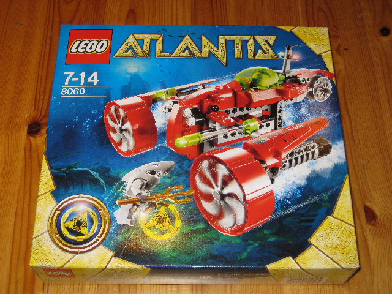
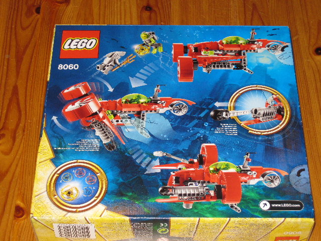
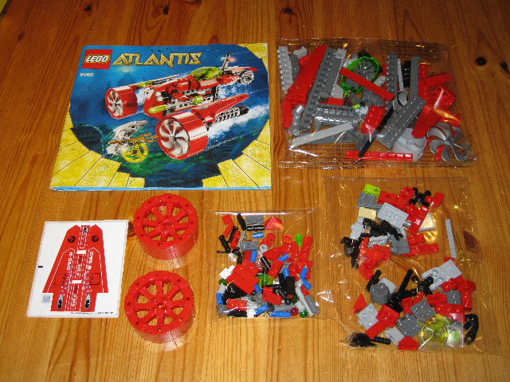
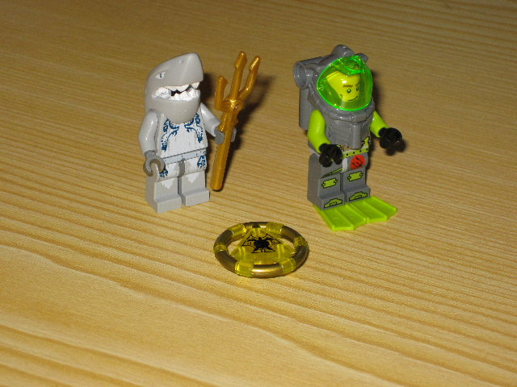
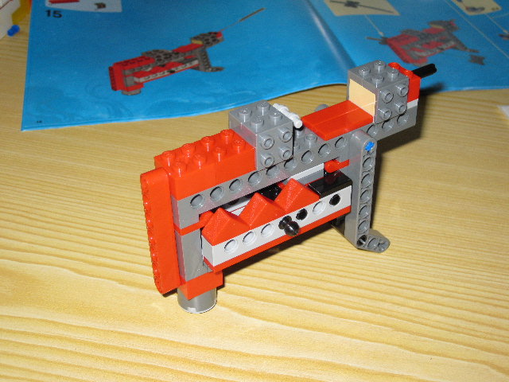
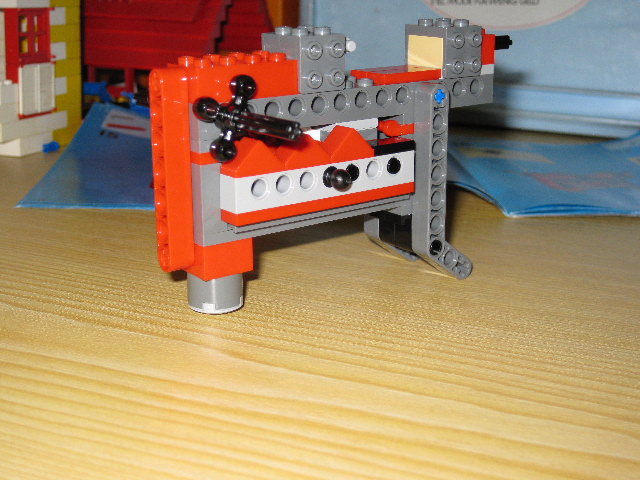
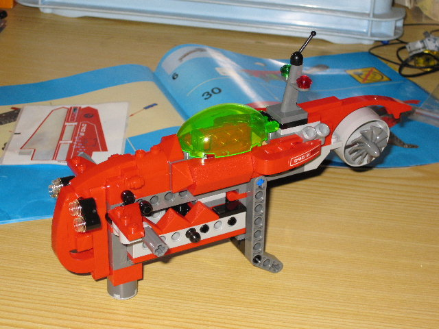
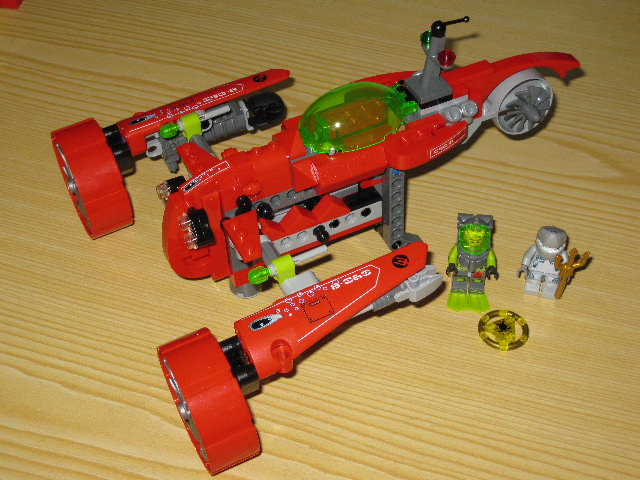
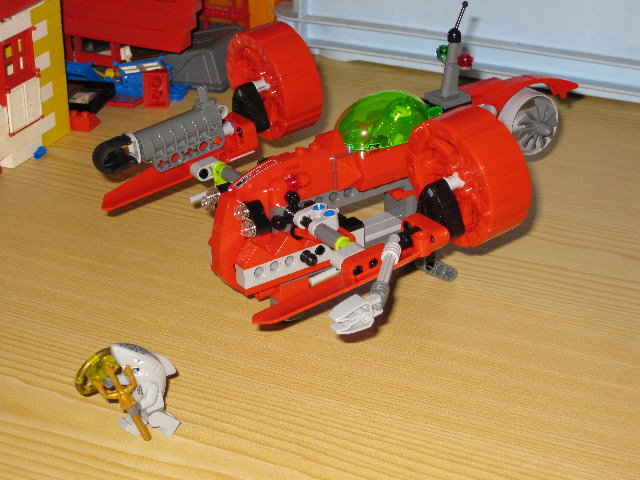

La gamme ATLANTIS, lancée en 2010, reprend un scénario déjà vu à plusieurs reprise, l’exploration des fonds sous-marin. Dans ce thème il faut partir à la recherche de clés pour ouvrir des cités englouties.

Mais les héros de cette aventure sont confrontés à des créatures mi-humaines/ mi-créatures-sous-marines... en plus elles sont trop méga-effrayantes... bref

Commençons par la fiche signalétique  
**–** référence du set : 8060  
**–** nom : Typhoon Turbo Sub/Le sous-marin turbo  
**–** année : 2010  
**–** nombre de pièces : 197  
**–** minifigs : 2  
**–** prix (shop LEGO) : 24,90 €  
**–** âge : 7-14  
**–** gamme : ATLANTIS

Petite description de la boîte.

La face avant

**boite face avant**

La face arrière

**boite face arrière**

Bon évidemment, comme c’est un thème qui évolue dans les fonds marins, la couleur dominante de la boite c’est le bleu.

Sur la face avant nous trouvons le véhicule en action. Et sur la face arrière est détaillé le fonctionnement des propulseurs à hélices pivotants, ainsi que le fonctionnement du double lance-torpille...

Euh y’a pas un soucis là ? Bin oui c’est censé être un double lance-torpille mais, en fait, y’en a qu’un.  
A moins que ce ne soit les torpilles manuelles situées sur l’axe pivotant... va savoir...

La boite contient une notice, trois sachets, deux roues 4570513, qui feront office de corps pour les propulseurs, et une planche d’autocollants qui, une fois n’est pas coutume, est sortie intacte de la boîte.

**Les sachets, la notice et les autocollants**

## Première étape : les minifigs

Il y en a deux, un plongeur, c’est le pilote du sous-marin, et un guerrier-requin.  
Et il y a aussi une clé jaune du trésor d’Atlantis.

Les minifigs

**Les minifigs**

## Deuxième étape : le châssis avec le mécanisme de basculement

Comment faire un modèle compact tout en l’équipant d’un moyen mécanique de basculement des propulseurs ?

Facile : en fabriquant une crémaillère en briques LEGO qui fait tourner deux "Technic Knob Wheel" fixé sur l’axe des propulseurs.

Le mécanisme se construit très facilement et il est à la porté des plus jeunes. Pour le faire fonctionner c’est très simple, il suffit de faire glisser les crémaillères d’avant en arrière. En butée le système se verrouille grâce à un plate 1X1 holder vertical qui s’enclenche sur un Plate 1X2 stick 3.18, simple et efficace.  
Le châssis est renforcé par des éléments Technic en position verticale, donc il n’y a pas de problème de rigidité, c’est du solide.

Le châssis

**Le chassis**

Le mécanisme de basculement des propulseurs

**Le mécanisme de basculement des propulseurs**

## Troisième étape : la carrosserie du sous-marin

Cette étape consiste à assembler tous les éléments qui habille le châssis. Le cockpit bien sûr avec sa verrière articulée. Le propulseur arrière, qui sert à diriger le sous-marin. Le nez du sous-marin.

Pas de difficulté particulière pour cette étape et le rendu est très réaliste avec un bel effet fuselé (c’est un sous-marin ne l’oublions pas).

La carrosserie du sous-marin

**La carrosserie du sous-marin**

## Quatrième étape : les propulseurs

Chaque propulseur est construit indépendamment. Il y a un gauche, qui supporte le bras articulé, et un droit, qui supporte le lance torpille.

La construction ne présente pas de difficulté particulière.  
Une fois fixé sur l’axe de basculement, nous obtenons un véhicule de belle taille.

Et c’est un des intérêts de ce set. Avec seulement 197 pièces nous avons un sous-marin assez imposant au design original pas rapport aux précédents sets des thèmes similaires.

Le mécanisme de basculement est simple et très pratique à utiliser. Comme il se verrouille en position propulsion ou en position attaque, il ne sera pas nécessaire de le tenir en permanence pour jouer avec.

Et voilà le résultat final.

Et avec les propulseurs en position de tir.

**propulseur en position d’attaque**

Pour conclure je dirais que c’est un set parfait pour les plus jeunes. Assez facile à construire avec malgré tout quelques petites parties techniques.

La forme est bien pensée, il tient bien en main, même dans les petites.

Compte tenu du nombre de pièces le prix est un peu élevé mais vu qu’il est assez imposant la facture passe bien (guettez les promos quand même).

Un petit bémol (très petit) quand même. Je trouve que l’installation du plongeur dans le cockpit est un peu fastidieuse. Il faut souvent s’y reprendre à plusieurs fois et, deux fois sur trois, il faut refixer le tableau de bord (qui est un sonar si je ne m’abuse).

Ah bin tiens, tant qu’on y est, un autre petit bémol. Je trouve que le bras manipulateur aurait pu être télescopique car il ne se déploie pas assez pour être suffisamment écarté du panel.  
Mais bon il faut bien laissé des opportunités pour améliorer les modèles.

Enfin, et c’est pour moi l’argument principal, la jouabilité est excellente. Nos chères petites têtes blondes passeront des heures aux commandes de ce beau sous-marin à pourchasser le guerrier requin pour lui subtiliser la clé jaune du trésor d’ALTANTIS.

A bientôt  
Raoulz
