Vous vous rappelez la pub pour le Canada Dry ? Et bien voici venir le temps des Hero Factory. Ca ressemble aux BIONICLE, ça a le goût des BIONICLE, mais ce n’est pas des BIONICLE...

..enfin presque pas car sur la boite, il y a quand même la mention : "_From the makers of BIONICLE Characters_" donc la filiation est clairement marquée.

Je vous propose donc aujourd’hui une description du set 7158 : Furno Bike/la moto du Monsieur Furno in french.

Et je préfère le dire dès le début, il y a carton rouge.

La fiche signalétique  
**–** référence du set : 7158  
**–** nom : Furno Bike  
**–** année : 2010  
**–** ombre de pièces : 165  
**–** prix (indicatif) : 24,99 €  
**–** âge : 8-16  
**–** gamme : Hero Factory

## Description de la boîte

La face avant

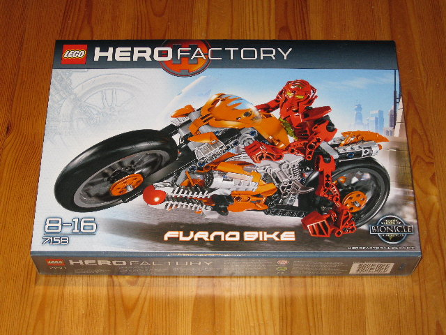

**boite face avant**

La face arrière

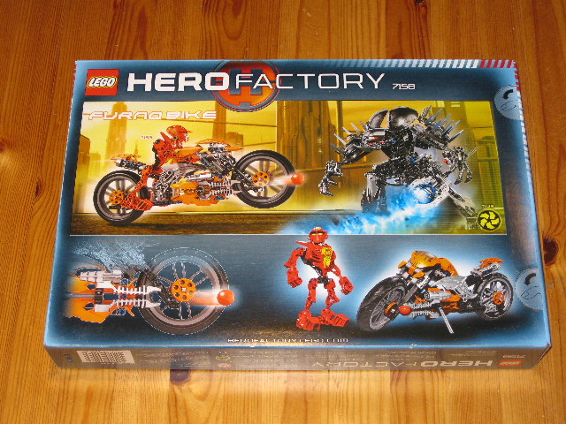

**boite face arrière**

La boîte est très belle. Sur la face avant, le décor du fond n’est pas très chargé du coup le modèle est bien mis en valeur.

La face arrière est pas mal non plus, pas super originale mais elle donne envie. Elle met essentiellement en valeur les lanceurs de bille.

D’ailleurs ils ont vraiment la "pêche", ou la "patate" si vous préférez, ces lanceurs de billes. Et comme TLC le rappelle justement dans la notice, les plus jeunes devront faire attention à ne pas viser les yeux, c’était la minute prévention/sécurité...

La boite contient une notice, deux sachets, deux roues 4568006 et deux pneus 4567999.

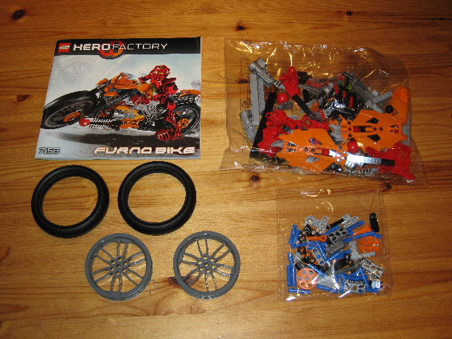

**Les sachets et la notice**

## Première étape : Monsieur Furno

Étape de construction classique pour ce type de personnage.  
Rien à signaler de particulier mis à part une belle couleur rouge qui pète (et qui brille un peu trop sur les photos) !

Ah si peut-être deux petits détails. Les 2 Connectors Bush W.Fric./Crossale fixés sur les pieds servent à fixer Furno sur la moto.

Alors je suis motard, normalement les pieds ça se posent sur des cales pieds. J’accroche pas mes botes sur le cadre de ma moto. Mais bon passons c’est un détail, vous allez finir par trouver que je pinaille (oui, oui c’est ça en rime en plus...).

Monsieur Furno

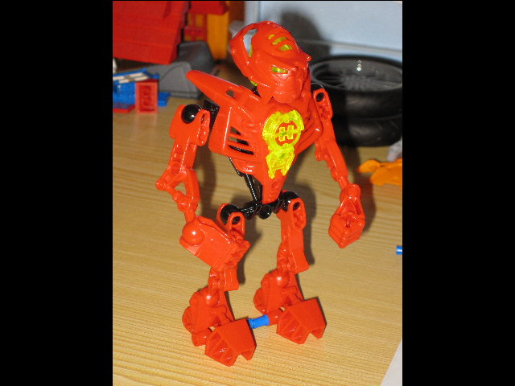

**Monsieur FURNO**

## Deuxième étape : le cadre de la moto

C’est un assemblage de pièces Technic qui forme un pentagone. Tout ce qu’il y a de plus classique pour un set de cette gamme.

Nous voyons sur la photo côté droit la fixation de la fourche.

Euh, au fait, vous ne remarquez rien ? Deux choses en fait.

Premièrement le vide intersidéral à l’intérieur du cadre. Franchement quelques pièces de plus auraient suffit à combler ce vide sans faire enfler le prix du set.

Deuxièmement, il est où le guidon pour que Monsieur Furno tourne la moto ? Sur le cadre... bin voyons.  
Donc Furno conduit une moto qu’il ne peut pas diriger car ses mains vont être fixées sur le cadre et pas sur la fourche ?

Franchement : carton rouge !

Le cadre

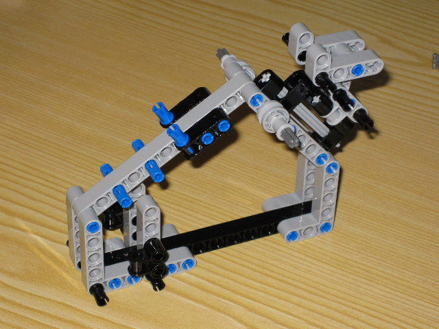

**Le cadre**

## Troisième étape : les roues

Elles sont fixées déportées par rapport à l’alignement, des bras arrières et de la fourche, ce qui donne à la moto un aspect "custom" très réaliste, au look "bobber" d’ailleurs.

Les disques de frein en poulie orange sont également d’un bel effet.

La cadre et les roues

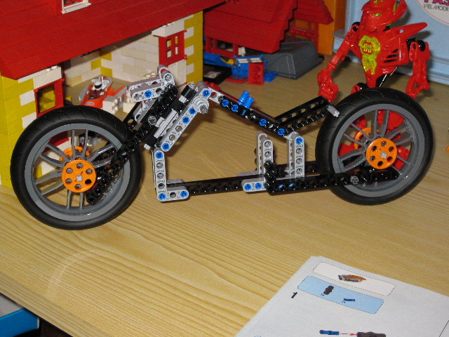

**Le cadre et les roues**

Une fois de plus nous remarquons bien le vide du cadre. A ce stade de la construction nous avons un très beau... vélo... il manque les pédales quand même.

## Quatrième étape : l’habillage de la moto

Bon vu que pour l’instant on a un machin composé de deux roues fixées à un pentagone vide, il faut bien habiller tout ça pour que ça ressemble à quelque chose, et surtout à une moto.

Et c’est vrai qu’il faut bien avouer qu’il est réussi cet habillage. Avec trois fois rien la moto est carénée pour l’hiver avec un résultat qui assure.

Les deux échappements (réacteurs ?) au dessus de la roue arrière sont très réussis, les deux lances billes (un de chaque côté) sont très bien placés et ne gênent pas les mouvements de la roue avant, la métapièce du réservoir fait effectivement penser à un réservoir, les carénages latéraux s’intègrent bien et donnent un aspect élancé à l’ensemble, la tête de fourche est simple mais agressive.

Et voilà le résultat final  
La moto

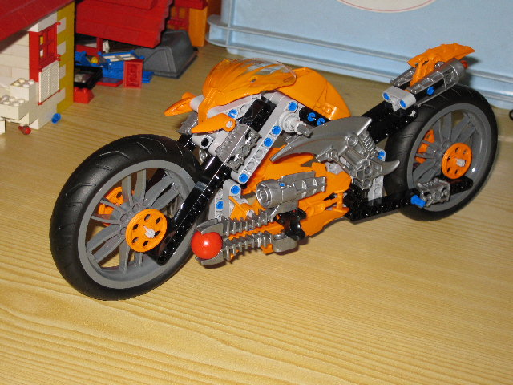

**La moto habillée côté gauche**

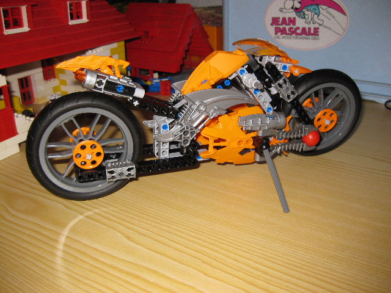

**La moto habillée côté droit**

Vous avez vu la belle béquille latérale ?  
Proposition d’amélioration du modèle : une béquille en plus de l’autre côté, deux plate 4X12 par dessus et hop on a une moto qui vole...

La moto avec son pilote

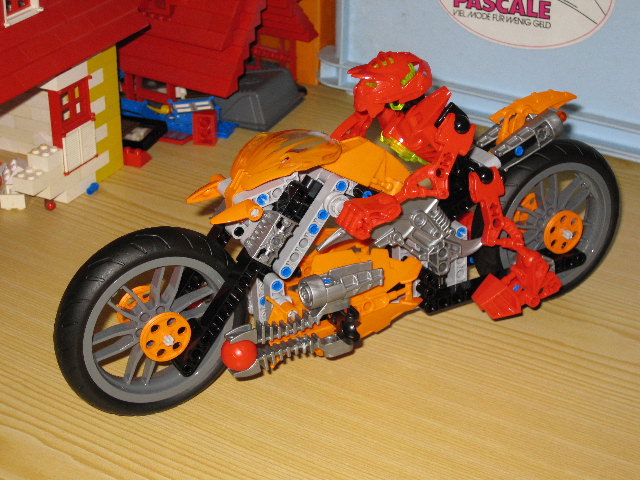

**La moto et son pilote de côté**

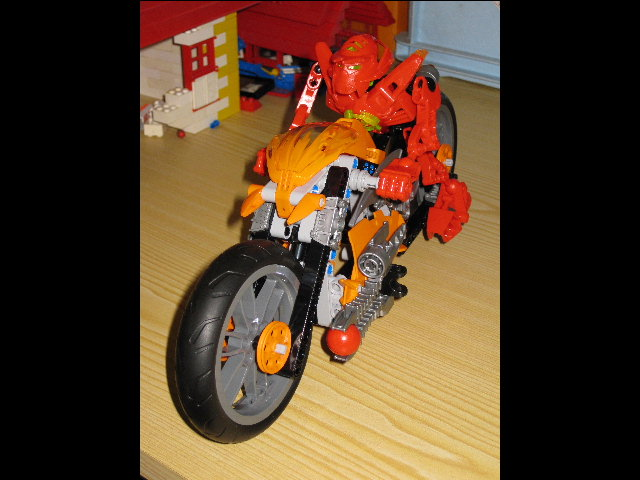

**La moto et son pilote.....de presque devant**

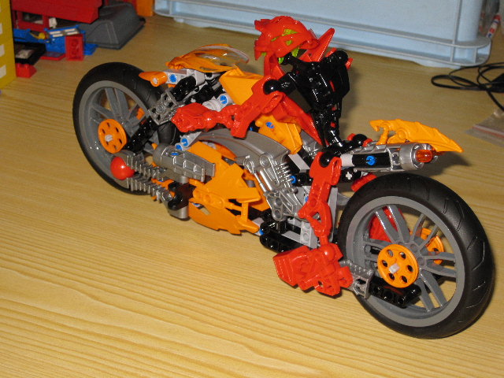

**La moto et son pilote.....de presque derrière**

Il a quand même fière allure Mr Furno sur son custom !

Bon, en conclusion, vous aurez compris que ce set a généré chez moi une réaction très mitigée que je vais synthétiser un peu.

Les "-" :  
**–** le vide à l’intérieur du cadre alors que quelques pièces, ou métapièces, auraient suffit à faire illusion  
**–** Furno ne dirige pas la moto puisque les poignées pour fixées les mains sont sur le cadre et pas sur la fourche. Là, franchement, pour le réalisme, TLC aurait pu faire un minimum d’efforts.  
**–** fixation des pieds sur le châssis sans les faire poser sur des cales-pieds (je suis motard alors "I’m chocked")  
**–** la béquille qui permettrait à Monsieur Furno de faire du saut à la perche

Les "+" :  
**–** le résultat final est très beau et ressemble à un vrai "custom".  
**–** la moto est bien habillée et le vide intersidéral du cadre, oui je sais je me répète, est bien caché derrière les pièces de carénage, qui par ailleurs, ont été fort bien choisies.  
**–** les deux lances billes sont très bien intégrés et surtout ils ne gênent pas les mouvements de la roue avant, malgré leur position très en avant.  
**–** en déplaçant vers l’avant le corps de Mr Furno vous pourrez installer un deuxième Hero juste derrière. Ça n’a pas de rapport direct avec la conception du set mais c’est quand même un plus.

Donc finalement ?  
Et bien je le conseille ce set 7158.  
Pourquoi ? Parce que la cible c’est les jeunes garçons et que je pense qu’ils vont bien s’amuser avec, et les points négatifs que j’ai souligné n’auront aucune importance pour eux.

Par contre pour les collectionneurs des véhicules des thèmes BIONICLE, et maintenant HERO FACTORY, le rendu est vraiment très beau mais, c’est tout. Mais finalement c’est peut-être le plus important.

A bientôt

Raoulz
