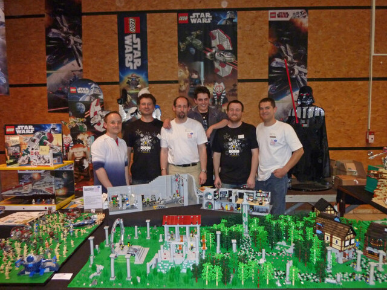
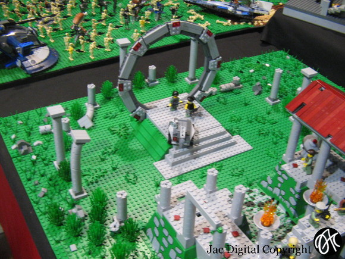
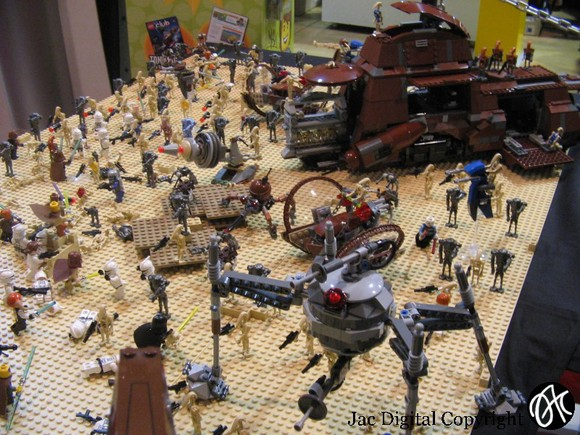
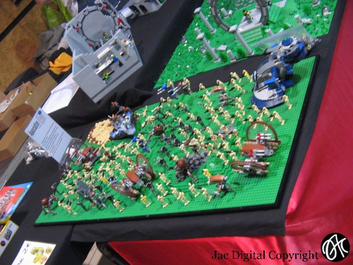
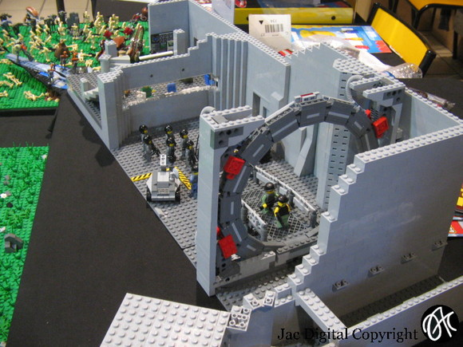

Un bon moment entre AFOLs, avec les fans de StarWars, qui s’est déroulé les 30 avril et 1er mai 2011.

**Les 6 fans of SW**

Invité par Jérôme, j’ai décidé de participer à l’exposition, après être passé en visiteur l’année dernière.

Ayant arrêté de collectionner les LEGO Star Wars depuis plusieurs années, je ne savais pas ce que j’allais exposer et c’est en discutant avec les autres que l’idée est venue de changer de thème. Pourquoi pas du Stargate ? La décision est prise rapidement, avec deux éléments séparés : le SGC d’un côté, une planète visitée de l’autre.

C’est ainsi que j’ai amené les deux portes (pour qu’elles soient identiques au moins à l’avant), ainsi que la partie de la planète autour de la porte (ruines antiques) adaptée au dernier moment pour le chemin... Ce thème Stargate m’a beaucoup plu, je le représenterai certainement !

Cette exposition s’est très bien passée, avec beaucoup de visiteurs, beaucoup de questions, des distributions parfois frénétiques de sachets promotionnels, un accès difficile à la borne XBox :), plein de costumes...

Merci à Jérôme pour son accueil, à David, Pierre, Etienne et Pierre (si si, il y a deux Pierre !)

A l’année prochaine !

_Laurent_

* * *

C’est reparti, le même emplacement est réservé à l’équipe des membres FreeLUG pour un nouveau diorama Star Wars ou Science Fiction.

Nous commençons à être rodé pour la présentation et la surveillance du stand. Cette année, à 6 exposants, le montage a été rondement mené. Les modèles en présortie à installer dans la vitrine de présentation ont pu être monté en toute tranquillité le samedi matin.

Comme l’explique Laurent, nous avons opté pour un diorama StarGate, mais aucun n’avait révisé avant l’exposition. Mais ça n’a pas du tout été gênant car les visiteurs ont vraiment apprécié le stand. 4500 visiteurs pour cette année. Un bon cru en attendant 2012...

_Jac_

* * *

Je commence à être un habitué de Cusset, on retrouve chaque année de nombreux exposants et organisateurs(trices). C’est d’ailleurs toujours un plaisir pour les fans de StarWars, Stargate... (et on commence à voir apparaître du cosplay).

Personnellement, j’ai exposé avec David pour sa première une petite bataille Clone Wars. Comme d’habitude la seule limite, c’est la place. Avec nos petits délires, on crée nos mini scènes qui plaisent beaucoup.

Du coté Stargate, les dioramas étaient très réussis sauf un bémol. Un porte des étoiles a un vortex mais apparemment en LEGO on s’en passe :p.

Merci à JAC pour nous avoir hébergé et son organisation toujours aussi marrante et à Napin pour nous avoir supporté.

Un clin d’oeil à une personne qui aura marqué le week-end et qui nous aura dépouillé de nos pièces de 1€ et billets pour certains. (Courage Pierre l’année prochaine c’est la bonne :D)

Et OUI il y a deux Pierre !

Bien entendu je serai présent l’année prochaine et je croise les doigts pour avoir plus de place.

_EtienneL/KitFisto_

* * *

Encore une "Génération" de passée !

Les héritiers se sont encore une fois mis en 4 pour nous laisser une place d’exposition sur laquelle nous avons pu présenter au public le fruit de notre imagination.

Cela faisait plusieurs années (depuis "Génération Star-Wars 2008" si je ne me trompe pas) que nous avions eu l’idée de présenter des créations autour de Stargate.

Je crois bien que c’est moi qui ai remis ça sur la table des idées quand nous avons commencé à chercher ce que nous ferions pour cette édition 2011. Mais heureusement que les autres étaient là car moi, je me suis occupé que des figurines des différent teams "SG".

Un conseil : allez voir les photos car les dioramas 2011 sont très réussis ! Personnellement, j’ai un petit faible pour le temple en ruine réalisé par Laurent !

Merci à Jérôme pour son accueil chez lui, à Laurent, Pierre, Étienne et David pour l’ambiance du week-end, et encore merci aux organisateurs de nous permettre de faire d’exposer au sein de cette superbe convention.

C’est toujours un plaisir de partager deux jours avec tout ce petit monstre !

Une dernière petite pensée, au porte-monnaie de l’autre Pierre, qui décidément, n’aime pas les tombolas Cussetoises...

_PierreC/Tribolego_

* * *

Encore une édition fort sympathique... Cette année nous avons mis l’univers Stargate à l’honneur... une façon de montrer que tout est possible en LEGO.. ;-)

Pour ma part, j’ai essayé de faire une reproduction du SGC, soit la base des unités Stargate. Après plusieurs essais, il en est ressorti que le plus simple était de faire uniquement la salle de la porte avec quelques couloirs et quelques pièces. Laurent les a complétés d’accessoires pour les labos de Carter et Jackson.

Un bravo à David pour sa première... je crois qu’on a réussi, il reviendra !

Un grand merci à l’organisation, toujours impeccable et qui nous supporte d’année en année... Merci à Jac de nous accueillir chez lui.

Et puis à l’année prochaine !

_Pierre L./Pierrolego_

* * *

## Galerie photos

**–** [JAC](http://photos.freelug.org/main.php/v/JAC/Exposition/Expositions2011/SW-Cusset/)  
**–** [Laurent](http://photos.freelug.org/main.php/v/LaurentT/Expositions/Cusset2011/)  
**–** [Pierrolego](http://photos.freelug.org/main.php/v/pierrel/exposition/2011/cusset2011/)
