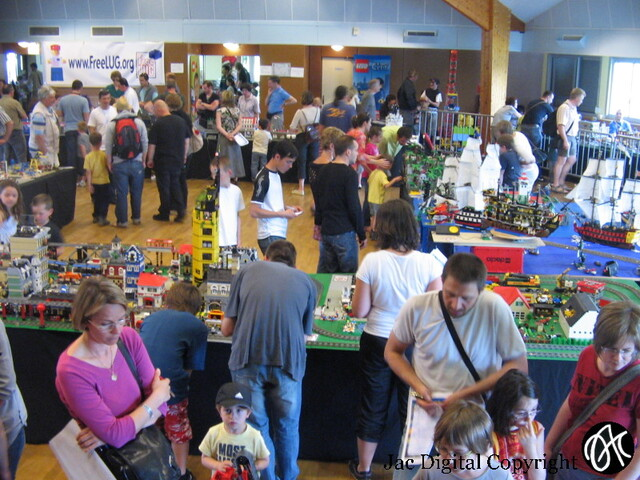
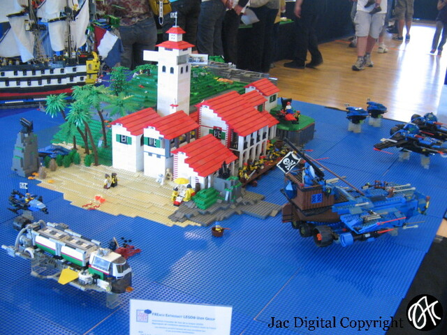
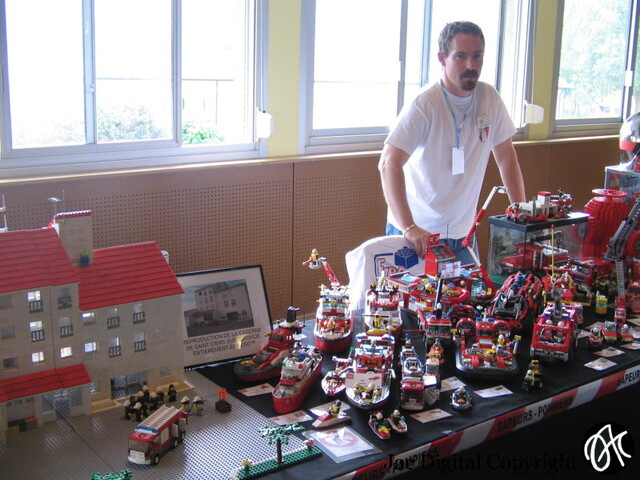
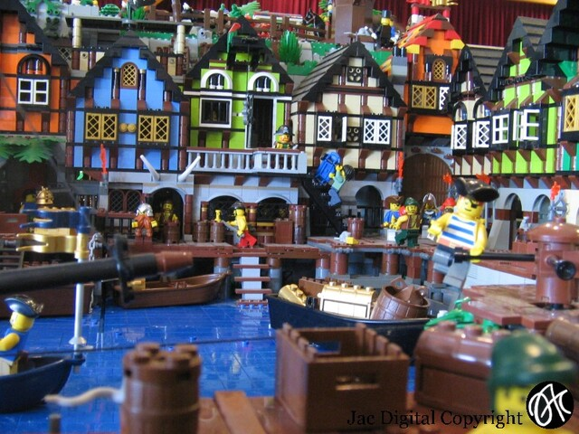
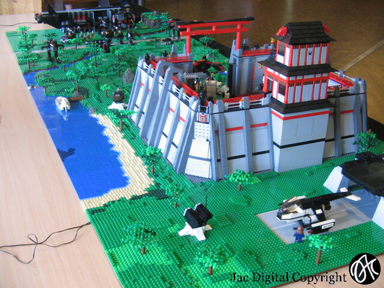
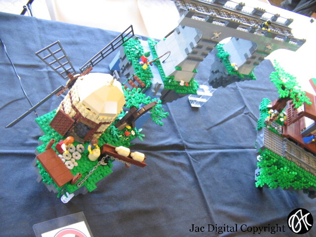
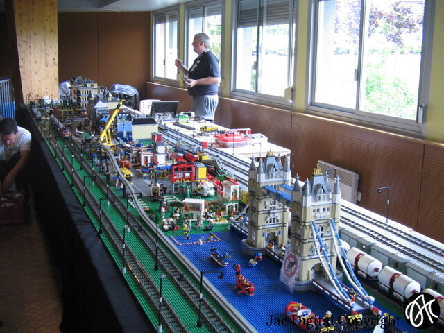
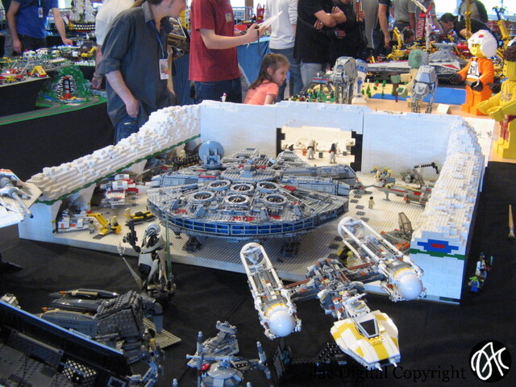
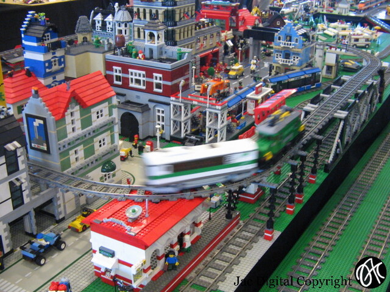

Les 7 et 8 mai 2011 se tenait notre première Briqu’Expo d’envergure sur plus de 600m² de surface et une trentaine d’exposants et bénévoles à Parigné-L’Évêque, près du Mans, avec la participation de l’association locale Les Boutinières.

Initiée par quelques passionnés du Grand Ouest, FreeLUG s’est lancé dans l’organisation de sa première vraie exposition 100% LEGO. Ce sont plus de 800 visiteurs qui sont venus admirer les créations proposées par les exposants, venus certes du Grand Ouest mais aussi d’un peu partout en France.

A l’entrée, les visiteurs pénétraient dans une première salle, la salle de jeux, où les enfants pouvaient construire avec les briques LEGO et DUPLO mises à disposition par Brigitte.

Ensuite, les visiteurs accédaient à la grande salle de l’exposition. Plusieurs stands permettaient tour à tour de présenter des thèmes variés, comme de l’espace et science fiction, du StarWars, du Technic, du GBB, du City, du pompier, du train, du pirate et du space-pirate, des ferries et encore plein d’autres choses.

Un petit questionnaire remis aux visiteurs les invitaient à s’intéresser de près aux stands et discuter avec les exposants pour espérer gagner l’une des deux vitrines mises en jeu.

A la sortie de l’exposition, dans une dernière salle, les visiteurs accédaient à un magasin de vente LEGO tenu par notre partenaire JouéClub du Mans.

* * *

Avec cette participation à l’article, PL 2011 se termine. Pour une première exposition 100% LEGO, je pense que les exposants peuvent être fiers. Fier d’avoir fait de ce week-end un bon moment.  
Il faut dire que c’était un vrai challenge. Mais quel succès !

L’installation de la salle fut un peu plus rapide que prévu cela nous a permis de parer à l’imprévisible (il y en a toujours). Mais heureusement nous avions pour nous plusieurs "Mac Gyver" et au final, les visiteurs ont pu bénéficier d’une belle exposition.

La soirée du samedi soir a été fort sympathique avec des questions plus pointues les unes que les autres.

Je vais maintenant passer la main aux exposants pour qu’ils puissent présenter leur diorama.

_Jean-Claude_

* * *

Les messages affluent avec plein de questions, sur la liste de discussion de la région... Ça veut dire que la date approche. J’ai prévu d’exposer ma base Space Pirate.

Comme on a essayé de réunir les thèmes, pour notre première exposition FreeLUG sur 2 jours, je me retrouve placé entre l’ile pirate de Mickbatto et les grands bateaux de Laurent.

Cinq heures de route dans ma petite Clio. Ma voiture de course a eu une jambe cassée un peu avant le départ. C’est avec regret que j’ai dû la laisser au garage. Mais ça a permis à Pierre L de me rejoindre à mi-parcours et du coup, on a pu finir la route ensemble. C’était plus sympa. On a tenté un concert de klaxon en arrivant, mais une des responsables des lieux (en fait notre ambassadrice, donc respect) a vite calmé les chenapans. Faut dire qu’il était presque 22h.

A l’arrivée, super accueil de tout le monde et la joie aussi de retrouver des AFOLs, mais bon, sans les coups de klaxons !

Après avoir sorti mes cartons et rangé la voiture sur son parking pour qu’elle se repose, j’ai enfin pu construire ma base. Avec des plaques bleues partout, ça faisait vraiment une belle île. C’était chouette. Les canons pics de caoutchouc que j’ai mis à la place des classiques canons pirate s’avère plus efficace que le lance boules du Mick. Du coup j’ai fait de bonnes séances de canardage en piqué, avec du dégommage de vigile et en prime du démâtage côté Laurent...

De belles séances d’amusement, un quizz mémorable, de belles rencontres. Mais surtout, des parties de bonnes rigolades et des visiteurs sympathiques. C’est tout ce qui fait une bonne exposition. Moi j’en redemande...

_Jérôme/JAC_

* * *

Avec ma Kangoo grande capacité, cela va de soi, j’ai amené à la demande de Jean-Claude mon grand diorama trains et ferries qui a marché merveilleusement bien grâce à la qualité des tables. J’ai profité de cette occasion pour installer mon BOURBON ENTREPRISE. Coté salon, les stands des uns et des autres étaient superbes. Coté organisation, c’était NICKEL, bravo à toute l’équipe organisatrice, aux bénévoles, bravo à Jean-Claude et Edwige.

A une prochaine.

_Jean-Marc, qui a confié son appareil photo à Laurent..._

* * *

**Pompiers de Christophe**

* * *

Première exposition 100% LEGO de FreeLUG ? Parigné-L’Évêque, le Mans, quelques bonnes heures de route avec papa ? Mouahaha, sans grande surprise, ce week-end totalement délirant fut une grande réussite ! Un joli bide de Viamichelin pour nous faire rouler de Rennes au Mans, un bel orage pour nous accueillir le vendredi soir, et l’heure était déjà venue de faire la connaissance d’une bonne partie des joyeux lurons de l’association, tout en procédant, lentement, à l’installation de mon stand qui s’agrandit d’expositions en expositions : reconstitution d’une bataille navale au XIX° siècle entre un navire français et un navire anglais, diorama d’une frégate échouée sur un récif, et un trois-ponts en coupe monté sur un socle rotatif. Forcément, démâtage dès que mon premier bateau monte sur son chariot, prise de tête monumentale pour mettre en place le treuil censé le tracter, et j’en ai eu jusqu’à trois heures du matin pour bricoler un double-rail qui tienne la route durant tout le week-end. Comme la grosse Bertha pendant la guerre, me dira-t-on, et en effet, un vaisseau de ligne en LEGO, ça pèse... quelques kilos qu’il faut répartir sur un pauvre petit chariot.

La nuit fut courte, mais tout était fin prêt (sauf mes voisins) pour l’inauguration puis l’ouverture au public, et l’exposition s’est déroulée pendant deux jours sans temps morts, entre les bricolages à droite à gauche pour repérer et améliorer les failles de mes dioramas, les discussions enflammées avec les autres AFOLs, les visites sur le stand de Gaëlle, Jean-Marc à aller emb..., et bien sûr l’accueil des visiteurs la plupart du temps émerveillés. Bon, il fallait aussi surveiller les deux zigotos qui me servaient de voisins, JAC et Mickbatto, pour ne pas les nommer ; bien sympathiques mais quelque peu envahissants, incontrôlables, infernaux voire tendrement détestables lorsqu’ils s’en prenaient à mes bateaux à grands coups de lance-missile ou qu’ils posaient des cales sur les rails de mon vaisseau de ligne, mais, fort heureusement pour eux et pour mes nerfs, aucune casse n’a été à déplorer. Ce qui ne fut pas une raison pour ne pas renforcer les mâts déjà bien améliorés depuis le précédent salon, à peine rentré à la maison.

**Ile pirate de Mick**

Mes navires n’ont certes pas eu autant de succès que les trains sur les stands voisins, mais beaucoup de visiteurs m’ont fait remarquer l’originalité de mes créations, qui n’en seront que plus valorisées les prochaines fois. J’en ai donc fait crier de joie plus d’un lorsqu’il s’agissait de faire traverser le stand à mon vaisseau de ligne monté sur rail, d’appuyer sur un bouton pour faire démâter un autre, ou pour activer la chute d’une cascade, tandis que mon grand trois-pont tournoyait à toutes berzingues le samedi. Mais je crois que ma plus grande fan restera Gaëlle, qui a fait défiler toute sa famille devant mon navire animé pour démâter. Tu peux compter sur moi Gaëlle, je ferai mieux la prochaine fois !

Sinon tout fut au poil, depuis les repas bien sympathiques jusqu’aux bonnes tranches de rigolade lors du quizz de samedi soir, en passant bien sûr par les AFOLs de FreeLUG qui sont toujours énormes et pleins de ressources. J’en profite pour remercier Denis ainsi que les membres de SeTechnic qui sont venus me filer un coup de main pour peaufiner mon treuil surpuissant, et à Bonnet Rouge qui m’en a appris bien plus en un jour et quelques mails qu’en quinze ans sur la mécanique legotique. Et aussi à Gaëlle pour ce brillant exposé sur la relation tout à fait hallucinante, entre le chiffre d’or et les proportions d’une brique LEGO. Mais bien sûr et surtout à Jean-Claude et à tous ceux qui ont contribué à l’organisation de l’évènement, pour nous avoir permis de vivre ce week-end de rêve en briques de grandeur nature.

_LaurentB_

* * *

**Base de Mindrunner**

* * *

Ho !

Une grande salle, rien que pour moi et les bambins, que du bonheur.  
Merci Jean Claude et toute l’équipe.

**–** Une très grande table que j’ai pu recouvrir de mon vrac  
**–** Une vitrine château fort et d’autres qui permettent aux gosses de voir dessus, derrière et à leur hauteur grâce aux cotés et dessus en plexi  
**–** Mes boites de sets à monter et même mes DUPLO /TOOLO (juste un peu) ont trouvé une petite place dans la salle de « l’atelier enfants »  
**–** Le trotteur éléphant 2022 a encore emporté une petite fille dans un voyage autour de la planète LEGO

Et puis, de temps en temps, les mains dans le tas de briques les amis AFOL autour de cette table pour de simple discussions legotique et de là de très jolies rencontres :  
**–** Une jeune femme venue de Bordeaux tout spécialement pour l’anniversaire de son fils. Cadeau une ballade jusque Parigné  
Mon homme qui cette fois joue vraiment aux briques, le virus est passé…  
**–** Olivier très absorbé par la salle d’exposition mais qui m’a beaucoup aidé.

Une organisation exceptionnelle.  
Je serai là en 2012. Merci JCP et Edwige pour votre disponibilité et gentillesse.

Merci a tous pour les photos.

_Brigitte et Alain_

* * *

**Rochers volants d’Erik**

* * *

Pensez donc que Jean-Claude m’a proposé à l’origine de venir jouer au LEGO avec lui dans une toute petite salle à Parigné, juste pour voir si ça pourrait intéresser les gens. Et le résultat est cette énorme salle remplie uniquement de LEGO et de la place partout pour étaler du train, de la ville, des bateaux, du Technic, et c’est sûr que j’en oublie tellement il y avait à voir.

En tous cas, je vous remercie tous de m’avoir, à nouveau donné l’occasion de jouer au LEGO ensemble et faire tourner des trains comme jamais mon frère (qui habite Parigné) n’en avait vu dans notre chambre quand nous étions enfants. Et il a joué lui aussi ! Comme quoi cela devait arriver.

Pour terminer, j’ai aussi une pensée pour tous les visiteurs au regard effaré à l’idée de répondre à la question de notre stand train DCC et ville pour le quizz.

C’est promis, je ne recommencerai plus ce genre de question effrayante : combien de tenons de long et de large fait ce stand ? Il y en a eu des mamans affolées à l’idée de trouver le moyen d’aider leur enfant à répondre... et qui ne se voyaient pas compter les "petits machins" tout du long des 21 mètres de façade. Et les papas qui nous regardaient en se demandant si on étaient vraiment bien dans notre tête pour poser une question pareille. Ouf, la calculatrice du téléphone portable et la modularité par plaques LEGO leur avait finalement sauvé leur dimanche !!!

Bravo à tous !

_Philippe/Frogleap_

* * *

**Base Hoth de Dominick**

* * *

_C’était ma première fois…_

Adhérent depuis un peu moins de 6 mois, j’ai la chance qu’une expo se tienne à quelques kilomètres de chez moi Je me suis donc inscrit dès que possible !

Si mon inexpérience, dans le domaine des expositions, a pu être démontrée par deux choses ; une surestimation de ma collection pour remplir ma zone, et une arrivée comme une fleur 1h30 avant le début de l’expo (j’ai bien senti avec vos regards noirs que c’était trop tard…), finalement ce week-end se déroule très bien. Après l’AG, c’est l’occasion pour moi de rencontrer de nouveaux membres de l’association, notamment ceux avec lesquels je partage un diorama. Mon frère m’accompagne lors de ce week-end.

Après une installation sous pression, histoire de ne pas rater l’inauguration de l’exposition, nous levons la tête et sommes ébahis par les dioramas présentés. Nous n’avions jamais vu la moindre exposition LEGO de notre vie, et là, de voir tout ça, pfiou… Incroyable.

Nous sommes sur le diorama du réseau DCC de Philippe. Nous faisons sa connaissance, et le questionnons, plus que les visiteurs tout au long du week-end, pour savoir comment fonctionne l’automatisation de son système !

Nous passons du temps à flâner dans les allées pour découvrir les réalisations de tout le monde. Nous échangeons également beaucoup avec les visiteurs. Nous les aidons à répondre aux questions liées à notre diorama. La question sur le nombre de tenons en longueur et largeur de notre diorama a souvent nécessité des explications !

Après deux jours bien intenses, nous rentrons chez nous des idées plein la tête. Nos portefeuilles vont avoir du mal à s’en remettre… Je le crains…

_Damien_

* * *

**Diorama CITY**

* * *

## Galeries photos

[JAC](http://photos.freelug.org/main.php/v/JAC/Exposition/Expositions2011/Briquexpo-Mai/)
