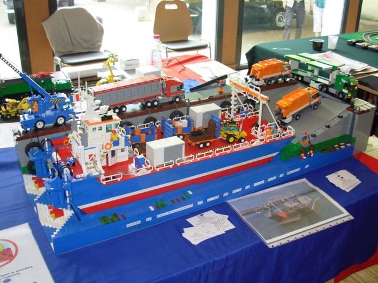
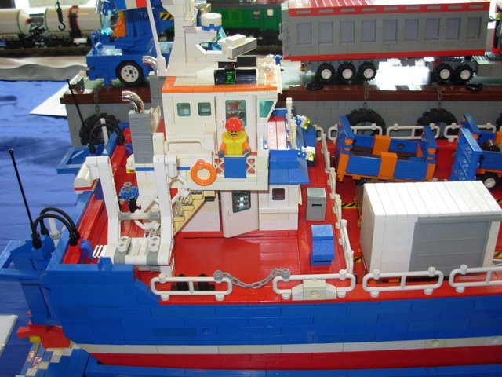
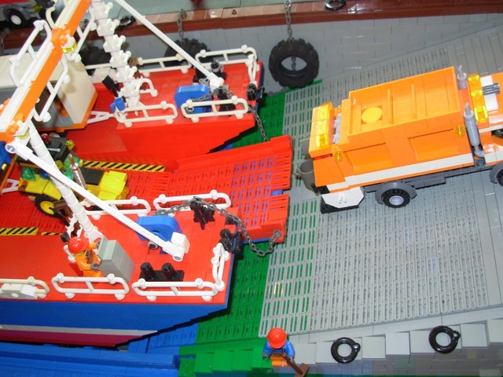
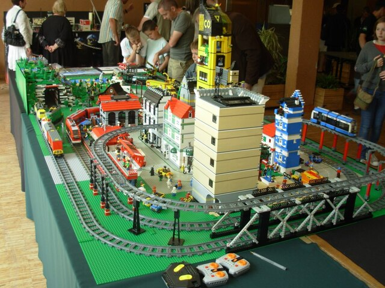
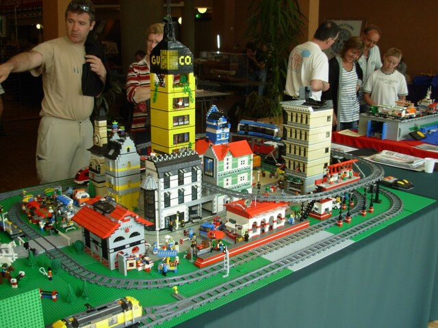
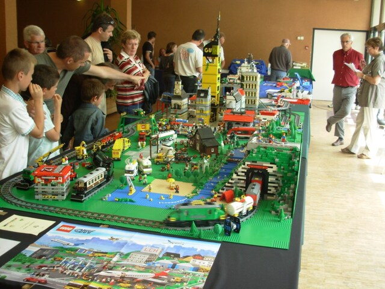

Pour cette douzième édition, les organisateurs m’ont, une nouvelle fois, invité (tous les 2 ans pour mémoire), mais cette année, j’ai donné la parole aux adhérents locaux en particulier à Gaelle, seule membre disponible, dont les talents d’affol sont prometteurs.

Sachant que le salon dure un jour, j’ai présenté un stand chic choc avec un grand classique : la barge animée toujours aussi prisée, admirée du public, une nouveauté qui a intrigué les maquettistes, mon BOURBON ENTERPRISE, plus un petit dernier qui fera partie d’un nouveau diorama marin en 2012, un canot tout temps de la Société Nationale du Sauvetage en Mer (SNSM). Quelques petites réalisations ont complété ma table.

**barge de l’ile de Batz**

Selon les organisateurs, notre stand était de loin le plus beau du salon, beaucoup de visites, des personnes qui n’ont pas hésité à revenir plusieurs fois nous voir. Ce petit détail est très bon pour la suite de nos opérations de séduction.

Votre dévoué serviteur : Jean-Marc

* * *

Merci Jean-Marc pour cette introduction dithyrambique.  
A coté de l’énorme Bourbon et de la barge animée, je présentais pour ce salon une version remaniée de ma ville de l’exposition de Parigné-l’Evêque qui avait eu lieu 15 jours plus tôt. Etant en solo, il a fallu assurer le trafic de trois trains à piles, plus la surveillance et le contact avec le public. Heureusement, Jean-Marc m’a bien aidée côté logistique en me prêtant des plaques vertes et des rails droits. Sinon, après un temps d’installation record (5h, soit moitié moins que Parigné !), j’ai pu mesurer l’engouement qu’a suscité mon diorama auprès du public ! L’animation des trains captivait le regard des enfants comme des adultes, et le Quizz que j’ai proposé (sur une idée de Mickbatto) a su inciter les gens à regarder les petits détails. en effet, il s’agissait de chercher des objets ou personnages présents sur le diorama, comme par exemple, un crocodile mangeant des jambes de minifgs, ou une bataille de martiens...

Bref,j’ai vu les yeux du public briller, et les mêmes têtes revenir encore et encore tourner autour de ma table !! quel plaisir !

**Ville de gaelle**

On peut donc dire que Jean-Marc et moi avons été très remarqués, d’ailleurs lors du démontage, la question n’a pas manqué : "vous reviendrez la prochaine fois, hein ? parce qu’on a comptabilisé 130 enfants, et à part vous il n’y avait rien pour eux".

Voilà, donc bilan de la journée très positif !

Gaelle
