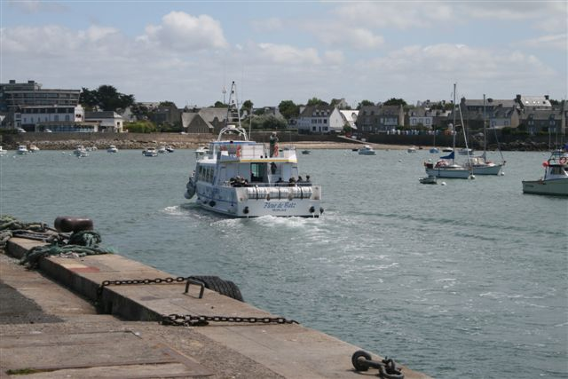
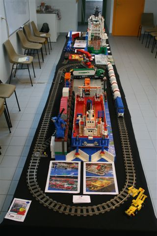
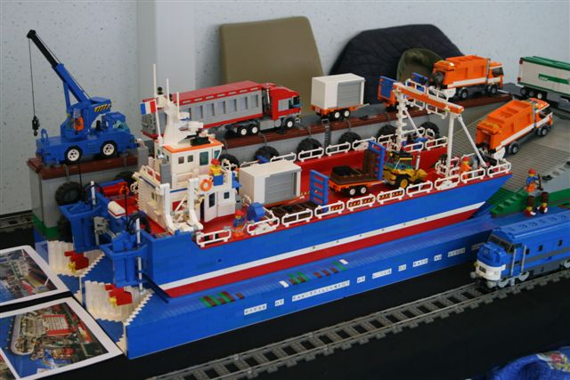

Ca y est, mon rêve s’est réalisé : amener la barge animée en LEGO à l’île de Batz (15mn de bateau au nord de Roscoff.

Avant d’en arriver là, j’avais fait des tentatives en 2009 mais les problèmes de transport par bateau sont difficiles à résoudre, il faut trouver des sous !

Heureusement, une personne du Syndicat d’Initiative de l’ile m’a repéré via la quinzaine legotique en mars dernier, et notre projet a abouti au grand plaisir des iliens.

Ce sont donc quatre caisses qui ont été prises en charge par une des vedettes du chenal. A leur arrivée, un taxi les a emporté en lieu sûr.

De mon coté, j’ai embarqué le lendemain matin. Sur place, ma barge animée, mon BOURBON ENTERPRISE, un petit réseau ferroviaire avec une rame de secours SNCF et une rame de wagons citernes furent présentés sur une surface de 7mx0.80m.

D’autres pièces furent ajoutées, sans oublier les cartes de visite de FreeLUG, une pile de catalogues LEGO et... mon livre d’or.

A 14h, premiers visiteurs : 80 le premier jour malgré un vent de nord-est presque glacial sous soleil. Dehors, les gens achetaient les fameuses pommes de terre de l’ile, musique, etc.

Dimanche, 80 visiteurs. Bref, un chiffre honorable malgré l’éloignement géographique, j’ai l’habitude.

Samedi, j’ai eu la visite du commandant de la vraie barge. Avant de démonter, j’ai refilé une pile de catalogues à une personne qui travaille pour une supérette. Ca intéressera à coup sur les enfants, parents...

En conclusion, un week-end excellent, un contact chaleureux avec la population,un bel accueil pour mes créations, une prise en charge exceptionnelle, sans faille (repas, hébergement, fest noz).

A renouveler dans deux ans, les iliens voudraient bien voir mon grand diorama mais , là, c’est une autre histoire, il faudra embarquer ma Kangoo sur la barge, affaire à suivre...
